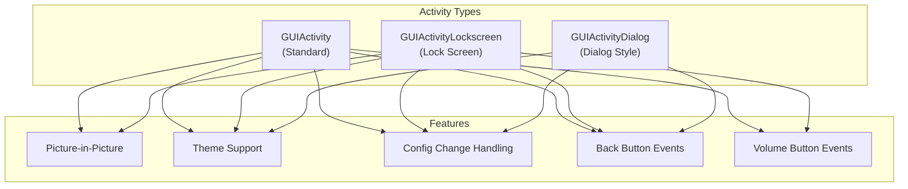
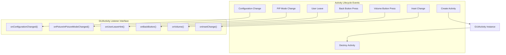
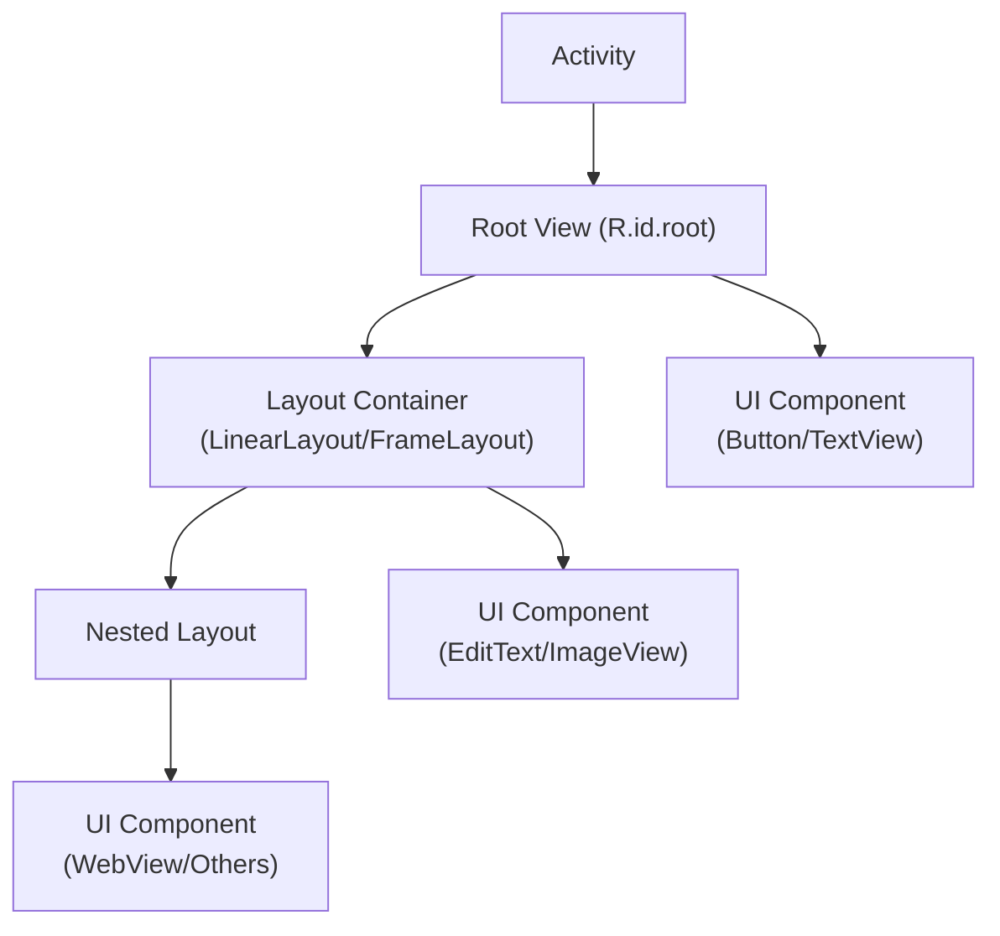
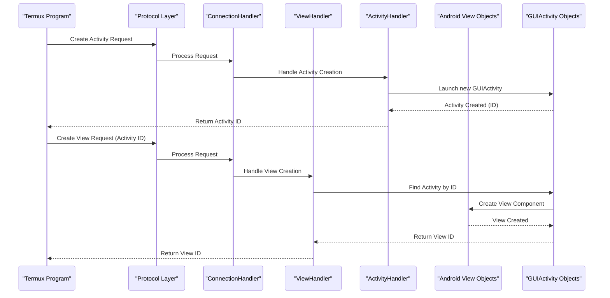
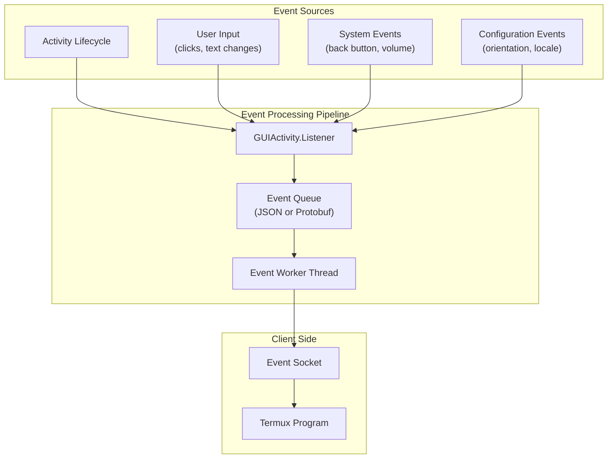

<!-- source: DeepWiki mcp.deepwiki.com · repo termux/termux-gui · page 3 Activities and UI Components · fetched 2026-10-26 -->

# Activities and UI Components

Relevant source files

The following files were used as context for generating this wiki page:

- [Developing.md](Developing.md)
- [README.md](README.md)
- [app/src/main/AndroidManifest.xml](app/src/main/AndroidManifest.xml)
- [app/src/main/java/com/termux/gui/ConnectionHandler.kt](app/src/main/java/com/termux/gui/ConnectionHandler.kt)
- [app/src/main/java/com/termux/gui/GUIActivity.kt](app/src/main/java/com/termux/gui/GUIActivity.kt)
- [fastlane/metadata/android/en-US/changelogs/8.txt](fastlane/metadata/android/en-US/changelogs/8.txt)

This document provides an overview of the activity and UI component system in Termux:GUI, which allows command-line programs running in Termux to create and manage native Android user interfaces. It covers how activities are created and managed, the types of UI components available, and how they can be organized into functional interfaces.

For information about how to interact with these components using the communication protocol, see [Protocol Documentation](#2). For details on buffer systems used for graphics rendering, see [Buffer System](#4).

## Activity Architecture

In Termux:GUI, activities serve as containers for UI components. The system provides different types of activities to support various use cases and display contexts.

Sources: [app/src/main/java/com/termux/gui/GUIActivity.kt:22-237](), [app/src/main/AndroidManifest.xml:66-93]()

### Activity Types

Termux:GUI provides several specialized activity types:

1. **Standard Activities** (`GUIActivity`): Regular full-screen activities that support all UI components and features including Picture-in-Picture mode.

2. **Dialog Activities** (`GUIActivityDialog`): Appear as floating dialogs rather than full-screen activities. Useful for quick interactions or confirmations.

3. **Lockscreen Activities** (`GUIActivityLockscreen`): Can appear on the lock screen and can optionally turn on the screen.

Each activity type is declared in the AndroidManifest with specific configuration options that define its behavior.

Sources: [app/src/main/java/com/termux/gui/GUIActivity.kt:27-34](), [app/src/main/java/com/termux/gui/GUIActivity.kt:176-201]()

## UI Component System

The UI component system in Termux:GUI is based on Android's native View architecture. Components are organized in a hierarchical structure, starting with a root view in an activity.

### View Hierarchy

Sources: [app/src/main/java/com/termux/gui/GUIActivity.kt:45-51]()

### UI Component Types

Termux:GUI supports a wide range of Android UI components:

| Component Type | Purpose | Features |
|----------------|---------|----------|
| TextView | Display text | Text styling, size adjustment |
| Button | User interaction | Click events, text/image display |
| EditText | Text input | Text watching, keyboard types |
| ImageView | Display images | Buffer support, scaling options |
| WebView | Web content | JavaScript interaction, URL loading |
| LinearLayout | Sequential arrangement | Vertical/horizontal orientation |
| FrameLayout | Stacking views | Z-order positioning |
| Specialized views | Custom interaction | Scrolling, selection widgets |

Sources: [README.md:19-31]()

## Activity and View Management

The Termux:GUI system manages activities and views through a unique ID system. When a Termux program creates an activity or view, it assigns an ID that is used in subsequent operations to reference that specific component.

Sources: [app/src/main/java/com/termux/gui/ConnectionHandler.kt:25-167](), [app/src/main/java/com/termux/gui/GUIActivity.kt:45-51]()

### Activity Management Features

Activities in Termux:GUI provide several management features:

1. **Theme Support**: Activities can be themed with custom colors for status bar, window background, text, and accents.

2. **Configuration Change Handling**: Activities automatically handle configuration changes like orientation shifts or locale changes, maintaining state.

3. **Picture-in-Picture Mode**: Activities can enter a compact floating mode that remains visible while using other apps.

4. **Secure Mode**: Activities can prevent screenshots and screen recording.

5. **Event Interception**: Back button and volume button events can be intercepted and handled by the Termux program.

Sources: [app/src/main/java/com/termux/gui/GUIActivity.kt:56-63](), [app/src/main/java/com/termux/gui/GUIActivity.kt:100-117](), [app/src/main/java/com/termux/gui/GUIActivity.kt:133-152]()

## Event System

The event system allows Termux programs to receive notifications about user interactions and system events. These events are sent through the event socket connection established between the Termux program and the plugin.

Sources: [app/src/main/java/com/termux/gui/ConnectionHandler.kt:48-50](), [app/src/main/java/com/termux/gui/ConnectionHandler.kt:114-133]()

The `GUIActivity.Listener` interface contains methods for various events:

- `onConfigurationChanged`: Called when device configuration changes
- `onPictureInPictureModeChanged`: Called when PiP mode changes
- `onUserLeaveHint`: Called when user navigates away
- `onBackButton`: Called when back button is pressed
- `onVolume`: Called when volume buttons are pressed
- `onInsetChange`: Called when window insets change

These events are sent to the Termux program through an event queue, which can use either JSON or Protobuf formats depending on the protocol being used.

Sources: [app/src/main/java/com/termux/gui/GUIActivity.kt:27-34]()

## Connection to Termux Programs

Termux programs connect to the Termux:GUI plugin through a Unix socket interface. The connection process includes:

1. **Connection Establishment**: Program opens two sockets (main and event)
2. **Protocol Negotiation**: Program selects JSON or Protobuf protocol
3. **Activity and View Creation**: Program sends requests to create and manipulate UI
4. **Event Handling**: Program receives events from the plugin

This system enables command-line programs to create rich user interfaces while maintaining their terminal-based nature.

Sources: [app/src/main/java/com/termux/gui/ConnectionHandler.kt:25-167]()

## Summary

The Activities and UI Components system in Termux:GUI provides a comprehensive framework for creating native Android user interfaces from Termux command-line programs. It supports various activity types, a wide range of UI components, and an event system for handling user interactions. 

This architecture bridges the gap between terminal applications and graphical interfaces, enabling Termux users to create more interactive and user-friendly applications without leaving the Termux environment.

Sources: [README.md:7-45](), [Developing.md:1-38]()

---

