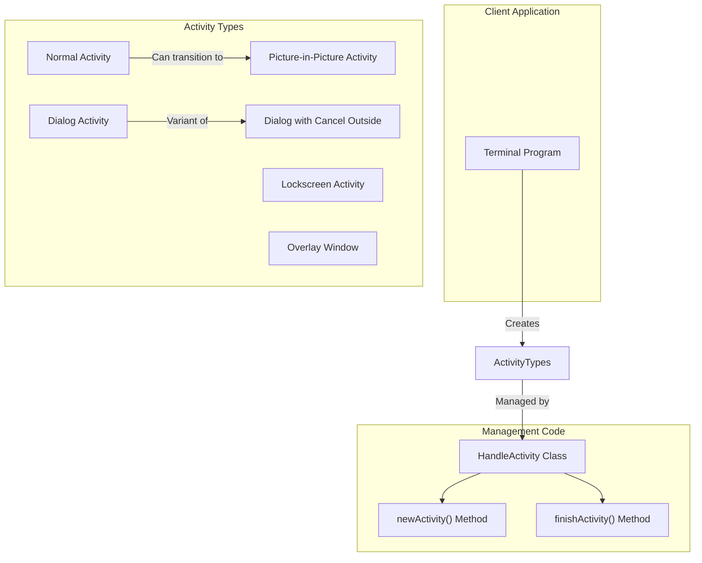
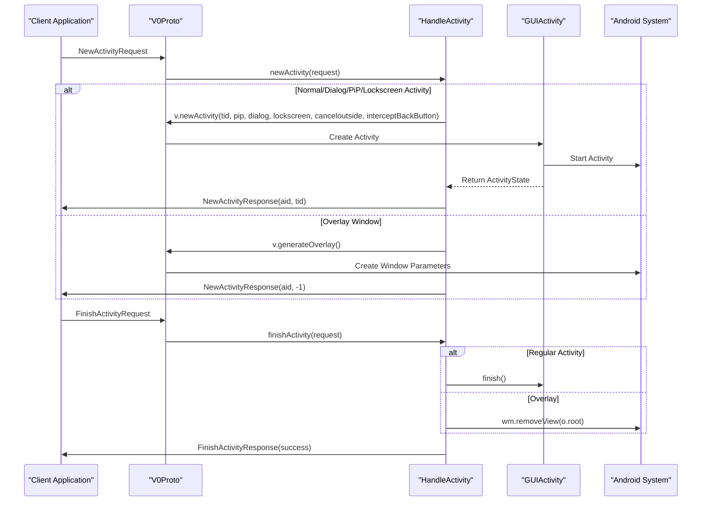
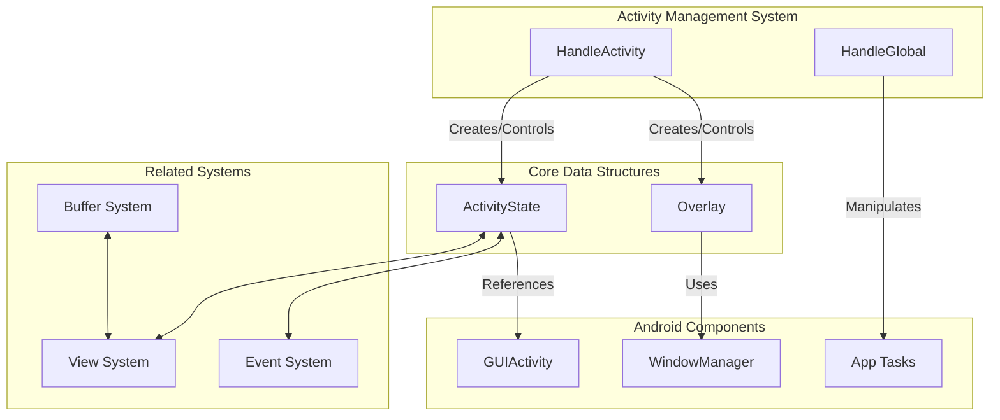
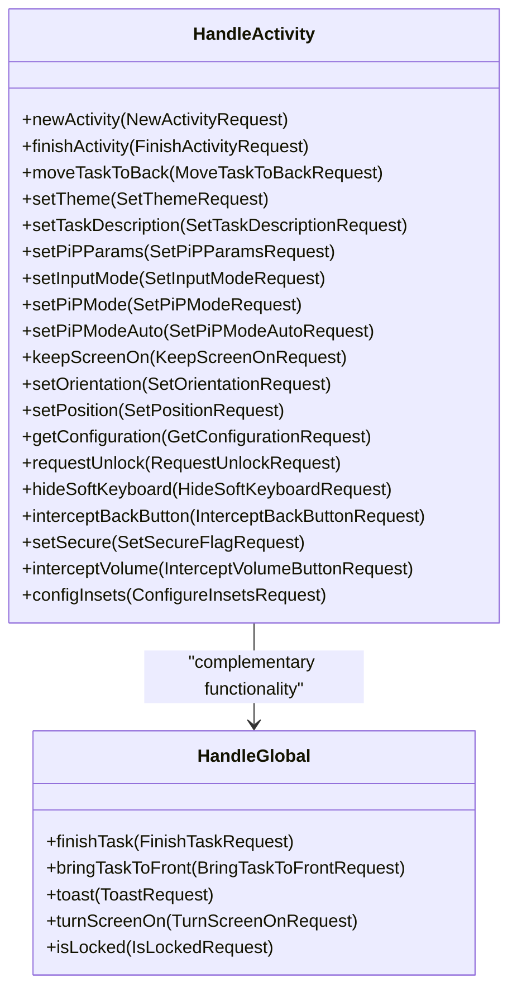

<!-- source: DeepWiki mcp.deepwiki.com · repo termux/termux-gui · page 3.1 Activity Management · fetched 2026-10-26 -->

# Activity Management

Relevant source files

The following files were used as context for generating this wiki page:

- [app/src/main/java/com/termux/gui/protocol/protobuf/v0/HandleActivity.kt](app/src/main/java/com/termux/gui/protocol/protobuf/v0/HandleActivity.kt)
- [app/src/main/java/com/termux/gui/protocol/protobuf/v0/HandleBuffer.kt](app/src/main/java/com/termux/gui/protocol/protobuf/v0/HandleBuffer.kt)
- [app/src/main/java/com/termux/gui/protocol/protobuf/v0/HandleGlobal.kt](app/src/main/java/com/termux/gui/protocol/protobuf/v0/HandleGlobal.kt)

This page documents the Activity Management system in Termux:GUI, which enables terminal applications to create and control Android activities (windows) for displaying user interfaces. The Activity Management system bridges the terminal environment and the Android window system by providing programmatic control over window creation, configuration, and lifecycle.

For information about creating and manipulating UI elements within activities, see [View Creation and Manipulation](#3.2). For details on special window types like overlays and Picture-in-Picture mode, see [Overlays and Picture-in-Picture](#5.1).

## Activity Types

Termux:GUI supports several types of activities to accommodate different UI requirements:

Sources: [app/src/main/java/com/termux/gui/protocol/protobuf/v0/HandleActivity.kt:35-78]()

## Creating and Finishing Activities

The primary operations in Activity Management are creating and destroying activities:

Sources: [app/src/main/java/com/termux/gui/protocol/protobuf/v0/HandleActivity.kt:35-113]()

## Task Management

In Android, activities are organized into tasks (groups of related activities). Termux:GUI provides methods to manipulate these tasks:

| Method | Class | Android API Call | Description |
|--------|-------|-----------------|-------------|
| `moveTaskToBack` | HandleActivity | Activity.moveTaskToBack() | Moves the task to the background |
| `bringTaskToFront` | HandleGlobal | AppTask.moveToFront() | Brings a task to the foreground |
| `finishTask` | HandleGlobal | AppTask.finishAndRemoveTask() | Terminates a task and all its activities |

Sources: [app/src/main/java/com/termux/gui/protocol/protobuf/v0/HandleActivity.kt:115-133](), [app/src/main/java/com/termux/gui/protocol/protobuf/v0/HandleGlobal.kt:19-55]()

## Activity Configuration

The Activity Management system provides numerous methods to configure activity appearance and behavior:

```mermaid
graph TD
    subgraph "Client Requests"
        SetThemeReq["SetThemeRequest"]
        SetTaskDescReq["SetTaskDescriptionRequest"]
        SetPiPParamsReq["SetPiPParamsRequest"]
        SetInputModeReq["SetInputModeRequest"]
        SetPiPModeReq["SetPiPModeRequest"]
        KeepScreenOnReq["KeepScreenOnRequest"]
        SetOrientationReq["SetOrientationRequest"]
        SetPositionReq["SetPositionRequest"]
        ConfigInsetsReq["ConfigureInsetsRequest"]
    end
    
    SetThemeReq --> |"Handler"| SetTheme["setTheme()"]
    SetTaskDescReq --> |"Handler"| SetTaskDesc["setTaskDescription()"]
    SetPiPParamsReq --> |"Handler"| SetPiPParams["setPiPParams()"]
    SetInputModeReq --> |"Handler"| SetInputMode["setInputMode()"]
    SetPiPModeReq --> |"Handler"| SetPiPMode["setPiPMode()"]
    KeepScreenOnReq --> |"Handler"| KeepScreenOn["keepScreenOn()"]
    SetOrientationReq --> |"Handler"| SetOrientation["setOrientation()"]
    SetPositionReq --> |"Handler"| SetPosition["setPosition()"]
    ConfigInsetsReq --> |"Handler"| ConfigInsets["configInsets()"]
    
    subgraph "Activity Properties"
        Theme["Theme Colors"]
        TaskDesc["Task Description"]
        PiPParams["PiP Parameters"]
        InputMode["Keyboard Behavior"]
        PiPMode["PiP State"]
        ScreenFlag["Screen-on Flag"]
        Orientation["Screen Orientation"]
        WindowPos["Window Position"]
        Insets["System UI Visibility"]
    end
    
    SetTheme --> Theme
    SetTaskDesc --> TaskDesc
    SetPiPParams --> PiPParams
    SetInputMode --> InputMode
    SetPiPMode --> PiPMode
    KeepScreenOn --> ScreenFlag
    SetOrientation --> Orientation
    SetPosition --> WindowPos
    ConfigInsets --> Insets
```

Sources: [app/src/main/java/com/termux/gui/protocol/protobuf/v0/HandleActivity.kt:135-357](), [app/src/main/java/com/termux/gui/protocol/protobuf/v0/HandleActivity.kt:503-557]()

### Theme Configuration

The `setTheme` method enables customization of activity appearance by setting colors for:
- Status bar
- Primary color
- Window background
- Text color
- Accent color

Sources: [app/src/main/java/com/termux/gui/protocol/protobuf/v0/HandleActivity.kt:135-151]()

### Screen Orientation

Activities can be configured with various orientation settings using `setOrientation`:

| Orientation Value | Android Constant | Description |
|-------------------|------------------|-------------|
| `landscape` | SCREEN_ORIENTATION_LANDSCAPE | Force landscape orientation |
| `portrait` | SCREEN_ORIENTATION_PORTRAIT | Force portrait orientation |
| `sensor` | SCREEN_ORIENTATION_SENSOR | Orientation determined by device sensors |
| `fullSensor` | SCREEN_ORIENTATION_FULL_SENSOR | Full range orientation from sensors |
| `sensorLandscape` | SCREEN_ORIENTATION_SENSOR_LANDSCAPE | Landscape with sensor assistance |
| `sensorPortrait` | SCREEN_ORIENTATION_SENSOR_PORTRAIT | Portrait with sensor assistance |
| `reverseLandscape` | SCREEN_ORIENTATION_REVERSE_LANDSCAPE | Reverse landscape orientation |
| `reversePortrait` | SCREEN_ORIENTATION_REVERSE_PORTRAIT | Reverse portrait orientation |
| And several others | | |

Sources: [app/src/main/java/com/termux/gui/protocol/protobuf/v0/HandleActivity.kt:292-325]()

### System Insets Configuration

The `configInsets` method controls the visibility of system UI elements:
- Status bar
- Navigation bar
- Display cutout areas

Sources: [app/src/main/java/com/termux/gui/protocol/protobuf/v0/HandleActivity.kt:503-557]()

## System Interaction

The Activity Management system provides methods for interacting with Android system components:

| Method | Description |
|--------|-------------|
| `requestUnlock` | Attempts to dismiss the keyguard (lock screen) |
| `hideSoftKeyboard` | Hides the software keyboard |
| `interceptBackButton` | Controls back button behavior |
| `interceptVolume` | Intercepts volume button events |
| `setSecure` | Prevents screenshots/screen recording |
| `turnScreenOn` | Wakes the device screen |
| `isLocked` | Checks if the device is locked |

Sources: [app/src/main/java/com/termux/gui/protocol/protobuf/v0/HandleActivity.kt:377-501](), [app/src/main/java/com/termux/gui/protocol/protobuf/v0/HandleGlobal.kt:74-111]()

## ComponentArchitecture

The Activity Management system integrates with other Termux:GUI subsystems:

Sources: [app/src/main/java/com/termux/gui/protocol/protobuf/v0/HandleActivity.kt:30-32]()

## Protocol Interface

The Activity Management system is primarily implemented in the `HandleActivity` class, which processes protocol messages to create and control activities. The class provides a comprehensive set of methods that handle different aspects of activity management:

Sources: [app/src/main/java/com/termux/gui/protocol/protobuf/v0/HandleActivity.kt:30-562](), [app/src/main/java/com/termux/gui/protocol/protobuf/v0/HandleGlobal.kt:17-134]()

This documentation covers the essential aspects of the Activity Management system in Termux:GUI. The system provides terminal applications with comprehensive control over Android activities, enabling the creation of rich graphical interfaces from the terminal environment.

---

