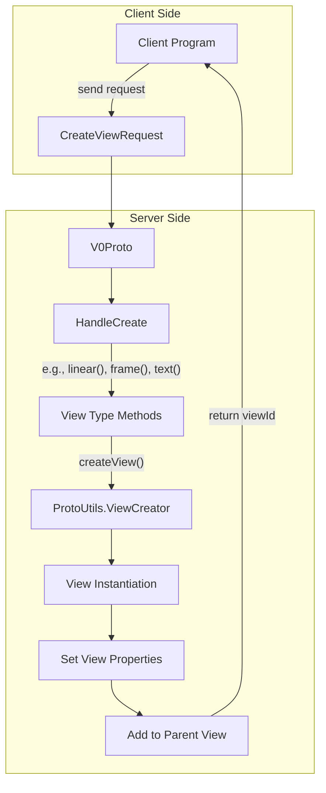
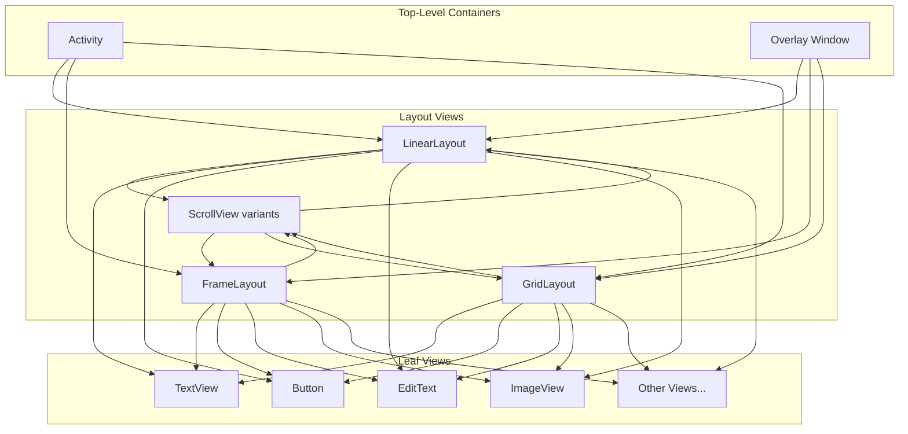
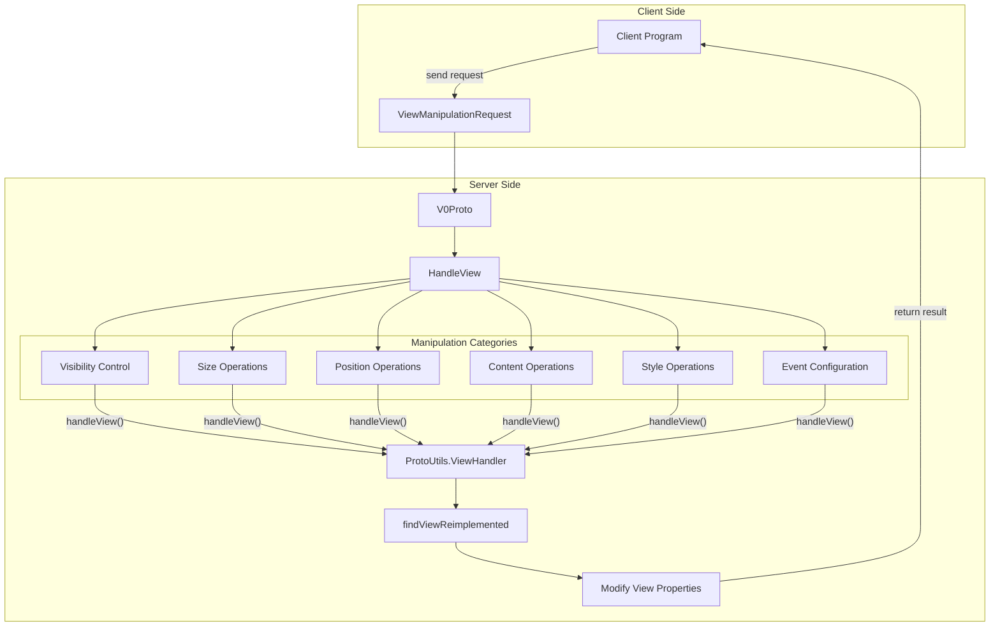
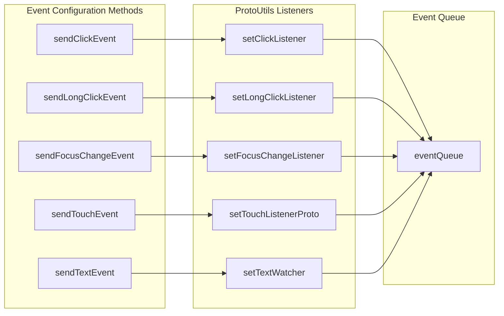

<!-- source: DeepWiki mcp.deepwiki.com · repo termux/termux-gui · page 3.2 View Creation and Manipulation · fetched 2026-10-26 -->

# View Creation and Manipulation

Relevant source files

The following files were used as context for generating this wiki page:

- [app/src/main/java/com/termux/gui/protocol/json/v0/Create.kt](app/src/main/java/com/termux/gui/protocol/json/v0/Create.kt)
- [app/src/main/java/com/termux/gui/protocol/json/v0/HandleBuffer.kt](app/src/main/java/com/termux/gui/protocol/json/v0/HandleBuffer.kt)
- [app/src/main/java/com/termux/gui/protocol/json/v0/HandleView.kt](app/src/main/java/com/termux/gui/protocol/json/v0/HandleView.kt)
- [app/src/main/java/com/termux/gui/protocol/protobuf/ProtoUtils.kt](app/src/main/java/com/termux/gui/protocol/protobuf/ProtoUtils.kt)
- [app/src/main/java/com/termux/gui/protocol/protobuf/v0/HandleCreate.kt](app/src/main/java/com/termux/gui/protocol/protobuf/v0/HandleCreate.kt)
- [app/src/main/java/com/termux/gui/protocol/protobuf/v0/HandleView.kt](app/src/main/java/com/termux/gui/protocol/protobuf/v0/HandleView.kt)
- [app/src/main/java/com/termux/gui/protocol/shared/v0/LifecycleListener.kt](app/src/main/java/com/termux/gui/protocol/shared/v0/LifecycleListener.kt)

This page documents how Termux:GUI creates and manipulates Android UI components. It covers the view creation process, view hierarchy management, and view manipulation operations. For information about custom view implementations, see [Custom Views](#3.3), and for buffer-based image manipulation, see [Buffer System](#4).

## View Creation Process

The view creation process allows Termux programs to create Android UI components and add them to the view hierarchy.

### View Creation Flow

Sources: [app/src/main/java/com/termux/gui/protocol/protobuf/v0/HandleCreate.kt:25-35](), [app/src/main/java/com/termux/gui/protocol/protobuf/ProtoUtils.kt:317-359]()

### Supported View Types

Termux:GUI supports a wide range of Android UI components:

| Category | View Types | Description |
|----------|------------|-------------|
| **Layouts** | LinearLayout, FrameLayout, GridLayout | Container views that organize child views |
| **Text** | TextView, EditText | Views for displaying and editing text |
| **Controls** | Button, CheckBox, RadioButton, Switch, ToggleButton | Interactive UI controls |
| **Selection** | Spinner, RadioGroup, TabLayout | Views for making selections |
| **Display** | ImageView, ProgressBar, WebView | Views for displaying content |
| **Containers** | ScrollView, NestedScrollView, HorizontalScrollView, SwipeRefreshLayout | Scrollable containers |
| **Other** | Space, SurfaceView | Utility views |

Sources: [app/src/main/java/com/termux/gui/protocol/protobuf/v0/HandleCreate.kt:36-291]()

## View Hierarchy Management

Views in Android are organized in a hierarchy, with parent views containing child views.

Sources: [app/src/main/java/com/termux/gui/protocol/protobuf/v0/HandleCreate.kt:25-35](), [app/src/main/java/com/termux/gui/protocol/protobuf/ProtoUtils.kt:317-359]()

### View Identification

Each view in the system is identified by two key components:
- **Activity ID (aid)** - Identifies the activity or overlay containing the view
- **View ID (id)** - Unique identifier for the view within its container

These IDs are used in all view manipulation requests to identify the target view.

Sources: [app/src/main/java/com/termux/gui/protocol/protobuf/ProtoUtils.kt:385-467]()

## View Manipulation

Once views are created, they can be manipulated through various operations handled by the `HandleView` class.

Sources: [app/src/main/java/com/termux/gui/protocol/protobuf/v0/HandleView.kt:32-39](), [app/src/main/java/com/termux/gui/protocol/protobuf/ProtoUtils.kt:385-467]()

### Manipulation Operations

The `HandleView` class provides numerous methods for manipulating views:

#### Visibility and Layout
- **visible** - Show, hide, or collapse a view
- **setWidth** / **setHeight** - Change view dimensions
- **location** - Set the position of a view
- **margin** - Adjust spacing around a view
- **padding** - Adjust spacing within a view

Sources: [app/src/main/java/com/termux/gui/protocol/protobuf/v0/HandleView.kt:120-280]()

#### Content Manipulation
- **setText** - Update text content
- **getText** - Retrieve text content
- **setImage** - Update image content
- **setBuffer** - Set an image from a shared memory buffer
- **setProgress** - Update progress indicator
- **setChecked** - Change checked state of checkable views

Sources: [app/src/main/java/com/termux/gui/protocol/protobuf/v0/HandleView.kt:302-544]()

#### Layout-Specific Manipulation
- **linearParams** - Adjust LinearLayout parameters (weight, position)
- **gridParams** - Set cell position and alignment in GridLayout
- **setScroll** / **getScroll** - Control scroll position

Sources: [app/src/main/java/com/termux/gui/protocol/protobuf/v0/HandleView.kt:52-114](), [app/src/main/java/com/termux/gui/protocol/protobuf/v0/HandleView.kt:394-439]()

#### WebView Operations
- **loadURI** - Load web content from a URL
- **setData** - Load web content from a string
- **allowJS** - Control JavaScript execution
- **evaluateJS** - Run JavaScript code
- **goBack** / **goForward** - Navigate web history

Sources: [app/src/main/java/com/termux/gui/protocol/protobuf/v0/HandleView.kt:584-655]()

### Event Configuration

Views can be configured to send events back to the client:

- **sendClickEvent** - Configure click notifications
- **sendLongClickEvent** - Configure long-press notifications
- **sendFocusChangeEvent** - Configure focus change notifications
- **sendTouchEvent** - Configure touch event notifications
- **sendTextEvent** - Configure text change notifications

These methods use utilities from `ProtoUtils` to set up the appropriate listeners:

Sources: [app/src/main/java/com/termux/gui/protocol/protobuf/v0/HandleView.kt:661-705](), [app/src/main/java/com/termux/gui/protocol/protobuf/ProtoUtils.kt:88-205]()

## Implementation Details

### Key Classes

- **HandleCreate** - Manages the creation of different view types
  - Located in [app/src/main/java/com/termux/gui/protocol/protobuf/v0/HandleCreate.kt]()
  - Contains methods for each supported view type (linear, frame, text, etc.)
  - Uses the `ViewCreator` utility to instantiate views

- **HandleView** - Manages operations on existing views
  - Located in [app/src/main/java/com/termux/gui/protocol/protobuf/v0/HandleView.kt]()
  - Contains methods for each type of manipulation operation
  - Uses the `ViewHandler` utility to perform operations on views

- **ProtoUtils.ViewCreator** - Utility class for view creation
  - Located in [app/src/main/java/com/termux/gui/protocol/protobuf/ProtoUtils.kt:317-359]()
  - Handles view instantiation and initial setup
  - Adds views to the view hierarchy

- **ProtoUtils.ViewHandler** - Utility class for view manipulation
  - Located in [app/src/main/java/com/termux/gui/protocol/protobuf/ProtoUtils.kt:385-467]()
  - Finds views by ID and performs operations on them
  - Handles error conditions and generates responses

### Protocol Dependencies

The view creation and manipulation system relies on a well-defined protocol:

- For protobuf protocol implementation, see classes in [app/src/main/java/com/termux/gui/protocol/protobuf/]()
- For JSON protocol implementation, see classes in [app/src/main/java/com/termux/gui/protocol/json/v0/]()

Both implementations share common functionality through classes in [app/src/main/java/com/termux/gui/protocol/shared/v0/]()

For more details on the protocols, see [JSON Protocol](#2.1) and [Protobuf Protocol](#2.2).

## View Lifecycle Considerations

When working with views in Termux:GUI, it's important to understand how they relate to the Android activity lifecycle:

- Views are bound to their parent Activity or Overlay
- When an Activity is destroyed, all its views are also destroyed
- Events from destroyed views will not be delivered
- The `LifecycleListener` class manages activity lifecycle events

Sources: [app/src/main/java/com/termux/gui/protocol/shared/v0/LifecycleListener.kt:11-126]()

---

