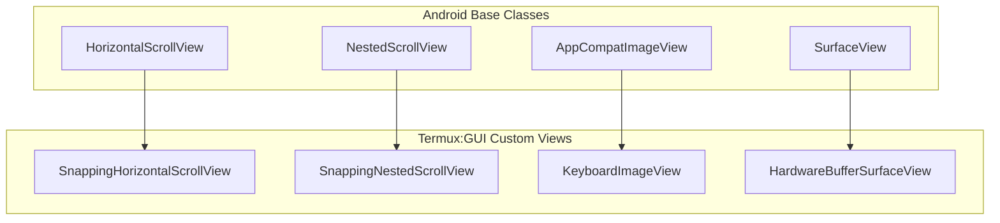
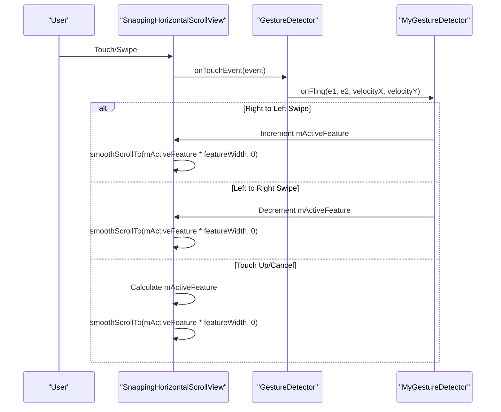
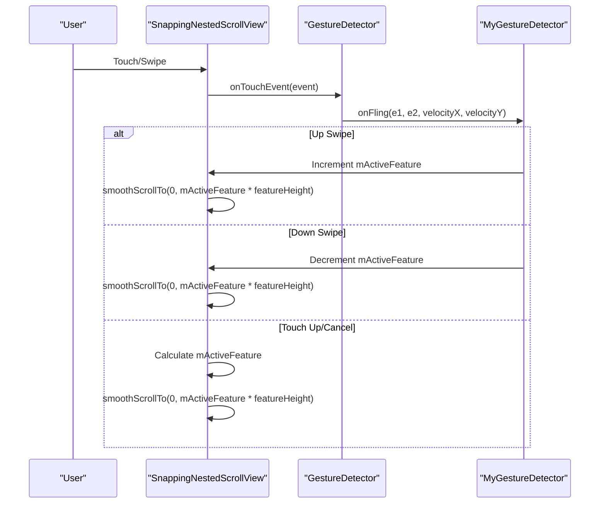
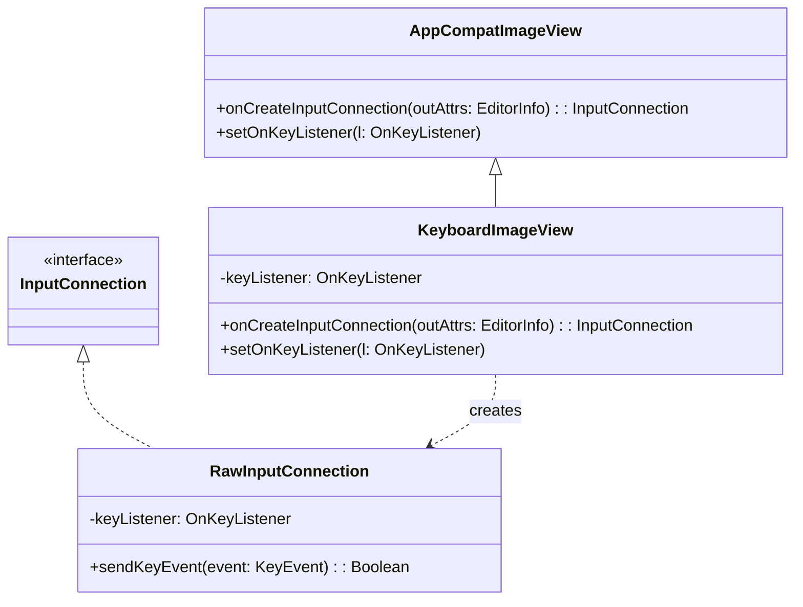
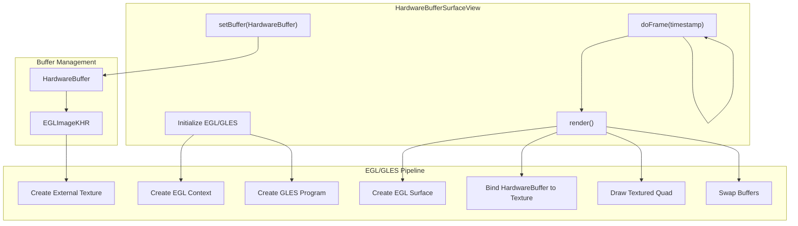
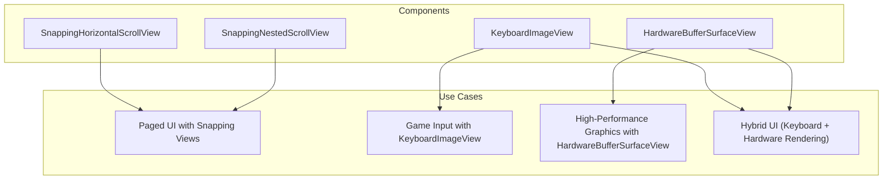

<!-- source: DeepWiki mcp.deepwiki.com · repo termux/termux-gui · page 3.3 Custom Views · fetched 2026-10-26 -->

# Custom Views

Relevant source files

The following files were used as context for generating this wiki page:

- [app/src/main/java/com/termux/gui/protocol/shared/v0/RawInputConnection.kt](app/src/main/java/com/termux/gui/protocol/shared/v0/RawInputConnection.kt)
- [app/src/main/java/com/termux/gui/views/HardwareBufferSurfaceView.kt](app/src/main/java/com/termux/gui/views/HardwareBufferSurfaceView.kt)
- [app/src/main/java/com/termux/gui/views/KeyboardImageView.kt](app/src/main/java/com/termux/gui/views/KeyboardImageView.kt)
- [app/src/main/java/com/termux/gui/views/SnappingHorizontalScrollView.kt](app/src/main/java/com/termux/gui/views/SnappingHorizontalScrollView.kt)
- [app/src/main/java/com/termux/gui/views/SnappingNestedScrollView.kt](app/src/main/java/com/termux/gui/views/SnappingNestedScrollView.kt)

## Purpose and Scope

This document describes the custom Android view implementations provided by Termux:GUI. These specialized views extend standard Android view classes to add capabilities such as snapping behavior, keyboard input support for image views, and hardware-accelerated buffer rendering. For information about basic view creation and manipulation, see [View Creation and Manipulation](#3.2).

## Overview of Custom Views

Termux:GUI implements several custom views to provide enhanced functionality beyond standard Android views:

Sources: [app/src/main/java/com/termux/gui/views/SnappingHorizontalScrollView.kt:1-70](), [app/src/main/java/com/termux/gui/views/SnappingNestedScrollView.kt:1-68](), [app/src/main/java/com/termux/gui/views/KeyboardImageView.kt:1-29](), [app/src/main/java/com/termux/gui/views/HardwareBufferSurfaceView.kt:1-632]()

## Snapping Views

### SnappingHorizontalScrollView

The `SnappingHorizontalScrollView` is an extension of Android's standard `HorizontalScrollView` that adds snapping behavior. When scrolling ends (either manually or through a fling gesture), the view snaps to the nearest child view, ensuring that one child is always fully visible.

Key features:
- Detects fling gestures and snaps to the appropriate child
- Maintains an active feature index to track the currently displayed child
- Automatically calculates snap positions based on view width

Implementation details:
- Uses a `GestureDetectorCompat` to detect fling gestures
- Defines threshold values for minimum distance and velocity
- Provides smooth animations when snapping between children

Sources: [app/src/main/java/com/termux/gui/views/SnappingHorizontalScrollView.kt:13-70]()

### SnappingNestedScrollView

Similar to `SnappingHorizontalScrollView`, the `SnappingNestedScrollView` extends `NestedScrollView` to provide snapping behavior for vertical scrolling. This enables paged vertical scrolling where each swipe navigates to the next or previous full-height item.

Key features:
- Vertical snapping behavior that aligns with child views
- Compatible with the newer NestedScrollView for better integration with modern Android UI components
- Shares the same gesture detection principles as its horizontal counterpart

Implementation details:
- Uses the same threshold values (SWIPE_MIN_DISTANCE and SWIPE_THRESHOLD_VELOCITY)
- Calculates snap positions based on view height instead of width
- Handles up/down fling gestures

Sources: [app/src/main/java/com/termux/gui/views/SnappingNestedScrollView.kt:13-68]()

## Input-Enabled Views

### KeyboardImageView

The `KeyboardImageView` extends `AppCompatImageView` to provide keyboard input support. This allows an image view to receive and process keyboard events, which is particularly useful for creating custom input interfaces or game controls.

Key features:
- Enables keyboard input events for an ImageView
- Overrides `onCreateInputConnection` to handle keyboard input
- Preserves the standard OnKeyListener interface

Implementation details:
- Creates a custom `InputConnection` using `RawInputConnection` when a key listener is set
- Sets `inputType` to `EditorInfo.TYPE_NULL` to avoid showing the soft keyboard automatically
- Preserves the key listener reference to pass events correctly

Sources: [app/src/main/java/com/termux/gui/views/KeyboardImageView.kt:1-29](), [app/src/main/java/com/termux/gui/protocol/shared/v0/RawInputConnection.kt:1-113]()

## Hardware-Accelerated Views

### HardwareBufferSurfaceView

The `HardwareBufferSurfaceView` is a specialized `SurfaceView` implementation for rendering content from a `HardwareBuffer`. It uses OpenGL ES for rendering and supports shared hardware buffers for efficient graphics performance.

Key features:
- Renders a shared HardwareBuffer to a SurfaceView
- Provides configuration options for handling dimension mismatches
- Supports hardware-accelerated rendering through OpenGL ES
- Implements keyboard input support similar to KeyboardImageView
- Provides frame callbacks for animation timing

Implementation details:
- Uses EGL for OpenGL ES context management
- Implements hardware buffer to texture mapping using EGLImageKHR
- Provides dimension mismatch handling strategies (CENTER_AXIS or STICK_TOPLEFT)
- Supports configuration of background color
- Implements the Choreographer.FrameCallback interface for frame-by-frame updates

Configuration options:
- `OnDimensionMismatch.CENTER_AXIS`: Centers the buffer content on a given axis
- `OnDimensionMismatch.STICK_TOPLEFT`: Aligns content to the top-left corner
- `backgroundColor`: Defines the color to fill areas not covered by the buffer

Sources: [app/src/main/java/com/termux/gui/views/HardwareBufferSurfaceView.kt:1-632]()

## Custom View Interactions and Use Cases

The custom views in Termux:GUI can be used together or individually to create rich UI experiences:

Sources: [app/src/main/java/com/termux/gui/views/SnappingHorizontalScrollView.kt:1-70](), [app/src/main/java/com/termux/gui/views/SnappingNestedScrollView.kt:1-68](), [app/src/main/java/com/termux/gui/views/KeyboardImageView.kt:1-29](), [app/src/main/java/com/termux/gui/views/HardwareBufferSurfaceView.kt:1-632]()

## Implementation Details

### Snapping Mechanism

Both snapping views use a common approach for implementing the snapping behavior:

1. Track the currently active feature with `mActiveFeature`
2. Use a `GestureDetector` to capture fling events
3. Calculate target position based on view dimensions and active feature index
4. Use `smoothScrollTo()` to animate to the target position

The threshold values are defined as:
- `SWIPE_MIN_DISTANCE`: 5 pixels (minimum movement to count as a swipe)
- `SWIPE_THRESHOLD_VELOCITY`: 300 pixels/second (minimum velocity to trigger a snap)

Sources: [app/src/main/java/com/termux/gui/views/SnappingHorizontalScrollView.kt:18-20](), [app/src/main/java/com/termux/gui/views/SnappingNestedScrollView.kt:17-18]()

### RawInputConnection Mechanism

The keyboard input functionality in both `KeyboardImageView` and `HardwareBufferSurfaceView` relies on a `RawInputConnection` implementation. This class:

1. Implements the Android `InputConnection` interface
2. Overrides only the necessary methods for key event handling
3. Routes key events to the provided `OnKeyListener`

The key event flow works as follows:
1. Input method (keyboard) sends key events to the view
2. `RawInputConnection.sendKeyEvent()` receives the event
3. Event is forwarded to the registered `OnKeyListener`

Sources: [app/src/main/java/com/termux/gui/protocol/shared/v0/RawInputConnection.kt:82-86](), [app/src/main/java/com/termux/gui/views/KeyboardImageView.kt:14-22](), [app/src/main/java/com/termux/gui/views/HardwareBufferSurfaceView.kt:612-620]()

---

