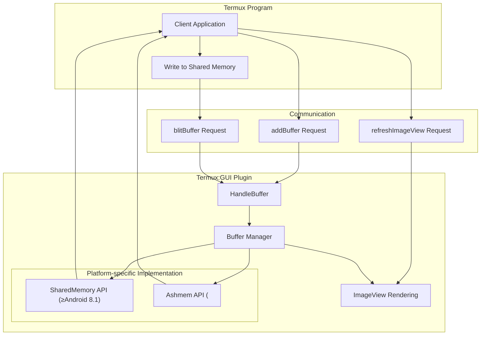
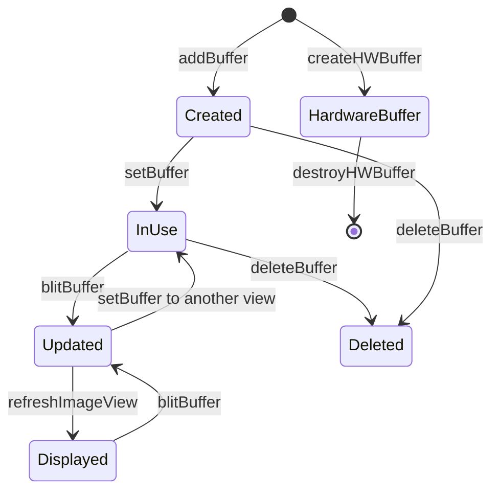
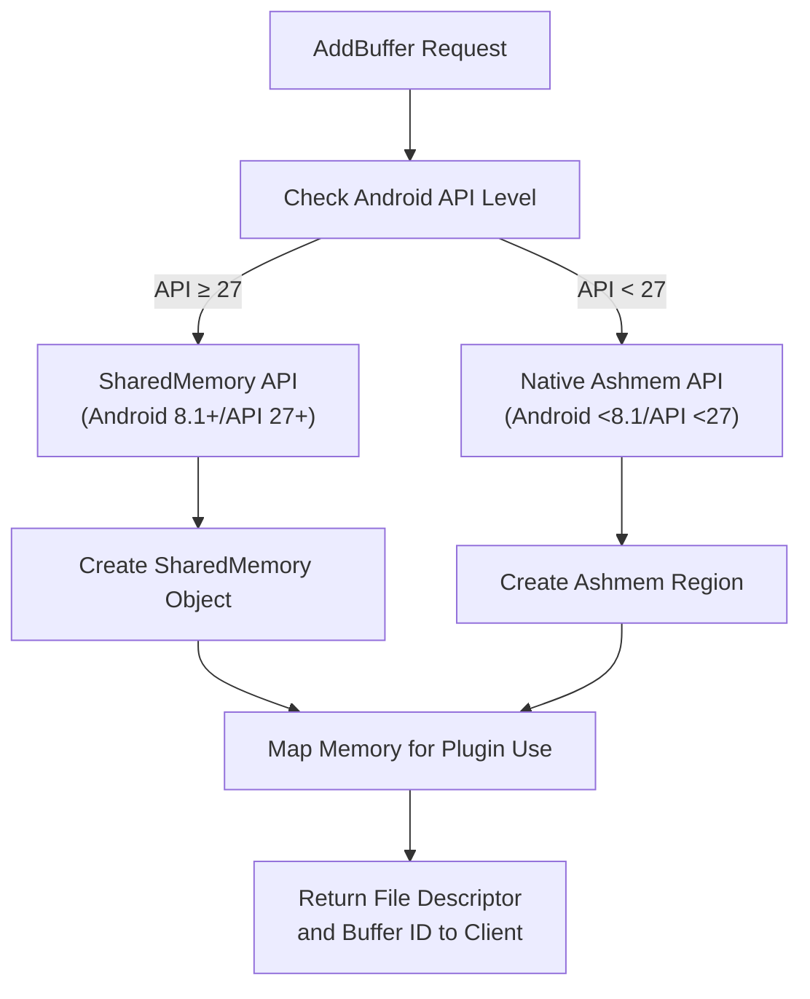

<!-- source: DeepWiki mcp.deepwiki.com · repo termux/termux-gui · page 4.1 Shared Memory Buffers · fetched 2026-10-26 -->

# Shared Memory Buffers

<details>
<summary>Relevant source files</summary>

The following files were used as context for generating this wiki page:

- [Protocol.md](Protocol.md)
- [TODO](TODO)

</details>


## Introduction

Shared Memory Buffers provide an efficient mechanism for displaying images and graphics in Termux:GUI applications without repeatedly transmitting large image data over the socket connection. This page documents the shared memory buffer implementation in Termux:GUI, focusing on creating, managing, and using these buffers for high-performance image rendering.

For information about hardware-accelerated rendering using HardwareBuffer, see [Hardware Acceleration](#4.2).

Sources: [Protocol.md:327-346]()

## System Overview

Shared memory buffers allow applications to create a shared memory region that both the Termux program and the Termux:GUI plugin can access. The program can write image data directly to this memory, and the plugin can render it without any data copy operations, significantly improving performance for graphics-heavy applications.



Sources: [Protocol.md:327-347](), [TODO:97-112]()

## Buffer Lifecycle

The shared memory buffer follows a specific lifecycle from creation to deletion:



Sources: [Protocol.md:327-346]()

## Creating and Managing Buffers

### Buffer Creation

To create a shared memory buffer:

1. Send an `addBuffer` request specifying format, width, and height
2. Receive a buffer ID and a file descriptor to the shared memory region
3. Map the shared memory into your process's address space

The shared memory buffer is created with specific dimensions and format parameters:

| Parameter | Description |
|-----------|-------------|
| format    | Image format. Currently only "ARGB8888" is supported (RGBA with one byte each) |
| w         | Width of the buffer in pixels |
| h         | Height of the buffer in pixels |

The `addBuffer` request returns a buffer ID (or -1 in case of an error) and transfers a file descriptor via SCM_RIGHTS, which can then be memory-mapped.

Sources: [Protocol.md:327-332]()

### Buffer Deletion

When a buffer is no longer needed, it should be deleted to free memory:

```
deleteBuffer(bid)
```

Where `bid` is the ID of the buffer to delete. Only delete a buffer when no ImageView is using it anymore.

Sources: [Protocol.md:332-335]()

### Updating Buffer Content

After writing to the shared memory, the client must notify the plugin about the changes:

```
blitBuffer(bid)
```

This copies the content from the shared memory into the plugin's internal buffer.

Sources: [Protocol.md:335-337]()

## Using Buffers with ImageViews

### Setting a Buffer as an ImageView Source

To display a buffer's content in an ImageView:

```
setBuffer(id, aid, bid)
```

Where:
- `id`: The View ID of an ImageView
- `aid`: The Activity ID
- `bid`: The buffer ID

Sources: [Protocol.md:338-343]()

### Refreshing the View

After updating the buffer content with `blitBuffer`, the view needs to be refreshed:

```
refreshImageView(id, aid)
```

This ensures the ImageView displays the latest content from the buffer.

Sources: [Protocol.md:343-346]()

## Implementation Details

The shared memory buffer implementation varies depending on the Android version:



Sources: [Protocol.md:327-332](), [TODO:97-112]()

## Protocol Details

### JSON Protocol

In the JSON protocol, buffer operations follow the standard method-parameter structure:

- `addBuffer`: Creates a buffer and returns the buffer ID
- `deleteBuffer`: Deletes a buffer
- `blitBuffer`: Updates the buffer content
- `setBuffer`: Associates a buffer with an ImageView
- `refreshImageView`: Updates the view to show latest buffer content

### Binary Protocol

The binary protocol handles the `addBuffer` method differently from other methods:

1. Client sends a Method message with AddBufferRequest
2. Plugin responds with a 32-bit big-endian signed integer (buffer ID)
3. Plugin sends one byte with a file descriptor as ancillary data (if successful)
4. If the integer is negative, no buffer was created and no file descriptor is sent

For other buffer operations, the plugin responds with the corresponding response message.

Sources: [Protocol.md:659-668]()

## Memory Management Considerations

Shared memory buffers consume system memory resources, so proper management is essential:

1. Create buffers with appropriate dimensions - no larger than necessary
2. Delete buffers when no longer needed
3. Reuse existing buffers when possible rather than creating new ones
4. Be aware that buffers persist until explicitly deleted or the connection is closed

Sources: [Protocol.md:332-335]()

## Use Cases and Best Practices

### Ideal Use Cases for Shared Memory Buffers

- Image editors or viewers
- Real-time visualization applications
- Games or animations with frequently changing graphics
- Custom drawing surfaces

### Best Practices

1. **Size Management**: Create buffers at the exact size needed to avoid wasting memory
2. **Buffer Reuse**: Reuse the same buffer for multiple updates rather than creating new ones
3. **Batched Updates**: Make all changes to the buffer before calling `blitBuffer`
4. **Lifecycle Management**: Delete buffers when the associated views are removed
5. **Error Handling**: Check for -1 return value from `addBuffer` and handle appropriately

Sources: [Protocol.md:327-346]()

## Future Improvements

Planned improvements to the buffer system include:

- Render thread for more efficient buffer handling
- Frame synchronization mechanisms to signal buffer readiness
- Support for damage regions to update only changed parts of a buffer
- Better framerate handling for smoother animations

Sources: [TODO:12-23]()

---

