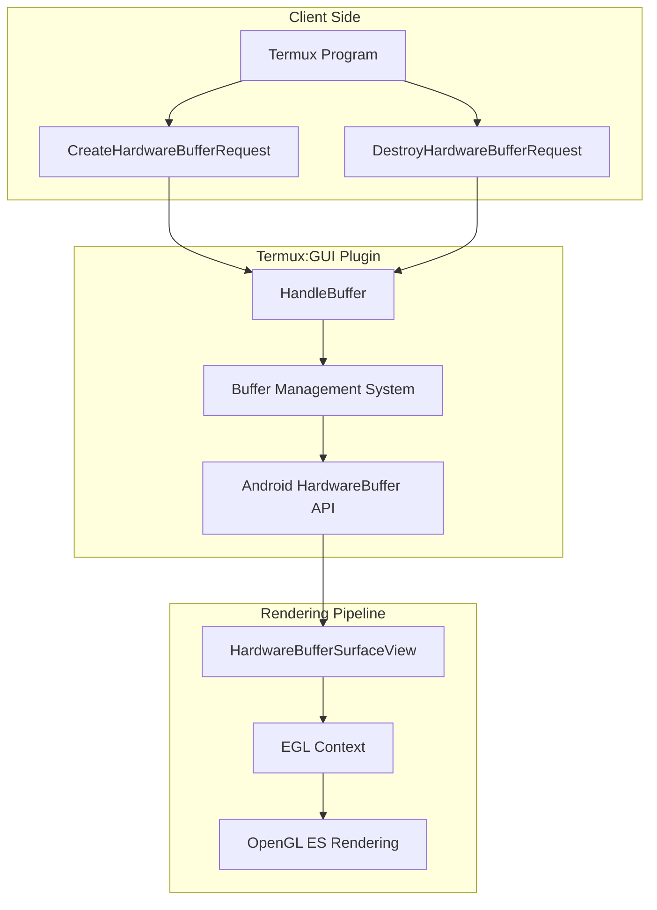
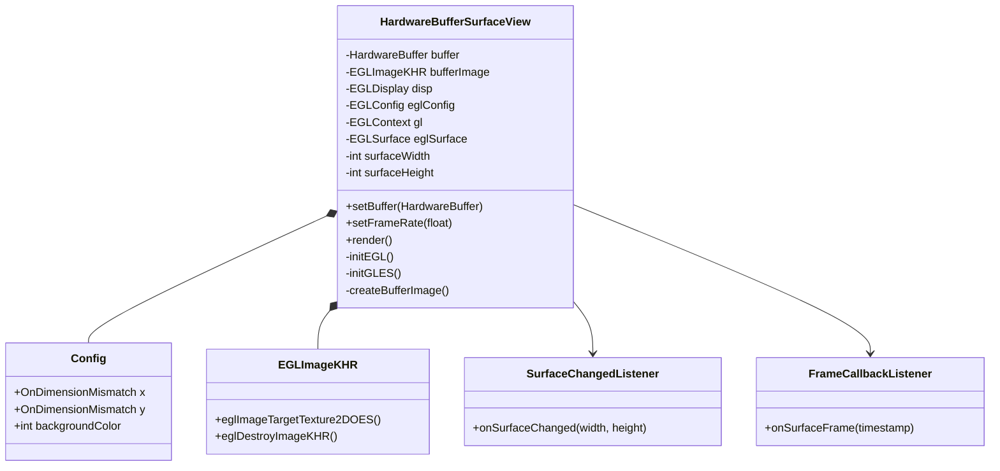
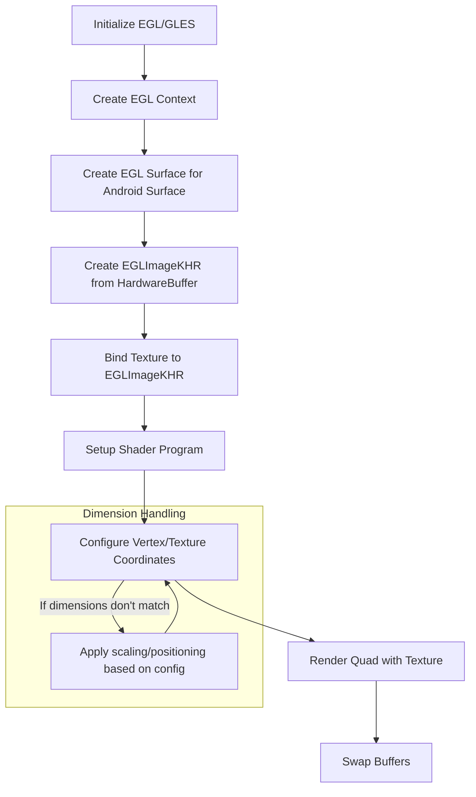
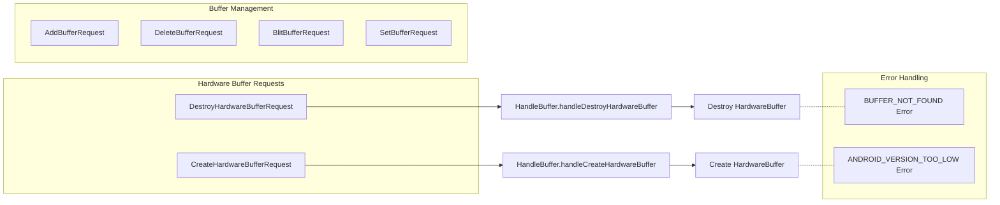
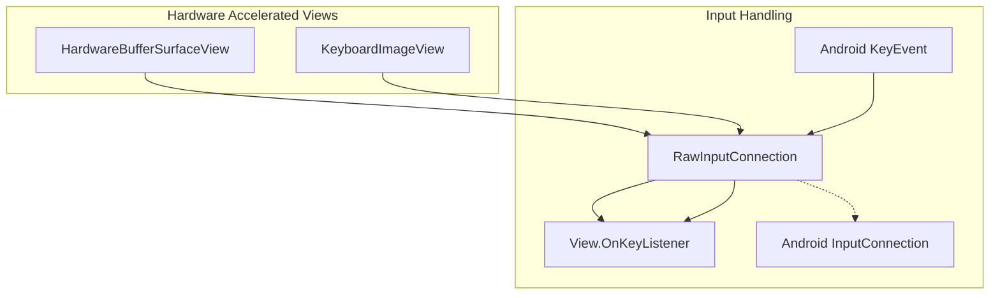

<!-- source: DeepWiki mcp.deepwiki.com · repo termux/termux-gui · page 4.2 Hardware Acceleration · fetched 2026-10-26 -->

# Hardware Acceleration

<details>
<summary>Relevant source files</summary>

The following files were used as context for generating this wiki page:

- [app/src/main/java/com/termux/gui/protocol/shared/v0/RawInputConnection.kt](app/src/main/java/com/termux/gui/protocol/shared/v0/RawInputConnection.kt)
- [app/src/main/java/com/termux/gui/views/HardwareBufferSurfaceView.kt](app/src/main/java/com/termux/gui/views/HardwareBufferSurfaceView.kt)
- [app/src/main/java/com/termux/gui/views/KeyboardImageView.kt](app/src/main/java/com/termux/gui/views/KeyboardImageView.kt)
- [app/src/main/proto/GUIProt0.proto](app/src/main/proto/GUIProt0.proto)

</details>


This document describes the hardware acceleration capabilities in Termux:GUI, which enable efficient rendering of graphics using GPU-accelerated APIs. For information about regular shared memory buffers, see [Shared Memory Buffers](#4.1).

## Overview

Termux:GUI provides hardware acceleration through the Android `HardwareBuffer` API (introduced in Android 8.0/API 26) and OpenGL ES rendering. This system allows Termux programs to create and manage hardware-accelerated buffers that can be efficiently rendered by the GPU, offering better performance for graphics-intensive applications.

The hardware acceleration system includes:

1. `HardwareBufferSurfaceView` - A specialized view that renders hardware buffers using OpenGL ES
2. Protocol messages for creating and managing hardware buffers
3. EGL/OpenGL ES rendering infrastructure

Sources: [app/src/main/java/com/termux/gui/views/HardwareBufferSurfaceView.kt:1-631]()

## Architecture

The hardware acceleration system in Termux:GUI integrates with the buffer management system to provide GPU-accelerated rendering capabilities.

### Hardware Acceleration System Architecture



Sources: [app/src/main/java/com/termux/gui/views/HardwareBufferSurfaceView.kt:31-631](), [app/src/main/proto/GUIProt0.proto:1763-1824]()

## HardwareBufferSurfaceView

The `HardwareBufferSurfaceView` is the core component of the hardware acceleration system. It extends Android's `SurfaceView` and implements the `Choreographer.FrameCallback` interface to provide smooth animation capabilities.

### Structure and Components



Sources: [app/src/main/java/com/termux/gui/views/HardwareBufferSurfaceView.kt:31-102](), [app/src/main/java/com/termux/gui/views/HardwareBufferSurfaceView.kt:36-58](), [app/src/main/java/com/termux/gui/views/HardwareBufferSurfaceView.kt:61-67](), [app/src/main/java/com/termux/gui/views/HardwareBufferSurfaceView.kt:73-99]()

### Key Features

1. **Buffer Management**: Ability to set and render a `HardwareBuffer` with GPU acceleration
2. **Dimension Handling**: Configurable handling of dimension mismatches between the buffer and surface
3. **OpenGL ES Integration**: Uses OpenGL ES 2.0 for rendering with EGL context management
4. **Frame Callbacks**: Support for frame-based animation through the Choreographer API
5. **Keyboard Support**: Integration with `RawInputConnection` for keyboard input handling

### Configuration Options

The `HardwareBufferSurfaceView.Config` class provides configuration options:

| Property | Description | Options |
|----------|-------------|---------|
| `x` | Behavior on width mismatch | `CENTER_AXIS`, `STICK_TOPLEFT` |
| `y` | Behavior on height mismatch | `CENTER_AXIS`, `STICK_TOPLEFT` |
| `backgroundColor` | Background color used when buffer is smaller than surface | ARGB int |

Sources: [app/src/main/java/com/termux/gui/views/HardwareBufferSurfaceView.kt:36-58]()

## OpenGL ES Rendering Pipeline

The `HardwareBufferSurfaceView` uses a complex OpenGL ES rendering pipeline to efficiently display hardware buffers.

### Rendering Flow



The rendering pipeline handles several key tasks:

1. **EGL/GLES Initialization**: Sets up the EGL display, context, and configuration
2. **Surface Management**: Creates and manages EGL surfaces for rendering
3. **Shader Program**: Compiles and uses vertex and fragment shaders for rendering
4. **Texture Binding**: Binds the hardware buffer to an EGL image and GLES texture
5. **Coordinate Mapping**: Maps the texture to screen coordinates, handling dimension mismatches
6. **Synchronized Rendering**: Uses synchronization to ensure thread safety

Sources: [app/src/main/java/com/termux/gui/views/HardwareBufferSurfaceView.kt:185-315](), [app/src/main/java/com/termux/gui/views/HardwareBufferSurfaceView.kt:356-446]()

## Protocol Integration

The protocol defines messages for creating and managing hardware buffers. These messages allow Termux programs to create hardware-accelerated buffers and use them for rendering.

### Hardware Buffer Protocol Messages



The protocol includes error handling for cases such as:

- `BUFFER_NOT_FOUND` (Error code 14): When the specified buffer wasn't found
- `ANDROID_VERSION_TOO_LOW` (Error code 13): When the Android version doesn't support hardware buffers (API < 26)

Sources: [app/src/main/proto/GUIProt0.proto:243-305](), [app/src/main/proto/GUIProt0.proto:1763-1824]()

## Version Compatibility

Hardware acceleration in Termux:GUI requires Android 8.0 (API level 26) or higher due to its dependency on the `HardwareBuffer` API. The code includes version checks to ensure compatibility:

```kotlin
if (Build.VERSION.SDK_INT < Build.VERSION_CODES.O) throw RuntimeException("HardwareBufferSurfaceView used on Android < 8.0")
```

Sources: [app/src/main/java/com/termux/gui/views/HardwareBufferSurfaceView.kt:218-218]()

## Keyboard Integration

Both `HardwareBufferSurfaceView` and `KeyboardImageView` support keyboard input through the `RawInputConnection` class, allowing hardware-accelerated views to receive and process keyboard events.



Sources: [app/src/main/java/com/termux/gui/views/HardwareBufferSurfaceView.kt:612-625](), [app/src/main/java/com/termux/gui/views/KeyboardImageView.kt:1-29](), [app/src/main/java/com/termux/gui/protocol/shared/v0/RawInputConnection.kt:1-113]()

## Usage Recommendations

Hardware acceleration is recommended for:

1. Real-time graphics rendering
2. High-framerate animations
3. Video playback
4. Games and interactive applications

For simple UI elements and static content, the standard shared memory buffers ([Shared Memory Buffers](#4.1)) are more efficient and have broader device compatibility.

Sources: [app/src/main/java/com/termux/gui/views/HardwareBufferSurfaceView.kt:31-631]()

---

