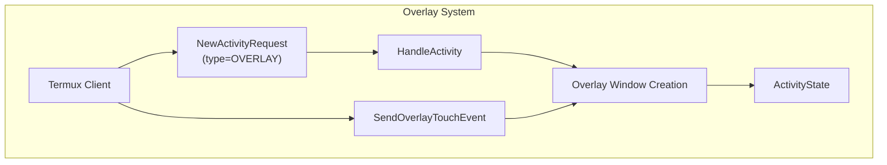
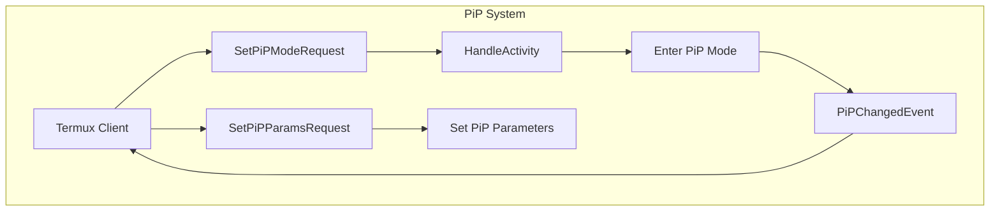
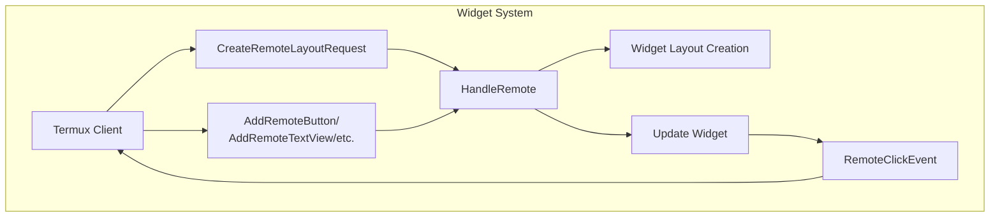
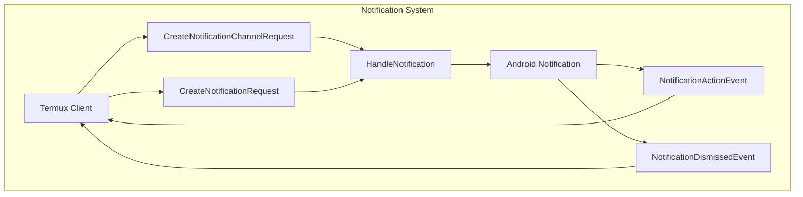
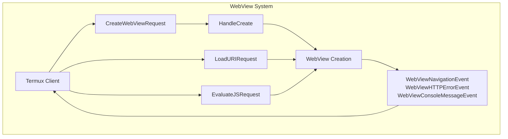
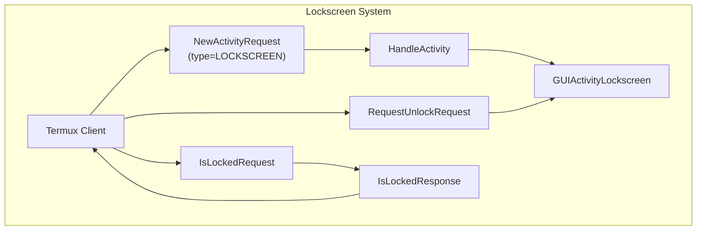
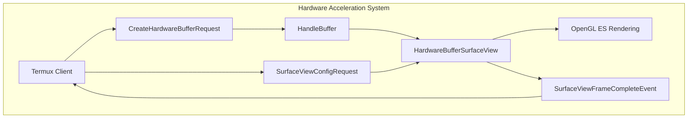
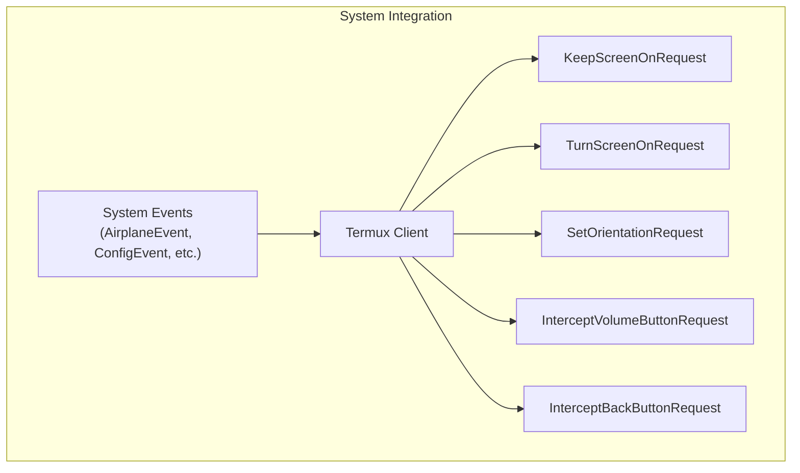
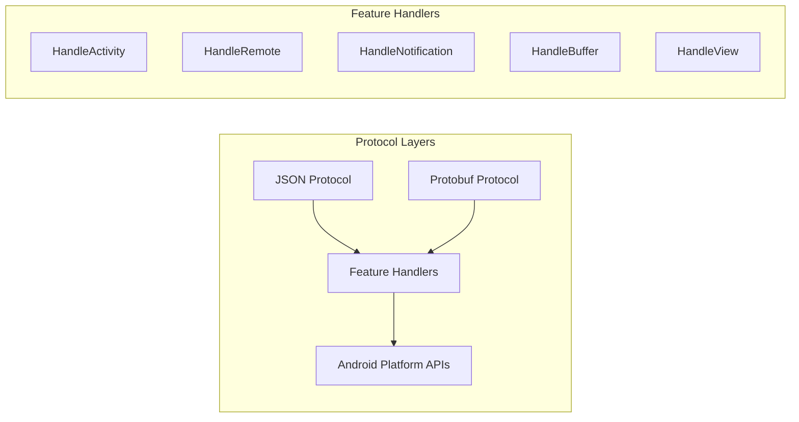

<!-- source: DeepWiki mcp.deepwiki.com · repo termux/termux-gui · page 5 Advanced Features · fetched 2026-10-26 -->

# Advanced Features

Relevant source files

The following files were used as context for generating this wiki page:

- [Developing.md](Developing.md)
- [README.md](README.md)
- [app/mapping.txt](app/mapping.txt)
- [app/proguard-rules.pro](app/proguard-rules.pro)
- [app/seeds.txt](app/seeds.txt)
- [app/src/main/AndroidManifest.xml](app/src/main/AndroidManifest.xml)
- [app/usage.txt](app/usage.txt)
- [fastlane/metadata/android/en-US/changelogs/8.txt](fastlane/metadata/android/en-US/changelogs/8.txt)

This page provides an overview of the advanced capabilities available in Termux:GUI that extend beyond basic UI components. These features allow Termux programs to create rich, interactive applications that deeply integrate with Android's advanced UI systems.

For basic information about Activities and UI components, see [Activities and UI Components](#3).

## 1. Overlays and Picture-in-Picture

### Overlay Windows

Overlay windows in Termux:GUI allow your application to display content on top of other applications, even when your app isn't in the foreground. This is useful for creating floating tools, always-visible information panels, or interactive overlays.

To use overlay windows, the SYSTEM_ALERT_WINDOW permission must be granted to the app. This can be enabled in the Termux:GUI app settings under "Display over other apps".

Sources: [app/src/main/AndroidManifest.xml:15](), [README.md:15-16]()

### Picture-in-Picture Mode

Picture-in-Picture (PiP) mode allows activities to continue displaying content in a small window pinned to a corner of the screen while users interact with other apps.

The system supports both manual and auto PiP mode entry, and allows customizing the aspect ratio and other parameters of the PiP window.

Sources: [app/src/main/AndroidManifest.xml:70](), [app/src/main/AndroidManifest.xml:80]()

## 2. Remote Views and Widgets

Termux:GUI allows your applications to create custom Android widgets that can display on the home screen. This is done through the Remote View system, which enables rendering UI components outside of your app's process.

Widgets created through Termux:GUI can display text, images, buttons, and other simple UI components. They can also respond to user interactions, sending events back to your Termux application.

Sources: [app/src/main/AndroidManifest.xml:42-51](), [app/src/main/AndroidManifest.xml:58-65]()

## 3. Custom Notifications

Termux:GUI enables applications to create custom Android notifications with rich content and interaction capabilities. These notifications can be used to display information, alerts, or provide quick actions.

Notifications can include:
- Normal notifications with text, title, and icon
- Big image notifications with large image content
- Custom notifications with buttons and actions

When a user interacts with a notification or dismisses it, events are sent back to your application for handling.

Sources: [README.md:22](), [app/src/main/AndroidManifest.xml:19]()

## 4. WebView Integration

Termux:GUI includes WebView integration, allowing applications to display web content directly within their UI. This is useful for displaying HTML content, web applications, or implementing hybrid web/native interfaces.

WebView supports:
- Loading URLs, HTML content, or local files
- JavaScript execution and evaluation
- Setting up JavaScript interfaces
- Handling navigation events and errors
- JavaScript dialog handling

Sources: [README.md:26](), [app/src/main/AndroidManifest.xml:91-93](), [app/src/main/AndroidManifest.xml:105-107]()

## 5. Lockscreen Activities

Termux:GUI supports creating activities that can be shown on the lockscreen, even when the device is locked. This enables creating applications that can display information or provide limited functionality without unlocking the device.

Lockscreen activities can:
- Display content when the device is locked
- Turn on the screen to show information
- Request the user to unlock the device when needed
- Check if the device is currently locked

Sources: [README.md:28](), [app/src/main/AndroidManifest.xml:73-83]()

## 6. Hardware Buffer and Graphics Acceleration

Termux:GUI provides access to hardware-accelerated rendering through the Hardware Buffer system, allowing efficient display of graphical content using OpenGL ES.

The hardware buffer system is useful for:
- High-performance graphics rendering
- Gaming applications
- Video processing
- Complex visualizations

The system supports OpenGL ES 2.0 rendering and can handle different buffer formats and usage patterns.

Sources: [README.md:25](), [app/src/main/AndroidManifest.xml:7-9]()

## 7. System Integration Features

Termux:GUI provides several features that integrate with the Android system to enhance application capabilities:

System integration features include:
- Wake-lock to keep the screen on
- Screen orientation control
- Volume and back button interception
- System event monitoring (airplane mode, configuration changes)
- Task management (bringing tasks to front, moving tasks to back)

Sources: [README.md:29](), [app/src/main/AndroidManifest.xml:17]()

## Implementation Details

The advanced features in Termux:GUI are implemented through a combination of protocol handlers, system services, and Android platform APIs. All features can be accessed through either the JSON or Protobuf protocol interfaces.

For detailed implementation information about specific advanced features, refer to the following pages:
- [Overlays and Picture-in-Picture](#5.1)
- [Remote Views and Widgets](#5.2)
- [Notifications](#5.3)
- [WebView Integration](#5.4)

Sources: [README.md:19-30](), [Developing.md:1-46]()

---

