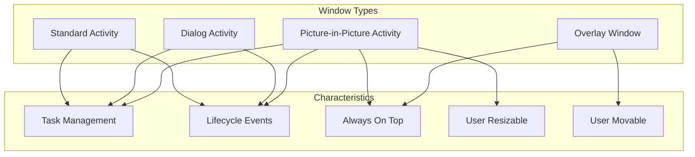
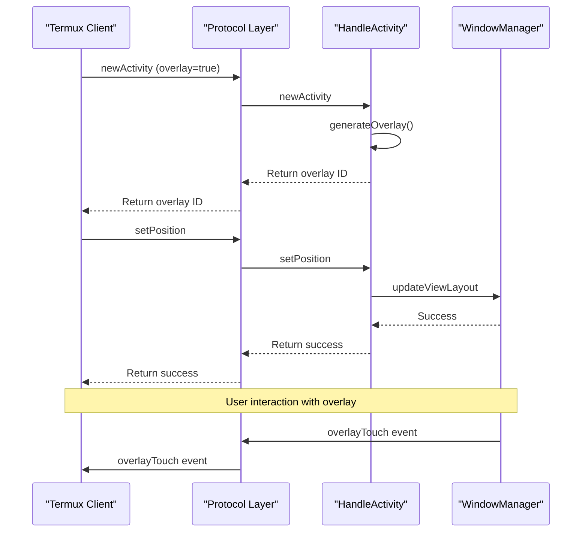
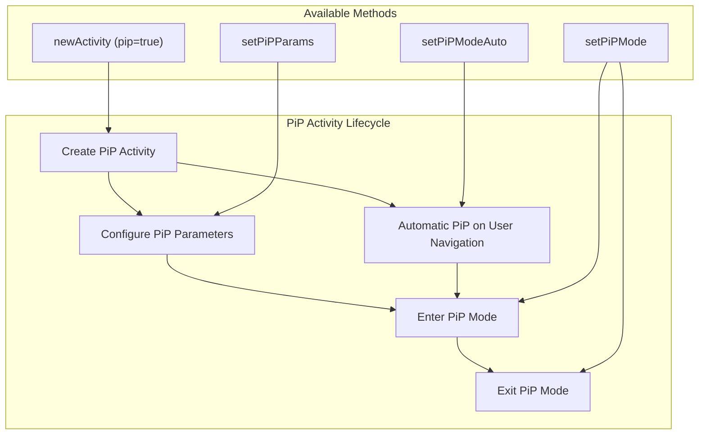
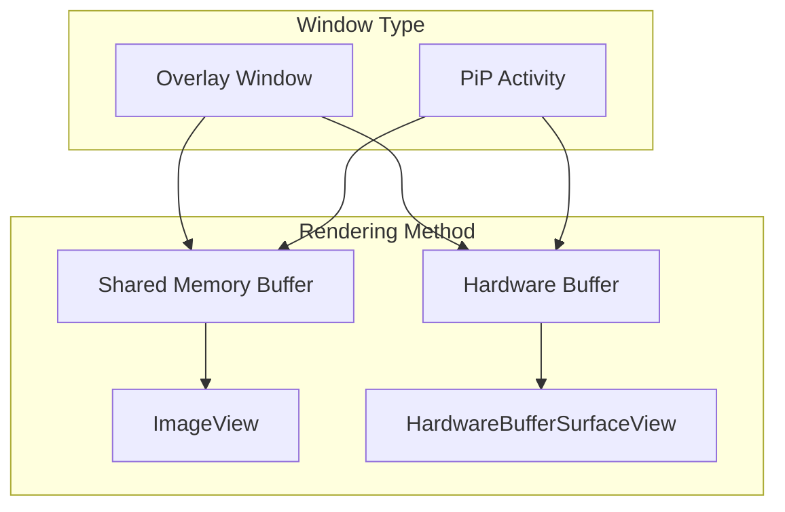

<!-- source: DeepWiki mcp.deepwiki.com · repo termux/termux-gui · page 5.1 Overlays and Picture-in-Picture · fetched 2026-10-26 -->

# Overlays and Picture-in-Picture

<details>
<summary>Relevant source files</summary>

The following files were used as context for generating this wiki page:

- [Protocol.md](Protocol.md)
- [TODO](TODO)
- [app/src/main/java/com/termux/gui/protocol/protobuf/v0/HandleActivity.kt](app/src/main/java/com/termux/gui/protocol/protobuf/v0/HandleActivity.kt)
- [app/src/main/java/com/termux/gui/protocol/protobuf/v0/HandleBuffer.kt](app/src/main/java/com/termux/gui/protocol/protobuf/v0/HandleBuffer.kt)
- [app/src/main/java/com/termux/gui/protocol/protobuf/v0/HandleGlobal.kt](app/src/main/java/com/termux/gui/protocol/protobuf/v0/HandleGlobal.kt)

</details>


This page documents two special window types available in Termux:GUI: Overlay windows and Picture-in-Picture (PiP) activities. These features allow Termux applications to create floating windows that can be displayed on top of other applications or in a special minimized form, enabling multitasking scenarios and persistent UI elements that remain accessible regardless of which app is currently focused.

For information about regular activities and standard UI components, see [Activities and UI Components](#3).

## Overview

Termux:GUI supports two distinct window types beyond standard activities:

1. **Overlay Windows**: System-level floating windows that appear on top of all other applications. These windows are not part of the Android task system and can remain visible regardless of which app is in the foreground.

2. **Picture-in-Picture (PiP) Mode**: A special Android feature that allows an activity to be displayed in a small floating window while the user interacts with another app. PiP mode is commonly used for video playback or other visual tasks that benefit from continued visibility.



Sources: [Protocol.md:41-61](), [app/src/main/java/com/termux/gui/protocol/protobuf/v0/HandleActivity.kt:34-77]()

## Overlay Windows

Overlay windows are system-level windows that can appear on top of all other applications, including the Android launcher, lock screen, and other system UI elements. They're useful for persistent UI components that need to be always accessible.

### Creating an Overlay Window

To create an overlay window, use the `newActivity` method with the `overlay` parameter set to `true`:

```json
{
  "method": "newActivity",
  "params": {
    "overlay": true
  }
}
```

This returns an activity ID that can be used to manage the overlay window. Unlike regular activities, overlays don't have a task ID and will return -1 for the task ID.

### Positioning Overlay Windows

Overlay windows can be positioned on the screen using the `setPosition` method:

```json
{
  "method": "setPosition",
  "params": {
    "aid": 123,  // The overlay activity ID
    "x": 100,    // X coordinate in pixels
    "y": 200     // Y coordinate in pixels
  }
}
```

### Handling Touch Events in Overlays

Overlay windows generate `overlayTouch` events for all touch interactions. These events provide absolute screen coordinates, which is different from regular touch events that provide coordinates relative to the view.



Sources: [app/src/main/java/com/termux/gui/protocol/protobuf/v0/HandleActivity.kt:328-350](), [Protocol.md:622-623]()

### Closing Overlay Windows

To close an overlay window, use the `finishActivity` method with the overlay's activity ID:

```json
{
  "method": "finishActivity",
  "params": {
    "aid": 123  // The overlay activity ID
  }
}
```

### Limitations and Planned Improvements

According to the TODO list, several improvements are planned for overlay windows:

- Option to specify margins where grabbing and moving is handled by the plugin
- Option to handle pinch scaling in the plugin
- Multiplier for how pinching translates to scaling

Sources: [TODO:39-43](), [app/src/main/java/com/termux/gui/protocol/protobuf/v0/HandleActivity.kt:81-113]()

## Picture-in-Picture Mode

Picture-in-Picture (PiP) is an Android feature that allows an activity to continue displaying content in a small window while the user navigates to another app or activity. PiP was introduced in Android 8.0 (API level 26) and is commonly used for video playback.

### Creating a PiP Activity

To create an activity that will use PiP mode, use the `newActivity` method with the `pip` parameter:

```json
{
  "method": "newActivity",
  "params": {
    "pip": true
  }
}
```

This will create a new activity in a new task that's configured for PiP mode.

### Setting PiP Parameters

You can configure the aspect ratio of the PiP window using the `setPiPParams` method:

```json
{
  "method": "setPiPParams",
  "params": {
    "aid": 123,  // The activity ID
    "num": 16,   // Numerator of aspect ratio
    "den": 9     // Denominator of aspect ratio
  }
}
```

The aspect ratio is constrained between 0.418 (100/239) and 2.39 (239/100) to ensure the PiP window remains usable.



Sources: [app/src/main/java/com/termux/gui/protocol/protobuf/v0/HandleActivity.kt:179-198](), [Protocol.md:83-87]()

### Entering and Exiting PiP Mode

You can programmatically control when an activity enters or exits PiP mode using the `setPiPMode` method:

```json
{
  "method": "setPiPMode",
  "params": {
    "aid": 123,   // The activity ID
    "pip": true   // true to enter PiP, false to exit
  }
}
```

When exiting PiP mode (setting `pip` to `false`), the activity becomes a background task rather than immediately returning to full-screen mode.

### Automatic PiP Mode

You can configure an activity to automatically enter PiP mode when the user navigates away from it:

```json
{
  "method": "setPiPModeAuto",
  "params": {
    "aid": 123,   // The activity ID
    "pip": true   // Enable automatic PiP
  }
}
```

This is particularly useful for media playback applications that should continue showing content when the user switches to another app.

### PiP Events

When an activity enters or exits PiP mode, a `pipchanged` event is fired with a boolean value indicating whether the activity is now in PiP mode.

Additionally, when the user navigates away from an activity, a `UserLeaveHint` event is fired, which can be used as a trigger to enter PiP mode.

Sources: [app/src/main/java/com/termux/gui/protocol/protobuf/v0/HandleActivity.kt:228-267](), [Protocol.md:92-99](), [Protocol.md:613-614]()

## Activity Lifecycle Differences

It's important to understand how the lifecycle differs between regular activities, PiP activities, and overlay windows:

| Feature | Regular Activity | PiP Activity | Overlay Window |
|---------|------------------|--------------|---------------|
| Task Management | Part of a task | Part of a task | Not in a task system |
| Lifecycle Events | Full lifecycle events | Full lifecycle events | No lifecycle events |
| Visibility | Only when task is active | Can be visible while inactive | Always on top |
| User Control | System back button | System PiP controls | Drag to move |
| Creation Method | `newActivity` | `newActivity` with `pip:true` | `newActivity` with `overlay:true` |

Overlay windows don't receive activity lifecycle events like `create`, `start`, `resume`, `pause`, `stop`, and `destroy`. This means they won't be automatically suspended or destroyed when the user switches to another app.

PiP activities follow the normal activity lifecycle but remain visible in a small window even when not in focus. They can be closed by the user through the PiP window controls.

Sources: [Protocol.md:597-610](), [app/src/main/java/com/termux/gui/protocol/protobuf/v0/HandleActivity.kt:81-113]()

## Integration with Other Systems

Both overlay windows and PiP activities can contain any views and layouts supported by Termux:GUI. This includes handling touch events, displaying images, and using buffer rendering.

### Combining with Hardware Buffers

For high-performance rendering in overlay windows or PiP activities, you can use hardware buffers to efficiently render graphics:



Sources: [app/src/main/java/com/termux/gui/protocol/protobuf/v0/HandleBuffer.kt:31-137](), [TODO:12-24]()

## Common Use Cases

### Overlay Windows
- Persistent controls for media playback or system functions
- Quick access tools that should be available in any app
- Floating calculators, notepads, or timers
- Custom keyboard input methods
- Debug information display

### PiP Mode
- Video playback while using other apps
- Video calls that continue while multitasking
- Navigation instructions that remain visible
- Timers or stopwatches that need to be visible continuously
- Monitoring live data feeds while using other apps

## Future Improvements

According to the TODO list, several improvements are planned for both overlay windows and PiP mode:

1. For overlay windows:
   - Option to specify margins for grabbing and moving
   - Option to handle pinch scaling in the plugin
   - Support for scaling multipliers

2. For PiP mode:
   - Events for PiP action buttons

These improvements will enhance the usability and flexibility of both window types.

Sources: [TODO:39-45]()

---

