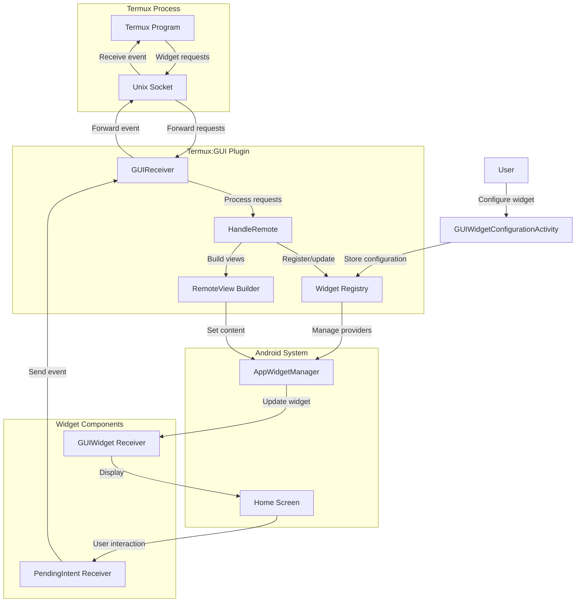
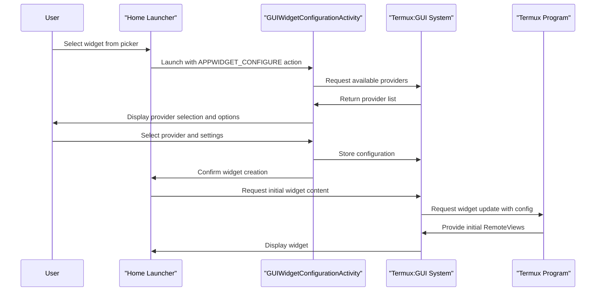
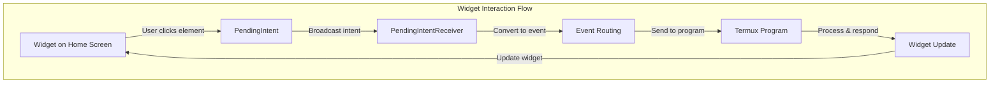

<!-- source: DeepWiki mcp.deepwiki.com · repo termux/termux-gui · page 5.2 Remote Views and Widgets · fetched 2026-10-26 -->

# Remote Views and Widgets

Relevant source files

The following files were used as context for generating this wiki page:

- [Developing.md](Developing.md)
- [README.md](README.md)
- [app/src/main/AndroidManifest.xml](app/src/main/AndroidManifest.xml)
- [fastlane/metadata/android/en-US/changelogs/8.txt](fastlane/metadata/android/en-US/changelogs/8.txt)

## Overview and Purpose

The Remote Views and Widgets system in Termux:GUI enables Termux command-line programs to create and manage Android home screen widgets. This feature allows terminal applications to display information and interactive elements directly on the Android home screen, even when Termux itself is not running in the foreground.

This document covers how to create, configure, and update widgets from Termux programs, as well as how to handle widget interactions. For information about notifications, which also use RemoteViews, see [Notifications](#5.3).

Sources: [README.md:23-24](), [app/src/main/AndroidManifest.xml:38-51]()

## Android RemoteViews Concept

In Android's architecture, RemoteViews is a specialized class designed for view hierarchies that need to be displayed in a different process than the one that created them. This is necessary for:

1. Home screen widgets (which run in the launcher process)
2. Notification views (which run in the system UI process)

RemoteViews have specific limitations compared to regular Android views:
- Only certain view types are supported (primarily TextView, ImageView, Button, etc.)
- Not all methods of these views can be called remotely
- Layout options are more restricted

Termux:GUI provides an abstraction layer that simplifies working with these limitations.

## Widget System Architecture

The widget system in Termux:GUI consists of several components working together:

Key components:

1. **GUIWidget** - A broadcast receiver that implements Android's AppWidgetProvider interface
2. **GUIWidgetConfigurationActivity** - An activity for configuring widgets before placement
3. **PendingIntentReceiver** - Handles user interactions with widgets
4. **HandleRemote** - Protocol handler component that processes widget requests from Termux programs

Sources: [app/src/main/AndroidManifest.xml:38-51](), [app/src/main/AndroidManifest.xml:57-65]()

## Widget Registration Process

To create a widget, a Termux program must register a widget provider that can generate and update widget content. The registration process includes:

1. Defining a unique provider ID
2. Setting a user-friendly label
3. Specifying update frequency
4. Indicating if configuration is required

Once registered, the provider becomes available in Android's widget picker when users add widgets to their home screen.

## Widget Configuration

When a user adds a configurable widget to their home screen, the following sequence occurs:

The configuration data is stored with the widget ID and passed to the Termux program during each update, allowing for customized widget behavior.

Sources: [app/src/main/AndroidManifest.xml:57-65]()

## Widget Update Mechanisms

Widgets can be updated through several mechanisms:

1. **Periodic Updates**: Android triggers updates based on the widget's update interval
2. **Manual Updates**: A Termux program can request widget updates at any time
3. **Broadcast Events**: System events like boot completion can trigger updates

During an update:
1. The Termux program receives an update request with the widget ID and configuration
2. The program generates new RemoteViews content
3. The content is passed to the Android AppWidgetManager
4. The widget refreshes on the home screen

## Making Widgets Interactive

To create interactive widgets, Termux programs can:

1. Add clickable elements to the widget layout
2. Configure PendingIntents that trigger when users interact with these elements
3. Process interaction events sent back through the Termux:GUI event system

This interaction loop allows widgets to respond to user input without launching the full Termux application.

Sources: [app/src/main/AndroidManifest.xml:38-40]()

## Remote View Creation and Limitations

When creating RemoteViews for widgets, it's important to understand their limitations:

| Feature | Supported | Notes |
|---------|-----------|-------|
| Layout types | Partial | LinearLayout, FrameLayout, RelativeLayout, GridLayout |
| View types | Partial | TextView, ImageView, Button, ProgressBar, etc. |
| Custom views | No | Only standard Android views |
| Dynamic changes | Limited | Must update entire RemoteViews |
| Animations | No | Static views only |
| Complex interactions | Limited | Click events only |

To work within these constraints, keep widgets simple and focused on displaying information and basic interactivity.

## Practical Use Cases

Common applications for Termux:GUI widgets include:

1. **System Monitors**: Display CPU, memory, or network usage
2. **Command Shortcuts**: Buttons that execute terminal commands
3. **Data Visualizers**: Show information from databases or APIs
4. **Status Indicators**: Display the status of long-running processes
5. **Control Interfaces**: Provide UI controls for terminal applications

## Example Widget Workflow

Here's a typical widget implementation workflow:

1. Register a widget provider in your Termux program
2. Create RemoteViews layouts for the widget
3. Set up interaction handlers for clickable elements
4. Implement update logic to refresh content periodically
5. Process and respond to user interactions

By following this approach, Termux programs can create useful and interactive widgets that extend their functionality to the Android home screen.

Sources: [README.md:22-24](), [app/src/main/AndroidManifest.xml:42-51]()

---

