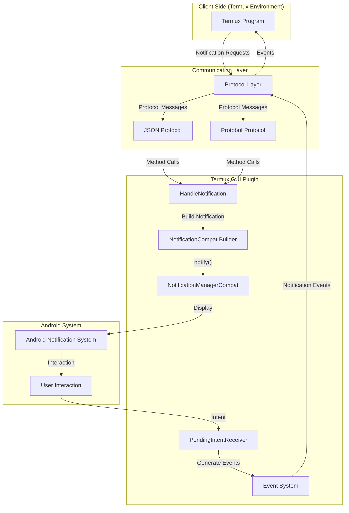
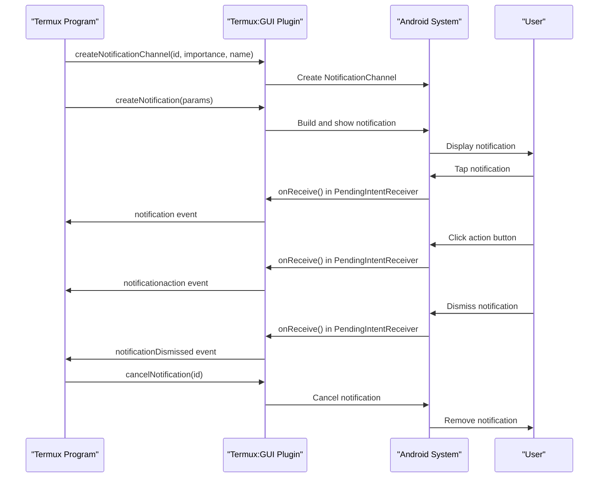
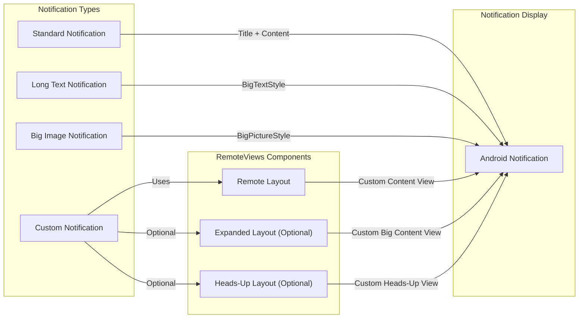

<!-- source: DeepWiki mcp.deepwiki.com · repo termux/termux-gui · page 5.3 Notifications · fetched 2026-10-26 -->

# Notifications

<details>
<summary>Relevant source files</summary>

The following files were used as context for generating this wiki page:

- [Protocol.md](Protocol.md)
- [TODO](TODO)
- [app/src/main/java/com/termux/gui/protocol/protobuf/v0/HandleNotification.kt](app/src/main/java/com/termux/gui/protocol/protobuf/v0/HandleNotification.kt)
- [app/src/main/java/com/termux/gui/protocol/protobuf/v0/HandleRemote.kt](app/src/main/java/com/termux/gui/protocol/protobuf/v0/HandleRemote.kt)

</details>


This page documents the notification system in Termux:GUI, which allows terminal applications to create and manage Android notifications. The notification API enables Termux applications to display notifications on the device, handle notification actions, and receive events when users interact with notifications. For information about remote views that can be used in notifications, see [Remote Views and Widgets](#5.2).

## Notification System Architecture

Termux:GUI's notification system provides a bridge between terminal applications and Android's notification framework. The system enables creating both standard and custom notifications with various configurations.

### Notification System Components



Sources: [app/src/main/java/com/termux/gui/protocol/protobuf/v0/HandleNotification.kt:24-211]()

The diagram illustrates how notification requests flow from the Termux program through the protocol layer to the HandleNotification class, which uses Android's notification APIs to create and display notifications. User interactions with notifications generate events that are sent back to the Termux program.

### Notification Lifecycle



Sources: [Protocol.md:517-545](), [app/src/main/java/com/termux/gui/protocol/protobuf/v0/HandleNotification.kt:73-187]()

The sequence diagram shows the lifecycle of a notification, from creation to user interaction to dismissal.

## Notification Types

Termux:GUI supports several types of notifications:

1. **Standard Notifications**: Basic notifications with a title and content
2. **Long Text Notifications**: Notifications with an expanded view showing longer text content
3. **Big Image Notifications**: Notifications with an expanded view displaying a large image
4. **Custom Notifications**: Notifications with completely custom layouts using RemoteViews



Sources: [app/src/main/java/com/termux/gui/protocol/protobuf/v0/HandleNotification.kt:77-123]()

## Creating and Managing Notifications

### Creating Notification Channels

On Android 8.0 and higher, you must create a notification channel before posting notifications. This allows users to control notification settings per channel.

```
createNotificationChannel(id, importance, name)
```

Parameters:
- `id`: String identifier for the channel
- `importance`: Notification importance level (MIN, LOW, DEFAULT, HIGH, MAX)
- `name`: User-visible name for the channel

Sources: [Protocol.md:518-523](), [app/src/main/java/com/termux/gui/protocol/protobuf/v0/HandleNotification.kt:29-47]()

### Creating Notifications

To create a notification, use the `createNotification` method with the appropriate parameters for your notification type.

```
createNotification(params)
```

Key parameters:
- `id`: Optional notification ID (generated if not provided)
- `channel`: Notification channel ID
- `ongoing`: Whether the notification can be dismissed by the user
- `title`: Notification title
- `content`: Notification content text
- `largeImage`: Optional large image for the expanded view
- `largeText`: Optional large text block for the expanded view
- `icon`: Optional custom icon (defaults to Termux:GUI icon)
- `actions`: Optional array of action button labels
- `layout`, `expandedLayout`, `hudLayout`: Optional remote layout IDs for custom notifications

Sources: [Protocol.md:523-542](), [app/src/main/java/com/termux/gui/protocol/protobuf/v0/HandleNotification.kt:51-187]()

#### Standard Notification Example

For a basic notification:

```json
{
  "method": "createNotificationChannel",
  "params": {
    "id": "default_channel",
    "importance": 2,
    "name": "Default Channel"
  }
}
```

```json
{
  "method": "createNotification",
  "params": {
    "channel": "default_channel",
    "title": "Notification Title",
    "content": "This is the notification content",
    "importance": 2
  }
}
```

#### Custom Notification with Remote Views

For custom notifications, first create remote layouts:

```json
{
  "method": "createRemoteLayout"
}
```

Add views to the layout:

```json
{
  "method": "addRemoteTextView",
  "params": {
    "rid": 1,
    "parent": 0
  }
}
```

Then create a notification using the remote layout:

```json
{
  "method": "createNotification",
  "params": {
    "channel": "default_channel",
    "layout": 1,
    "importance": 2
  }
}
```

Sources: [Protocol.md:439-496](), [app/src/main/java/com/termux/gui/protocol/protobuf/v0/HandleRemote.kt:24-186]()

### Canceling Notifications

To cancel a notification, use the `cancelNotification` method:

```
cancelNotification(id)
```

Parameters:
- `id`: The ID of the notification to cancel

Sources: [Protocol.md:542-545](), [app/src/main/java/com/termux/gui/protocol/protobuf/v0/HandleNotification.kt:190-205]()

## Notification Events

When users interact with notifications, events are sent back to the client application:

| Event | Description | Data |
|-------|-------------|------|
| `notification` | User taps the notification | `id`: Notification ID |
| `notificationDismissed` | User dismisses the notification | `id`: Notification ID |
| `notificationaction` | User taps an action button | `id`: Notification ID, `action`: Action index (0-based) |

Sources: [Protocol.md:623-630]()

These events are delivered through the event socket, alongside other event types.

## Internal Implementation

When a notification is created, Termux:GUI:

1. Checks for the notification permission on Android 13+ and requests it if needed
2. Creates a `NotificationCompat.Builder` and configures it based on the notification type
3. Sets up PendingIntents for notification tap, dismissal, and action buttons
4. Posts the notification through `NotificationManagerCompat`

For each notification action, a PendingIntent is created with a URI containing encoded data about the notification ID, action index, and thread ID. When the user interacts with the notification, the PendingIntentReceiver broadcasts the appropriate event back to the client.

Sources: [app/src/main/java/com/termux/gui/protocol/protobuf/v0/HandleNotification.kt:147-179]()

## Best Practices

1. **Create appropriate channels**: Group similar notifications into the same channel with an appropriate importance level.
2. **Use ongoing notifications sparingly**: Only use ongoing notifications (which can't be swiped away) when truly necessary, such as for active background processes.
3. **Provide useful actions**: When adding action buttons, make them meaningful and helpful to the user.
4. **Clean up**: Cancel notifications that are no longer relevant to avoid cluttering the notification drawer.

## Future Developments

According to the project roadmap, planned improvements to the notification system include:

- Option for notifications to stay after the connection is closed (currently notifications are removed when the connection ends)
- Setting ongoing notifications to not-ongoing when the connection closes, to allow dismissal

Sources: [TODO:10-11]()

## Limitations

1. All notifications are automatically dismissed when the connection to Termux:GUI is closed.
2. On Android 13 and higher, the POST_NOTIFICATIONS permission is required. Termux:GUI will request this permission when needed.

---

