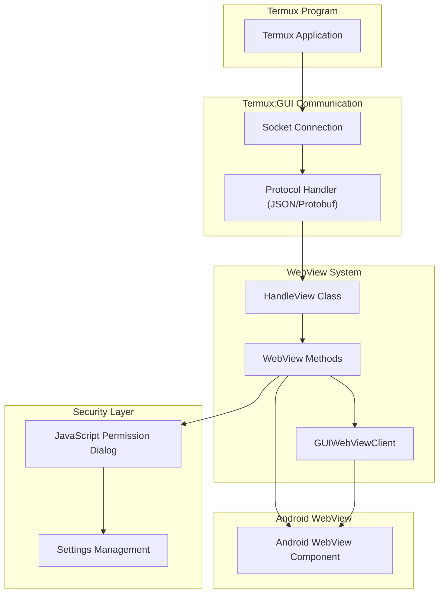
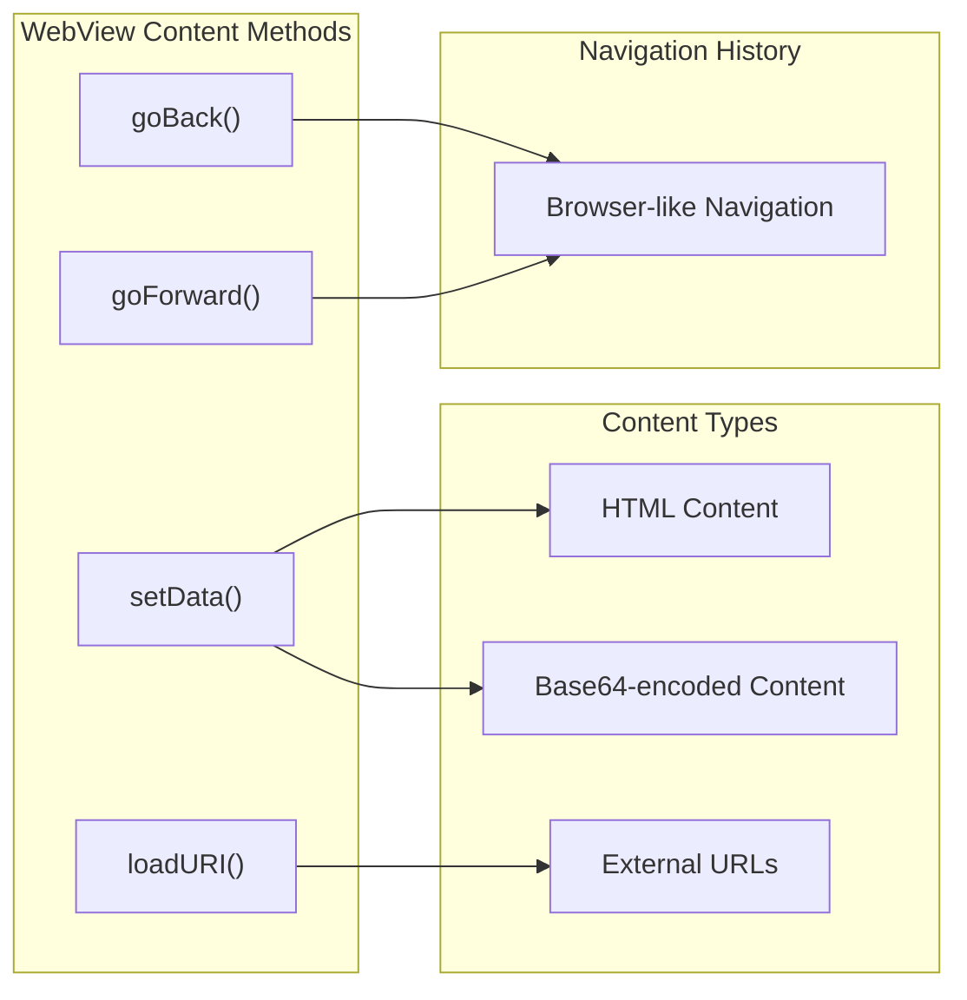
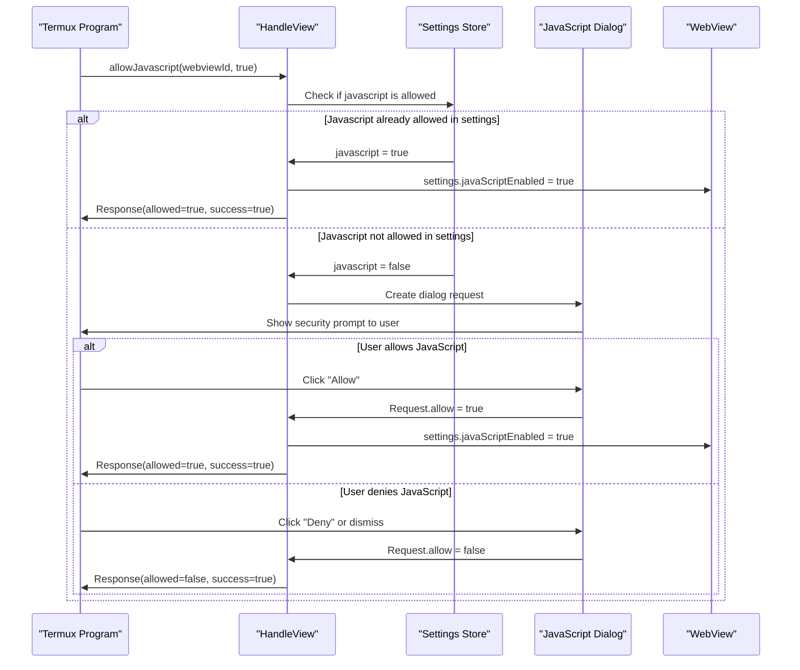

<!-- source: DeepWiki mcp.deepwiki.com · repo termux/termux-gui · page 5.4 WebView Integration · fetched 2026-10-26 -->

# WebView Integration

<details>
<summary>Relevant source files</summary>

The following files were used as context for generating this wiki page:

- [app/src/main/java/com/termux/gui/App.kt](app/src/main/java/com/termux/gui/App.kt)
- [app/src/main/java/com/termux/gui/GUIConfigActivity.kt](app/src/main/java/com/termux/gui/GUIConfigActivity.kt)
- [app/src/main/java/com/termux/gui/GUIWebViewJavascriptDialog.kt](app/src/main/java/com/termux/gui/GUIWebViewJavascriptDialog.kt)
- [app/src/main/java/com/termux/gui/Settings.kt](app/src/main/java/com/termux/gui/Settings.kt)
- [app/src/main/java/com/termux/gui/protocol/protobuf/v0/HandleView.kt](app/src/main/java/com/termux/gui/protocol/protobuf/v0/HandleView.kt)
- [app/src/main/res/values/strings.xml](app/src/main/res/values/strings.xml)

</details>


This document details how to utilize and configure WebView components within the Termux:GUI system. WebViews allow Termux applications to display web content and HTML interfaces directly within their GUI applications.

## Overview

WebView integration in Termux:GUI enables Termux applications to render web content without requiring an external browser. This functionality allows for:

- Displaying HTML, CSS, and JavaScript content
- Loading external websites
- Creating rich interfaces using web technologies
- Executing JavaScript and interacting with web content

Sources: [app/src/main/java/com/termux/gui/protocol/protobuf/v0/HandleView.kt:16-16](), [app/src/main/java/com/termux/gui/protocol/protobuf/v0/HandleView.kt:549-658]()

## WebView Architecture

The following diagram illustrates how WebViews are integrated within the Termux:GUI system:



Sources: [app/src/main/java/com/termux/gui/protocol/protobuf/v0/HandleView.kt:546-658](), [app/src/main/java/com/termux/gui/GUIWebViewJavascriptDialog.kt:1-79]()

## Creating and Using WebViews

WebViews are created like other view components in Termux:GUI through the view creation request mechanism. Once created, they can be configured and manipulated using the methods provided by the `HandleView` class.

### Content Loading Methods

The following diagram illustrates the different methods available for loading content into WebViews:



Sources: [app/src/main/java/com/termux/gui/protocol/protobuf/v0/HandleView.kt:594-644]()

### Loading Content

#### Loading URL

To load content from a URL:

```
loadURI(webviewId, "https://example.com")
```

The corresponding method in the code is:

Sources: [app/src/main/java/com/termux/gui/protocol/protobuf/v0/HandleView.kt:604-611]()

#### Loading HTML Content

To load raw HTML content:

```
setData(webviewId, "<html><body><h1>Hello World</h1></body></html>", "text/html", false)
```

The method takes parameters for the content, MIME type, and whether the content is Base64-encoded.

Sources: [app/src/main/java/com/termux/gui/protocol/protobuf/v0/HandleView.kt:594-602]()

#### Navigation

WebViews maintain navigation history similar to regular browsers:

- `goBack()`: Navigate to the previous page
- `goForward()`: Navigate to the next page (after going back)

Sources: [app/src/main/java/com/termux/gui/protocol/protobuf/v0/HandleView.kt:628-644]()

## JavaScript Support

JavaScript integration is a powerful feature but requires careful security consideration. Termux:GUI implements a permission system to control JavaScript execution.

### JavaScript Security Flow



Sources: [app/src/main/java/com/termux/gui/protocol/protobuf/v0/HandleView.kt:546-583](), [app/src/main/java/com/termux/gui/GUIWebViewJavascriptDialog.kt:1-79]()

### Enabling JavaScript

To enable JavaScript in a WebView:

```
allowJavascript(webviewId, true)
```

This triggers the security dialog if JavaScript is not already allowed in the settings.

Sources: [app/src/main/java/com/termux/gui/protocol/protobuf/v0/HandleView.kt:547-583]()

### Security Dialog

When JavaScript is requested for the first time, a security dialog is shown to the user explaining the potential risks. The user can:

1. Allow JavaScript for this request
2. Deny JavaScript execution

The dialog warns that allowing untrusted JavaScript execution could potentially leak data from other programs using the plugin.

Sources: [app/src/main/java/com/termux/gui/GUIWebViewJavascriptDialog.kt:10-79](), [app/src/main/res/values/strings.xml:19-23]()

### JavaScript Execution

Once JavaScript is enabled, you can execute JavaScript code in the WebView:

```
evaluateJS(webviewId, "document.getElementById('header').innerText = 'New Title';")
```

The execution is asynchronous and doesn't return a value.

Sources: [app/src/main/java/com/termux/gui/protocol/protobuf/v0/HandleView.kt:646-658]()

## Advanced WebView Configuration

### Content URI Access

WebViews can be configured to allow or disallow access to content URIs:

```
allowContentURI(webviewId, true)
```

This controls whether the WebView can access content from the content:// schema.

Sources: [app/src/main/java/com/termux/gui/protocol/protobuf/v0/HandleView.kt:585-592]()

### Navigation Control

You can control whether a WebView should follow navigation links or keep them in the current WebView:

```
allowNavigation(webviewId, true)
```

This functionality is only available on Android O (API 26) and higher.

Sources: [app/src/main/java/com/termux/gui/protocol/protobuf/v0/HandleView.kt:614-626]()

## WebView Methods Table

The following table summarizes all WebView-specific methods available in Termux:GUI:

| Method | Description | Parameters | Android API Requirement |
|--------|-------------|------------|-------------------------|
| `allowJavascript` | Enables or disables JavaScript execution | WebView ID, boolean enable | All supported |
| `allowContentURI` | Controls access to content URIs | WebView ID, boolean allow | All supported |
| `setData` | Loads HTML content into the WebView | WebView ID, String data, String MIME type, boolean isBase64 | All supported |
| `loadURI` | Loads content from a URL | WebView ID, String URL | All supported |
| `allowNavigation` | Controls whether navigation requests should be loaded in the WebView | WebView ID, boolean allow | API 26+ (Android O) |
| `goBack` | Navigates to the previous page in history | WebView ID | All supported |
| `goForward` | Navigates to the next page in history | WebView ID | All supported |
| `evaluateJS` | Executes JavaScript code | WebView ID, String code | All supported (requires JavaScript enabled) |

Sources: [app/src/main/java/com/termux/gui/protocol/protobuf/v0/HandleView.kt:546-658]()

## Security Considerations

WebViews with JavaScript enabled can pose security risks. The Termux:GUI system implements several security measures:

1. **JavaScript Permission Dialog**: Users must explicitly allow JavaScript execution.
2. **Global Setting**: Administrators can set a global default for JavaScript permission.
3. **Secure Settings Storage**: Settings are stored in encrypted shared preferences.
4. **Per-WebView Control**: JavaScript can be enabled or disabled for each WebView separately.

For more information on general security concerns in Termux:GUI, see the relevant security documentation.

Sources: [app/src/main/java/com/termux/gui/Settings.kt:46-46](), [app/src/main/java/com/termux/gui/GUIWebViewJavascriptDialog.kt:10-79](), [app/src/main/res/values/strings.xml:19-23]()

---

