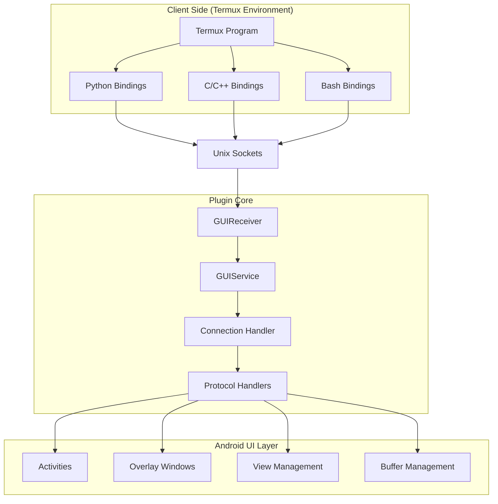
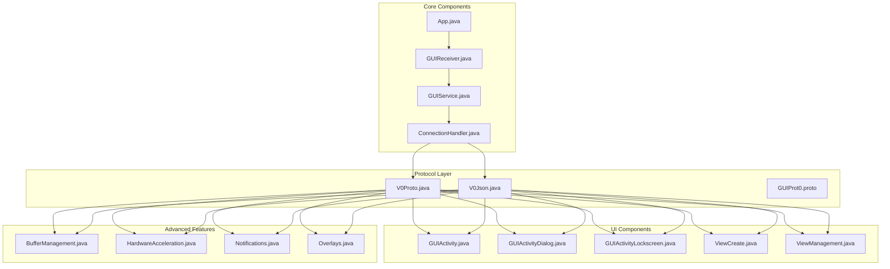
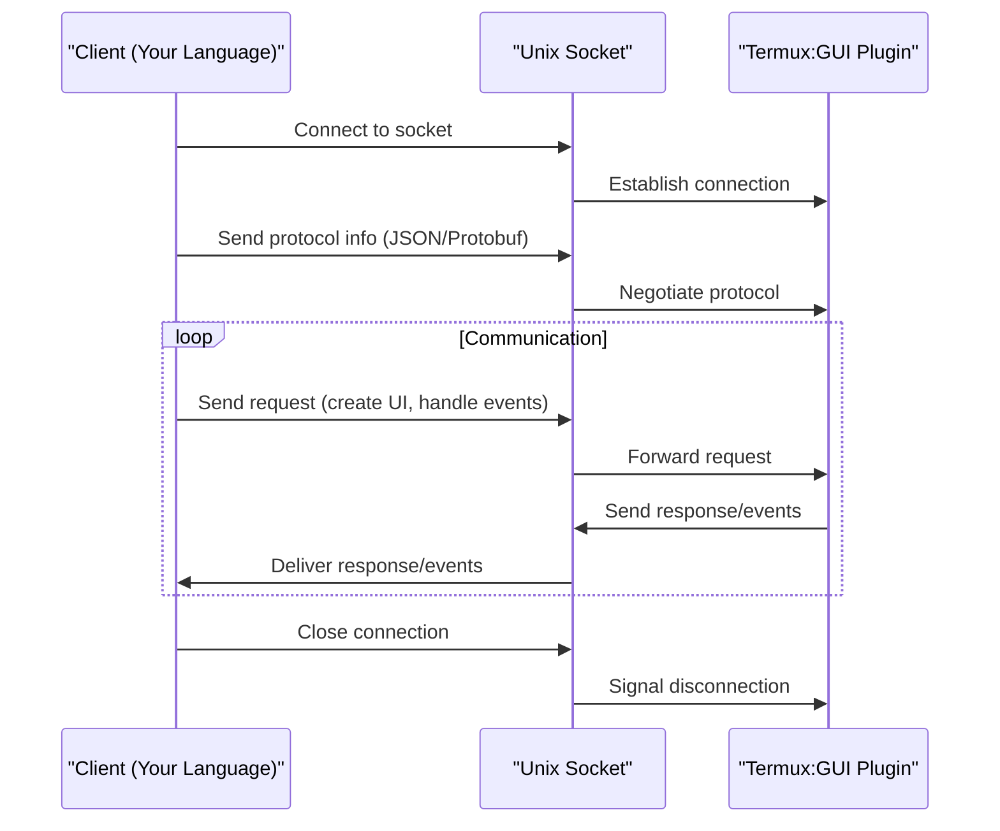

<!-- source: DeepWiki mcp.deepwiki.com · repo termux/termux-gui · page 6 Development Guide · fetched 2026-10-26 -->

# Development Guide

<details>
<summary>Relevant source files</summary>

The following files were used as context for generating this wiki page:

- [Developing.md](Developing.md)
- [README.md](README.md)
- [app/src/main/AndroidManifest.xml](app/src/main/AndroidManifest.xml)
- [build.gradle](build.gradle)
- [fastlane/metadata/android/en-US/changelogs/8.txt](fastlane/metadata/android/en-US/changelogs/8.txt)
- [gradle.properties](gradle.properties)
- [gradle/wrapper/gradle-wrapper.properties](gradle/wrapper/gradle-wrapper.properties)

</details>


This guide provides comprehensive information for developers who want to contribute to or extend the Termux:GUI project. It covers setting up a development environment, building the plugin, understanding the architecture, and creating language bindings. For information about using Termux:GUI in your applications, see [Overview](#1) and [Protocol Documentation](#2).

## Development Environment Setup

Before you can start developing for Termux:GUI, you need to set up your development environment.

### Requirements

- Android Studio (latest version recommended)
- JDK 17 or higher
- Android SDK with minimum API level 24 (Android 7.0)
- Git for version control

### Setting Up Android Studio

1. Clone the repository:
   ```bash
   git clone https://github.com/termux/termux-gui.git
   ```
2. Open the project in Android Studio
3. Let Gradle sync the project dependencies

Sources: [build.gradle:1-14](), [gradle/wrapper/gradle-wrapper.properties:1-8](), [gradle.properties:1-23]()

## Project Architecture

The Termux:GUI project follows a client-server architecture where Termux programs act as clients that communicate with the Android plugin (server) through Unix sockets.

### High-Level Architecture



Sources: [app/src/main/AndroidManifest.xml:102-104](), [app/src/main/AndroidManifest.xml:95-99]()

### Code Structure Overview



Sources: [app/src/main/AndroidManifest.xml:22-104]()

## Building Termux:GUI

### Building with Android Studio

1. Open the project in Android Studio
2. Select "Build > Make Project" or press Ctrl+F9 (Cmd+F9 on Mac)
3. To create a debug APK, select "Build > Build Bundle(s) / APK(s) > Build APK(s)"
4. The APK will be located in `app/build/outputs/apk/debug/`

### Building from Command Line

You can also build the project using Gradle from the command line:

```bash
# From the project root directory
./gradlew assembleDebug   # For debug build
./gradlew assembleRelease # For release build (requires signing configuration)
```

### F-Droid Build Process

Termux:GUI is distributed through F-Droid. The F-Droid build process uses the same source code but may have specific build settings. If you're contributing code that will be distributed through F-Droid, make sure it compiles and works correctly with the F-Droid build system.

Sources: [build.gradle:1-14](), [gradle/wrapper/gradle-wrapper.properties:1-8]()

## Development Workflow

### Making Changes

1. Create a new branch for your feature or bugfix
2. Make changes to the codebase
3. Test your changes thoroughly
4. Submit a pull request to the main repository

### Project Structure

The project follows the standard Android application structure:

| Directory | Purpose |
|-----------|---------|
| `app/src/main/java` | Java/Kotlin source code |
| `app/src/main/res` | Resources (layouts, strings, etc.) |
| `app/src/main/proto` | Protobuf definition files |
| `app/src/main/AndroidManifest.xml` | Application manifest |

### Key Components

The main components you'll work with when developing for Termux:GUI are:

1. **GUIReceiver**: Receives intent commands from clients
2. **GUIService**: Foreground service that maintains connections
3. **Protocol Handlers**: Handle communication protocol (JSON and Protobuf)
4. **Activity Components**: Different types of Android activities for UI
5. **View Management**: Classes that create and manage Android views

Sources: [app/src/main/AndroidManifest.xml:22-104]()

## Creating Language Bindings

Termux:GUI uses a socket-based protocol for communication, which makes it possible to create bindings for various programming languages. Currently, official bindings exist for Python, C/C++, and Bash, with community bindings for other languages like Rust.

### Protocol Understanding

Before creating new language bindings, you need to understand the two protocols supported by Termux:GUI:

1. **JSON Protocol**: A simpler text-based protocol
2. **Protobuf Protocol**: A more efficient binary protocol



Sources: [Developing.md:39-46]()

### Steps to Create Bindings

1. **Understand the protocol**: Read [Protocol Documentation](#2) and the `GUIProt0.proto` definition for Protobuf
2. **Create connection handling**: Implement socket connection to Termux:GUI
3. **Implement protocol serialization/deserialization**: For JSON or Protobuf
4. **Create API wrapper**: Provide a language-appropriate API for your users
5. **Implement event handling**: Create mechanisms to handle events from the GUI

### Examples from Existing Bindings

You can use the official bindings as reference:
- Python bindings: Good example for JSON-based implementation
- C/C++ bindings: Reference for Protobuf implementation
- Bash bindings: Example of minimalist implementation

### Using FFI

For languages that support Foreign Function Interface (FFI), you can also create bindings by wrapping the C library:

1. Create FFI bindings to the C functions
2. Create a higher-level API in your language
3. Handle memory management appropriately

Sources: [Developing.md:39-46](), [README.md:47-60]()

## Configuration and Settings

Termux:GUI provides several configuration options that can be adjusted during development.

### Android Manifest Configuration

The `AndroidManifest.xml` file contains important settings:

- **Permissions**: Required permissions for features like overlay windows
- **Activities**: Different activity types and their configurations
- **Service settings**: Configuration for the foreground service

Key permissions include:
- `FOREGROUND_SERVICE`: For keeping the app running in the background
- `SYSTEM_ALERT_WINDOW`: For overlay windows
- `WAKE_LOCK`: For turning on the display
- `POST_NOTIFICATIONS`: For notifications on Android 13+

Sources: [app/src/main/AndroidManifest.xml:5-19]()

### Runtime Settings

The Termux:GUI app also provides runtime settings that users can configure. When developing, you should be aware of these settings and how they might affect your implementation:

- Display over other apps permission
- Background service configuration
- Default themes and styles

## Testing Your Changes

Proper testing is essential when developing for Termux:GUI.

### Testing Setup

1. Install Termux and Termux:GUI on a test device or emulator
2. Install any necessary language bindings in Termux
3. Create test scripts/programs that exercise your changes

### Testing Protocol Changes

If you make changes to the protocol:

1. Test backward compatibility with existing clients
2. Test edge cases for new features
3. Test with both JSON and Protobuf protocols if applicable

### Testing UI Components

For changes to UI components:

1. Test on different screen sizes and orientations
2. Test with different Android versions
3. Test edge cases (very large text, empty values, etc.)

### Integration Testing

For comprehensive testing:

1. Create test scripts that use all affected features
2. Test performance impacts
3. Test for memory leaks using Android Profiler

## Contributing Guidelines

When contributing to Termux:GUI, please follow these guidelines:

1. **Code style**: Follow the existing code style patterns
2. **Documentation**: Document your changes, both in code and external documentation
3. **Testing**: Thoroughly test your changes before submitting
4. **Pull requests**: Keep pull requests focused on a single issue or feature
5. **Compatibility**: Maintain backward compatibility whenever possible

## Troubleshooting Common Development Issues

### Socket Connection Issues

If you're having trouble with socket connections:
- Check that Termux:GUI is installed and running
- Verify the socket path is correct
- Check for permission issues

### UI Not Updating

If your UI isn't updating properly:
- Verify that event handling is set up correctly
- Check for threading issues (UI updates must be on the main thread)
- Look for errors in the Android logcat

### Build Issues

For build problems:
- Make sure your Android SDK is up to date
- Check that you have the correct Gradle version
- Verify that all dependencies are available

Sources: [build.gradle:1-14](), [gradle/wrapper/gradle-wrapper.properties:1-8](), [gradle.properties:1-23]()

---

