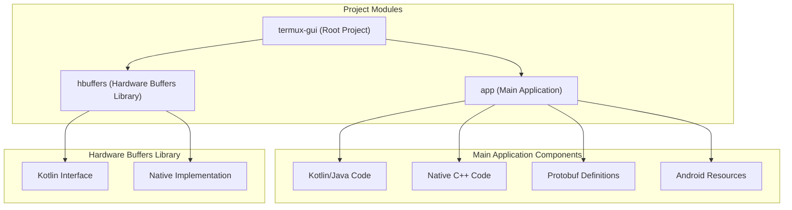
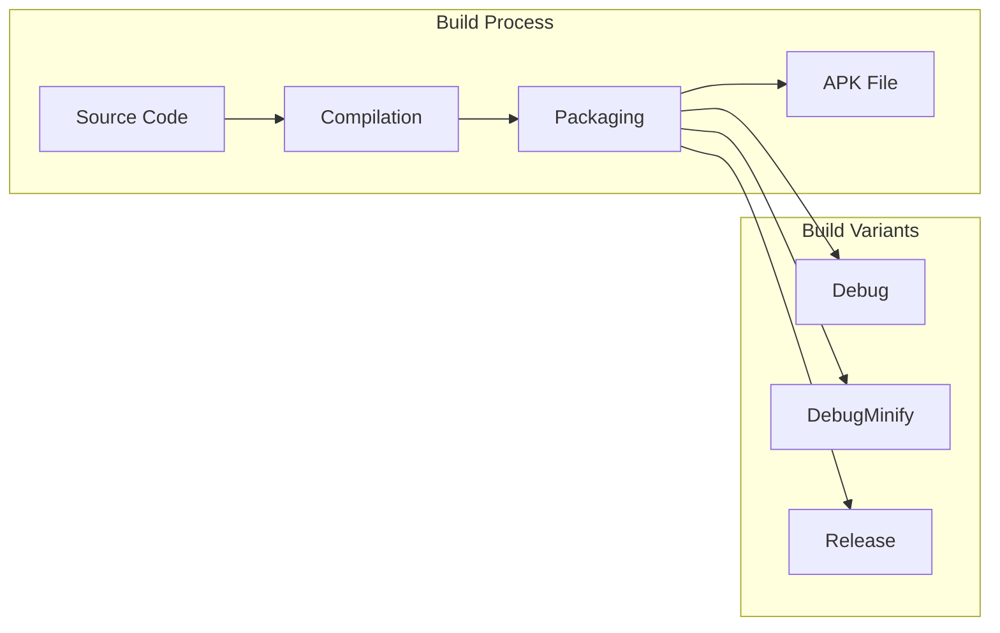
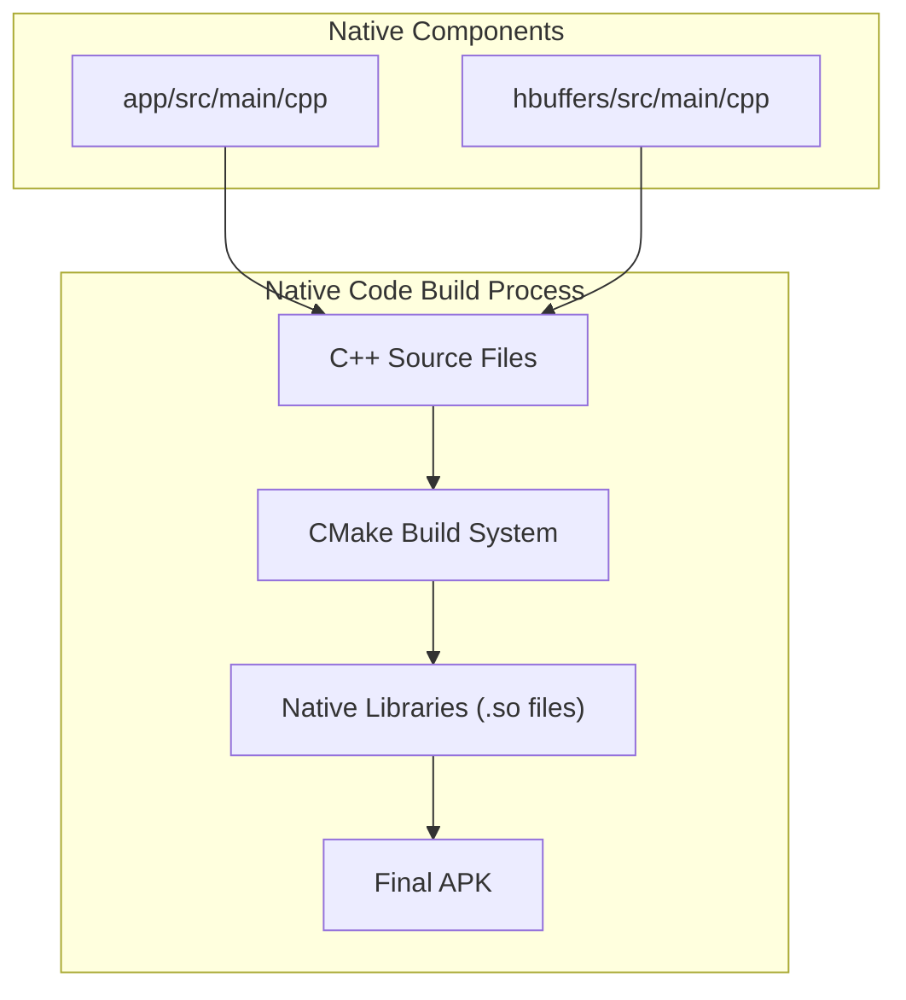
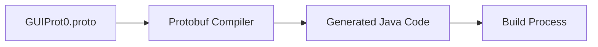
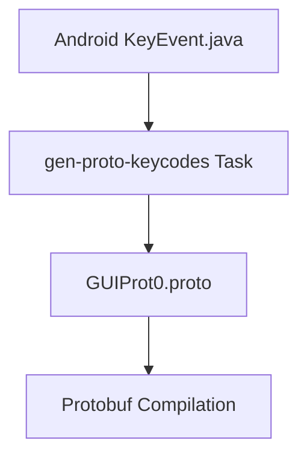
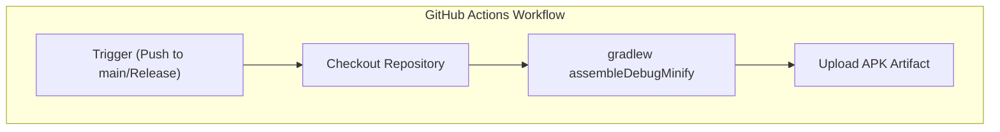

<!-- source: DeepWiki mcp.deepwiki.com · repo termux/termux-gui · page 6.1 Building Termux:GUI · fetched 2026-10-26 -->

# Building Termux:GUI

<details>
<summary>Relevant source files</summary>

The following files were used as context for generating this wiki page:

- [.github/workflows/build.yml](.github/workflows/build.yml)
- [.github/workflows/gradle-wrapper-validation.yml](.github/workflows/gradle-wrapper-validation.yml)
- [app/build.gradle](app/build.gradle)
- [build.gradle](build.gradle)
- [gradle.properties](gradle.properties)
- [gradle/wrapper/gradle-wrapper.properties](gradle/wrapper/gradle-wrapper.properties)
- [hbuffers/build.gradle](hbuffers/build.gradle)

</details>


This page provides detailed instructions for building the Termux:GUI plugin from source code. It covers setting up the development environment, obtaining the source code, and compiling the application. For information about installing the pre-built application, see [Installation](#1.1).

## Prerequisites

Before building Termux:GUI, you need to have the following tools and components installed on your system:

- Java Development Kit (JDK) 8 or higher
- Android SDK with Android API level 34
- Android NDK (version 23.1.7779620 as specified in the project)
- Git for cloning the repository
- Gradle (recommended to use the wrapper included in the project)

## Project Structure Overview

Termux:GUI consists of two main modules:



Sources: [app/build.gradle:5-9](), [app/build.gradle:131-135](), [hbuffers/build.gradle:1-4](), [hbuffers/build.gradle:40-45]()

## Getting the Source Code

Clone the repository from GitHub:

```
git clone https://github.com/termux/termux-gui.git
cd termux-gui
```

## Building the Application

### Using Gradle Command Line

The project includes a Gradle wrapper that can be used to build the application without installing Gradle separately.



Sources: [app/build.gradle:103-120](), [.github/workflows/build.yml:19-20]()

#### Available Build Variants

1. **Debug** - Unminified build with debug symbols
2. **DebugMinify** - Minified but still debuggable build
3. **Release** - Fully minified production build

To build the debug variant:

```
./gradlew assembleDebug
```

To build the debug minified variant (used in automated builds):

```
./gradlew assembleDebugMinify
```

To build the release variant:

```
./gradlew assembleRelease
```

The output APK files will be located in:
- Debug: `app/build/outputs/apk/debug/`
- DebugMinify: `app/build/outputs/apk/debugMinify/`
- Release: `app/build/outputs/apk/release/`

Sources: [app/build.gradle:103-120](), [.github/workflows/build.yml:19-20]()

### Using Android Studio

1. Open Android Studio
2. Select "Open an Existing Project"
3. Navigate to the cloned repository and select it
4. Wait for the Gradle sync to complete
5. Select the desired build variant from the Build Variants panel
6. Click on "Run" or "Build" from the menu

## Native Code Components

Termux:GUI contains native C++ code that is built using CMake. The NDK version is specified as 23.1.7779620 in the project configuration.



Sources: [app/build.gradle:131-136](), [hbuffers/build.gradle:40-45]()

## Protobuf Generation

The project uses Protocol Buffers for communication. The Protobuf definitions are automatically compiled during the build process.



Sources: [app/build.gradle:11-24](), [app/build.gradle:148](), [build.gradle:10]()

### KeyCode Enum Generation

The project includes a custom Gradle task that automatically updates the KeyCode enum in the Protobuf definitions based on the Android SDK's KeyEvent class.



Sources: [app/build.gradle:26-76]()

## Project Dependencies

The main app has several dependencies that are automatically resolved during the build process.

| Dependency | Purpose |
|------------|---------|
| com.google.code.gson:gson | JSON processing for the JSON protocol |
| androidx.appcompat:appcompat | Android compatibility support |
| com.google.protobuf:protobuf-javalite | Protocol Buffers light runtime |
| androidx.security:security-crypto | Cryptography support |
| com.google.android.material:material | Material Design components |
| hbuffers module | Hardware buffer support |

Sources: [app/build.gradle:140-157]()

## Automated Builds

The project includes GitHub Actions workflows for automated builds. These workflows build the DebugMinify variant of the application.



Sources: [.github/workflows/build.yml:1-26]()

## Signing Configuration

The debug build uses a predefined development keystore for signing the APK. For release builds, you'll need to provide your own signing configuration.

Sources: [app/build.gradle:88-95]()

## Troubleshooting Common Build Issues

### 1. Missing Android SDK Components

If you encounter errors about missing SDK components, install the required packages using the SDK Manager:

```
sdkmanager "platforms;android-34" "build-tools;33.0.2" "ndk;23.1.7779620" "sources;android-34"
```

### 2. Gradle Version Issues

If you encounter Gradle compatibility issues, use the provided wrapper:

```
./gradlew --version
```

The project uses Gradle 8.10.2 as specified in the wrapper properties.

Sources: [gradle/wrapper/gradle-wrapper.properties:1-8]()

### 3. Protobuf Generation Issues

If the protobuf generation fails, ensure you have the Android SDK sources installed as the KeyCode enum generation requires them.

Sources: [app/build.gradle:37-62](), [app/build.gradle:70-71]()

## Summary

Building Termux:GUI from source is straightforward using Gradle or Android Studio. The project includes both Java/Kotlin and native C++ code components, uses Protocol Buffers for communication, and has automated build pipelines configured via GitHub Actions.

---

