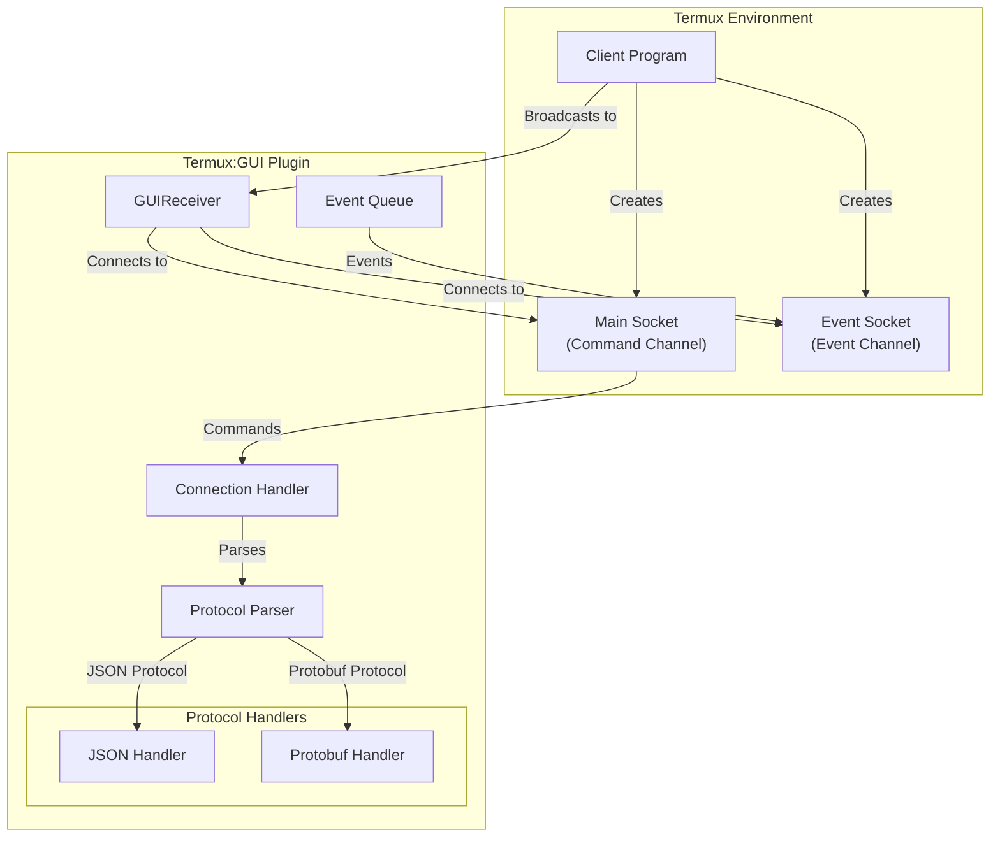
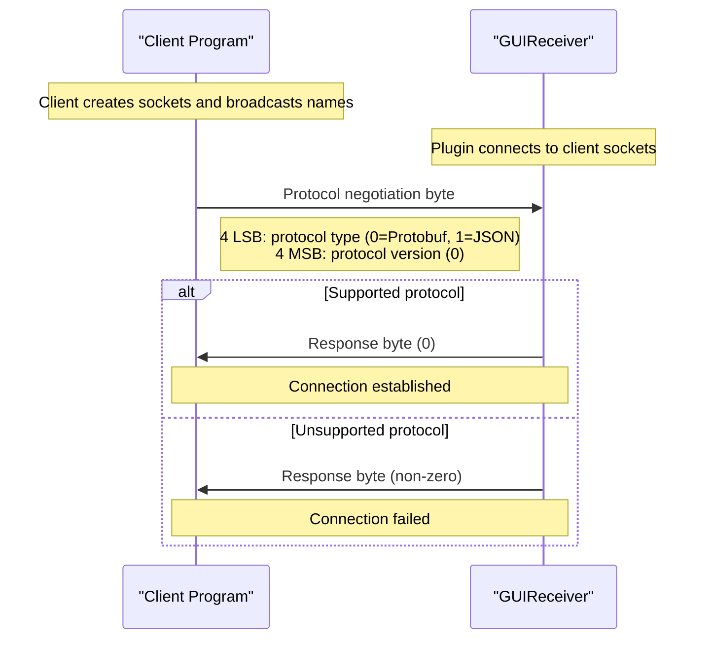
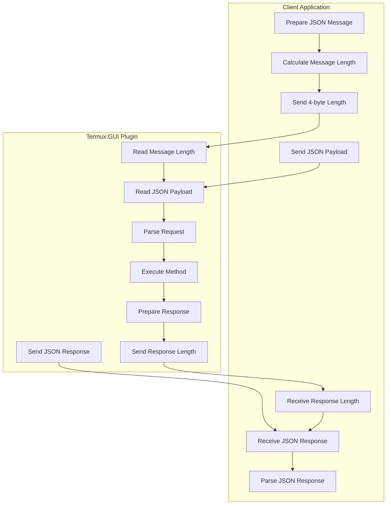
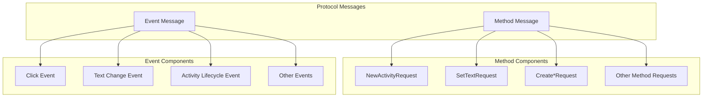
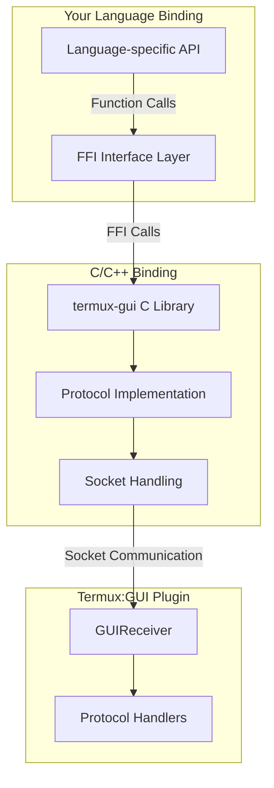
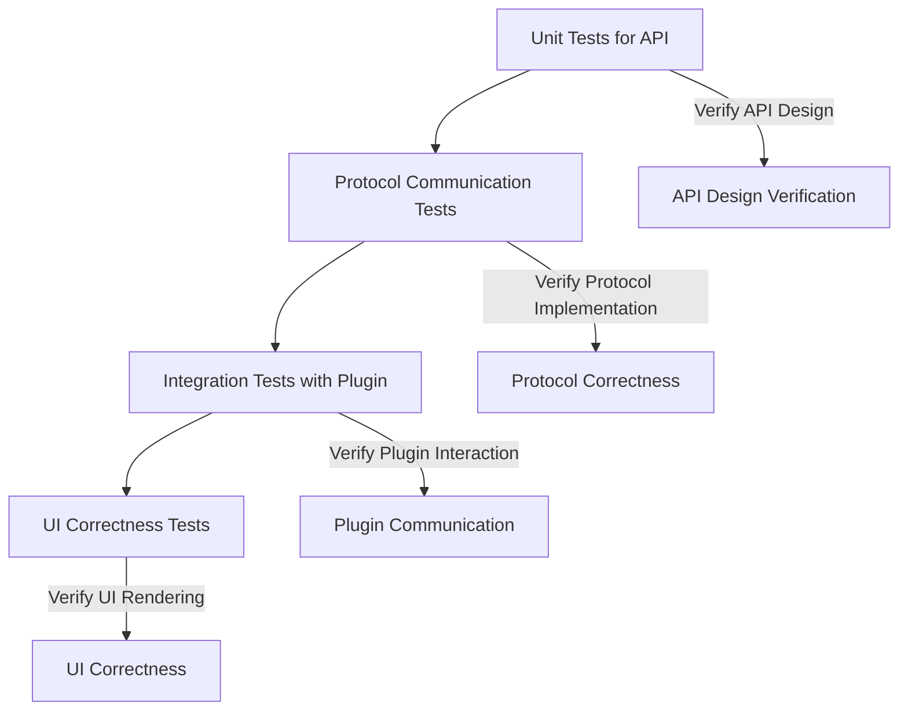

<!-- source: DeepWiki mcp.deepwiki.com · repo termux/termux-gui · page 6.2 Creating Language Bindings · fetched 2026-10-26 -->

# Creating Language Bindings

<details>
<summary>Relevant source files</summary>

The following files were used as context for generating this wiki page:

- [Developing.md](Developing.md)
- [Protocol.md](Protocol.md)
- [README.md](README.md)
- [TODO](TODO)
- [app/src/main/AndroidManifest.xml](app/src/main/AndroidManifest.xml)
- [app/src/main/proto/GUIProt0.proto](app/src/main/proto/GUIProt0.proto)
- [fastlane/metadata/android/en-US/changelogs/8.txt](fastlane/metadata/android/en-US/changelogs/8.txt)

</details>


This page provides a comprehensive guide for developers who want to create language bindings for Termux:GUI. Language bindings enable programs written in various programming languages to communicate with the Termux:GUI plugin, allowing command-line applications to use Android's native GUI components.

For information about existing language bindings and their usage, see the [Protocol Documentation](#2) section. This guide focuses specifically on implementing new language bindings for programming languages not yet supported.

## Overview of Language Bindings

Language bindings for Termux:GUI are libraries that implement the communication protocol between client programs running in Termux and the Termux:GUI plugin. They typically provide an API that abstracts the underlying protocol details, making it easier for developers to build GUI applications.

### Current Available Bindings

Termux:GUI currently has official bindings for:

- Python
- C/C++
- Bash

There is also a community-maintained binding for Rust.

This document will help you implement bindings for additional programming languages.

## Communication Architecture

Before creating a binding, you need to understand how Termux:GUI communicates with client programs.

### Diagram: Termux:GUI Communication Architecture



Sources: [Protocol.md:9-18](), [Developing.md:40-47]()

## Protocol Selection and Negotiation

Termux:GUI supports two protocol types:

1. **JSON Protocol**: Easier to implement in high-level languages with good JSON libraries
2. **Protobuf Protocol**: Better performance, more suited for low-level languages

### Diagram: Protocol Negotiation Process



Sources: [Protocol.md:31-38]()

## Implementing a JSON Protocol Binding

JSON is usually the easier protocol to implement for most languages, especially high-level ones with good JSON support.

### Socket Setup and Connection

To implement a JSON-based binding:

1. Create two AF_UNIX SOCK_STREAM server sockets in the abstract Linux namespace
2. Bind and listen on both sockets
3. Send a broadcast to `com.termux.gui/.GUIReceiver` with socket names
4. Accept connections from the plugin
5. Negotiate the JSON protocol

### Message Format

For the JSON protocol:

1. Each message must be preceded by a 4-byte unsigned big-endian integer representing the message length
2. Messages are JSON objects with a "method" field and parameters

### Diagram: JSON Protocol Message Flow



Sources: [Protocol.md:28-30](), [Protocol.md:39-421]()

### Example Implementation

Here's a pseudocode example for implementing the JSON protocol connection:

```
function initialize_connection(main_socket_name, event_socket_name):
    # Create server sockets
    main_socket = create_abstract_unix_socket()
    event_socket = create_abstract_unix_socket()
    
    # Bind and listen
    bind_and_listen(main_socket, main_socket_name)
    bind_and_listen(event_socket, event_socket_name)
    
    # Send broadcast to plugin
    execute_command("am broadcast --user 0 -n com.termux.gui/.GUIReceiver " +
                   "--es mainSocket " + main_socket_name + 
                   " --es eventSocket " + event_socket_name)
    
    # Accept connections
    main_conn = accept_connection(main_socket)
    event_conn = accept_connection(event_socket)
    
    # Negotiate JSON protocol (first byte: 0x01 for JSON, version 0)
    send_byte(main_conn, 0x01)
    response = receive_byte(main_conn)
    
    if response != 0:
        throw error("Protocol negotiation failed")
    
    return (main_conn, event_conn)
```

## Implementing a Protobuf Protocol Binding

The Protobuf protocol offers better performance and is well-suited for low-level languages. It requires implementing the protocol buffer messages defined in the `.proto` file.

### Protocol Setup

The setup is similar to the JSON protocol, but you negotiate the Protobuf protocol by sending `0x00` as the protocol negotiation byte.

### Message Format

For the Protobuf protocol:

1. Each message is sent with a varint size prefix
2. Messages are serialized protocol buffer messages as defined in `GUIProt0.proto`

### Diagram: Protobuf Protocol Message Structure



Sources: [app/src/main/proto/GUIProt0.proto:34-41](), [app/src/main/proto/GUIProt0.proto:307-1805]()

### Protocol Buffer Message Definition

The Protobuf protocol is defined in `GUIProt0.proto`. The file defines all message types for methods and events. Here's a simplified view of the key message types:

1. `Method` - Contains various request types for methods like creating views, setting properties, etc.
2. `Event` - Contains different types of events like click events, activity events, etc.

Sources: [app/src/main/proto/GUIProt0.proto:11-1834]()

### Example Implementation

Implementing a Protobuf binding requires:

1. Generating code from the `.proto` file using the Protocol Buffers compiler for your language
2. Implementing the socket communication
3. Serializing and deserializing Protobuf messages

```
function send_method(connection, method_message):
    # Serialize the protobuf message
    serialized_data = method_message.serialize()
    
    # Send the size as a varint
    send_varint(connection, len(serialized_data))
    
    # Send the serialized message
    send_data(connection, serialized_data)
    
    # Receive the response size
    response_size = read_varint(connection)
    
    # Receive the response data
    response_data = read_data(connection, response_size)
    
    # Deserialize the response
    return deserialize_response(response_data)
```

## Using FFI to Leverage Existing Bindings

For languages with Foreign Function Interface (FFI) capabilities, you can reuse the existing C/C++ binding.

### Diagram: FFI Integration Architecture



Sources: [Developing.md:40-47]()

### Example FFI Implementation

Here's a pseudocode example of how to use FFI to access the C library:

```
// Load the C library
c_library = load_library("libtermux-gui.so")

// Define function signatures
initialize_function = define_function(c_library, "tgui_initialize", [])
new_activity_function = define_function(c_library, "tgui_new_activity", [connection_handle, task_id])
// Define other functions...

// Use the C library through FFI
connection = initialize_function()
activity_id = new_activity_function(connection, -1)  // -1 for new task
```

## Best Practices for Language Binding Development

When creating a language binding for Termux:GUI, follow these best practices:

### 1. Protocol Selection

- Use the JSON protocol for high-level languages with good JSON support
- Use the Protobuf protocol for performance-critical applications or low-level languages
- Consider FFI to the C library for languages with good FFI support

### 2. API Design

- Follow language-specific idioms and conventions
- Provide a clean, intuitive API that abstracts the protocol details
- Use appropriate error handling mechanisms for the language

### 3. Resource Management

- Properly close sockets when the application exits
- Release any allocated resources (memory, buffers, etc.)
- Implement proper error handling and recovery

### 4. Documentation and Examples

- Document all API functions clearly
- Provide example applications
- Include tutorials for common use cases

## Testing Your Binding

Test your binding with a variety of usage scenarios:

1. Basic UI creation (activities, views)
2. Event handling
3. Advanced features (shared buffers, remote views)
4. Error handling and recovery

### Diagram: Testing Workflow



Sources: [TODO:9-24]()

## Publishing Your Binding

Once you've created a binding:

1. Create a repository for it
2. Document it thoroughly with installation instructions
3. Provide example applications
4. Consider submitting a pull request to add it to the official list of bindings in the Termux:GUI README

## Conclusion

Creating a language binding for Termux:GUI enables programmers to build GUI applications in Termux using their preferred programming language. Whether you choose the JSON protocol for ease of implementation or the Protobuf protocol for performance, this guide provides the foundation for developing robust bindings.

Remember to refer to the existing official bindings as examples:
- Python: https://github.com/tareksander/termux-gui-python-bindings
- C/C++: https://github.com/tareksander/termux-gui-c-bindings
- Bash: https://github.com/tareksander/termux-gui-bash

Sources: [README.md:49-54]()

---

