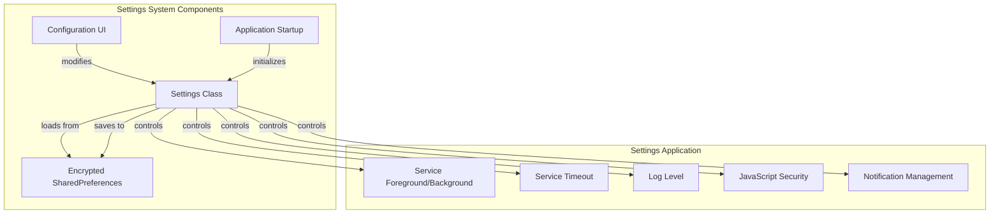
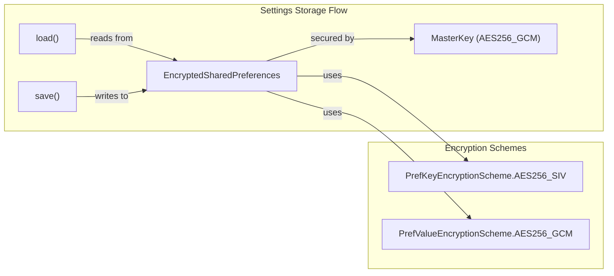
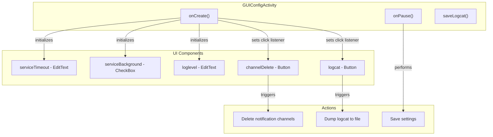
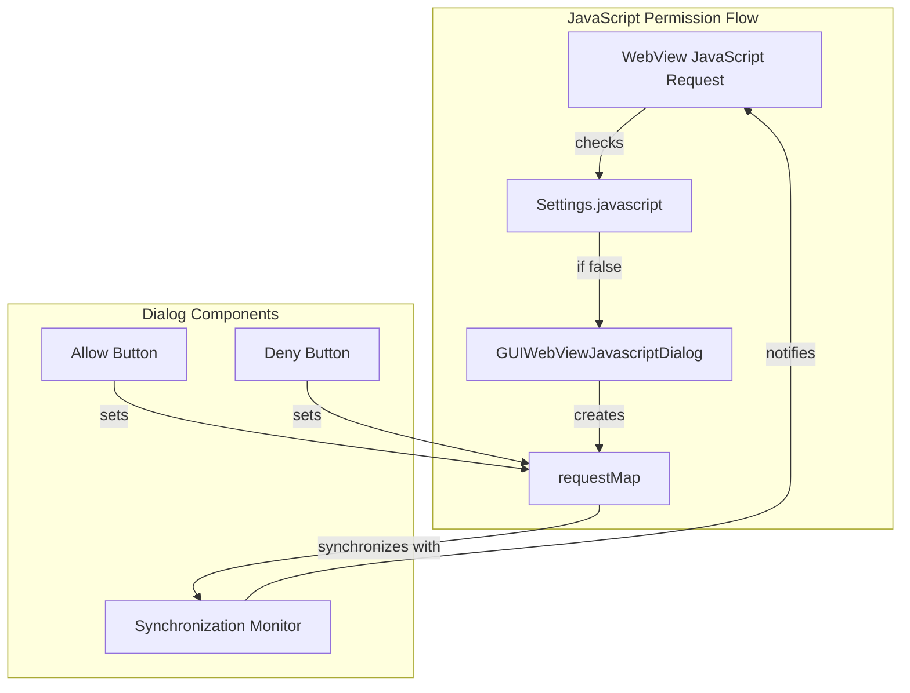

<!-- source: DeepWiki mcp.deepwiki.com · repo termux/termux-gui · page 6.3 Configuration and Settings · fetched 2026-10-26 -->

# Configuration and Settings

Relevant source files

The following files were used as context for generating this wiki page:

- [app/src/main/java/com/termux/gui/App.kt](app/src/main/java/com/termux/gui/App.kt)
- [app/src/main/java/com/termux/gui/GUIConfigActivity.kt](app/src/main/java/com/termux/gui/GUIConfigActivity.kt)
- [app/src/main/java/com/termux/gui/GUIWebViewJavascriptDialog.kt](app/src/main/java/com/termux/gui/GUIWebViewJavascriptDialog.kt)
- [app/src/main/java/com/termux/gui/Settings.kt](app/src/main/java/com/termux/gui/Settings.kt)
- [app/src/main/res/values/strings.xml](app/src/main/res/values/strings.xml)

This document details the configuration and settings system in Termux:GUI. It covers how settings are managed, stored, and accessed throughout the application, as well as the available configuration options provided to both users and developers.

## Overview

Termux:GUI implements a settings management system that handles user preferences related to the plugin's service behavior, logging levels, notification display, and security features. These settings affect how the plugin operates when interfacing between Termux programs and the Android UI layer.

Sources: [app/src/main/java/com/termux/gui/Settings.kt:1-101](), [app/src/main/java/com/termux/gui/GUIConfigActivity.kt:1-101](), [app/src/main/java/com/termux/gui/App.kt:1-33]()

## Available Settings

Termux:GUI provides several configurable settings that control various aspects of the plugin's behavior:

| Setting | Default | Description |
|---------|---------|-------------|
| Service Timeout | 3 seconds | The time the service stays active when there are no connections |
| Background Mode | Disabled | Whether the service hides notifications when no connections are active |
| Log Level | 0 | Controls verbosity of logs (0-5, with higher values providing more detail) |
| JavaScript | Disabled | Whether JavaScript execution is allowed in WebViews without a prompt |

### Service Timeout

The service timeout setting controls how long the Termux:GUI service remains active after the last client disconnects. A longer timeout reduces the startup delay when a program wants to connect shortly after another has disconnected. Setting this value to negative makes the service stay active indefinitely.

### Background Mode

When enabled, this setting allows the service to operate in the background without showing a notification when there are no active connections. This is particularly useful when combined with a negative timeout value, keeping the service always ready without visual indicators.

### Log Level

The log level controls the verbosity of information available in logcat. Higher values provide progressively more debugging information, up to level 5.

### JavaScript Security

This setting determines whether JavaScript execution requests in WebViews are automatically allowed or require user confirmation via a dialog. This is a security feature to prevent potential data leakage between programs.

Sources: [app/src/main/java/com/termux/gui/Settings.kt:28-46](), [app/src/main/res/values/strings.xml:14-24]()

## Settings Storage

Termux:GUI uses Android's EncryptedSharedPreferences to securely store settings data. This provides encryption for both the setting keys and values.

The `Settings` class is implemented as a singleton that manages the loading and saving of preferences:

1. Settings are loaded on application startup in `App.onCreate()`
2. Changes are saved when the settings activity is paused
3. If secure storage can't be established, default values are used

Sources: [app/src/main/java/com/termux/gui/Settings.kt:49-96](), [app/src/main/java/com/termux/gui/App.kt:16-20]()

## Configuration UI

The configuration interface is implemented in `GUIConfigActivity`, which provides a user-friendly way to modify settings.

The activity provides options to:

1. Configure service timeout through a text input
2. Toggle background mode with a checkbox
3. Set log level through a text input
4. Delete notification channels (for Android 8.0+)
5. Dump the current logcat to a file

When the activity is paused (e.g., when navigating away), it automatically saves the current settings values.

Sources: [app/src/main/java/com/termux/gui/GUIConfigActivity.kt:29-98](), [app/src/main/res/values/strings.xml:11-25]()

## JavaScript Security Dialog

A special security feature is the JavaScript permission dialog. When a WebView component requests JavaScript execution and automatic approval is not enabled in settings, the system shows a confirmation dialog to the user.

The dialog implementation uses:

1. A static `requestMap` to store pending JavaScript requests
2. Monitor objects for thread synchronization
3. UI components to allow or deny execution

This security feature helps prevent potential data leakage between programs using the plugin, requiring explicit user consent for JavaScript execution unless auto-approval is enabled in settings.

Sources: [app/src/main/java/com/termux/gui/GUIWebViewJavascriptDialog.kt:1-79](), [app/src/main/java/com/termux/gui/Settings.kt:22-46]()

## Integration with Service Management

The settings directly influence how the Termux:GUI service operates:

1. The timeout setting determines how long the service stays active without connections
2. The background mode setting controls whether the service shows a notification
3. Log level settings affect the detail of debug information available in logcat

These settings provide a balance between:
- Responsiveness (longer timeouts = faster reconnection)
- Battery usage (background mode and timeouts affect power consumption)
- Debug capabilities (log levels provide varying degrees of visibility)

## Notification Channel Management

For Android 8.0 and above, Termux:GUI provides management of notification channels. The settings UI includes an option to delete all notification channels, which can be useful if many unused channels accumulate over time.

This functionality is conditionally displayed based on the Android version, as notification channels were introduced in API level 26 (Android 8.0).

Sources: [app/src/main/java/com/termux/gui/GUIConfigActivity.kt:44-56](), [app/src/main/res/values/strings.xml:17-18]()

## Logcat Support

To assist with debugging, the settings interface provides functionality to:

1. Dump the current logcat output to a file
2. Clear the logcat buffer after dumping

This feature uses the system's `logcat` command, executed through a `ProcessBuilder`. The output is saved to a user-selected file location.

Sources: [app/src/main/java/com/termux/gui/GUIConfigActivity.kt:58-82](), [app/src/main/res/values/strings.xml:24-25]()

## Technical Implementation

The settings system is designed with several key technical considerations:

1. **Security**: Uses encrypted storage for settings values
2. **Singleton Pattern**: Single `Settings` instance accessible throughout the app
3. **Default Values**: Fallback values defined as constants
4. **Persistence**: Settings are automatically saved when modified
5. **Graceful Degradation**: Handles errors in security initialization

The implementation follows Android best practices for settings management while providing additional security through encryption.

Sources: [app/src/main/java/com/termux/gui/Settings.kt:13-101]()

---

