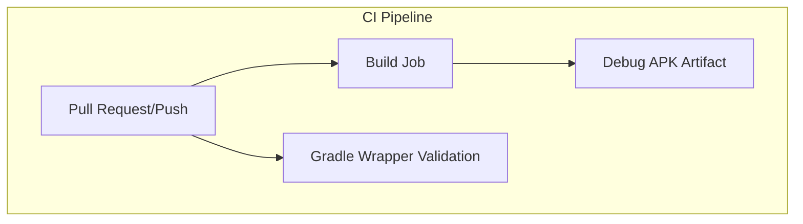
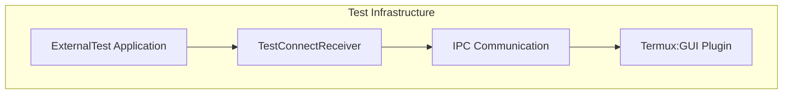
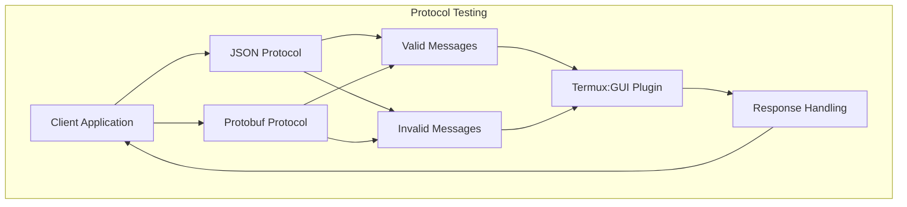
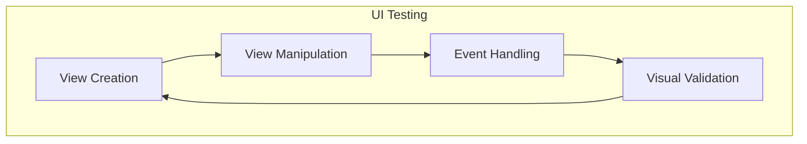
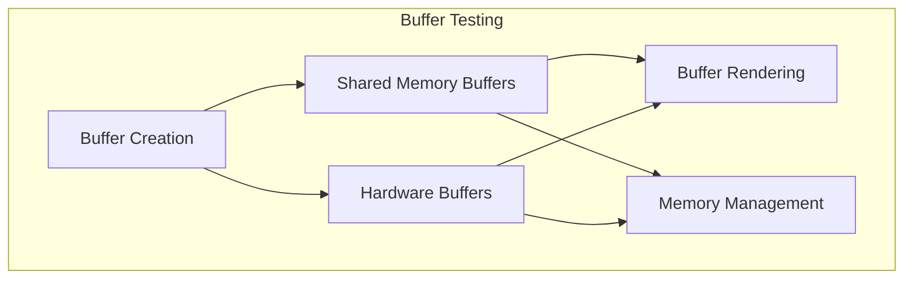

<!-- source: DeepWiki mcp.deepwiki.com · repo termux/termux-gui · page 6.4 Testing · fetched 2026-10-26 -->

# Testing

Relevant source files

The following files were used as context for generating this wiki page:

- [.github/workflows/build.yml](.github/workflows/build.yml)
- [.github/workflows/gradle-wrapper-validation.yml](.github/workflows/gradle-wrapper-validation.yml)
- [externaltest/build.gradle](externaltest/build.gradle)
- [externaltest/src/main/AndroidManifest.xml](externaltest/src/main/AndroidManifest.xml)
- [hbuffers/src/main/AndroidManifest.xml](hbuffers/src/main/AndroidManifest.xml)

This document outlines the testing procedures and infrastructure for the Termux:GUI plugin. It covers both internal testing methodologies used for development as well as guidance for developers creating applications with Termux:GUI. For information about general development and building Termux:GUI, see [Building Termux:GUI](#6.1).

## Testing Infrastructure

Termux:GUI employs several testing mechanisms to ensure stability and functionality across the various components of the system.

### Continuous Integration

Termux:GUI uses GitHub Actions for continuous integration to automatically build and validate the project on code changes.

Sources: [.github/workflows/build.yml](), [.github/workflows/gradle-wrapper-validation.yml]()

The CI pipeline automatically builds the application using the command `./gradlew assembleDebugMinify` and produces a debug APK that can be used for testing. This ensures that every change to the codebase results in a buildable application.

### External Test Application

Termux:GUI includes an external test application specifically designed to test integration points and communication between other Android applications and the Termux:GUI plugin.

Sources: [externaltest/build.gradle](), [externaltest/src/main/AndroidManifest.xml]()

The external test application provides a BroadcastReceiver (`TestConnectReceiver`) that can be used to test the connection and communication protocols between applications and the Termux:GUI plugin.

## Testing Components

When testing Termux:GUI implementations, it's important to test each major system component individually as well as the integration between components.

### Protocol Testing

The communication protocol is a critical component that should be thoroughly tested to ensure reliable operation.

When testing protocol implementations, consider:

1. **Valid message handling**: Test that correctly formatted messages produce the expected outcomes
2. **Error handling**: Test how the system responds to malformed or invalid messages
3. **Protocol version compatibility**: Test against different versions of the protocol
4. **Edge cases**: Test with boundary values, empty values, and extremely large payloads

### UI Component Testing

Testing UI components requires validating both the creation and manipulation of Android views as well as the event handling system.

For each UI component, test:

1. **Creation**: Test that views are created with the correct properties
2. **Manipulation**: Test property changes (visibility, text, dimensions, etc.)
3. **Hierarchy**: Test parent-child relationships between views
4. **Events**: Test that user interactions generate the expected events
5. **Visual appearance**: Test that views are displayed correctly

### Buffer System Testing

The buffer system requires special testing considerations due to its use of shared memory and hardware acceleration.

When testing buffer implementations:

1. **Buffer creation**: Test creating buffers of various sizes
2. **Data transfer**: Test writing to and reading from buffers
3. **Rendering**: Test that buffer contents are correctly displayed
4. **Memory management**: Test proper cleanup and resource release
5. **Performance**: Test rendering performance, especially for hardware buffers

## Testing Approaches

### Unit Testing

Unit testing focuses on testing individual components in isolation. For Termux:GUI clients, this would involve testing your application's buffer handling logic, message creation, and event processing separately from the actual IPC communication.

| Component | Testing Focus |
|-----------|---------------|
| Protocol messages | Message construction, serialization, deserialization |
| View management | Logic for tracking and updating views |
| Event handling | Processing of incoming events |
| Buffer manipulation | Image processing, buffer data handling |

### Integration Testing

Integration testing verifies that components work together correctly. For Termux:GUI applications, this involves testing the interaction between your application and the Termux:GUI plugin.

| Integration Point | Testing Focus |
|-------------------|---------------|
| Connection establishment | Successful connection to the plugin |
| Protocol communication | End-to-end message exchange |
| View lifecycle | Creation, update, and destruction of views |
| Event processing | Generation and handling of user interaction events |

### End-to-End Testing

End-to-end testing validates complete user workflows. For Termux:GUI applications, this means testing entire features from user input through to visual output.

| Workflow | Testing Steps |
|----------|---------------|
| UI interaction | User input → Event generation → Application logic → UI update |
| Buffer rendering | Image creation → Buffer transfer → Rendering → Visual verification |
| Activity management | Activity creation → Lifecycle events → Activity destruction |

## Testing Tools

### Manual Testing

For manual testing, use the provided debug APK from the CI pipeline or build the plugin locally. Install it on a test device and use your client application to interact with it.

### Automated Testing

For automated testing, consider:

1. **JUnit and Android Testing Framework**: For unit and integration testing
2. **UI Automator**: For end-to-end testing of Android applications
3. **Espresso**: For UI testing within a single application
4. **Custom test harnesses**: For specific protocol and buffer testing needs

## Troubleshooting

When encountering issues during testing, follow these steps:

1. **Check logs**: Use `logcat` to view system logs for communication errors
2. **Verify protocol messages**: Validate that messages are correctly formatted
3. **Check view IDs**: Ensure view IDs are unique and correctly referenced
4. **Test with simplified cases**: Reduce complexity to isolate issues
5. **Verify buffer management**: Ensure proper memory allocation and cleanup

## Best Practices

1. **Test incrementally**: Start with basic functionality before testing complex features
2. **Test across devices**: Test on different Android versions and device types
3. **Test edge cases**: Include error conditions and boundary values
4. **Automate regression tests**: Create automated tests for critical functionality
5. **Test performance**: Monitor memory usage and UI responsiveness
6. **Test interoperability**: If using multiple languages/bindings, test cross-language interaction

By following these testing approaches and best practices, developers can ensure robust and reliable implementation of applications using the Termux:GUI plugin.