# Page: Overview

# Overview

<details>
<summary>Relevant source files</summary>

The following files were used as context for generating this wiki page:

- [Developing.md](Developing.md)
- [Protocol.md](Protocol.md)
- [README.md](README.md)
- [TODO](TODO)
- [app/mapping.txt](app/mapping.txt)
- [app/proguard-rules.pro](app/proguard-rules.pro)
- [app/seeds.txt](app/seeds.txt)
- [app/src/main/AndroidManifest.xml](app/src/main/AndroidManifest.xml)
- [app/usage.txt](app/usage.txt)
- [fastlane/metadata/android/en-US/changelogs/8.txt](fastlane/metadata/android/en-US/changelogs/8.txt)

</details>


Termux:GUI is a plugin for Termux that enables command-line programs to use the native Android GUI elements. This documentation introduces the Termux:GUI system architecture, key components, and communication protocols that allow terminal programs to create and interact with graphical user interfaces.

For specific installation instructions, see [Installation](#1.1), and for a more detailed architecture breakdown, see [Architecture Overview](#1.2).

## System Architecture

Termux:GUI follows a client-server architecture where Termux programs (clients) communicate with the GUI plugin (server) through Unix sockets using a defined protocol. The system is composed of several core components that work together to enable terminal programs to create and manage Android UI elements.

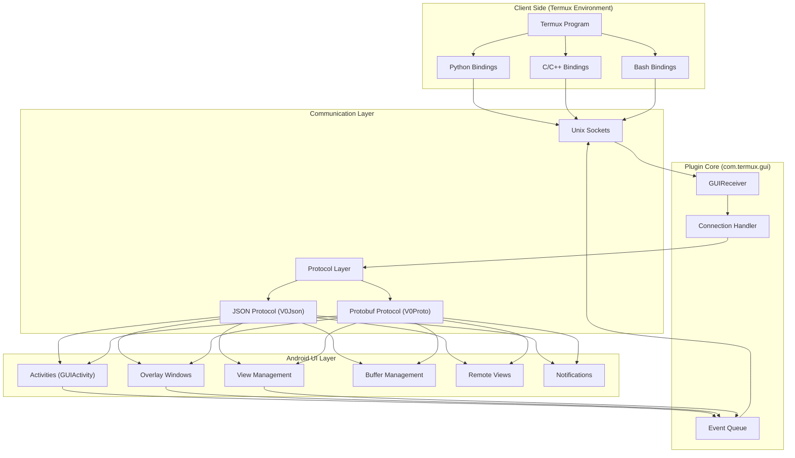

Sources: [README.md:6-11](), [Protocol.md:9-19](), [app/src/main/AndroidManifest.xml:21-108]()

## Connection Process

The Termux:GUI system uses Unix sockets for bidirectional communication between Termux programs and the Android GUI plugin. Here's how the connection is established:

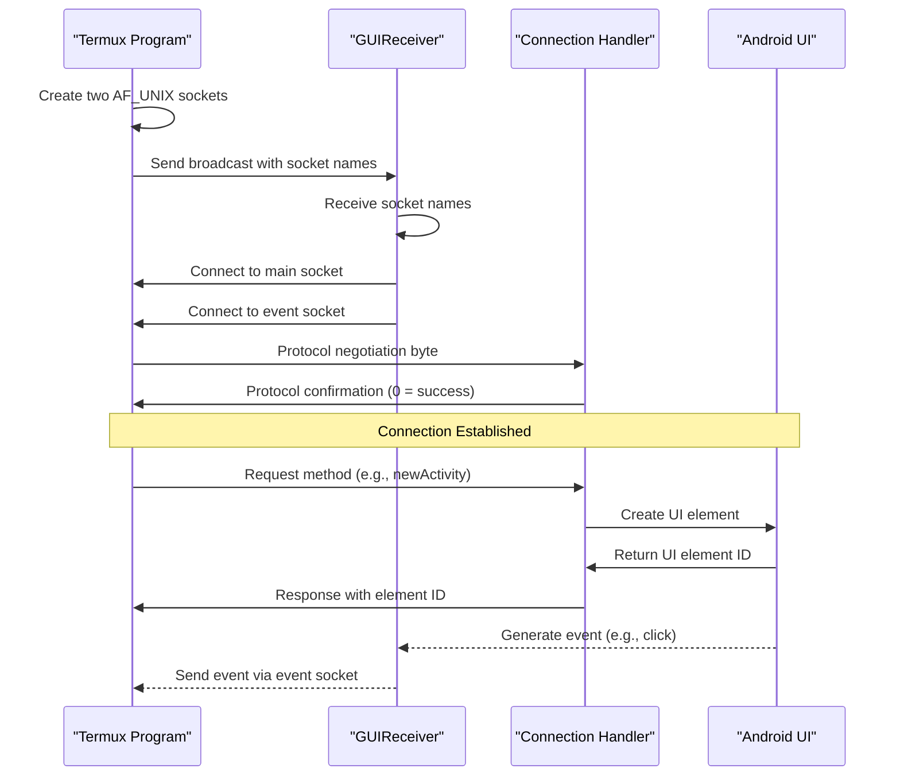

Sources: [Protocol.md:9-43]()

## Key Components

### Client-Side Libraries

Termux:GUI provides official language bindings to make it easy for different programming languages to use the plugin:

| Language | Repository | Description |
|----------|------------|-------------|
| Python   | termux-gui-python-bindings | Object-oriented API for Python programs |
| C/C++    | termux-gui-c-bindings | C library with low-level access to protocol |
| Bash     | termux-gui-bash | Bash script helpers for GUI creation |

Community-maintained bindings are also available for languages like Rust.

Sources: [README.md:47-60]()

### Plugin Core Components

The core of the Termux:GUI plugin consists of several key components that handle connections and manage the Android UI elements:

1. **GUIReceiver**: Receives connection broadcasts from Termux programs and establishes socket connections
2. **Connection Handler**: Handles protocol messages and routes them to appropriate handlers
3. **Protocol Handlers**: Process specific protocol methods to create and manipulate UI elements
4. **Event System**: Captures UI events and sends them back to the client program

Sources: [app/src/main/AndroidManifest.xml:101-104]()

### Android UI Components

Termux:GUI leverages several Android components to create and display UI elements:

1. **Activities**: Standard Android screen containers that can display UI elements
   - GUIActivity: Regular fullscreen activity
   - GUIActivityDialog: Dialog-style floating activity
   - GUIActivityLockscreen: Activity that can appear on the lockscreen

2. **Views**: UI elements like buttons, text fields, and layouts that can be arranged in a hierarchy

3. **Overlays**: Windows that can be displayed on top of other applications

4. **Buffers**: Shared memory areas for efficient image rendering

5. **Remote Views**: Used for homescreen widgets and custom notifications

Sources: [app/src/main/AndroidManifest.xml:66-89](), [Protocol.md:146-421](), [Protocol.md:436-514]()

## Protocol System

Termux:GUI supports two protocol types for communication between client programs and the plugin:

1. **JSON Protocol**: Text-based protocol using JSON for data serialization
   - Easier to implement in high-level languages
   - Implemented in `V0Json` class

2. **Protobuf Protocol**: Binary protocol using Protocol Buffers
   - Higher throughput and better performance
   - Better for low-level languages
   - Implemented in `V0Proto` class

Both protocols support the same set of methods for creating and manipulating UI elements.

Sources: [Protocol.md:20-43]()

## Feature Categories

Termux:GUI provides several categories of features that allow terminal programs to create rich, interactive user interfaces:

### Activity and Task Management

Methods for creating and controlling Android Activities and Tasks:
- Create standard, dialog, or lockscreen activities
- Picture-in-Picture mode support
- Task management (bring to front, move to back)
- Orientation and theme control

Sources: [Protocol.md:46-145]()

### UI Components

A wide range of UI components can be created and manipulated:
- Layouts (LinearLayout, FrameLayout, GridLayout)
- Basic controls (Button, TextView, EditText)
- Input controls (Checkbox, RadioButton, Switch)
- Advanced components (TabLayout, WebView, ScrollView)

Sources: [Protocol.md:146-421](), [README.md:19-31]()

### Buffer System

The buffer system allows efficient image rendering through shared memory:
- Shared memory buffers for standard images
- Hardware-accelerated buffers for high-performance graphics
- Support for different Android API levels

Sources: [Protocol.md:327-347](), [TODO:12-24]()

### Advanced Features

Additional features extend the functionality:
- Custom notifications with actions
- Homescreen widgets
- WebView for embedded web content
- Overlay windows that can appear above other apps

Sources: [Protocol.md:365-421](), [Protocol.md:436-545](), [README.md:19-31]()

## Event System

Termux:GUI includes a comprehensive event system that allows client programs to receive and respond to user interactions and system events:

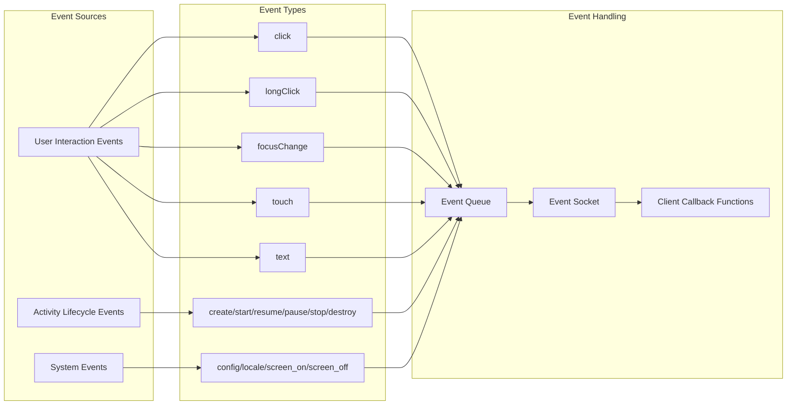

Sources: [Protocol.md:551-621]()

## Permissions and Requirements

Termux:GUI requires several Android permissions to function properly:

- **SYSTEM_ALERT_WINDOW**: Required for overlay windows
- **FOREGROUND_SERVICE**: Allows the service to run in the background
- **WAKE_LOCK**: Used to turn on the display
- **POST_NOTIFICATIONS**: Required for notifications on Android 13+

The plugin also declares a requirement for OpenGL ES 2.0 for hardware-accelerated graphics features.

Sources: [app/src/main/AndroidManifest.xml:5-19]()

## Conclusion

Termux:GUI provides a powerful bridge between command-line programs and native Android GUI capabilities. Through its client-server architecture and flexible protocol system, it enables developers to create rich graphical interfaces for Termux applications while maintaining the benefits of command-line programming.

For more detailed information about specific aspects of Termux:GUI, refer to the other sections of this documentation.

---

# Page: Installation

# Installation

<details>
<summary>Relevant source files</summary>

The following files were used as context for generating this wiki page:

- [Developing.md](Developing.md)
- [README.md](README.md)
- [app/src/main/AndroidManifest.xml](app/src/main/AndroidManifest.xml)
- [fastlane/metadata/android/en-US/changelogs/6.txt](fastlane/metadata/android/en-US/changelogs/6.txt)
- [fastlane/metadata/android/en-US/changelogs/7.txt](fastlane/metadata/android/en-US/changelogs/7.txt)
- [fastlane/metadata/android/en-US/changelogs/8.txt](fastlane/metadata/android/en-US/changelogs/8.txt)
- [fastlane/metadata/android/en-US/full_description.txt](fastlane/metadata/android/en-US/full_description.txt)

</details>


This page provides instructions for installing and setting up the Termux:GUI plugin, which enables Termux command-line programs to create native Android GUI interfaces. For information about the overall architecture and system design, see [Architecture Overview](#1.2).

## Installation Methods

Termux:GUI can be installed through two primary methods:

### F-Droid Installation
The recommended installation method is through F-Droid, which ensures you receive stable updates.

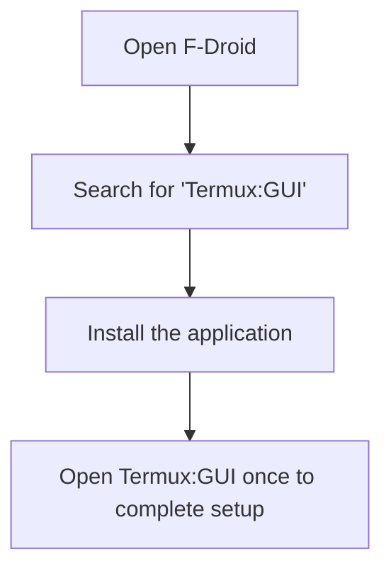

### GitHub Releases Installation
Alternatively, you can download the APK from the GitHub releases page if you prefer the latest development versions.

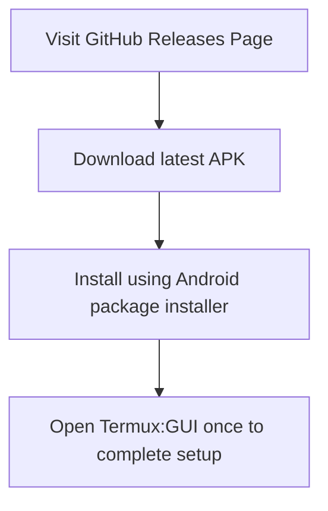

Sources: [README.md:12-13]()

## System Requirements

Termux:GUI requires the following:

1. A working installation of the Termux application
2. Android OS (no specific minimum version is mentioned, but newer versions will have more features)

The plugin requires several Android permissions to function properly:

| Permission | Purpose |
|------------|---------|
| `FOREGROUND_SERVICE` | Keeps the app running even when no client has visible activities |
| `SYSTEM_ALERT_WINDOW` | Required for overlay windows functionality |
| `WAKE_LOCK` | Used to turn on the device display when needed |
| `POST_NOTIFICATIONS` | Used for custom notifications (Android 13+) |

Sources: [app/src/main/AndroidManifest.xml:12-19]()

## Post-Installation Setup

After installing Termux:GUI, additional setup steps are necessary to enable full functionality:

### Required Permissions

To use overlay windows or to open windows from the background, follow these steps:

1. Go to Android Settings → Apps → Termux:GUI
2. Open the Advanced section
3. Enable "Display over other apps" permission

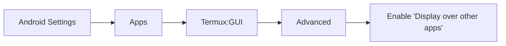

Sources: [README.md:15]()

## System Integration

The following diagram illustrates how Termux:GUI integrates with Termux and the Android system:

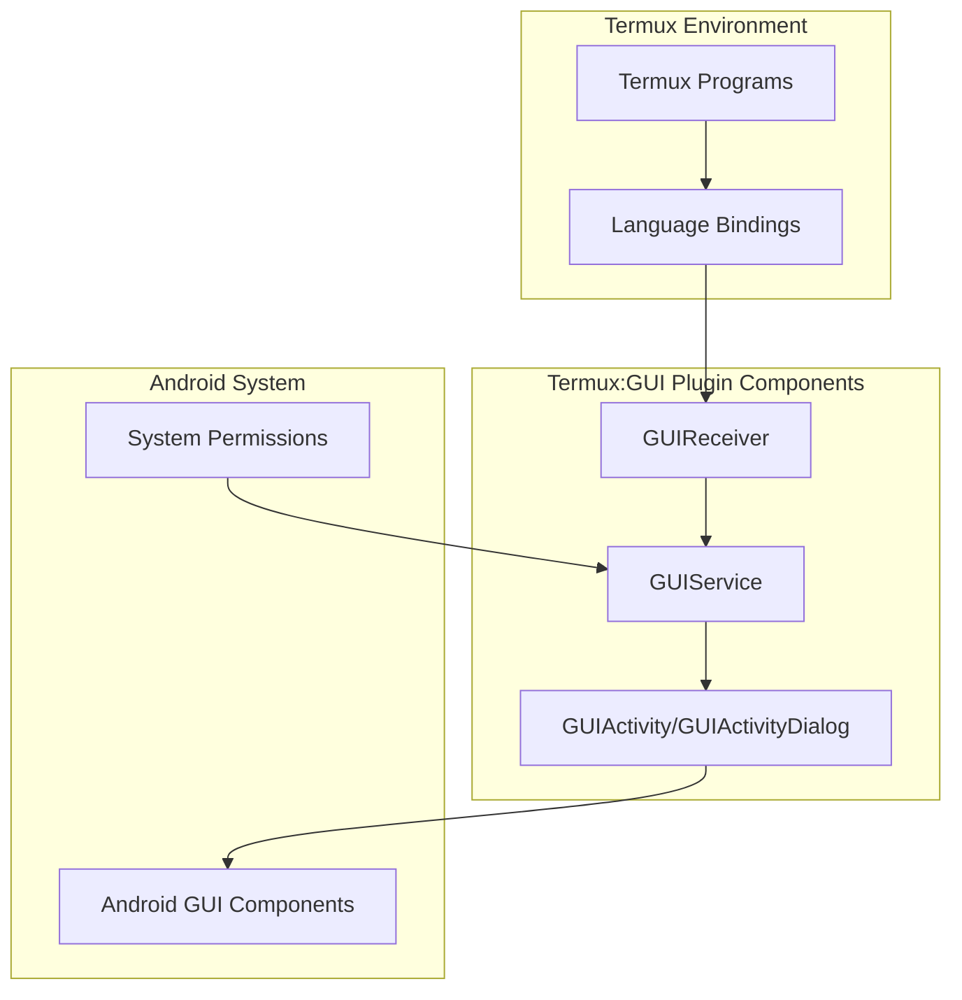

Sources: [app/src/main/AndroidManifest.xml:37-104](), [README.md:7-8]()

## Installing Language Bindings

To use Termux:GUI effectively, you'll need to install language bindings for your preferred programming language:

### Official Bindings

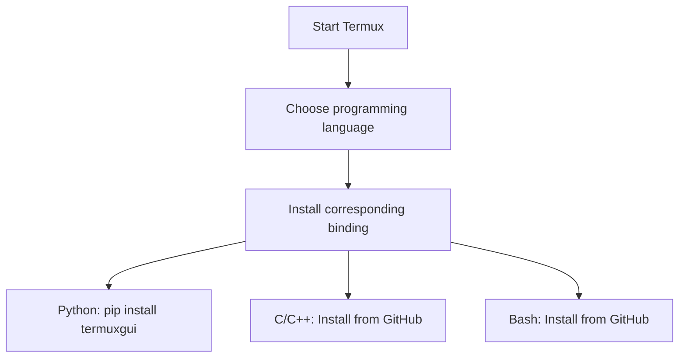

#### Python Bindings
Install using pip:
```
pip install termuxgui
```

#### C/C++ Bindings
Clone and build from GitHub:
```
git clone https://github.com/tareksander/termux-gui-c-bindings
cd termux-gui-c-bindings
./configure
make
make install
```

#### Bash Bindings
Clone from GitHub:
```
git clone https://github.com/tareksander/termux-gui-bash
```

### Community Bindings

There are also community-maintained bindings:

- Rust: https://github.com/sweetkitty13/tgui-rs

Sources: [README.md:47-60]()

## Verifying Installation

To verify that Termux:GUI is properly installed and working:

1. Install one of the language bindings (Python recommended for beginners)
2. Run a simple test program to create a basic UI

### Example Test (Python)
```python
from termuxgui import Connection, Activity, Button

conn = Connection()
activity = Activity(conn)
button = Button(conn, activity, "Hello Termux:GUI!")
activity.wait_for_finish()
```

If a window appears with a button displaying "Hello Termux:GUI!", your installation is working correctly.

## Prepackaged Applications

For users who want to quickly try Termux:GUI without writing code, there are prepackaged programs available:

```
pkg install termux-gui-package
```

This package contains a collection of small programs that demonstrate Termux:GUI capabilities.

Sources: [README.md:11](), [fastlane/metadata/android/en-US/full_description.txt:17-19]()

## Troubleshooting

If you encounter issues with installation:

1. Ensure Termux is up to date
2. Check that all required permissions are granted
3. Try reinstalling both Termux:GUI and the language bindings
4. Verify that Unix sockets are working properly in your Termux installation

Sources: [README.md:13](), [Developing.md:39-46]()

---

# Page: Architecture Overview

# Architecture Overview

<details>
<summary>Relevant source files</summary>

The following files were used as context for generating this wiki page:

- [Developing.md](Developing.md)
- [README.md](README.md)
- [app/src/main/AndroidManifest.xml](app/src/main/AndroidManifest.xml)
- [app/src/main/java/com/termux/gui/ConnectionHandler.kt](app/src/main/java/com/termux/gui/ConnectionHandler.kt)
- [app/src/main/java/com/termux/gui/GUIActivity.kt](app/src/main/java/com/termux/gui/GUIActivity.kt)
- [app/src/main/java/com/termux/gui/protocol/protobuf/v0/V0Proto.kt](app/src/main/java/com/termux/gui/protocol/protobuf/v0/V0Proto.kt)
- [fastlane/metadata/android/en-US/changelogs/8.txt](fastlane/metadata/android/en-US/changelogs/8.txt)

</details>


This page provides a comprehensive explanation of the Termux:GUI system architecture, detailing how the plugin enables command-line programs to create and interact with native Android UI components. For information about installation, see [Installation](#1.1), and for protocol-specific details, see [Protocol Documentation](#2).

## System Overview

Termux:GUI is built on a client-server architecture that bridges Terminal programs with Android's UI framework. The system enables text-based programs to create fully native Android UI components without requiring the complexity of building a complete Android application.

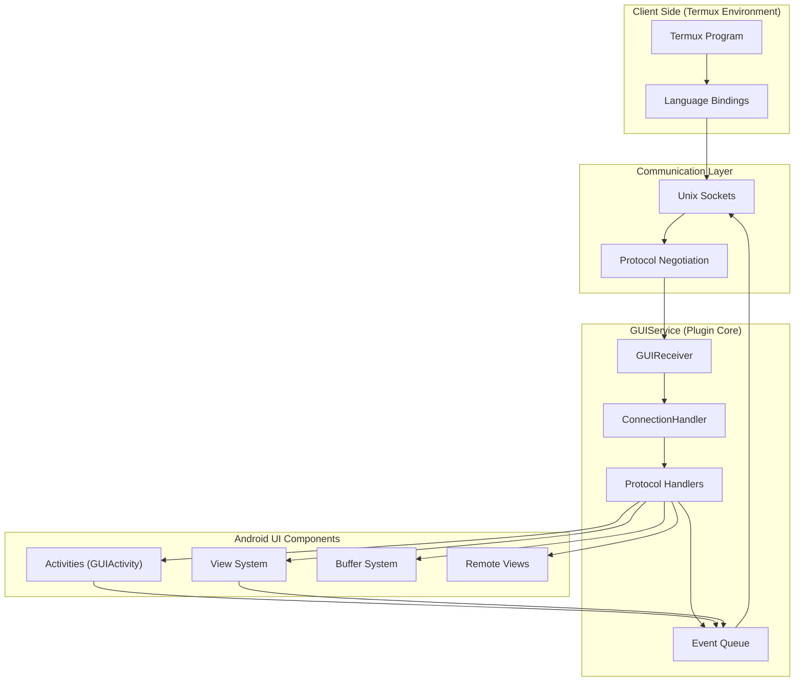

Sources: [README.md:7-11](), [ConnectionHandler.kt:20-25](), [AndroidManifest.xml:95-104]()

## Core Components

### Communication Layer

Termux:GUI uses Unix domain sockets for Inter-Process Communication (IPC) between Termux programs and the plugin. This communication happens through two socket connections:

1. **Main Socket**: Used for sending commands from client to plugin
2. **Event Socket**: Used for sending events from plugin back to client

The `ConnectionHandler` authenticates connections by verifying they originate from the Termux application and negotiates which protocol to use.

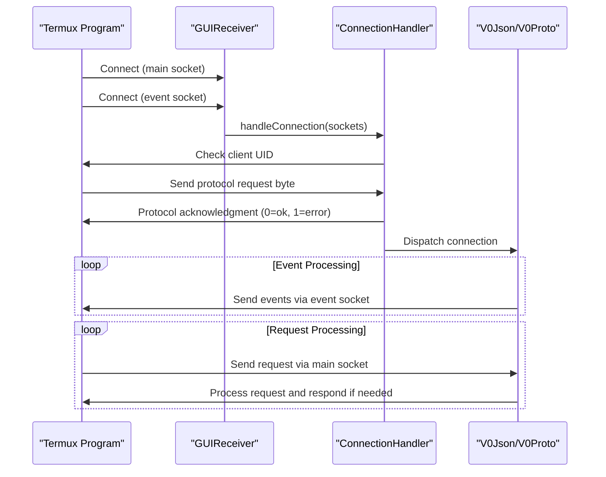

Sources: [ConnectionHandler.kt:53-149]()

### Protocol Handlers

The plugin supports two protocol types:

1. **JSON Protocol** (type=1): Human-readable format, easier for debugging
2. **Protobuf Protocol** (type=0): Binary format, more efficient

The protocol version is specified in the protocol negotiation byte:
- High 4 bits: protocol version (currently only version 0)
- Low 4 bits: protocol type (0=Protobuf, 1=JSON)

Both protocol implementations share common functionality through the base class `V0Shared`, with protocol-specific implementations in `V0Proto` and `V0Json`.

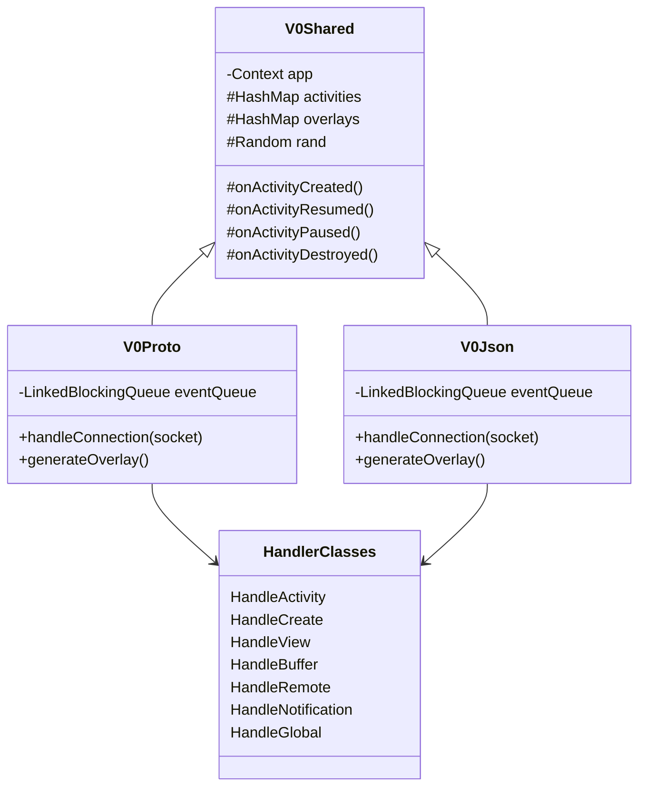

Sources: [V0Proto.kt:28-43](), [ConnectionHandler.kt:94-148]()

### Request Processing

When a client sends a request, the plugin processes it through specialized handler classes:

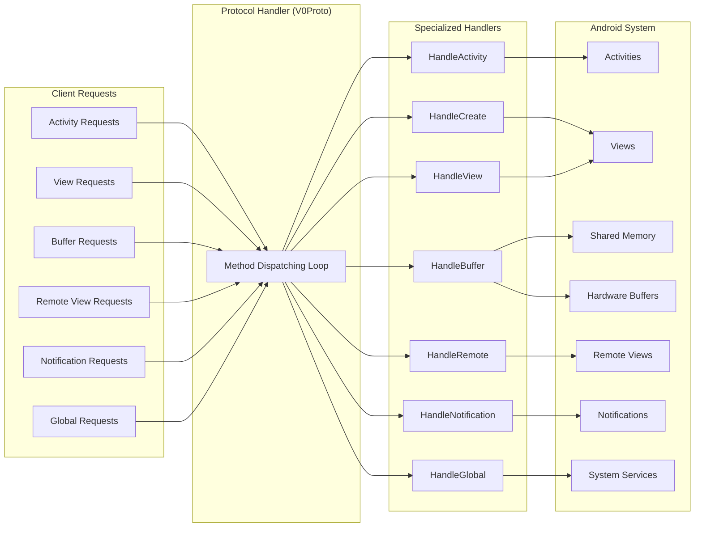

Sources: [V0Proto.kt:50-206]()

## Event System

Events flow from Android UI components back to client applications through an event queue:

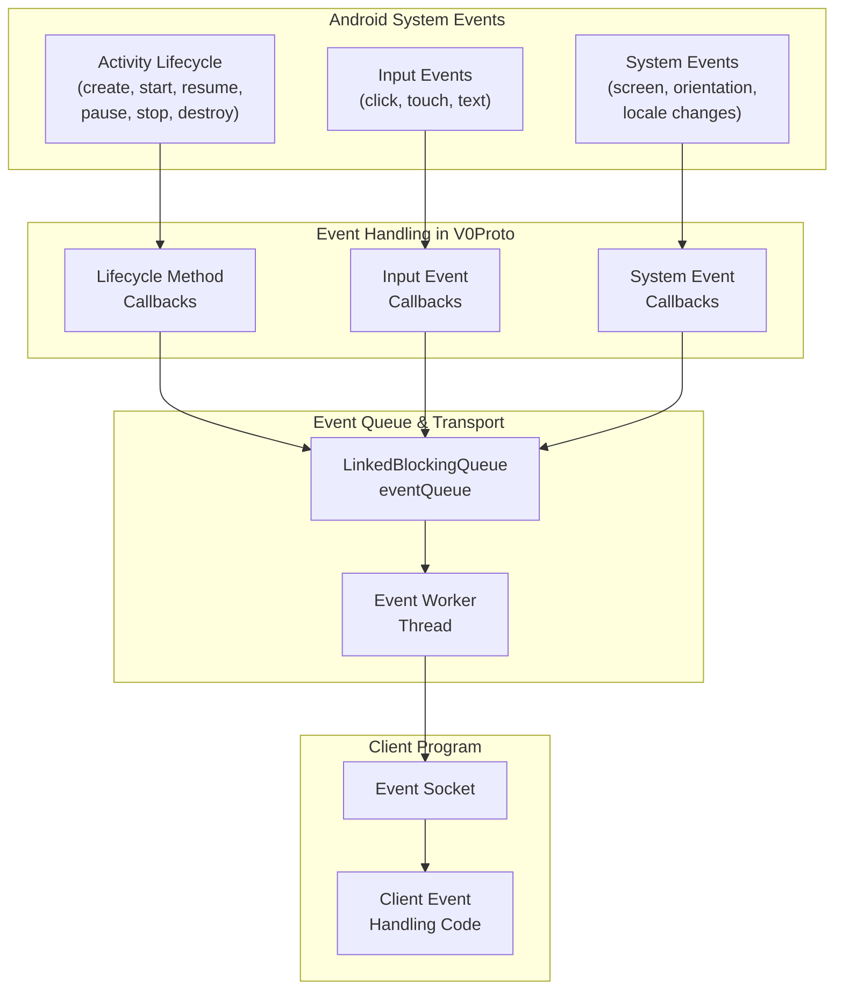

Sources: [V0Proto.kt:208-318](), [ConnectionHandler.kt:114-134]()

## Activity Management

Termux:GUI provides several types of activities to serve different UI needs:

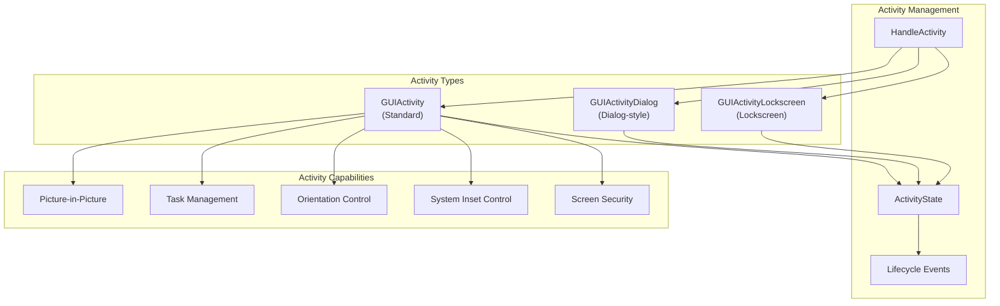

Sources: [GUIActivity.kt:22-237](), [AndroidManifest.xml:67-93]()

## View System

Views are the UI components displayed within activities. Termux:GUI supports a wide range of Android view types:

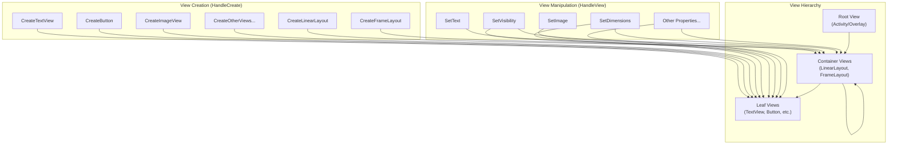

Sources: [V0Proto.kt:101-121](), [V0Proto.kt:123-162]()

## Buffer System

The buffer system provides efficient image rendering through shared memory:

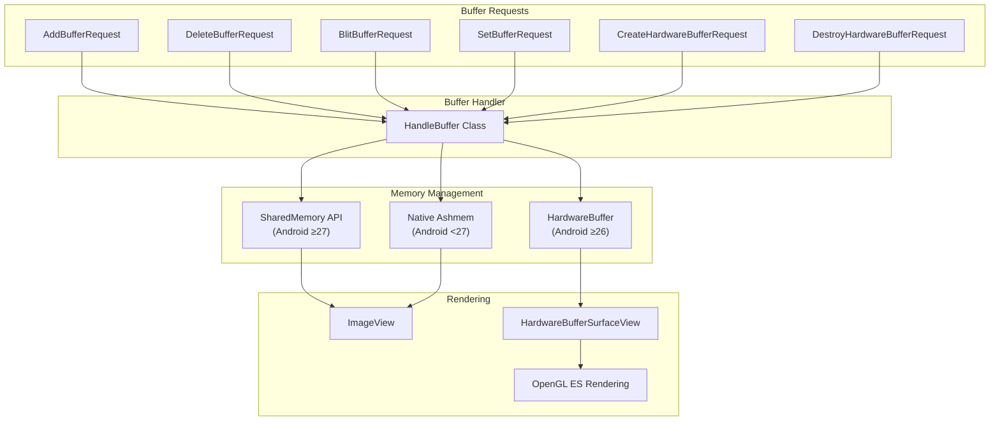

Sources: [ConnectionHandler.kt:39-44](), [V0Proto.kt:149-161]()

## Advanced Features

### Overlay Windows

Termux:GUI supports creating overlay windows that can float above other applications:

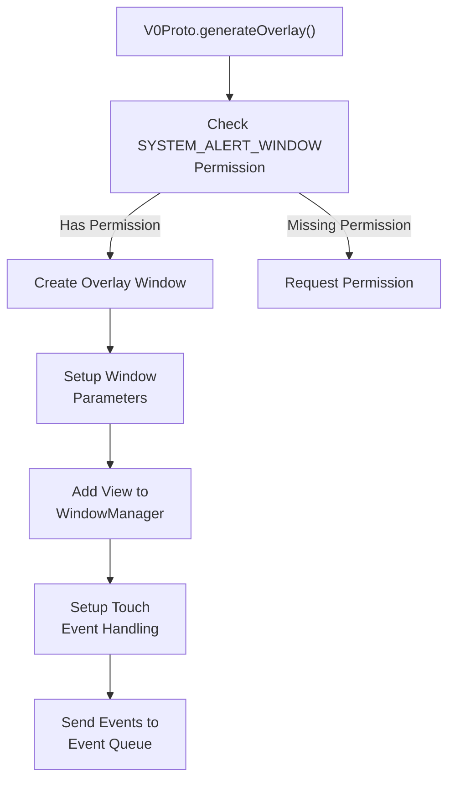

Sources: [V0Proto.kt:321-415](), [AndroidManifest.xml:15]()

### Remote Views and Widgets

Remote views allow creating Android home screen widgets:

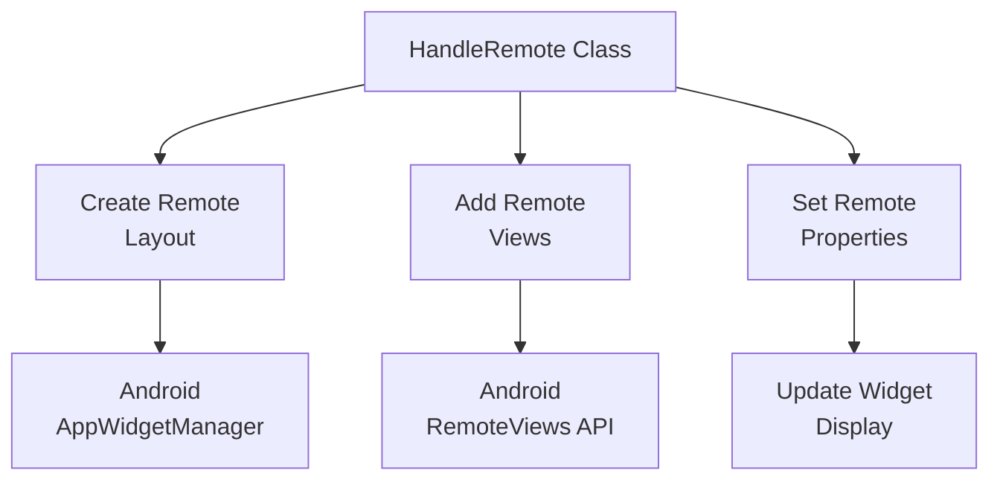

Sources: [V0Proto.kt:164-180](), [AndroidManifest.xml:42-51]()

## Putting It All Together

Here's how all these components interact in a complete system:

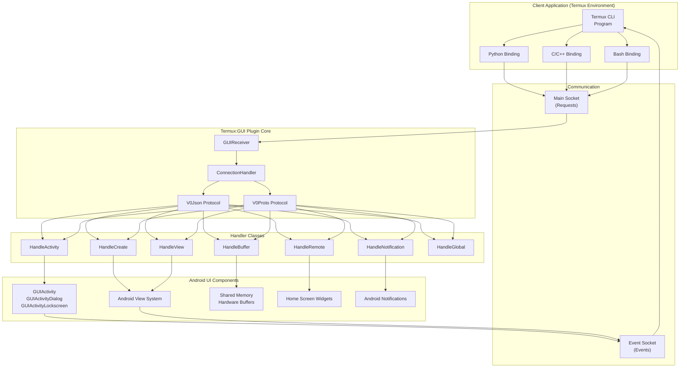

Sources: [ConnectionHandler.kt:25-167](), [V0Proto.kt:28-443](), [GUIActivity.kt:22-237]()

## Conclusion

The Termux:GUI architecture provides a flexible bridge between command-line Termux programs and Android's native UI capabilities. By using a client-server model with Unix sockets and supporting both JSON and Protobuf protocols, the system achieves a balance between ease of use and performance.

The modular design with specialized handlers for different aspects of the UI (activities, views, buffers, etc.) makes the system maintainable and extensible. This architecture enables command-line programs to create rich, native Android UIs without having to be fully-fledged Android applications.

For more detailed information about specific protocols, see [Protocol Documentation](#2), and for specific UI component information, see [Activities and UI Components](#3).

---

# Page: Protocol Documentation

# Protocol Documentation

<details>
<summary>Relevant source files</summary>

The following files were used as context for generating this wiki page:

- [Protocol.md](Protocol.md)
- [TODO](TODO)
- [app/src/main/proto/GUIProt0.proto](app/src/main/proto/GUIProt0.proto)

</details>


This document details the communication protocol between Termux programs and the Termux:GUI plugin. It outlines how connections are established, how messages are structured and transmitted, and the overall flow of communication. For specific protocol implementations, see [JSON Protocol](#2.1) and [Protobuf Protocol](#2.2). For information about handling events, see [Event System](#2.3).

## Connection Establishment

To communicate with the Termux:GUI plugin, a Termux program must establish a connection through Unix sockets:

1. The program creates two AF_UNIX SOCK_STREAM server sockets in the abstract Linux namespace:
   - A main socket for bidirectional command communication
   - An event socket for receiving asynchronous events (clicks, lifecycle events, etc.)

2. The program broadcasts these socket names to the plugin:
   ```bash
   am broadcast --user 0 -n com.termux.gui/.GUIReceiver --es mainSocket mainSocketName --es eventSocket eventSocketName
   ```

3. For security, programs should verify that the connected peer has the same user ID.

### Connection Establishment Diagram

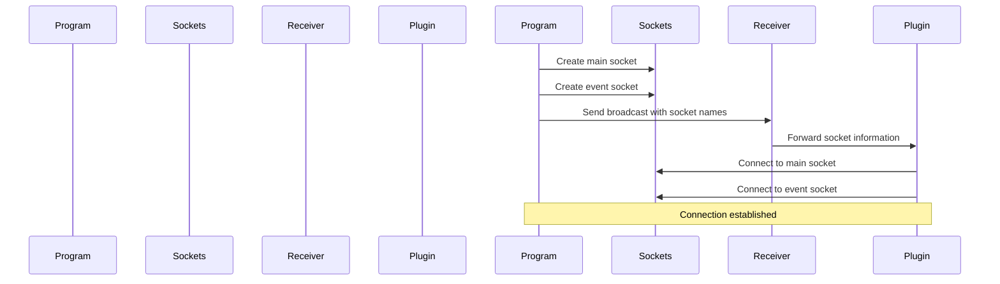

Sources: [Protocol.md:9-18]()

## Protocol Types

Termux:GUI supports two protocol formats:

| Protocol Type | Description | Advantages | Recommended For |
|--------------|-------------|------------|-----------------|
| JSON | Messages exchanged in JSON format | Better compatibility with high-level languages | Scripts, prototyping, languages with good JSON support |
| Binary (Protobuf) | Messages encoded using Protocol Buffers | Higher throughput, better efficiency, type safety | Performance-critical applications, low-level languages |

New features will primarily be implemented in the binary protocol, but the JSON protocol remains sufficient for many applications.

Sources: [Protocol.md:21-26](), [Protocol.md:644-655]()

## Protocol Negotiation

Once the connection is established, the protocol type and version must be negotiated:

1. The client sends a single byte specifying the desired protocol:
   - Lower 4 bits: Protocol type (0 = binary, 1 = JSON)
   - Upper 4 bits: Protocol version (currently 0)

2. The plugin responds with a single byte:
   - 0: Success, protocol supported
   - Non-zero: Failure, connection will be closed

### Protocol Negotiation Diagram

```mermaid
sequenceDiagram
    participant "TermuxProgram" as Client
    participant "TermuxGUIPlugin" as Plugin
    
    Client->>Plugin: Send protocol type/version byte
    Note right of Client: Upper 4 bits = version (0)<br>Lower 4 bits = type (0=binary, 1=JSON)
    Plugin->>Client: Send response byte
    Note left of Plugin: 0 = success<br>non-zero = error
    alt Success
        Note over Client,Plugin: Begin communication using negotiated protocol
    else Failure
        Note over Client,Plugin: Connection closed
    end
```

Sources: [Protocol.md:33-37]()

## Message Structure

### JSON Protocol

For the JSON protocol:
- Each message is preceded by a 4-byte big-endian unsigned integer indicating the message length
- Requests are JSON objects with:
  - `method`: The name of the method to call
  - `params`: Optional parameters as a JSON object
- Responses are either single JSON values or arrays for multiple return values
- Binary data (like images) must be base64-encoded as JSON strings
- Events are JSON objects with a `type` field indicating the event type and a `value` field with event data

### Binary Protocol

For the binary (Protobuf) protocol:
- Messages follow the schema defined in [app/src/main/proto/GUIProt0.proto]()
- Messages are sent "delimited" (preceded by their size as a varint)
- Requests use the `Method` message with the appropriate request type set
- Responses use the corresponding response message type
- Events are sent as `Event` messages with the event type set in the oneof field

Special case: The `addBuffer` method returns a 32-bit signed integer and a file descriptor instead of a protobuf message. If the integer is negative, buffer creation failed.

Sources: [Protocol.md:28-37](), [app/src/main/proto/GUIProt0.proto:33-40]()

## Message Flow and Communication Pattern

The communication follows two primary patterns:

### Request-Response Flow

```mermaid
sequenceDiagram
    participant "TermuxProgram" as Client
    participant "MainSocket" as Main
    participant "TermuxGUIPlugin" as Plugin
    
    Client->>Main: Send method request
    Main->>Plugin: Forward request
    Plugin->>Plugin: Process request
    Plugin->>Main: Send response
    Main->>Client: Forward response
```

### Asynchronous Event Flow

```mermaid
sequenceDiagram
    participant "TermuxProgram" as Client
    participant "EventSocket" as Event
    participant "TermuxGUIPlugin" as Plugin
    
    Plugin->>Plugin: Detect event (user input, lifecycle change, etc.)
    Plugin->>Event: Send event notification
    Event->>Client: Forward event
    Client->>Client: Process event
```

Sources: [Protocol.md:6-7](), [app/src/main/proto/GUIProt0.proto:18-35]()

## Protocol System Architecture

The following diagram shows the overall architecture of the protocol system:

```mermaid
graph TD
    subgraph "Client Side"
        TP["TermuxProgram"]
        PB["PythonBindings"]
        CB["CBindings"]
        BB["BashBindings"]
    end
    
    subgraph "Communication"
        MS["MainSocket"]
        ES["EventSocket"]
        PN["ProtocolNegotiation"]
    end
    
    subgraph "Plugin"
        GR["GUIReceiver"]
        CH["ConnectionHandler"]
        V0P["V0Proto Handler"]
        V0J["V0Json Handler"]
        EQ["EventQueue"]
    end
    
    TP --> PB & CB & BB
    PB & CB & BB --> MS & ES
    
    MS --> GR
    ES --> GR
    GR --> CH
    
    CH --> PN
    PN --> V0P & V0J
    
    V0P & V0J --> EQ
    EQ --> ES
```

Sources: [app/src/main/proto/GUIProt0.proto:11-41]()

## Request and Response Types

The protocol supports various request types, which can be grouped into several categories:

```mermaid
graph LR
    subgraph "Client Requests"
        CR1["Activity Management Requests"]
        CR2["View Creation Requests"]
        CR3["View Manipulation Requests"]
        CR4["Buffer Management Requests"]
        CR5["RemoteViews Requests"]
        CR6["Notification Requests"]
        CR7["WebView Requests"]
        CR8["Event Control Requests"]
    end
    
    subgraph "Plugin Handlers"
        PH1["HandleActivity"]
        PH2["HandleCreate"]
        PH3["HandleView"]
        PH4["HandleBuffer"]
        PH5["HandleRemote"]
        PH6["HandleNotification"]
        PH7["HandleWebView"]
        PH8["HandleEvent"]
    end
    
    subgraph "Plugin Responses"
        PR1["Success/ID Responses"]
        PR2["Data Responses"]
        PR3["Error Responses"]
    end
    
    CR1 --> PH1
    CR2 --> PH2
    CR3 --> PH3
    CR4 --> PH4
    CR5 --> PH5
    CR6 --> PH6
    CR7 --> PH7
    CR8 --> PH8
    
    PH1 & PH2 & PH3 & PH4 & PH5 & PH6 & PH7 & PH8 --> PR1 & PR2 & PR3
```

Sources: [app/src/main/proto/GUIProt0.proto:310-2753]()

## Error Handling

Error handling in the protocol ensures clients can properly respond to failures:

### JSON Protocol
- Failed methods typically return `-1` or other predefined error values
- No explicit error codes or messages are provided

### Binary Protocol
Error codes are standardized in the `Error` enum:
- `0 (OK)`: No error
- Negative values: Non-fatal informational codes
- Positive values: Fatal errors

Common error codes include:
- `ACTIVITY_STOPPED (1)`: Activity temporarily unavailable
- `INVALID_ACTIVITY (2)`: Activity doesn't exist
- `INTERNAL_ERROR (3)`: Exception occurred
- `INVALID_VIEW (4)`: View ID not found
- `INVALID_VIEW_TYPE (5)`: Incorrect view type for operation
- `ANDROID_VERSION_TOO_LOW (13)`: Feature requires newer Android version

Sources: [app/src/main/proto/GUIProt0.proto:240-305]()

## Activity State and Method Queueing

Due to Android's lifecycle constraints, the protocol handles temporarily unavailable activities:

- **JSON Protocol**: Methods that don't return values are queued (up to 100) until the Activity becomes visible again
- **Binary Protocol**: No methods are queued as all methods return a value (with possible error code)
- Methods that return values fail immediately with appropriate error codes when the Activity isn't visible

Sources: [Protocol.md:6-7]()

## Special Protocol Features

### Buffer Management
For efficient image handling, the protocol supports shared memory buffers:
- `addBuffer`: Creates a shared memory region, returns buffer ID and file descriptor
- `deleteBuffer`: Releases buffer resources
- `blitBuffer`: Updates buffer content
- `setBuffer`: Associates buffer with an ImageView

### Hardware Buffer Support
For hardware-accelerated graphics, the protocol supports Android's HardwareBuffer API:
- `createHardwareBuffer`: Creates a GPU-accessible buffer
- `destroyHardwareBuffer`: Releases hardware buffer resources
- `surfaceViewSetBuffer`: Presents buffer content in a SurfaceView

Sources: [app/src/main/proto/GUIProt0.proto:1762-1785](), [app/src/main/proto/GUIProt0.proto:2461-2508]()

---

# Page: JSON Protocol

# JSON Protocol

<details>
<summary>Relevant source files</summary>

The following files were used as context for generating this wiki page:

- [Protocol.md](Protocol.md)
- [TODO](TODO)
- [app/src/main/java/com/termux/gui/protocol/json/v0/HandleActivityAndTask.kt](app/src/main/java/com/termux/gui/protocol/json/v0/HandleActivityAndTask.kt)
- [app/src/main/java/com/termux/gui/protocol/json/v0/V0Json.kt](app/src/main/java/com/termux/gui/protocol/json/v0/V0Json.kt)
- [app/src/main/java/com/termux/gui/protocol/shared/v0/V0Shared.kt](app/src/main/java/com/termux/gui/protocol/shared/v0/V0Shared.kt)

</details>


The JSON Protocol is one of two communication protocols supported by Termux:GUI, designed primarily for better compatibility with high-level programming languages. This document details how client applications communicate with the Termux:GUI plugin using JSON-formatted messages, the message structure, and the protocol flow.

For information about the alternative protocol that uses Protocol Buffers, see [Protobuf Protocol](#2.2). For details about handling events sent from the plugin back to clients, see [Event System](#2.3).

## Connection Establishment

The JSON Protocol requires setting up a bidirectional communication channel between the client program and the Termux:GUI plugin.

```mermaid
sequenceDiagram
    participant "Client Program" as Client
    participant "TermuxGUI Plugin" as Plugin
    
    Note over Client: Create two AF_UNIX sockets in abstract namespace
    Note over Client: Listen on both sockets
    Client->>Plugin: Broadcast Intent with socket names
    Note right of Client: am broadcast --user 0 -n com.termux.gui/.GUIReceiver<br>--es mainSocket socketName1 --es eventSocket socketName2
    Plugin->>Client: Connect to main socket
    Plugin->>Client: Connect to event socket
    
    Note over Client,Plugin: Protocol Negotiation
    Client->>Plugin: Protocol byte (0x01 for JSON)
    Plugin->>Client: 0x00 (Success) or non-zero (Error)
    
    Note over Client,Plugin: Start Communication
```

### Implementation details:

1. The client program must create two AF_UNIX SOCK_STREAM server sockets in the abstract Linux namespace
2. One socket is used for main communication (requests/responses), and the other for receiving asynchronous events
3. The socket names are sent via an Android broadcast Intent
4. After connection, the client must send a protocol negotiation byte:
   - 4 least significant bits = 1 (indicating JSON protocol)
   - 4 most significant bits = 0 (protocol version)
5. The plugin responds with 0x00 for success or another value for error

Sources: [Protocol.md:10-36]()

## Message Format and Structure

All JSON protocol messages follow a consistent format for both requests and responses.

```mermaid
graph TD
    subgraph "Message Framing"
        Length["4-byte unsigned integer<br>Big Endian"]
        JSONData["JSON Message Data"]
        Length --> JSONData
    end
    
    subgraph "Request Format"
        ClientMsg["Client Message"]
        Method["method: string"]
        Params["params: object (optional)"]
        
        ClientMsg --> Method
        ClientMsg --> Params
    end
    
    subgraph "Response Format"
        ServerMsg["Server Response"]
        SingleValue["Single JSON value"]
        MultipleValues["JSON array of values"]
        
        ServerMsg --> SingleValue
        ServerMsg --> MultipleValues
    end
    
    subgraph "Event Format"
        EventMsg["Event Message"]
        Type["type: string"]
        Value["value: varies by event type"]
        
        EventMsg --> Type
        EventMsg --> Value
    end
```

### Request Format

```json
{
  "method": "methodName",
  "params": {
    "param1": value1,
    "param2": value2
  }
}
```

### Response Format

For methods returning a single value:
```json
value
```

For methods returning multiple values:
```json
[value1, value2, ...]
```

### Event Format

```json
{
  "type": "eventType",
  "value": {
    "property1": value1,
    "property2": value2
  }
}
```

### Framing

Every JSON message (for both requests and responses) must be preceded by its length as a 4-byte unsigned integer in big-endian format. This allows the receiver to correctly identify message boundaries.

### Binary Data

Binary data (such as images) must be transmitted as base64-encoded strings in the JSON messages.

Sources: [Protocol.md:28-30](), [Protocol.md:647-654]()

## Protocol Message Flow

The following diagram illustrates the message flow between client and plugin:

```mermaid
sequenceDiagram
    participant Client
    participant V0Json as "V0Json Handler"
    participant Handlers as "Specialized Handlers"
    participant Activities as "Android Activities"
    
    Client->>V0Json: JSON Message with method and params
    Note over V0Json: Parse message using Gson
    
    alt Remote Views Message
        V0Json->>Handlers: HandleRemote.handleRemoteMessage()
    else Activity/Task Message
        V0Json->>Handlers: handleActivityTaskMessage()
    else View Message
        V0Json->>Handlers: handleView()
    else Buffer Message
        V0Json->>Handlers: HandleBuffer.handleBuffer()
    else Unknown Message
        V0Json-->>Client: "invalidMethod" event
    end
    
    Handlers->>Activities: Manipulate Android UI
    Handlers-->>Client: Result as JSON
    
    Note over Activities,Client: User interactions generate events
    Activities->>V0Json: UI Events (clicks, etc.)
    V0Json-->>Client: Event messages via event socket
```

The handling of JSON protocol messages is implemented in the `V0Json` class, which:
1. Reads incoming messages from the main socket
2. Dispatches them to appropriate handlers based on method type
3. Returns responses to the client
4. Forwards events from the Android UI to the client via the event socket

Sources: [app/src/main/java/com/termux/gui/protocol/json/v0/V0Json.kt:33-62](), [app/src/main/java/com/termux/gui/protocol/json/v0/V0Json.kt:64-163]()

## Method Categories

The JSON Protocol provides a rich set of methods grouped into several categories:

### Activity and Task Control

Methods to create and manage Android Activities and Tasks:

| Method | Description | Key Parameters |
|--------|-------------|----------------|
| `newActivity` | Creates a new Activity | `tid`, `dialog`, `pip`, `lockscreen`, `overlay` |
| `finishActivity` | Closes an Activity | `aid` (Activity ID) |
| `setTheme` | Sets colors for an Activity | `aid`, `statusBarColor`, `colorPrimary`, etc. |
| `setPiPMode` | Enters/exits Picture-in-Picture mode | `aid`, `pip` |
| `setOrientation` | Sets screen orientation | `aid`, `orientation` |

Sources: [Protocol.md:46-144](), [app/src/main/java/com/termux/gui/protocol/json/v0/HandleActivityAndTask.kt:23-287]()

### View Creation and Manipulation

Methods to create and modify UI elements:

| Method | Description | Key Parameters |
|--------|-------------|----------------|
| `create*` | Creates views (Button, TextView, etc.) | `aid`, `parent`, type-specific parameters |
| `setText` | Sets text for a TextView/Button | `aid`, `id`, `text` |
| `setVisibility` | Shows/hides views | `aid`, `id`, `vis` |
| `deleteView` | Removes a view | `aid`, `id` |
| `setBackgroundColor` | Sets background color | `aid`, `id`, `color` |

Various view types are supported, including:
- LinearLayout, FrameLayout, GridLayout
- TextView, EditText, Button
- ImageView, WebView
- ProgressBar, Spinner, TabLayout
- And many more

Sources: [Protocol.md:146-242]()

### Buffer System

Methods for efficient image handling using shared memory:

| Method | Description | Key Parameters |
|--------|-------------|----------------|
| `addBuffer` | Creates a shared memory buffer | `format`, `w`, `h` |
| `deleteBuffer` | Removes a buffer | `bid` (Buffer ID) |
| `blitBuffer` | Updates buffer contents | `bid` |
| `setBuffer` | Assigns a buffer to an ImageView | `aid`, `id`, `bid` |

Sources: [Protocol.md:327-346]()

### Event Control

Methods to control which UI events are sent to the client:

| Method | Description | Key Parameters |
|--------|-------------|----------------|
| `sendClickEvent` | Enables/disables click events | `aid`, `id`, `send` |
| `sendTouchEvent` | Enables/disables touch events | `aid`, `id`, `send` |
| `sendTextEvent` | Enables/disables text change events | `aid`, `id`, `send` |

Sources: [Protocol.md:421-433](), [app/src/main/java/com/termux/gui/protocol/json/v0/V0Json.kt:89-161]()

### WebView Control

Methods for embedded web browser control:

| Method | Description | Key Parameters |
|--------|-------------|----------------|
| `setData` | Sets HTML content | `aid`, `id`, `doc`, `mime` |
| `loadURI` | Loads from URL | `aid`, `id`, `uri` |
| `evaluateJS` | Runs JavaScript | `aid`, `id`, `code` |

Sources: [Protocol.md:366-416]()

### RemoteViews and Notifications

Methods for Android RemoteViews (widgets) and system notifications:

| Method | Description | Key Parameters |
|--------|-------------|----------------|
| `createRemoteLayout` | Creates a remote layout | - |
| `addRemote*` | Adds views to remote layouts | `rid`, `parent` |
| `createNotification` | Creates Android notification | `id`, `layout`, `title`, etc. |

Sources: [Protocol.md:436-545]()

## Implementation and Handling

The JSON Protocol is implemented in the `V0Json` class, which extends `V0Shared`. The class:

1. Maintains state for active Activities, views, buffers, and notifications
2. Reads and parses incoming JSON messages
3. Dispatches methods to appropriate handlers:
   - `HandleRemote.handleRemoteMessage` for RemoteViews operations
   - `handleActivityTaskMessage` for Activity and Task operations
   - `handleView` for UI view operations
   - `HandleBuffer.handleBuffer` for buffer operations
4. Processes events from the Android system and UI
5. Sends events back to the client via the event socket

The protocol dispatches incoming messages using a series of handler classes, each responsible for a specific category of functionality. This modular design allows for separation of concerns and easier maintenance.

Sources: [app/src/main/java/com/termux/gui/protocol/json/v0/V0Json.kt:33-169](), [app/src/main/java/com/termux/gui/protocol/shared/v0/V0Shared.kt:30-368]()

## Limitations

The JSON Protocol has several limitations due to Android's architecture:

1. Methods that return a value fail when the Activity isn't visible
2. Up to 100 methods that don't return a value will be queued to run when the Activity becomes visible again
3. When an Activity is destroyed, all queued methods for that Activity are lost
4. The JSON protocol has more overhead than the Protobuf protocol due to JSON parsing and serialization

These limitations should be considered when designing applications that use the JSON Protocol.

Sources: [Protocol.md:6-8]()

## Protocol Lifecycle

```mermaid
stateDiagram-v2
    [*] --> ConnectionSetup
    ConnectionSetup --> ProtocolNegotiation
    ProtocolNegotiation --> Active
    
    Active --> SendingRequests
    Active --> ReceivingEvents
    
    SendingRequests --> MethodDispatch
    MethodDispatch --> HandleActivityTask: Activity methods
    MethodDispatch --> HandleView: View methods
    MethodDispatch --> HandleBuffer: Buffer methods
    MethodDispatch --> HandleRemote: Remote methods
    
    HandleActivityTask --> ResponseGeneration
    HandleView --> ResponseGeneration
    HandleBuffer --> ResponseGeneration
    HandleRemote --> ResponseGeneration
    
    ResponseGeneration --> SendingRequests
    
    ReceivingEvents --> UIEvents: User interaction
    ReceivingEvents --> SystemEvents: System changes
    ReceivingEvents --> LifecycleEvents: Activity lifecycle
    
    UIEvents --> EventDispatching
    SystemEvents --> EventDispatching
    LifecycleEvents --> EventDispatching
    
    EventDispatching --> ReceivingEvents
    
    Active --> ConnectionClosed
    ConnectionClosed --> [*]
```

This diagram illustrates the lifecycle of the JSON Protocol from connection setup through normal operation to connection close, showing both the request-response flow and the asynchronous event flow.

Sources: [app/src/main/java/com/termux/gui/protocol/json/v0/V0Json.kt:36-169](), [app/src/main/java/com/termux/gui/protocol/shared/v0/V0Shared.kt:50-126]()

---

# Page: Protobuf Protocol

# Protobuf Protocol

<details>
<summary>Relevant source files</summary>

The following files were used as context for generating this wiki page:

- [app/src/main/java/com/termux/gui/protocol/protobuf/v0/V0Proto.kt](app/src/main/java/com/termux/gui/protocol/protobuf/v0/V0Proto.kt)
- [app/src/main/proto/GUIProt0.proto](app/src/main/proto/GUIProt0.proto)

</details>


This document details the Protocol Buffers (protobuf) based communication protocol used in Termux:GUI. The protobuf protocol offers a structured, efficient binary serialization mechanism for communication between Termux programs and the Android UI system. For information about the alternative JSON-based communication protocol, see [JSON Protocol](#2.1).

## Overview

The Protobuf Protocol establishes a bidirectional communication channel between Termux applications and the GUI plugin through Unix domain sockets. It provides a strongly-typed, efficient messaging system that enables terminal applications to create and manipulate Android UI components.

```mermaid
graph LR
    subgraph "Termux Environment"
        Client["Termux Program"]
        ProtobufLib["Protobuf Library"]
    end
    
    subgraph "Communication Layer"
        MainSocket["Main Socket"]
        EventSocket["Event Socket"]
    end
    
    subgraph "Termux:GUI Plugin"
        V0Proto["V0Proto Handler"]
        HandlerClasses["Specialized Handlers"]
        EventQueue["Event Queue"]
    end
    
    subgraph "Android UI Layer"
        Activities["Activities"]
        Views["View Hierarchy"]
        Buffers["Memory Buffers"]
        Notifications["Notifications"]
    end
    
    Client --> ProtobufLib
    ProtobufLib -- "Method Messages" --> MainSocket
    MainSocket --> V0Proto
    V0Proto --> HandlerClasses
    HandlerClasses --> Activities
    HandlerClasses --> Views
    HandlerClasses --> Buffers
    HandlerClasses --> Notifications
    
    Activities --> EventQueue
    Views --> EventQueue
    EventQueue -- "Event Messages" --> EventSocket
    EventSocket --> Client
```

Sources: [app/src/main/proto/GUIProt0.proto:19-41](), [app/src/main/java/com/termux/gui/protocol/protobuf/v0/V0Proto.kt:28-50]()

## Connection Establishment

To establish a connection with the Termux:GUI plugin, a Termux program follows these steps:

1. Open two AF_UNIX SO_STREAM server sockets in the abstract Linux namespace
2. One socket handles main communication, the other receives asynchronous events
3. Send a broadcast to `com.termux.gui/.GUIReceiver` with socket names as extras
4. The plugin connects to these sockets to establish bidirectional communication

Example connection using `am` command:
```
am broadcast --user 0 -n com.termux.gui/.GUIReceiver --es mainSocket mainSocketName --es eventSocket eventSocketName
```

For security, the program should verify that connected peers have the same user ID.

Sources: [app/src/main/proto/GUIProt0.proto:19-30]()

## Message Format

All protocol messages are sent in a delimited format:

1. Message size is sent first as a variable-length integer (varint)
2. The serialized protocol buffer message follows
3. All Protocol Buffer implementations support reading varints and delimited messages

The protocol defines two primary message types:
- **Method**: Requests sent from Termux programs to the plugin
- **Event**: Asynchronous events sent from the plugin back to Termux programs

After sending a Method message, the corresponding response is sent back to the client.

Sources: [app/src/main/proto/GUIProt0.proto:34-40]()

## Handler Architecture

The V0Proto class processes incoming messages by dispatching them to specialized handlers, each responsible for a specific domain of functionality:

```mermaid
graph TD
    V0Proto["V0Proto"] --> HandleActivity["HandleActivity"]
    V0Proto --> HandleGlobal["HandleGlobal"]
    V0Proto --> HandleCreate["HandleCreate"]
    V0Proto --> HandleView["HandleView"]
    V0Proto --> HandleBuffer["HandleBuffer"]
    V0Proto --> HandleRemote["HandleRemote"]
    V0Proto --> HandleNotification["HandleNotification"]
    
    HandleActivity --> ActivityManagement["Activity Lifecycle<br>Management"]
    HandleGlobal --> GlobalOperations["Global System<br>Operations"]
    HandleCreate --> ViewCreation["View Creation"]
    HandleView --> ViewManipulation["View Property<br>Manipulation"]
    HandleBuffer --> BufferOperations["Shared Memory<br>Buffer Operations"]
    HandleRemote --> RemoteViewOperations["Remote Views<br>for Widgets"]
    HandleNotification --> NotificationManagement["Notification<br>Management"]
```

Sources: [app/src/main/java/com/termux/gui/protocol/protobuf/v0/V0Proto.kt:50-206]()

## Message Types

### Method Messages

The protocol defines numerous request types organized into functional categories:

| Category | Description | Example Methods |
|----------|-------------|-----------------|
| Activity Management | Create and control Activities | `newActivity`, `finishActivity`, `setTheme` |
| View Creation | Create UI components | `createLinearLayout`, `createButton`, `createTextView` |
| View Manipulation | Modify View properties | `setVisibility`, `setText`, `setBackgroundColor` |
| Buffer Management | Manage shared memory | `addBuffer`, `blitBuffer`, `setBuffer` |
| Remote Views | Create widget layouts | `createRemoteLayout`, `addRemoteTextView` |
| Notifications | Create Android notifications | `createChannel`, `createNotification` |
| WebView | Control WebView components | `allowJS`, `loadURI`, `evaluateJS` |
| Event Control | Configure event delivery | `sendClickEvent`, `sendTouchEvent` |

The `Method` message acts as a container with an `oneof` field that can hold any request type:

```mermaid
graph TD
    Method["Method Message"] --> MethodType["oneof method"]
    MethodType --> ActivityMethods["Activity Methods<br>(16-42)"]
    MethodType --> ViewCreateMethods["View Creation Methods<br>(100-130)"]
    MethodType --> ViewManipulateMethods["View Manipulation Methods<br>(200-235)"]
    MethodType --> RemoteMethods["Remote View Methods<br>(300-316)"]
    MethodType --> WebMethods["WebView Methods<br>(400-407)"]
    MethodType --> NotificationMethods["Notification Methods<br>(500-502)"]
    MethodType --> EventMethods["Event Control Methods<br>(600-605)"]
    MethodType --> BufferMethods["Buffer Methods<br>(700-703)"]
```

Sources: [app/src/main/proto/GUIProt0.proto:2599-2754]()

### Event Messages

Events are asynchronous notifications sent from the plugin to Termux programs:

| Category | Description | Example Events |
|----------|-------------|----------------|
| Activity Lifecycle | Activity state changes | `create`, `start`, `resume`, `pause`, `stop`, `destroy` |
| View Events | User interactions | `click`, `longClick`, `touch`, `focusChange` |
| System Events | System state changes | `screenOn`, `screenOff`, `locale`, `airplane` |
| WebView Events | WebView callbacks | `webNavigation`, `webHTTPError`, `webConsoleMessage` |
| Widget Events | Remote view interactions | `remoteClick`, `notification`, `notificationAction` |

The `Event` message also uses an `oneof` field to contain any event type:

```mermaid
graph TD
    Event["Event Message"] --> EventType["oneof event"]
    EventType --> InputEvents["Input Events<br>(click, touch, text)"]
    EventType --> LifecycleEvents["Activity Lifecycle Events<br>(create, start, resume, pause, etc.)"]
    EventType --> UIEvents["UI Events<br>(longClick, focusChange, refresh, etc.)"]
    EventType --> WebViewEvents["WebView Events<br>(webNavigation, webError, etc.)"]
    EventType --> SystemEvents["System Events<br>(airplane, locale, screenOn, etc.)"]
    EventType --> NotificationEvents["Notification Events<br>(notification, notificationAction)"]
```

Sources: [app/src/main/proto/GUIProt0.proto:3170-3222]()

## Error Handling

The protocol includes a standardized error handling mechanism through the `Error` enum. These codes are returned in response messages to indicate success or failure:

| Error Code | Description | Severity |
|------------|-------------|----------|
| `OK` | Operation successful | Success |
| `ACTIVITY_STOPPED` | Activity temporarily stopped | Retry |
| `INVALID_ACTIVITY` | Activity doesn't exist | Fatal |
| `INTERNAL_ERROR` | Exception during processing | Fatal |
| `INVALID_VIEW` | View ID not found | Fatal |
| `INVALID_VIEW_TYPE` | View of wrong type | Fatal |
| `ANDROID_VERSION_TOO_LOW` | Feature requires newer Android | Fatal |
| `BUFFER_NOT_FOUND` | Referenced buffer not found | Fatal |

Negative error codes are non-fatal information, 0 means success, and positive codes indicate failures.

Sources: [app/src/main/proto/GUIProt0.proto:240-305]()

## Protocol Definition

The protocol is defined using Protocol Buffers syntax in `GUIProt0.proto`. This file specifies all message types, enumerations, and structures used in the protocol. It's organized into sections:

1. Common types (lines 46-245)
2. Activity and task management (lines 312-772)
3. View creation (lines 928-1270)
4. View manipulation (lines 1274-1694)
5. Buffer management (lines 1762-1836)
6. Remote views (lines 1897-2106)
7. Other specialized components (WebView, notifications, etc.)
8. Method and Event container messages (lines 2599-3222)

The file is licensed under the Unlicense, placing it in the public domain for easy reuse.

Sources: [app/src/main/proto/GUIProt0.proto:11-3640]()

## Protocol Implementation

The `V0Proto` class is the core implementation that handles protocol communication:

1. Receives messages from the main socket
2. Dispatches messages to appropriate handlers
3. Processes system events and converts them to protocol events
4. Sends events through the event queue to the event socket

```mermaid
sequenceDiagram
    participant TP as "Termux Program"
    participant V0 as "V0Proto"
    participant HA as "HandleActivity"
    participant HC as "HandleCreate"
    participant HV as "HandleView"
    participant EQ as "Event Queue"
    
    TP->>V0: Method: newActivity
    V0->>HA: handleActivity.newActivity()
    HA->>TP: NewActivityResponse
    
    TP->>V0: Method: createButton
    V0->>HC: handleCreate.button()
    HC->>TP: CreateButtonResponse
    
    TP->>V0: Method: setText
    V0->>HV: handleView.setText()
    HV->>TP: SetTextResponse
    
    Note over V0: User clicks button
    
    V0->>EQ: Click Event
    EQ->>TP: Event: click
```

Sources: [app/src/main/java/com/termux/gui/protocol/protobuf/v0/V0Proto.kt:50-206]()

## Buffer System

The Protobuf Protocol includes an efficient shared memory buffer system for graphics operations:

1. Create a buffer with `addBuffer` which returns a file descriptor
2. Map the shared memory region to access the pixels directly
3. Update the memory with new image data
4. Call `blitBuffer` to notify the plugin about updates
5. Use `setBuffer` to associate the buffer with an ImageView

This approach is much more efficient than sending image data through the protocol, especially for frequently updated graphics.

For hardware-accelerated graphics, the protocol provides the `createHardwareBuffer` method which creates a shared GPU-accessible buffer for rendering with OpenGL ES or Vulkan.

Sources: [app/src/main/proto/GUIProt0.proto:1762-1824](), [app/src/main/proto/GUIProt0.proto:2460-2507]()

## Event System

The event system in the Protobuf Protocol enables asynchronous notifications about UI interactions and system changes:

1. The plugin detects events (clicks, lifecycle changes, etc.)
2. Events are converted to protocol Event messages
3. Messages are placed in an event queue
4. Messages are serialized and sent over the event socket
5. The Termux program deserializes and handles these events

Various event control methods like `sendClickEvent` allow configuring which events should be sent to the client.

Sources: [app/src/main/java/com/termux/gui/protocol/protobuf/v0/V0Proto.kt:208-318]()

## Conclusion

The Protobuf Protocol provides a comprehensive, efficient communication mechanism between Termux applications and Android's UI system. Its binary serialization format, strongly-typed messages, and structured design offer advantages in performance, type safety, and error handling compared to text-based protocols.

For detailed information on how to use the protocol with specific types of UI components, refer to the [Activities and UI Components](#3) section of the documentation.

---

# Page: Event System

# Event System

<details>
<summary>Relevant source files</summary>

The following files were used as context for generating this wiki page:

- [app/src/main/java/com/termux/gui/Util.kt](app/src/main/java/com/termux/gui/Util.kt)
- [app/src/main/java/com/termux/gui/protocol/protobuf/v0/V0Proto.kt](app/src/main/java/com/termux/gui/protocol/protobuf/v0/V0Proto.kt)

</details>


## Purpose and Scope

The Event System in Termux:GUI provides a bidirectional communication mechanism that allows Termux programs to receive feedback from user interactions and system changes. This page documents how events are captured in the Android GUI plugin and communicated back to Termux client programs. For information about sending commands from Termux to the GUI plugin, see [Protocol Documentation](#2).

Sources: [app/src/main/java/com/termux/gui/protocol/protobuf/v0/V0Proto.kt:28-29]()

## Event Architecture Overview

The Event System consists of a centralized event queue that collects events from various sources and delivers them to client programs. Events are generated by UI interactions, activity lifecycle changes, and system-wide events.

### Event Flow Diagram

```mermaid
flowchart LR
    subgraph "Android System"
        AndroidEvents["Android System Events"]
        ActivityLifecycle["Activity Lifecycle"]
        UIEvents["UI Component Events"]
    end
    
    subgraph "Termux:GUI Plugin"
        EventListeners["Event Listeners"]
        EventQueue["LinkedBlockingQueue<Event>"]
        ProtocolHandlers["Protocol Handlers (JSON/Protobuf)"]
    end
    
    subgraph "Termux Client"
        ClientProgram["Client Program"]
        EventHandlers["Event Handlers"]
    end
    
    AndroidEvents --> EventListeners
    ActivityLifecycle --> EventListeners
    UIEvents --> EventListeners
    
    EventListeners --> EventQueue
    EventQueue --> ProtocolHandlers
    ProtocolHandlers --> ClientProgram
    ClientProgram --> EventHandlers
```

Sources: [app/src/main/java/com/termux/gui/protocol/protobuf/v0/V0Proto.kt:50-64]()

## Event Queue

The event queue is implemented as a `LinkedBlockingQueue<Event>`, which serves as a thread-safe buffer between event generators and clients. Events are added to the queue using the `offer()` method, which ensures that the queue operations are non-blocking.

### Event Queue Implementation

```mermaid
classDiagram
    class V0Proto {
        -LinkedBlockingQueue~Event~ eventQueue
        +handleConnection(LocalSocket main)
        +onActivityCreated(ActivityState state)
        +onActivityStarted(ActivityState state)
        +onActivityResumed(ActivityState state)
        +onActivityPaused(ActivityState state)
        +onActivityStopped(ActivityState state)
        +onActivityDestroyed(ActivityState state)
        +onBackButton(GUIActivity a)
        +onVolume(GUIActivity a, int keyCode, boolean down)
        +onInsetChange(GUIActivity a, WindowInsetsCompat insets)
    }
    
    class HandleCreate {
        +linear(CreateLinearLayout request)
        +frame(CreateFrameLayout request)
        +text(CreateTextView request)
        +button(CreateButton request)
    }
    
    class HandleView {
        +showCursor(ShowCursor request)
        +setWidth(SetWidth request)
        +setHeight(SetHeight request)
        +visible(SetVisibility request)
    }
    
    V0Proto --> HandleCreate: Creates
    V0Proto --> HandleView: Creates
```

Sources: [app/src/main/java/com/termux/gui/protocol/protobuf/v0/V0Proto.kt:28-29](), [app/src/main/java/com/termux/gui/protocol/protobuf/v0/V0Proto.kt:57-63]()

## Event Categories

The Event System handles various categories of events, each serving different purposes in the communication between Android and Termux applications.

### Activity Lifecycle Events

Activity lifecycle events inform the client program about the state changes of its associated activities. These include creation, starting, resuming, pausing, stopping, and destruction of activities.

```mermaid
sequenceDiagram
    participant A as "Android System"
    participant G as "GUIActivity"
    participant V as "V0Proto"
    participant Q as "EventQueue"
    participant C as "Client Program"
    
    A->>G: Activity lifecycle change
    G->>V: Notify lifecycle callback
    V->>Q: offer(Event)
    Q->>C: Deliver event
```

Sources: [app/src/main/java/com/termux/gui/protocol/protobuf/v0/V0Proto.kt:208-232]()

### System Events

System events originate from the Android system and provide information about system-wide changes, such as airplane mode, locale changes, screen state, and timezone updates.

| Event Type | Description | Generated By |
|------------|-------------|--------------|
| Airplane Mode | Notifies when airplane mode is enabled/disabled | `onAirplaneModeChanged()` |
| Locale | Notifies when system language/locale changes | `onLocaleChanged()` |
| Screen State | Notifies when screen turns on/off | `onScreenOff()`, `onScreenOn()` |
| Timezone | Notifies when timezone changes | `onTimezoneChanged()` |
| Configuration | Notifies of system configuration changes | `onConfigurationChanged()` |

Sources: [app/src/main/java/com/termux/gui/protocol/protobuf/v0/V0Proto.kt:234-252](), [app/src/main/java/com/termux/gui/protocol/protobuf/v0/V0Proto.kt:302-307]()

### Input Events

Input events are generated by user interactions with the device, such as pressing buttons or touching the screen.

| Event Type | Description | Generated By |
|------------|-------------|--------------|
| Back Button | Triggered when the back button is pressed | `onBackButton()` |
| Volume Keys | Triggered when volume keys are pressed | `onVolume()` |
| Touch | Triggered by touch screen interactions | View's touch listener |
| System Insets | Reports changes in system UI visibility | `onInsetChange()` |

Sources: [app/src/main/java/com/termux/gui/protocol/protobuf/v0/V0Proto.kt:254-284]()

### UI Component Events

UI component events are generated when users interact with specific UI elements such as buttons, text fields, and other widgets.

```mermaid
flowchart TD
    subgraph "UI Component Events"
        Click["Click Event"]
        LongClick["Long Click Event"]
        FocusChange["Focus Change Event"]
        TextChange["Text Change Event"]
        ItemSelected["Item Selected Event"]
        RefreshAction["Refresh Action Event"]
        TabSelection["Tab Selection Event"]
    end
    
    subgraph "Event Listeners"
        ClickListener["setClickListener()"]
        LongClickListener["setLongClickListener()"]
        FocusChangeListener["setFocusChangeListener()"]
        TextWatcher["setTextWatcher()"]
        TouchListener["setTouchListenerJSON()"]
        CheckedListener["setCheckedListener()"]
        SpinnerListener["setSpinnerListener()"]
        RefreshListener["setRefreshListener()"]
        TabListener["setTabSelectedListener()"]
    end
    
    subgraph "Event Queue"
        Queue["LinkedBlockingQueue<Event>"]
    end
    
    Click --> ClickListener
    LongClick --> LongClickListener
    FocusChange --> FocusChangeListener
    TextChange --> TextWatcher
    ItemSelected --> SpinnerListener
    RefreshAction --> RefreshListener
    TabSelection --> TabListener
    
    ClickListener --> Queue
    LongClickListener --> Queue
    FocusChangeListener --> Queue
    TextWatcher --> Queue
    TouchListener --> Queue
    CheckedListener --> Queue
    SpinnerListener --> Queue
    RefreshListener --> Queue
    TabListener --> Queue
```

Sources: [app/src/main/java/com/termux/gui/Util.kt:191-211](), [app/src/main/java/com/termux/gui/Util.kt:216-226](), [app/src/main/java/com/termux/gui/Util.kt:231-243](), [app/src/main/java/com/termux/gui/Util.kt:333-349](), [app/src/main/java/com/termux/gui/Util.kt:356-411]()

### Special Events

Special events include notifications from remote views, PiP mode changes, and other specialized events.

| Event Type | Description | Generated By |
|------------|-------------|--------------|
| Remote Click | Click on a remote view (widget) | `onRemoteButton()` |
| Notification | Notification interactions | `onNotification()`, `onNotificationDismissed()`, `onNotificationAction()` |
| PiP Mode | Picture-in-Picture mode changes | `onPictureInPictureModeChanged()` |
| User Leave Hint | User is navigating away | `onUserLeaveHint()` |
| Overlay Scale | Scale gesture on overlay | `ScaleGestureDetector.OnScaleGestureListener` |

Sources: [app/src/main/java/com/termux/gui/protocol/protobuf/v0/V0Proto.kt:286-319](), [app/src/main/java/com/termux/gui/protocol/protobuf/v0/V0Proto.kt:354-370]()

## Event Listener Registration

The `Util` class provides helper methods to register event listeners for various UI components. These methods attach appropriate listeners to views and configure them to generate events that are added to the event queue.

### Listener Registration Process

```mermaid
sequenceDiagram
    participant V as "View"
    participant U as "Util"
    participant L as "Listener"
    participant E as "EventQueue"
    
    Note over V,U: View creation and setup
    V->>U: Request listener attachment
    U->>V: Attach listener to view
    Note over V,L: User interaction with view
    V->>L: Trigger listener callback
    L->>E: offer(Event)
```

Sources: [app/src/main/java/com/termux/gui/Util.kt:191-311]()

## Event Format and Delivery

Events are formatted according to either the JSON protocol or the Protobuf protocol, depending on which is being used. For Protobuf, events are instances of the `Event` message type that contains different fields based on the event type.

### Event Processing in Client Code

Client programs typically implement an event loop that:

1. Reads events from the protocol socket
2. Parses the event data
3. Dispatches the event to appropriate handlers
4. Performs actions in response to the events

### Example Event Structure (Protobuf)

The structure of Protobuf events can be seen in the event creation methods in `V0Proto`. For example, an activity creation event is constructed as:

```
Event.newBuilder().setCreate(CreateEvent.newBuilder().setAid(it)).build()
```

where `it` is the activity ID.

Sources: [app/src/main/java/com/termux/gui/protocol/protobuf/v0/V0Proto.kt:208-231]()

## System Listeners and Cleanup

The `handleConnection` method in `V0Proto` uses a helper function called `withSystemListenersAndCleanup` to manage the lifecycle of system listeners. This ensures that listeners are properly registered when a connection starts and cleaned up when it ends.

Sources: [app/src/main/java/com/termux/gui/protocol/protobuf/v0/V0Proto.kt:50-206]()

## Integration with UI Components

The Event System integrates tightly with UI components to provide immediate feedback on user interactions. This integration is primarily handled through the utility methods in the `Util` class.

### Component Integration Diagram

```mermaid
flowchart TD
    subgraph "Android UI Components"
        Button["Button"]
        TextView["TextView"]
        EditText["EditText"]
        ImageView["ImageView"]
        Spinner["Spinner"]
        TabLayout["TabLayout"]
        RadioGroup["RadioGroup"]
        SwipeRefreshLayout["SwipeRefreshLayout"]
    end
    
    subgraph "Event Listener Utility Methods"
        SetClick["setClickListener()"]
        SetLongClick["setLongClickListener()"]
        SetFocus["setFocusChangeListener()"]
        SetText["setTextWatcher()"]
        SetTouch["setTouchListenerJSON()"]
        SetSpinner["setSpinnerListener()"]
        SetTab["setTabSelectedListener()"]
        SetRadio["setCheckedListener()"]
        SetRefresh["setRefreshListener()"]
    end
    
    subgraph "Event Queue System"
        EventQueue["LinkedBlockingQueue<Event>"]
        EventProcessor["Event Processing Loop"]
        ClientDelivery["Client Event Delivery"]
    end
    
    Button --> SetClick
    TextView --> SetText
    EditText --> SetText
    ImageView --> SetTouch
    Spinner --> SetSpinner
    TabLayout --> SetTab
    RadioGroup --> SetRadio
    SwipeRefreshLayout --> SetRefresh
    
    SetClick --> EventQueue
    SetLongClick --> EventQueue
    SetFocus --> EventQueue
    SetText --> EventQueue
    SetTouch --> EventQueue
    SetSpinner --> EventQueue
    SetTab --> EventQueue
    SetRadio --> EventQueue
    SetRefresh --> EventQueue
    
    EventQueue --> EventProcessor
    EventProcessor --> ClientDelivery
```

Sources: [app/src/main/java/com/termux/gui/Util.kt:191-349]()

## Event Logging

The `V0Proto` class includes a `ProtoLogger` inner class that provides logging functionality for events. This is useful for debugging and diagnostics.

Sources: [app/src/main/java/com/termux/gui/protocol/protobuf/v0/V0Proto.kt:30-48]()

## Conclusion

The Event System in Termux:GUI provides a comprehensive mechanism for bidirectional communication between Termux programs and Android UI components. It handles a wide range of events, from system-level changes to specific user interactions, allowing Termux applications to create responsive and interactive user interfaces.

---

# Page: Activities and UI Components

# Activities and UI Components

<details>
<summary>Relevant source files</summary>

The following files were used as context for generating this wiki page:

- [Developing.md](Developing.md)
- [README.md](README.md)
- [app/src/main/AndroidManifest.xml](app/src/main/AndroidManifest.xml)
- [app/src/main/java/com/termux/gui/ConnectionHandler.kt](app/src/main/java/com/termux/gui/ConnectionHandler.kt)
- [app/src/main/java/com/termux/gui/GUIActivity.kt](app/src/main/java/com/termux/gui/GUIActivity.kt)
- [fastlane/metadata/android/en-US/changelogs/8.txt](fastlane/metadata/android/en-US/changelogs/8.txt)

</details>


This document provides an overview of the activity and UI component system in Termux:GUI, which allows command-line programs running in Termux to create and manage native Android user interfaces. It covers how activities are created and managed, the types of UI components available, and how they can be organized into functional interfaces.

For information about how to interact with these components using the communication protocol, see [Protocol Documentation](#2). For details on buffer systems used for graphics rendering, see [Buffer System](#4).

## Activity Architecture

In Termux:GUI, activities serve as containers for UI components. The system provides different types of activities to support various use cases and display contexts.

```mermaid
graph TD
    subgraph "Activity Types"
        GUIActivity["GUIActivity<br>(Standard)"]
        GUIActivityDialog["GUIActivityDialog<br>(Dialog Style)"]
        GUIActivityLockscreen["GUIActivityLockscreen<br>(Lock Screen)"]
    end

    subgraph "Features"
        PiP["Picture-in-Picture"]
        ThemeSupport["Theme Support"]
        ConfigChanges["Config Change Handling"]
        BackEvent["Back Button Events"]
        VolumeButtons["Volume Button Events"]
    end

    GUIActivity --> PiP
    GUIActivity --> ThemeSupport
    GUIActivity --> ConfigChanges
    GUIActivity --> BackEvent
    GUIActivity --> VolumeButtons
    
    GUIActivityLockscreen --> ThemeSupport
    GUIActivityLockscreen --> ConfigChanges
    GUIActivityLockscreen --> BackEvent
    GUIActivityLockscreen --> VolumeButtons
    GUIActivityLockscreen --> PiP
    
    GUIActivityDialog --> ThemeSupport
    GUIActivityDialog --> ConfigChanges
    GUIActivityDialog --> BackEvent
```

Sources: [app/src/main/java/com/termux/gui/GUIActivity.kt:22-237](), [app/src/main/AndroidManifest.xml:66-93]()

### Activity Types

Termux:GUI provides several specialized activity types:

1. **Standard Activities** (`GUIActivity`): Regular full-screen activities that support all UI components and features including Picture-in-Picture mode.

2. **Dialog Activities** (`GUIActivityDialog`): Appear as floating dialogs rather than full-screen activities. Useful for quick interactions or confirmations.

3. **Lockscreen Activities** (`GUIActivityLockscreen`): Can appear on the lock screen and can optionally turn on the screen.

Each activity type is declared in the AndroidManifest with specific configuration options that define its behavior.

```mermaid
graph TD
    subgraph "Activity Lifecycle Events"
        CreateActivity["Create Activity"]
        ConfigChange["Configuration Change"]
        PiPChange["PiP Mode Change"]
        UserLeave["User Leave"]
        BackButton["Back Button Press"]
        VolumeButton["Volume Button Press"]
        InsetChange["Inset Change"]
        DestroyActivity["Destroy Activity"]
    end

    subgraph "GUIActivity Listener Interface"
        OnConfig["onConfigurationChanged()"]
        OnPiP["onPictureInPictureModeChanged()"]
        OnUserLeave["onUserLeaveHint()"]
        OnBack["onBackButton()"]
        OnVolume["onVolume()"]
        OnInset["onInsetChange()"]
    end

    CreateActivity --> GUIActivityInstance["GUIActivity Instance"]
    ConfigChange --> OnConfig
    PiPChange --> OnPiP
    UserLeave --> OnUserLeave
    BackButton --> OnBack
    VolumeButton --> OnVolume
    InsetChange --> OnInset
    
    GUIActivityInstance --> DestroyActivity
```

Sources: [app/src/main/java/com/termux/gui/GUIActivity.kt:27-34](), [app/src/main/java/com/termux/gui/GUIActivity.kt:176-201]()

## UI Component System

The UI component system in Termux:GUI is based on Android's native View architecture. Components are organized in a hierarchical structure, starting with a root view in an activity.

### View Hierarchy

```mermaid
graph TD
    Activity["Activity"]
    RootView["Root View (R.id.root)"]
    Layout1["Layout Container<br>(LinearLayout/FrameLayout)"]
    Layout2["Nested Layout"]
    UIComponent1["UI Component<br>(Button/TextView)"]
    UIComponent2["UI Component<br>(EditText/ImageView)"]
    UIComponent3["UI Component<br>(WebView/Others)"]

    Activity --> RootView
    RootView --> Layout1
    RootView --> UIComponent1
    Layout1 --> Layout2
    Layout1 --> UIComponent2
    Layout2 --> UIComponent3
```

Sources: [app/src/main/java/com/termux/gui/GUIActivity.kt:45-51]()

### UI Component Types

Termux:GUI supports a wide range of Android UI components:

| Component Type | Purpose | Features |
|----------------|---------|----------|
| TextView | Display text | Text styling, size adjustment |
| Button | User interaction | Click events, text/image display |
| EditText | Text input | Text watching, keyboard types |
| ImageView | Display images | Buffer support, scaling options |
| WebView | Web content | JavaScript interaction, URL loading |
| LinearLayout | Sequential arrangement | Vertical/horizontal orientation |
| FrameLayout | Stacking views | Z-order positioning |
| Specialized views | Custom interaction | Scrolling, selection widgets |

Sources: [README.md:19-31]()

## Activity and View Management

The Termux:GUI system manages activities and views through a unique ID system. When a Termux program creates an activity or view, it assigns an ID that is used in subsequent operations to reference that specific component.

```mermaid
sequenceDiagram
    participant TermuxProgram as "Termux Program"
    participant Protocol as "Protocol Layer"
    participant ConnectionHandler as "ConnectionHandler"
    participant ViewHandler as "ViewHandler"
    participant ActivityHandler as "ActivityHandler"
    participant ViewObj as "Android View Objects"
    participant ActivityObj as "GUIActivity Objects"
    
    TermuxProgram->>Protocol: Create Activity Request
    Protocol->>ConnectionHandler: Process Request
    ConnectionHandler->>ActivityHandler: Handle Activity Creation
    ActivityHandler->>ActivityObj: Launch new GUIActivity
    ActivityObj-->>ActivityHandler: Activity Created (ID)
    ActivityHandler-->>TermuxProgram: Return Activity ID
    
    TermuxProgram->>Protocol: Create View Request (Activity ID)
    Protocol->>ConnectionHandler: Process Request
    ConnectionHandler->>ViewHandler: Handle View Creation
    ViewHandler->>ActivityObj: Find Activity by ID
    ActivityObj->>ViewObj: Create View Component
    ViewObj-->>ActivityObj: View Created
    ActivityObj-->>ViewHandler: Return View ID
    ViewHandler-->>TermuxProgram: Return View ID
```

Sources: [app/src/main/java/com/termux/gui/ConnectionHandler.kt:25-167](), [app/src/main/java/com/termux/gui/GUIActivity.kt:45-51]()

### Activity Management Features

Activities in Termux:GUI provide several management features:

1. **Theme Support**: Activities can be themed with custom colors for status bar, window background, text, and accents.

2. **Configuration Change Handling**: Activities automatically handle configuration changes like orientation shifts or locale changes, maintaining state.

3. **Picture-in-Picture Mode**: Activities can enter a compact floating mode that remains visible while using other apps.

4. **Secure Mode**: Activities can prevent screenshots and screen recording.

5. **Event Interception**: Back button and volume button events can be intercepted and handled by the Termux program.

Sources: [app/src/main/java/com/termux/gui/GUIActivity.kt:56-63](), [app/src/main/java/com/termux/gui/GUIActivity.kt:100-117](), [app/src/main/java/com/termux/gui/GUIActivity.kt:133-152]()

## Event System

The event system allows Termux programs to receive notifications about user interactions and system events. These events are sent through the event socket connection established between the Termux program and the plugin.

```mermaid
graph TD
    subgraph "Event Sources"
        ActLifecycle["Activity Lifecycle"]
        UserInput["User Input<br>(clicks, text changes)"]
        SysEvents["System Events<br>(back button, volume)"]
        ConfigEvents["Configuration Events<br>(orientation, locale)"]
    end
    
    subgraph "Event Processing Pipeline"
        Listener["GUIActivity.Listener"]
        EventQueue["Event Queue<br>(JSON or Protobuf)"]
        EventWorker["Event Worker Thread"]
    end
    
    subgraph "Client Side"
        EventSocket["Event Socket"]
        ClientProgram["Termux Program"]
    end
    
    ActLifecycle --> Listener
    UserInput --> Listener
    SysEvents --> Listener
    ConfigEvents --> Listener
    
    Listener --> EventQueue
    EventQueue --> EventWorker
    EventWorker --> EventSocket
    EventSocket --> ClientProgram
```

Sources: [app/src/main/java/com/termux/gui/ConnectionHandler.kt:48-50](), [app/src/main/java/com/termux/gui/ConnectionHandler.kt:114-133]()

The `GUIActivity.Listener` interface contains methods for various events:

- `onConfigurationChanged`: Called when device configuration changes
- `onPictureInPictureModeChanged`: Called when PiP mode changes
- `onUserLeaveHint`: Called when user navigates away
- `onBackButton`: Called when back button is pressed
- `onVolume`: Called when volume buttons are pressed
- `onInsetChange`: Called when window insets change

These events are sent to the Termux program through an event queue, which can use either JSON or Protobuf formats depending on the protocol being used.

Sources: [app/src/main/java/com/termux/gui/GUIActivity.kt:27-34]()

## Connection to Termux Programs

Termux programs connect to the Termux:GUI plugin through a Unix socket interface. The connection process includes:

1. **Connection Establishment**: Program opens two sockets (main and event)
2. **Protocol Negotiation**: Program selects JSON or Protobuf protocol
3. **Activity and View Creation**: Program sends requests to create and manipulate UI
4. **Event Handling**: Program receives events from the plugin

This system enables command-line programs to create rich user interfaces while maintaining their terminal-based nature.

Sources: [app/src/main/java/com/termux/gui/ConnectionHandler.kt:25-167]()

## Summary

The Activities and UI Components system in Termux:GUI provides a comprehensive framework for creating native Android user interfaces from Termux command-line programs. It supports various activity types, a wide range of UI components, and an event system for handling user interactions. 

This architecture bridges the gap between terminal applications and graphical interfaces, enabling Termux users to create more interactive and user-friendly applications without leaving the Termux environment.

Sources: [README.md:7-45](), [Developing.md:1-38]()

---

# Page: Activity Management

# Activity Management

<details>
<summary>Relevant source files</summary>

The following files were used as context for generating this wiki page:

- [app/src/main/java/com/termux/gui/protocol/protobuf/v0/HandleActivity.kt](app/src/main/java/com/termux/gui/protocol/protobuf/v0/HandleActivity.kt)
- [app/src/main/java/com/termux/gui/protocol/protobuf/v0/HandleBuffer.kt](app/src/main/java/com/termux/gui/protocol/protobuf/v0/HandleBuffer.kt)
- [app/src/main/java/com/termux/gui/protocol/protobuf/v0/HandleGlobal.kt](app/src/main/java/com/termux/gui/protocol/protobuf/v0/HandleGlobal.kt)

</details>


This page documents the Activity Management system in Termux:GUI, which enables terminal applications to create and control Android activities (windows) for displaying user interfaces. The Activity Management system bridges the terminal environment and the Android window system by providing programmatic control over window creation, configuration, and lifecycle.

For information about creating and manipulating UI elements within activities, see [View Creation and Manipulation](#3.2). For details on special window types like overlays and Picture-in-Picture mode, see [Overlays and Picture-in-Picture](#5.1).

## Activity Types

Termux:GUI supports several types of activities to accommodate different UI requirements:

```mermaid
graph TD
    subgraph "Client Application"
        TermuxApp["Terminal Program"]
    end
    
    TermuxApp --> |"Creates"| ActivityTypes
    
    subgraph "Activity Types"
        Normal["Normal Activity"]
        Dialog["Dialog Activity"]
        DialogCancel["Dialog with Cancel Outside"]
        PiP["Picture-in-Picture Activity"]
        Lockscreen["Lockscreen Activity"]
        Overlay["Overlay Window"]
    end
    
    Normal --> |"Can transition to"| PiP
    Dialog --> |"Variant of"| DialogCancel
    
    ActivityTypes --> |"Managed by"| HandleActivity
    
    subgraph "Management Code"
        HandleActivity["HandleActivity Class"]
        NewActivity["newActivity() Method"]
        FinishActivity["finishActivity() Method"]
    end
    
    HandleActivity --> NewActivity
    HandleActivity --> FinishActivity
```

Sources: [app/src/main/java/com/termux/gui/protocol/protobuf/v0/HandleActivity.kt:35-78]()

## Creating and Finishing Activities

The primary operations in Activity Management are creating and destroying activities:

```mermaid
sequenceDiagram
    participant Client as "Client Application"
    participant Proto as "V0Proto"
    participant Handler as "HandleActivity"
    participant Activity as "GUIActivity"
    participant Android as "Android System"
    
    Client->>Proto: NewActivityRequest
    Proto->>Handler: newActivity(request)
    
    alt Normal/Dialog/PiP/Lockscreen Activity
        Handler->>Proto: v.newActivity(tid, pip, dialog, lockscreen, canceloutside, interceptBackButton)
        Proto->>Activity: Create Activity
        Activity->>Android: Start Activity
        Activity-->>Handler: Return ActivityState
        Handler->>Client: NewActivityResponse(aid, tid)
    else Overlay Window
        Handler->>Proto: v.generateOverlay()
        Proto->>Android: Create Window Parameters
        Handler->>Client: NewActivityResponse(aid, -1)
    end
    
    Client->>Proto: FinishActivityRequest
    Proto->>Handler: finishActivity(request)
    
    alt Regular Activity
        Handler->>Activity: finish()
    else Overlay
        Handler->>Android: wm.removeView(o.root)
    end
    
    Handler->>Client: FinishActivityResponse(success)
```

Sources: [app/src/main/java/com/termux/gui/protocol/protobuf/v0/HandleActivity.kt:35-113]()

## Task Management

In Android, activities are organized into tasks (groups of related activities). Termux:GUI provides methods to manipulate these tasks:

| Method | Class | Android API Call | Description |
|--------|-------|-----------------|-------------|
| `moveTaskToBack` | HandleActivity | Activity.moveTaskToBack() | Moves the task to the background |
| `bringTaskToFront` | HandleGlobal | AppTask.moveToFront() | Brings a task to the foreground |
| `finishTask` | HandleGlobal | AppTask.finishAndRemoveTask() | Terminates a task and all its activities |

Sources: [app/src/main/java/com/termux/gui/protocol/protobuf/v0/HandleActivity.kt:115-133](), [app/src/main/java/com/termux/gui/protocol/protobuf/v0/HandleGlobal.kt:19-55]()

## Activity Configuration

The Activity Management system provides numerous methods to configure activity appearance and behavior:

```mermaid
graph TD
    subgraph "Client Requests"
        SetThemeReq["SetThemeRequest"]
        SetTaskDescReq["SetTaskDescriptionRequest"]
        SetPiPParamsReq["SetPiPParamsRequest"]
        SetInputModeReq["SetInputModeRequest"]
        SetPiPModeReq["SetPiPModeRequest"]
        KeepScreenOnReq["KeepScreenOnRequest"]
        SetOrientationReq["SetOrientationRequest"]
        SetPositionReq["SetPositionRequest"]
        ConfigInsetsReq["ConfigureInsetsRequest"]
    end
    
    SetThemeReq --> |"Handler"| SetTheme["setTheme()"]
    SetTaskDescReq --> |"Handler"| SetTaskDesc["setTaskDescription()"]
    SetPiPParamsReq --> |"Handler"| SetPiPParams["setPiPParams()"]
    SetInputModeReq --> |"Handler"| SetInputMode["setInputMode()"]
    SetPiPModeReq --> |"Handler"| SetPiPMode["setPiPMode()"]
    KeepScreenOnReq --> |"Handler"| KeepScreenOn["keepScreenOn()"]
    SetOrientationReq --> |"Handler"| SetOrientation["setOrientation()"]
    SetPositionReq --> |"Handler"| SetPosition["setPosition()"]
    ConfigInsetsReq --> |"Handler"| ConfigInsets["configInsets()"]
    
    subgraph "Activity Properties"
        Theme["Theme Colors"]
        TaskDesc["Task Description"]
        PiPParams["PiP Parameters"]
        InputMode["Keyboard Behavior"]
        PiPMode["PiP State"]
        ScreenFlag["Screen-on Flag"]
        Orientation["Screen Orientation"]
        WindowPos["Window Position"]
        Insets["System UI Visibility"]
    end
    
    SetTheme --> Theme
    SetTaskDesc --> TaskDesc
    SetPiPParams --> PiPParams
    SetInputMode --> InputMode
    SetPiPMode --> PiPMode
    KeepScreenOn --> ScreenFlag
    SetOrientation --> Orientation
    SetPosition --> WindowPos
    ConfigInsets --> Insets
```

Sources: [app/src/main/java/com/termux/gui/protocol/protobuf/v0/HandleActivity.kt:135-357](), [app/src/main/java/com/termux/gui/protocol/protobuf/v0/HandleActivity.kt:503-557]()

### Theme Configuration

The `setTheme` method enables customization of activity appearance by setting colors for:
- Status bar
- Primary color
- Window background
- Text color
- Accent color

Sources: [app/src/main/java/com/termux/gui/protocol/protobuf/v0/HandleActivity.kt:135-151]()

### Screen Orientation

Activities can be configured with various orientation settings using `setOrientation`:

| Orientation Value | Android Constant | Description |
|-------------------|------------------|-------------|
| `landscape` | SCREEN_ORIENTATION_LANDSCAPE | Force landscape orientation |
| `portrait` | SCREEN_ORIENTATION_PORTRAIT | Force portrait orientation |
| `sensor` | SCREEN_ORIENTATION_SENSOR | Orientation determined by device sensors |
| `fullSensor` | SCREEN_ORIENTATION_FULL_SENSOR | Full range orientation from sensors |
| `sensorLandscape` | SCREEN_ORIENTATION_SENSOR_LANDSCAPE | Landscape with sensor assistance |
| `sensorPortrait` | SCREEN_ORIENTATION_SENSOR_PORTRAIT | Portrait with sensor assistance |
| `reverseLandscape` | SCREEN_ORIENTATION_REVERSE_LANDSCAPE | Reverse landscape orientation |
| `reversePortrait` | SCREEN_ORIENTATION_REVERSE_PORTRAIT | Reverse portrait orientation |
| And several others | | |

Sources: [app/src/main/java/com/termux/gui/protocol/protobuf/v0/HandleActivity.kt:292-325]()

### System Insets Configuration

The `configInsets` method controls the visibility of system UI elements:
- Status bar
- Navigation bar
- Display cutout areas

Sources: [app/src/main/java/com/termux/gui/protocol/protobuf/v0/HandleActivity.kt:503-557]()

## System Interaction

The Activity Management system provides methods for interacting with Android system components:

| Method | Description |
|--------|-------------|
| `requestUnlock` | Attempts to dismiss the keyguard (lock screen) |
| `hideSoftKeyboard` | Hides the software keyboard |
| `interceptBackButton` | Controls back button behavior |
| `interceptVolume` | Intercepts volume button events |
| `setSecure` | Prevents screenshots/screen recording |
| `turnScreenOn` | Wakes the device screen |
| `isLocked` | Checks if the device is locked |

Sources: [app/src/main/java/com/termux/gui/protocol/protobuf/v0/HandleActivity.kt:377-501](), [app/src/main/java/com/termux/gui/protocol/protobuf/v0/HandleGlobal.kt:74-111]()

## ComponentArchitecture

The Activity Management system integrates with other Termux:GUI subsystems:

```mermaid
graph TD
    subgraph "Activity Management System"
        HandleActivity["HandleActivity"]
        HandleGlobal["HandleGlobal"]
    end
    
    subgraph "Core Data Structures"
        ActivityState["ActivityState"]
        Overlay["Overlay"]
    end
    
    subgraph "Android Components"
        GUIActivity["GUIActivity"]
        WindowManager["WindowManager"]
        Tasks["App Tasks"]
    end
    
    subgraph "Related Systems"
        ViewSystem["View System"]
        BufferSystem["Buffer System"]
        EventSystem["Event System"]
    end
    
    HandleActivity --> |"Creates/Controls"| ActivityState
    HandleActivity --> |"Creates/Controls"| Overlay
    
    ActivityState --> |"References"| GUIActivity
    Overlay --> |"Uses"| WindowManager
    
    HandleGlobal --> |"Manipulates"| Tasks
    
    ActivityState <--> ViewSystem
    ActivityState <--> EventSystem
    BufferSystem <--> ViewSystem
```

Sources: [app/src/main/java/com/termux/gui/protocol/protobuf/v0/HandleActivity.kt:30-32]()

## Protocol Interface

The Activity Management system is primarily implemented in the `HandleActivity` class, which processes protocol messages to create and control activities. The class provides a comprehensive set of methods that handle different aspects of activity management:

```mermaid
classDiagram
    class HandleActivity {
        +newActivity(NewActivityRequest)
        +finishActivity(FinishActivityRequest)
        +moveTaskToBack(MoveTaskToBackRequest)
        +setTheme(SetThemeRequest)
        +setTaskDescription(SetTaskDescriptionRequest)
        +setPiPParams(SetPiPParamsRequest)
        +setInputMode(SetInputModeRequest)
        +setPiPMode(SetPiPModeRequest)
        +setPiPModeAuto(SetPiPModeAutoRequest)
        +keepScreenOn(KeepScreenOnRequest)
        +setOrientation(SetOrientationRequest)
        +setPosition(SetPositionRequest)
        +getConfiguration(GetConfigurationRequest)
        +requestUnlock(RequestUnlockRequest)
        +hideSoftKeyboard(HideSoftKeyboardRequest)
        +interceptBackButton(InterceptBackButtonRequest)
        +setSecure(SetSecureFlagRequest)
        +interceptVolume(InterceptVolumeButtonRequest)
        +configInsets(ConfigureInsetsRequest)
    }
    
    class HandleGlobal {
        +finishTask(FinishTaskRequest)
        +bringTaskToFront(BringTaskToFrontRequest)
        +toast(ToastRequest)
        +turnScreenOn(TurnScreenOnRequest)
        +isLocked(IsLockedRequest)
    }
    
    HandleActivity --> HandleGlobal : "complementary functionality"
```

Sources: [app/src/main/java/com/termux/gui/protocol/protobuf/v0/HandleActivity.kt:30-562](), [app/src/main/java/com/termux/gui/protocol/protobuf/v0/HandleGlobal.kt:17-134]()

This documentation covers the essential aspects of the Activity Management system in Termux:GUI. The system provides terminal applications with comprehensive control over Android activities, enabling the creation of rich graphical interfaces from the terminal environment.

---

# Page: View Creation and Manipulation

# View Creation and Manipulation

<details>
<summary>Relevant source files</summary>

The following files were used as context for generating this wiki page:

- [app/src/main/java/com/termux/gui/protocol/json/v0/Create.kt](app/src/main/java/com/termux/gui/protocol/json/v0/Create.kt)
- [app/src/main/java/com/termux/gui/protocol/json/v0/HandleBuffer.kt](app/src/main/java/com/termux/gui/protocol/json/v0/HandleBuffer.kt)
- [app/src/main/java/com/termux/gui/protocol/json/v0/HandleView.kt](app/src/main/java/com/termux/gui/protocol/json/v0/HandleView.kt)
- [app/src/main/java/com/termux/gui/protocol/protobuf/ProtoUtils.kt](app/src/main/java/com/termux/gui/protocol/protobuf/ProtoUtils.kt)
- [app/src/main/java/com/termux/gui/protocol/protobuf/v0/HandleCreate.kt](app/src/main/java/com/termux/gui/protocol/protobuf/v0/HandleCreate.kt)
- [app/src/main/java/com/termux/gui/protocol/protobuf/v0/HandleView.kt](app/src/main/java/com/termux/gui/protocol/protobuf/v0/HandleView.kt)
- [app/src/main/java/com/termux/gui/protocol/shared/v0/LifecycleListener.kt](app/src/main/java/com/termux/gui/protocol/shared/v0/LifecycleListener.kt)

</details>


This page documents how Termux:GUI creates and manipulates Android UI components. It covers the view creation process, view hierarchy management, and view manipulation operations. For information about custom view implementations, see [Custom Views](#3.3), and for buffer-based image manipulation, see [Buffer System](#4).

## View Creation Process

The view creation process allows Termux programs to create Android UI components and add them to the view hierarchy.

### View Creation Flow

```mermaid
graph TD
    subgraph "Client Side"
        Client["Client Program"]
        Request["CreateViewRequest"]
    end
    
    subgraph "Server Side"
        V0Proto["V0Proto"]
        HandleCreate["HandleCreate"]
        ViewMethods["View Type Methods"]
        ViewCreator["ProtoUtils.ViewCreator"]
        ViewInst["View Instantiation"]
        SetProps["Set View Properties"]
        SetParent["Add to Parent View"]
    end
    
    Client --> |"send request"| Request
    Request --> V0Proto
    V0Proto --> HandleCreate
    HandleCreate --> |"e.g., linear(), frame(), text()"| ViewMethods
    ViewMethods --> |"createView<T>()"| ViewCreator
    ViewCreator --> ViewInst
    ViewInst --> SetProps
    SetProps --> SetParent
    SetParent --> |"return viewId"| Client
```

Sources: [app/src/main/java/com/termux/gui/protocol/protobuf/v0/HandleCreate.kt:25-35](), [app/src/main/java/com/termux/gui/protocol/protobuf/ProtoUtils.kt:317-359]()

### Supported View Types

Termux:GUI supports a wide range of Android UI components:

| Category | View Types | Description |
|----------|------------|-------------|
| **Layouts** | LinearLayout, FrameLayout, GridLayout | Container views that organize child views |
| **Text** | TextView, EditText | Views for displaying and editing text |
| **Controls** | Button, CheckBox, RadioButton, Switch, ToggleButton | Interactive UI controls |
| **Selection** | Spinner, RadioGroup, TabLayout | Views for making selections |
| **Display** | ImageView, ProgressBar, WebView | Views for displaying content |
| **Containers** | ScrollView, NestedScrollView, HorizontalScrollView, SwipeRefreshLayout | Scrollable containers |
| **Other** | Space, SurfaceView | Utility views |

Sources: [app/src/main/java/com/termux/gui/protocol/protobuf/v0/HandleCreate.kt:36-291]()

## View Hierarchy Management

Views in Android are organized in a hierarchy, with parent views containing child views.

```mermaid
graph TD
    subgraph "Top-Level Containers"
        Activity["Activity"]
        Overlay["Overlay Window"]
    end
    
    subgraph "Layout Views"
        LinearLayout["LinearLayout"]
        FrameLayout["FrameLayout"]
        GridLayout["GridLayout"]
        ScrollView["ScrollView variants"]
    end
    
    subgraph "Leaf Views"
        TextView["TextView"]
        Button["Button"]
        EditText["EditText"]
        ImageView["ImageView"]
        OtherViews["Other Views..."]
    end
    
    Activity --> LinearLayout
    Activity --> FrameLayout
    Activity --> GridLayout
    
    Overlay --> LinearLayout
    Overlay --> FrameLayout
    Overlay --> GridLayout
    
    LinearLayout --> ScrollView
    LinearLayout --> TextView
    LinearLayout --> Button
    LinearLayout --> EditText
    LinearLayout --> ImageView
    LinearLayout --> OtherViews
    
    FrameLayout --> ScrollView
    FrameLayout --> TextView
    FrameLayout --> Button
    FrameLayout --> EditText
    FrameLayout --> ImageView
    FrameLayout --> OtherViews
    
    GridLayout --> ScrollView
    GridLayout --> TextView
    GridLayout --> Button
    GridLayout --> EditText
    GridLayout --> ImageView
    GridLayout --> OtherViews
    
    ScrollView --> LinearLayout
    ScrollView --> FrameLayout
    ScrollView --> GridLayout
```

Sources: [app/src/main/java/com/termux/gui/protocol/protobuf/v0/HandleCreate.kt:25-35](), [app/src/main/java/com/termux/gui/protocol/protobuf/ProtoUtils.kt:317-359]()

### View Identification

Each view in the system is identified by two key components:
- **Activity ID (aid)** - Identifies the activity or overlay containing the view
- **View ID (id)** - Unique identifier for the view within its container

These IDs are used in all view manipulation requests to identify the target view.

Sources: [app/src/main/java/com/termux/gui/protocol/protobuf/ProtoUtils.kt:385-467]()

## View Manipulation

Once views are created, they can be manipulated through various operations handled by the `HandleView` class.

```mermaid
graph TD
    subgraph "Client Side"
        Client["Client Program"]
        Request["ViewManipulationRequest"]
    end
    
    subgraph "Server Side"
        V0Proto["V0Proto"]
        HandleView["HandleView"]
        
        subgraph "Manipulation Categories"
            Visibility["Visibility Control"]
            Dimensions["Size Operations"]
            Position["Position Operations"]
            Content["Content Operations"]
            Style["Style Operations"]
            Events["Event Configuration"]
        end
        
        ViewHandler["ProtoUtils.ViewHandler"]
        FindView["findViewReimplemented<T>"]
        ModifyView["Modify View Properties"]
    end
    
    Client --> |"send request"| Request
    Request --> V0Proto
    V0Proto --> HandleView
    
    HandleView --> Visibility
    HandleView --> Dimensions
    HandleView --> Position
    HandleView --> Content
    HandleView --> Style
    HandleView --> Events
    
    Visibility --> |"handleView<T,R>()"| ViewHandler
    Dimensions --> |"handleView<T,R>()"| ViewHandler
    Position --> |"handleView<T,R>()"| ViewHandler
    Content --> |"handleView<T,R>()"| ViewHandler
    Style --> |"handleView<T,R>()"| ViewHandler
    Events --> |"handleView<T,R>()"| ViewHandler
    
    ViewHandler --> FindView
    FindView --> ModifyView
    ModifyView --> |"return result"| Client
```

Sources: [app/src/main/java/com/termux/gui/protocol/protobuf/v0/HandleView.kt:32-39](), [app/src/main/java/com/termux/gui/protocol/protobuf/ProtoUtils.kt:385-467]()

### Manipulation Operations

The `HandleView` class provides numerous methods for manipulating views:

#### Visibility and Layout
- **visible** - Show, hide, or collapse a view
- **setWidth** / **setHeight** - Change view dimensions
- **location** - Set the position of a view
- **margin** - Adjust spacing around a view
- **padding** - Adjust spacing within a view

Sources: [app/src/main/java/com/termux/gui/protocol/protobuf/v0/HandleView.kt:120-280]()

#### Content Manipulation
- **setText** - Update text content
- **getText** - Retrieve text content
- **setImage** - Update image content
- **setBuffer** - Set an image from a shared memory buffer
- **setProgress** - Update progress indicator
- **setChecked** - Change checked state of checkable views

Sources: [app/src/main/java/com/termux/gui/protocol/protobuf/v0/HandleView.kt:302-544]()

#### Layout-Specific Manipulation
- **linearParams** - Adjust LinearLayout parameters (weight, position)
- **gridParams** - Set cell position and alignment in GridLayout
- **setScroll** / **getScroll** - Control scroll position

Sources: [app/src/main/java/com/termux/gui/protocol/protobuf/v0/HandleView.kt:52-114](), [app/src/main/java/com/termux/gui/protocol/protobuf/v0/HandleView.kt:394-439]()

#### WebView Operations
- **loadURI** - Load web content from a URL
- **setData** - Load web content from a string
- **allowJS** - Control JavaScript execution
- **evaluateJS** - Run JavaScript code
- **goBack** / **goForward** - Navigate web history

Sources: [app/src/main/java/com/termux/gui/protocol/protobuf/v0/HandleView.kt:584-655]()

### Event Configuration

Views can be configured to send events back to the client:

- **sendClickEvent** - Configure click notifications
- **sendLongClickEvent** - Configure long-press notifications
- **sendFocusChangeEvent** - Configure focus change notifications
- **sendTouchEvent** - Configure touch event notifications
- **sendTextEvent** - Configure text change notifications

These methods use utilities from `ProtoUtils` to set up the appropriate listeners:

```mermaid
graph LR
    subgraph "Event Configuration Methods"
        SendClick["sendClickEvent"]
        SendLongClick["sendLongClickEvent"]
        SendFocus["sendFocusChangeEvent"]
        SendTouch["sendTouchEvent"]
        SendText["sendTextEvent"]
    end
    
    subgraph "ProtoUtils Listeners"
        SetClick["setClickListener"]
        SetLongClick["setLongClickListener"]
        SetFocus["setFocusChangeListener"]
        SetTouch["setTouchListenerProto"]
        SetText["setTextWatcher"]
    end
    
    subgraph "Event Queue"
        Queue["eventQueue"]
    end
    
    SendClick --> SetClick
    SendLongClick --> SetLongClick
    SendFocus --> SetFocus
    SendTouch --> SetTouch
    SendText --> SetText
    
    SetClick --> Queue
    SetLongClick --> Queue
    SetFocus --> Queue
    SetTouch --> Queue
    SetText --> Queue
```

Sources: [app/src/main/java/com/termux/gui/protocol/protobuf/v0/HandleView.kt:661-705](), [app/src/main/java/com/termux/gui/protocol/protobuf/ProtoUtils.kt:88-205]()

## Implementation Details

### Key Classes

- **HandleCreate** - Manages the creation of different view types
  - Located in [app/src/main/java/com/termux/gui/protocol/protobuf/v0/HandleCreate.kt]()
  - Contains methods for each supported view type (linear, frame, text, etc.)
  - Uses the `ViewCreator` utility to instantiate views

- **HandleView** - Manages operations on existing views
  - Located in [app/src/main/java/com/termux/gui/protocol/protobuf/v0/HandleView.kt]()
  - Contains methods for each type of manipulation operation
  - Uses the `ViewHandler` utility to perform operations on views

- **ProtoUtils.ViewCreator** - Utility class for view creation
  - Located in [app/src/main/java/com/termux/gui/protocol/protobuf/ProtoUtils.kt:317-359]()
  - Handles view instantiation and initial setup
  - Adds views to the view hierarchy

- **ProtoUtils.ViewHandler** - Utility class for view manipulation
  - Located in [app/src/main/java/com/termux/gui/protocol/protobuf/ProtoUtils.kt:385-467]()
  - Finds views by ID and performs operations on them
  - Handles error conditions and generates responses

### Protocol Dependencies

The view creation and manipulation system relies on a well-defined protocol:

- For protobuf protocol implementation, see classes in [app/src/main/java/com/termux/gui/protocol/protobuf/]()
- For JSON protocol implementation, see classes in [app/src/main/java/com/termux/gui/protocol/json/v0/]()

Both implementations share common functionality through classes in [app/src/main/java/com/termux/gui/protocol/shared/v0/]()

For more details on the protocols, see [JSON Protocol](#2.1) and [Protobuf Protocol](#2.2).

## View Lifecycle Considerations

When working with views in Termux:GUI, it's important to understand how they relate to the Android activity lifecycle:

- Views are bound to their parent Activity or Overlay
- When an Activity is destroyed, all its views are also destroyed
- Events from destroyed views will not be delivered
- The `LifecycleListener` class manages activity lifecycle events

Sources: [app/src/main/java/com/termux/gui/protocol/shared/v0/LifecycleListener.kt:11-126]()

---

# Page: Custom Views

# Custom Views

<details>
<summary>Relevant source files</summary>

The following files were used as context for generating this wiki page:

- [app/src/main/java/com/termux/gui/protocol/shared/v0/RawInputConnection.kt](app/src/main/java/com/termux/gui/protocol/shared/v0/RawInputConnection.kt)
- [app/src/main/java/com/termux/gui/views/HardwareBufferSurfaceView.kt](app/src/main/java/com/termux/gui/views/HardwareBufferSurfaceView.kt)
- [app/src/main/java/com/termux/gui/views/KeyboardImageView.kt](app/src/main/java/com/termux/gui/views/KeyboardImageView.kt)
- [app/src/main/java/com/termux/gui/views/SnappingHorizontalScrollView.kt](app/src/main/java/com/termux/gui/views/SnappingHorizontalScrollView.kt)
- [app/src/main/java/com/termux/gui/views/SnappingNestedScrollView.kt](app/src/main/java/com/termux/gui/views/SnappingNestedScrollView.kt)

</details>


## Purpose and Scope

This document describes the custom Android view implementations provided by Termux:GUI. These specialized views extend standard Android view classes to add capabilities such as snapping behavior, keyboard input support for image views, and hardware-accelerated buffer rendering. For information about basic view creation and manipulation, see [View Creation and Manipulation](#3.2).

## Overview of Custom Views

Termux:GUI implements several custom views to provide enhanced functionality beyond standard Android views:

```mermaid
graph TD
    subgraph "Termux:GUI Custom Views"
        SnappingHorizontalScrollView["SnappingHorizontalScrollView"]
        SnappingNestedScrollView["SnappingNestedScrollView"]
        KeyboardImageView["KeyboardImageView"]
        HardwareBufferSurfaceView["HardwareBufferSurfaceView"]
    end
    
    subgraph "Android Base Classes"
        HorizontalScrollView["HorizontalScrollView"]
        NestedScrollView["NestedScrollView"]
        AppCompatImageView["AppCompatImageView"]
        SurfaceView["SurfaceView"]
    end
    
    HorizontalScrollView --> SnappingHorizontalScrollView
    NestedScrollView --> SnappingNestedScrollView
    AppCompatImageView --> KeyboardImageView
    SurfaceView --> HardwareBufferSurfaceView
```

Sources: [app/src/main/java/com/termux/gui/views/SnappingHorizontalScrollView.kt:1-70](), [app/src/main/java/com/termux/gui/views/SnappingNestedScrollView.kt:1-68](), [app/src/main/java/com/termux/gui/views/KeyboardImageView.kt:1-29](), [app/src/main/java/com/termux/gui/views/HardwareBufferSurfaceView.kt:1-632]()

## Snapping Views

### SnappingHorizontalScrollView

The `SnappingHorizontalScrollView` is an extension of Android's standard `HorizontalScrollView` that adds snapping behavior. When scrolling ends (either manually or through a fling gesture), the view snaps to the nearest child view, ensuring that one child is always fully visible.

Key features:
- Detects fling gestures and snaps to the appropriate child
- Maintains an active feature index to track the currently displayed child
- Automatically calculates snap positions based on view width

Implementation details:
- Uses a `GestureDetectorCompat` to detect fling gestures
- Defines threshold values for minimum distance and velocity
- Provides smooth animations when snapping between children

```mermaid
sequenceDiagram
    participant User as "User"
    participant SHV as "SnappingHorizontalScrollView"
    participant GD as "GestureDetector"
    participant MGD as "MyGestureDetector"
    
    User->>SHV: Touch/Swipe
    SHV->>GD: onTouchEvent(event)
    GD->>MGD: onFling(e1, e2, velocityX, velocityY)
    
    alt Right to Left Swipe
        MGD->>SHV: Increment mActiveFeature
        SHV->>SHV: smoothScrollTo(mActiveFeature * featureWidth, 0)
    else Left to Right Swipe
        MGD->>SHV: Decrement mActiveFeature
        SHV->>SHV: smoothScrollTo(mActiveFeature * featureWidth, 0)
    else Touch Up/Cancel
        SHV->>SHV: Calculate mActiveFeature
        SHV->>SHV: smoothScrollTo(mActiveFeature * featureWidth, 0)
    end
```

Sources: [app/src/main/java/com/termux/gui/views/SnappingHorizontalScrollView.kt:13-70]()

### SnappingNestedScrollView

Similar to `SnappingHorizontalScrollView`, the `SnappingNestedScrollView` extends `NestedScrollView` to provide snapping behavior for vertical scrolling. This enables paged vertical scrolling where each swipe navigates to the next or previous full-height item.

Key features:
- Vertical snapping behavior that aligns with child views
- Compatible with the newer NestedScrollView for better integration with modern Android UI components
- Shares the same gesture detection principles as its horizontal counterpart

Implementation details:
- Uses the same threshold values (SWIPE_MIN_DISTANCE and SWIPE_THRESHOLD_VELOCITY)
- Calculates snap positions based on view height instead of width
- Handles up/down fling gestures

```mermaid
sequenceDiagram
    participant User as "User"
    participant SNV as "SnappingNestedScrollView"
    participant GD as "GestureDetector"
    participant MGD as "MyGestureDetector"
    
    User->>SNV: Touch/Swipe
    SNV->>GD: onTouchEvent(event)
    GD->>MGD: onFling(e1, e2, velocityX, velocityY)
    
    alt Up Swipe
        MGD->>SNV: Increment mActiveFeature
        SNV->>SNV: smoothScrollTo(0, mActiveFeature * featureHeight)
    else Down Swipe
        MGD->>SNV: Decrement mActiveFeature
        SNV->>SNV: smoothScrollTo(0, mActiveFeature * featureHeight)
    else Touch Up/Cancel
        SNV->>SNV: Calculate mActiveFeature
        SNV->>SNV: smoothScrollTo(0, mActiveFeature * featureHeight)
    end
```

Sources: [app/src/main/java/com/termux/gui/views/SnappingNestedScrollView.kt:13-68]()

## Input-Enabled Views

### KeyboardImageView

The `KeyboardImageView` extends `AppCompatImageView` to provide keyboard input support. This allows an image view to receive and process keyboard events, which is particularly useful for creating custom input interfaces or game controls.

Key features:
- Enables keyboard input events for an ImageView
- Overrides `onCreateInputConnection` to handle keyboard input
- Preserves the standard OnKeyListener interface

Implementation details:
- Creates a custom `InputConnection` using `RawInputConnection` when a key listener is set
- Sets `inputType` to `EditorInfo.TYPE_NULL` to avoid showing the soft keyboard automatically
- Preserves the key listener reference to pass events correctly

```mermaid
classDiagram
    class AppCompatImageView {
        +onCreateInputConnection(outAttrs: EditorInfo): InputConnection
        +setOnKeyListener(l: OnKeyListener)
    }
    class KeyboardImageView {
        -keyListener: OnKeyListener
        +onCreateInputConnection(outAttrs: EditorInfo): InputConnection
        +setOnKeyListener(l: OnKeyListener)
    }
    class RawInputConnection {
        -keyListener: OnKeyListener
        +sendKeyEvent(event: KeyEvent): Boolean
    }
    class InputConnection {
        <<interface>>
    }
    
    AppCompatImageView <|-- KeyboardImageView
    InputConnection <|.. RawInputConnection
    KeyboardImageView ..> RawInputConnection : creates
```

Sources: [app/src/main/java/com/termux/gui/views/KeyboardImageView.kt:1-29](), [app/src/main/java/com/termux/gui/protocol/shared/v0/RawInputConnection.kt:1-113]()

## Hardware-Accelerated Views

### HardwareBufferSurfaceView

The `HardwareBufferSurfaceView` is a specialized `SurfaceView` implementation for rendering content from a `HardwareBuffer`. It uses OpenGL ES for rendering and supports shared hardware buffers for efficient graphics performance.

Key features:
- Renders a shared HardwareBuffer to a SurfaceView
- Provides configuration options for handling dimension mismatches
- Supports hardware-accelerated rendering through OpenGL ES
- Implements keyboard input support similar to KeyboardImageView
- Provides frame callbacks for animation timing

Implementation details:
- Uses EGL for OpenGL ES context management
- Implements hardware buffer to texture mapping using EGLImageKHR
- Provides dimension mismatch handling strategies (CENTER_AXIS or STICK_TOPLEFT)
- Supports configuration of background color
- Implements the Choreographer.FrameCallback interface for frame-by-frame updates

Configuration options:
- `OnDimensionMismatch.CENTER_AXIS`: Centers the buffer content on a given axis
- `OnDimensionMismatch.STICK_TOPLEFT`: Aligns content to the top-left corner
- `backgroundColor`: Defines the color to fill areas not covered by the buffer

```mermaid
flowchart TD
    subgraph "HardwareBufferSurfaceView"
        Init["Initialize EGL/GLES"]
        SetBuffer["setBuffer(HardwareBuffer)"]
        Render["render()"]
        Frame["doFrame(timestamp)"]
    end
    
    subgraph "EGL/GLES Pipeline"
        CreateContext["Create EGL Context"]
        CreateSurface["Create EGL Surface"]
        CreateProgram["Create GLES Program"]
        CreateTexture["Create External Texture"]
        BindBuffer["Bind HardwareBuffer to Texture"]
        DrawFrame["Draw Textured Quad"]
        Swap["Swap Buffers"]
    end
    
    subgraph "Buffer Management"
        HB["HardwareBuffer"]
        EGLI["EGLImageKHR"]
    end
    
    Init --> CreateContext
    Init --> CreateProgram
    
    SetBuffer --> HB
    
    Render --> CreateSurface
    Render --> BindBuffer
    Render --> DrawFrame
    Render --> Swap
    
    HB --> EGLI
    EGLI --> CreateTexture
    
    Frame --> Render
    Frame --> Frame
```

Sources: [app/src/main/java/com/termux/gui/views/HardwareBufferSurfaceView.kt:1-632]()

## Custom View Interactions and Use Cases

The custom views in Termux:GUI can be used together or individually to create rich UI experiences:

```mermaid
graph TD
    subgraph "Use Cases"
        Paging["Paged UI with Snapping Views"]
        GameInput["Game Input with KeyboardImageView"]
        Graphics["High-Performance Graphics with HardwareBufferSurfaceView"]
        HybridUI["Hybrid UI (Keyboard + Hardware Rendering)"]
    end
    
    subgraph "Components"
        SH["SnappingHorizontalScrollView"]
        SN["SnappingNestedScrollView"]
        KI["KeyboardImageView"]
        HB["HardwareBufferSurfaceView"]
    end
    
    SH --> Paging
    SN --> Paging
    KI --> GameInput
    HB --> Graphics
    KI --> HybridUI
    HB --> HybridUI
```

Sources: [app/src/main/java/com/termux/gui/views/SnappingHorizontalScrollView.kt:1-70](), [app/src/main/java/com/termux/gui/views/SnappingNestedScrollView.kt:1-68](), [app/src/main/java/com/termux/gui/views/KeyboardImageView.kt:1-29](), [app/src/main/java/com/termux/gui/views/HardwareBufferSurfaceView.kt:1-632]()

## Implementation Details

### Snapping Mechanism

Both snapping views use a common approach for implementing the snapping behavior:

1. Track the currently active feature with `mActiveFeature`
2. Use a `GestureDetector` to capture fling events
3. Calculate target position based on view dimensions and active feature index
4. Use `smoothScrollTo()` to animate to the target position

The threshold values are defined as:
- `SWIPE_MIN_DISTANCE`: 5 pixels (minimum movement to count as a swipe)
- `SWIPE_THRESHOLD_VELOCITY`: 300 pixels/second (minimum velocity to trigger a snap)

Sources: [app/src/main/java/com/termux/gui/views/SnappingHorizontalScrollView.kt:18-20](), [app/src/main/java/com/termux/gui/views/SnappingNestedScrollView.kt:17-18]()

### RawInputConnection Mechanism

The keyboard input functionality in both `KeyboardImageView` and `HardwareBufferSurfaceView` relies on a `RawInputConnection` implementation. This class:

1. Implements the Android `InputConnection` interface
2. Overrides only the necessary methods for key event handling
3. Routes key events to the provided `OnKeyListener`

The key event flow works as follows:
1. Input method (keyboard) sends key events to the view
2. `RawInputConnection.sendKeyEvent()` receives the event
3. Event is forwarded to the registered `OnKeyListener`

Sources: [app/src/main/java/com/termux/gui/protocol/shared/v0/RawInputConnection.kt:82-86](), [app/src/main/java/com/termux/gui/views/KeyboardImageView.kt:14-22](), [app/src/main/java/com/termux/gui/views/HardwareBufferSurfaceView.kt:612-620]()

---

# Page: Shared Memory Buffers

# Shared Memory Buffers

<details>
<summary>Relevant source files</summary>

The following files were used as context for generating this wiki page:

- [Protocol.md](Protocol.md)
- [TODO](TODO)

</details>


## Introduction

Shared Memory Buffers provide an efficient mechanism for displaying images and graphics in Termux:GUI applications without repeatedly transmitting large image data over the socket connection. This page documents the shared memory buffer implementation in Termux:GUI, focusing on creating, managing, and using these buffers for high-performance image rendering.

For information about hardware-accelerated rendering using HardwareBuffer, see [Hardware Acceleration](#4.2).

Sources: [Protocol.md:327-346]()

## System Overview

Shared memory buffers allow applications to create a shared memory region that both the Termux program and the Termux:GUI plugin can access. The program can write image data directly to this memory, and the plugin can render it without any data copy operations, significantly improving performance for graphics-heavy applications.

```mermaid
flowchart TD
    subgraph "Termux Program"
        Client["Client Application"]
        ShmWrite["Write to Shared Memory"]
    end
    
    subgraph "Communication"
        AddBuffer["addBuffer Request"]
        BlitBuffer["blitBuffer Request"]
        RefreshView["refreshImageView Request"]
    end
    
    subgraph "Termux:GUI Plugin"
        HandleBuffer["HandleBuffer"]
        BufferManager["Buffer Manager"]
        subgraph "Platform-specific Implementation"
            SharedMem["SharedMemory API (≥Android 8.1)"]
            Ashmem["Ashmem API (<Android 8.1)"]
        end
        ImageView["ImageView Rendering"]
    end
    
    Client --> AddBuffer
    AddBuffer --> HandleBuffer
    HandleBuffer --> BufferManager
    BufferManager --> SharedMem
    BufferManager --> Ashmem
    SharedMem --> Client
    Ashmem --> Client
    
    Client --> ShmWrite
    ShmWrite --> BlitBuffer
    BlitBuffer --> HandleBuffer
    Client --> RefreshView
    RefreshView --> ImageView
    BufferManager --> ImageView
```

Sources: [Protocol.md:327-347](), [TODO:97-112]()

## Buffer Lifecycle

The shared memory buffer follows a specific lifecycle from creation to deletion:

```mermaid
stateDiagram-v2
    [*] --> Created: addBuffer
    Created --> InUse: setBuffer
    InUse --> Updated: blitBuffer
    Updated --> Displayed: refreshImageView
    Displayed --> Updated: blitBuffer
    Updated --> InUse: setBuffer to another view
    InUse --> Deleted: deleteBuffer
    Created --> Deleted: deleteBuffer
    [*] --> HardwareBuffer: createHWBuffer
    HardwareBuffer --> [*]: destroyHWBuffer
```

Sources: [Protocol.md:327-346]()

## Creating and Managing Buffers

### Buffer Creation

To create a shared memory buffer:

1. Send an `addBuffer` request specifying format, width, and height
2. Receive a buffer ID and a file descriptor to the shared memory region
3. Map the shared memory into your process's address space

The shared memory buffer is created with specific dimensions and format parameters:

| Parameter | Description |
|-----------|-------------|
| format    | Image format. Currently only "ARGB8888" is supported (RGBA with one byte each) |
| w         | Width of the buffer in pixels |
| h         | Height of the buffer in pixels |

The `addBuffer` request returns a buffer ID (or -1 in case of an error) and transfers a file descriptor via SCM_RIGHTS, which can then be memory-mapped.

Sources: [Protocol.md:327-332]()

### Buffer Deletion

When a buffer is no longer needed, it should be deleted to free memory:

```
deleteBuffer(bid)
```

Where `bid` is the ID of the buffer to delete. Only delete a buffer when no ImageView is using it anymore.

Sources: [Protocol.md:332-335]()

### Updating Buffer Content

After writing to the shared memory, the client must notify the plugin about the changes:

```
blitBuffer(bid)
```

This copies the content from the shared memory into the plugin's internal buffer.

Sources: [Protocol.md:335-337]()

## Using Buffers with ImageViews

### Setting a Buffer as an ImageView Source

To display a buffer's content in an ImageView:

```
setBuffer(id, aid, bid)
```

Where:
- `id`: The View ID of an ImageView
- `aid`: The Activity ID
- `bid`: The buffer ID

Sources: [Protocol.md:338-343]()

### Refreshing the View

After updating the buffer content with `blitBuffer`, the view needs to be refreshed:

```
refreshImageView(id, aid)
```

This ensures the ImageView displays the latest content from the buffer.

Sources: [Protocol.md:343-346]()

## Implementation Details

The shared memory buffer implementation varies depending on the Android version:

```mermaid
flowchart TD
    AddBuffer["AddBuffer Request"]
    CheckAPI["Check Android API Level"]
    
    SharedMemAPI["SharedMemory API\n(Android 8.1+/API 27+)"]
    AshmemAPI["Native Ashmem API\n(Android <8.1/API <27)"]
    
    CreateSharedMem["Create SharedMemory Object"]
    CreateAshmem["Create Ashmem Region"]
    
    MapMemory["Map Memory for Plugin Use"]
    
    ReturnFD["Return File Descriptor\nand Buffer ID to Client"]
    
    AddBuffer --> CheckAPI
    CheckAPI -- "API ≥ 27" --> SharedMemAPI
    CheckAPI -- "API < 27" --> AshmemAPI
    
    SharedMemAPI --> CreateSharedMem
    AshmemAPI --> CreateAshmem
    
    CreateSharedMem --> MapMemory
    CreateAshmem --> MapMemory
    
    MapMemory --> ReturnFD
```

Sources: [Protocol.md:327-332](), [TODO:97-112]()

## Protocol Details

### JSON Protocol

In the JSON protocol, buffer operations follow the standard method-parameter structure:

- `addBuffer`: Creates a buffer and returns the buffer ID
- `deleteBuffer`: Deletes a buffer
- `blitBuffer`: Updates the buffer content
- `setBuffer`: Associates a buffer with an ImageView
- `refreshImageView`: Updates the view to show latest buffer content

### Binary Protocol

The binary protocol handles the `addBuffer` method differently from other methods:

1. Client sends a Method message with AddBufferRequest
2. Plugin responds with a 32-bit big-endian signed integer (buffer ID)
3. Plugin sends one byte with a file descriptor as ancillary data (if successful)
4. If the integer is negative, no buffer was created and no file descriptor is sent

For other buffer operations, the plugin responds with the corresponding response message.

Sources: [Protocol.md:659-668]()

## Memory Management Considerations

Shared memory buffers consume system memory resources, so proper management is essential:

1. Create buffers with appropriate dimensions - no larger than necessary
2. Delete buffers when no longer needed
3. Reuse existing buffers when possible rather than creating new ones
4. Be aware that buffers persist until explicitly deleted or the connection is closed

Sources: [Protocol.md:332-335]()

## Use Cases and Best Practices

### Ideal Use Cases for Shared Memory Buffers

- Image editors or viewers
- Real-time visualization applications
- Games or animations with frequently changing graphics
- Custom drawing surfaces

### Best Practices

1. **Size Management**: Create buffers at the exact size needed to avoid wasting memory
2. **Buffer Reuse**: Reuse the same buffer for multiple updates rather than creating new ones
3. **Batched Updates**: Make all changes to the buffer before calling `blitBuffer`
4. **Lifecycle Management**: Delete buffers when the associated views are removed
5. **Error Handling**: Check for -1 return value from `addBuffer` and handle appropriately

Sources: [Protocol.md:327-346]()

## Future Improvements

Planned improvements to the buffer system include:

- Render thread for more efficient buffer handling
- Frame synchronization mechanisms to signal buffer readiness
- Support for damage regions to update only changed parts of a buffer
- Better framerate handling for smoother animations

Sources: [TODO:12-23]()

---

# Page: Hardware Acceleration

# Hardware Acceleration

<details>
<summary>Relevant source files</summary>

The following files were used as context for generating this wiki page:

- [app/src/main/java/com/termux/gui/protocol/shared/v0/RawInputConnection.kt](app/src/main/java/com/termux/gui/protocol/shared/v0/RawInputConnection.kt)
- [app/src/main/java/com/termux/gui/views/HardwareBufferSurfaceView.kt](app/src/main/java/com/termux/gui/views/HardwareBufferSurfaceView.kt)
- [app/src/main/java/com/termux/gui/views/KeyboardImageView.kt](app/src/main/java/com/termux/gui/views/KeyboardImageView.kt)
- [app/src/main/proto/GUIProt0.proto](app/src/main/proto/GUIProt0.proto)

</details>


This document describes the hardware acceleration capabilities in Termux:GUI, which enable efficient rendering of graphics using GPU-accelerated APIs. For information about regular shared memory buffers, see [Shared Memory Buffers](#4.1).

## Overview

Termux:GUI provides hardware acceleration through the Android `HardwareBuffer` API (introduced in Android 8.0/API 26) and OpenGL ES rendering. This system allows Termux programs to create and manage hardware-accelerated buffers that can be efficiently rendered by the GPU, offering better performance for graphics-intensive applications.

The hardware acceleration system includes:

1. `HardwareBufferSurfaceView` - A specialized view that renders hardware buffers using OpenGL ES
2. Protocol messages for creating and managing hardware buffers
3. EGL/OpenGL ES rendering infrastructure

Sources: [app/src/main/java/com/termux/gui/views/HardwareBufferSurfaceView.kt:1-631]()

## Architecture

The hardware acceleration system in Termux:GUI integrates with the buffer management system to provide GPU-accelerated rendering capabilities.

### Hardware Acceleration System Architecture

```mermaid
graph TD
    subgraph "Client Side"
        TermuxProgram["Termux Program"]
        CreateHWBuffer["CreateHardwareBufferRequest"]
        DestroyHWBuffer["DestroyHardwareBufferRequest"]
    end

    subgraph "Termux:GUI Plugin"
        HandleBuffer["HandleBuffer"]
        HardwareBuffer["Android HardwareBuffer API"]
        BufferManagement["Buffer Management System"]
    end

    subgraph "Rendering Pipeline"
        HardwareBufferSurfaceView["HardwareBufferSurfaceView"]
        EGLContext["EGL Context"]
        GLESRendering["OpenGL ES Rendering"]
    end

    TermuxProgram --> CreateHWBuffer
    TermuxProgram --> DestroyHWBuffer
    
    CreateHWBuffer --> HandleBuffer
    DestroyHWBuffer --> HandleBuffer
    
    HandleBuffer --> BufferManagement
    BufferManagement --> HardwareBuffer
    
    HardwareBuffer --> HardwareBufferSurfaceView
    HardwareBufferSurfaceView --> EGLContext
    EGLContext --> GLESRendering
```

Sources: [app/src/main/java/com/termux/gui/views/HardwareBufferSurfaceView.kt:31-631](), [app/src/main/proto/GUIProt0.proto:1763-1824]()

## HardwareBufferSurfaceView

The `HardwareBufferSurfaceView` is the core component of the hardware acceleration system. It extends Android's `SurfaceView` and implements the `Choreographer.FrameCallback` interface to provide smooth animation capabilities.

### Structure and Components

```mermaid
classDiagram
    class HardwareBufferSurfaceView {
        -HardwareBuffer buffer
        -EGLImageKHR bufferImage
        -EGLDisplay disp
        -EGLConfig eglConfig
        -EGLContext gl
        -EGLSurface eglSurface
        -int surfaceWidth
        -int surfaceHeight
        +setBuffer(HardwareBuffer)
        +setFrameRate(float)
        +render()
        -initEGL()
        -initGLES()
        -createBufferImage()
    }
    
    class Config {
        +OnDimensionMismatch x
        +OnDimensionMismatch y
        +int backgroundColor
    }
    
    class EGLImageKHR {
        +eglImageTargetTexture2DOES()
        +eglDestroyImageKHR()
    }
    
    class SurfaceChangedListener {
        +onSurfaceChanged(width, height)
    }
    
    class FrameCallbackListener {
        +onSurfaceFrame(timestamp)
    }
    
    HardwareBufferSurfaceView *-- Config
    HardwareBufferSurfaceView *-- EGLImageKHR
    HardwareBufferSurfaceView --> SurfaceChangedListener
    HardwareBufferSurfaceView --> FrameCallbackListener
```

Sources: [app/src/main/java/com/termux/gui/views/HardwareBufferSurfaceView.kt:31-102](), [app/src/main/java/com/termux/gui/views/HardwareBufferSurfaceView.kt:36-58](), [app/src/main/java/com/termux/gui/views/HardwareBufferSurfaceView.kt:61-67](), [app/src/main/java/com/termux/gui/views/HardwareBufferSurfaceView.kt:73-99]()

### Key Features

1. **Buffer Management**: Ability to set and render a `HardwareBuffer` with GPU acceleration
2. **Dimension Handling**: Configurable handling of dimension mismatches between the buffer and surface
3. **OpenGL ES Integration**: Uses OpenGL ES 2.0 for rendering with EGL context management
4. **Frame Callbacks**: Support for frame-based animation through the Choreographer API
5. **Keyboard Support**: Integration with `RawInputConnection` for keyboard input handling

### Configuration Options

The `HardwareBufferSurfaceView.Config` class provides configuration options:

| Property | Description | Options |
|----------|-------------|---------|
| `x` | Behavior on width mismatch | `CENTER_AXIS`, `STICK_TOPLEFT` |
| `y` | Behavior on height mismatch | `CENTER_AXIS`, `STICK_TOPLEFT` |
| `backgroundColor` | Background color used when buffer is smaller than surface | ARGB int |

Sources: [app/src/main/java/com/termux/gui/views/HardwareBufferSurfaceView.kt:36-58]()

## OpenGL ES Rendering Pipeline

The `HardwareBufferSurfaceView` uses a complex OpenGL ES rendering pipeline to efficiently display hardware buffers.

### Rendering Flow

```mermaid
flowchart TD
    A["Initialize EGL/GLES"] --> B["Create EGL Context"]
    B --> C["Create EGL Surface for Android Surface"]
    C --> D["Create EGLImageKHR from HardwareBuffer"]
    D --> E["Bind Texture to EGLImageKHR"]
    E --> F["Setup Shader Program"]
    F --> G["Configure Vertex/Texture Coordinates"]
    G --> H["Render Quad with Texture"]
    H --> I["Swap Buffers"]
    
    subgraph "Dimension Handling"
        G -- "If dimensions don't match" --> J["Apply scaling/positioning based on config"]
        J --> G
    end
```

The rendering pipeline handles several key tasks:

1. **EGL/GLES Initialization**: Sets up the EGL display, context, and configuration
2. **Surface Management**: Creates and manages EGL surfaces for rendering
3. **Shader Program**: Compiles and uses vertex and fragment shaders for rendering
4. **Texture Binding**: Binds the hardware buffer to an EGL image and GLES texture
5. **Coordinate Mapping**: Maps the texture to screen coordinates, handling dimension mismatches
6. **Synchronized Rendering**: Uses synchronization to ensure thread safety

Sources: [app/src/main/java/com/termux/gui/views/HardwareBufferSurfaceView.kt:185-315](), [app/src/main/java/com/termux/gui/views/HardwareBufferSurfaceView.kt:356-446]()

## Protocol Integration

The protocol defines messages for creating and managing hardware buffers. These messages allow Termux programs to create hardware-accelerated buffers and use them for rendering.

### Hardware Buffer Protocol Messages

```mermaid
graph LR
    subgraph "Hardware Buffer Requests"
        CreateHWBuffer["CreateHardwareBufferRequest"]
        DestroyHWBuffer["DestroyHardwareBufferRequest"]
    end
    
    subgraph "Buffer Management"
        AddBuffer["AddBufferRequest"]
        DeleteBuffer["DeleteBufferRequest"]
        BlitBuffer["BlitBufferRequest"]
        SetBuffer["SetBufferRequest"]
    end
    
    subgraph "Error Handling"
        BUFFER_NOT_FOUND["BUFFER_NOT_FOUND Error"]
        ANDROID_VERSION_TOO_LOW["ANDROID_VERSION_TOO_LOW Error"]
    end
    
    CreateHWBuffer --> HandleHWBufferCreate["HandleBuffer.handleCreateHardwareBuffer"]
    DestroyHWBuffer --> HandleHWBufferDestroy["HandleBuffer.handleDestroyHardwareBuffer"]
    
    HandleHWBufferCreate --> HardwareBufferCreation["Create HardwareBuffer"]
    HandleHWBufferDestroy --> HardwareBufferDestruction["Destroy HardwareBuffer"]
    
    HardwareBufferCreation -.- ANDROID_VERSION_TOO_LOW
    HardwareBufferDestruction -.- BUFFER_NOT_FOUND
```

The protocol includes error handling for cases such as:

- `BUFFER_NOT_FOUND` (Error code 14): When the specified buffer wasn't found
- `ANDROID_VERSION_TOO_LOW` (Error code 13): When the Android version doesn't support hardware buffers (API < 26)

Sources: [app/src/main/proto/GUIProt0.proto:243-305](), [app/src/main/proto/GUIProt0.proto:1763-1824]()

## Version Compatibility

Hardware acceleration in Termux:GUI requires Android 8.0 (API level 26) or higher due to its dependency on the `HardwareBuffer` API. The code includes version checks to ensure compatibility:

```kotlin
if (Build.VERSION.SDK_INT < Build.VERSION_CODES.O) throw RuntimeException("HardwareBufferSurfaceView used on Android < 8.0")
```

Sources: [app/src/main/java/com/termux/gui/views/HardwareBufferSurfaceView.kt:218-218]()

## Keyboard Integration

Both `HardwareBufferSurfaceView` and `KeyboardImageView` support keyboard input through the `RawInputConnection` class, allowing hardware-accelerated views to receive and process keyboard events.

```mermaid
graph TD
    subgraph "Hardware Accelerated Views"
        HardwareBufferSurfaceView
        KeyboardImageView
    end
    
    subgraph "Input Handling"
        RawInputConnection
        OnKeyListener["View.OnKeyListener"]
        InputConnection["Android InputConnection"]
        KeyEvent["Android KeyEvent"]
    end
    
    HardwareBufferSurfaceView --> RawInputConnection
    KeyboardImageView --> RawInputConnection
    
    RawInputConnection --> OnKeyListener
    RawInputConnection -.-> InputConnection
    
    KeyEvent --> RawInputConnection
    RawInputConnection --> OnKeyListener
```

Sources: [app/src/main/java/com/termux/gui/views/HardwareBufferSurfaceView.kt:612-625](), [app/src/main/java/com/termux/gui/views/KeyboardImageView.kt:1-29](), [app/src/main/java/com/termux/gui/protocol/shared/v0/RawInputConnection.kt:1-113]()

## Usage Recommendations

Hardware acceleration is recommended for:

1. Real-time graphics rendering
2. High-framerate animations
3. Video playback
4. Games and interactive applications

For simple UI elements and static content, the standard shared memory buffers ([Shared Memory Buffers](#4.1)) are more efficient and have broader device compatibility.

Sources: [app/src/main/java/com/termux/gui/views/HardwareBufferSurfaceView.kt:31-631]()

---

# Page: Advanced Features

# Advanced Features

<details>
<summary>Relevant source files</summary>

The following files were used as context for generating this wiki page:

- [Developing.md](Developing.md)
- [README.md](README.md)
- [app/mapping.txt](app/mapping.txt)
- [app/proguard-rules.pro](app/proguard-rules.pro)
- [app/seeds.txt](app/seeds.txt)
- [app/src/main/AndroidManifest.xml](app/src/main/AndroidManifest.xml)
- [app/usage.txt](app/usage.txt)
- [fastlane/metadata/android/en-US/changelogs/8.txt](fastlane/metadata/android/en-US/changelogs/8.txt)

</details>


This page provides an overview of the advanced capabilities available in Termux:GUI that extend beyond basic UI components. These features allow Termux programs to create rich, interactive applications that deeply integrate with Android's advanced UI systems.

For basic information about Activities and UI components, see [Activities and UI Components](#3).

## 1. Overlays and Picture-in-Picture

### Overlay Windows

Overlay windows in Termux:GUI allow your application to display content on top of other applications, even when your app isn't in the foreground. This is useful for creating floating tools, always-visible information panels, or interactive overlays.

```mermaid
graph TD
    subgraph "Overlay System"
        Client["Termux Client"]
        OverlayReq["NewActivityRequest\n(type=OVERLAY)"]
        OverlayHandler["HandleActivity"]
        Overlay["Overlay Window Creation"]
        ActivityState["ActivityState"]
        TouchHandler["SendOverlayTouchEvent"]
    end

    Client --> OverlayReq
    OverlayReq --> OverlayHandler
    OverlayHandler --> Overlay
    Overlay --> ActivityState
    Client --> TouchHandler
    TouchHandler --> Overlay
```

To use overlay windows, the SYSTEM_ALERT_WINDOW permission must be granted to the app. This can be enabled in the Termux:GUI app settings under "Display over other apps".

Sources: [app/src/main/AndroidManifest.xml:15](), [README.md:15-16]()

### Picture-in-Picture Mode

Picture-in-Picture (PiP) mode allows activities to continue displaying content in a small window pinned to a corner of the screen while users interact with other apps.

```mermaid
graph TD
    subgraph "PiP System"
        Client["Termux Client"]
        PiPReq["SetPiPModeRequest"]
        PiPHandler["HandleActivity"]
        PiPMode["Enter PiP Mode"]
        PiPParams["SetPiPParamsRequest"]
        PiPParamsHandler["Set PiP Parameters"]
        PiPEvent["PiPChangedEvent"]
    end

    Client --> PiPReq
    PiPReq --> PiPHandler
    PiPHandler --> PiPMode
    Client --> PiPParams
    PiPParams --> PiPParamsHandler
    PiPMode --> PiPEvent
    PiPEvent --> Client
```

The system supports both manual and auto PiP mode entry, and allows customizing the aspect ratio and other parameters of the PiP window.

Sources: [app/src/main/AndroidManifest.xml:70](), [app/src/main/AndroidManifest.xml:80]()

## 2. Remote Views and Widgets

Termux:GUI allows your applications to create custom Android widgets that can display on the home screen. This is done through the Remote View system, which enables rendering UI components outside of your app's process.

```mermaid
graph TD
    subgraph "Widget System"
        Client["Termux Client"]
        CreateRemote["CreateRemoteLayoutRequest"]
        RemoteHandler["HandleRemote"]
        WidgetLayout["Widget Layout Creation"]
        AddComponents["AddRemoteButton/\nAddRemoteTextView/etc."]
        UpdateWidget["Update Widget"]
        RemoteClick["RemoteClickEvent"]
    end

    Client --> CreateRemote
    CreateRemote --> RemoteHandler
    RemoteHandler --> WidgetLayout
    Client --> AddComponents
    AddComponents --> RemoteHandler
    RemoteHandler --> UpdateWidget
    UpdateWidget --> RemoteClick
    RemoteClick --> Client
```

Widgets created through Termux:GUI can display text, images, buttons, and other simple UI components. They can also respond to user interactions, sending events back to your Termux application.

Sources: [app/src/main/AndroidManifest.xml:42-51](), [app/src/main/AndroidManifest.xml:58-65]()

## 3. Custom Notifications

Termux:GUI enables applications to create custom Android notifications with rich content and interaction capabilities. These notifications can be used to display information, alerts, or provide quick actions.

```mermaid
graph TD
    subgraph "Notification System"
        Client["Termux Client"]
        NotificationChannel["CreateNotificationChannelRequest"]
        NotificationReq["CreateNotificationRequest"]
        NotificationHandler["HandleNotification"]
        SystemNotification["Android Notification"]
        ActionEvent["NotificationActionEvent"]
        DismissEvent["NotificationDismissedEvent"]
    end

    Client --> NotificationChannel
    NotificationChannel --> NotificationHandler
    Client --> NotificationReq
    NotificationReq --> NotificationHandler
    NotificationHandler --> SystemNotification
    SystemNotification --> ActionEvent
    ActionEvent --> Client
    SystemNotification --> DismissEvent
    DismissEvent --> Client
```

Notifications can include:
- Normal notifications with text, title, and icon
- Big image notifications with large image content
- Custom notifications with buttons and actions

When a user interacts with a notification or dismisses it, events are sent back to your application for handling.

Sources: [README.md:22](), [app/src/main/AndroidManifest.xml:19]()

## 4. WebView Integration

Termux:GUI includes WebView integration, allowing applications to display web content directly within their UI. This is useful for displaying HTML content, web applications, or implementing hybrid web/native interfaces.

```mermaid
graph TD
    subgraph "WebView System"
        Client["Termux Client"]
        WebViewReq["CreateWebViewRequest"]
        WebViewHandler["HandleCreate"]
        WebView["WebView Creation"]
        LoadURI["LoadURIRequest"]
        Javascript["EvaluateJSRequest"]
        WebEvents["WebViewNavigationEvent\nWebViewHTTPErrorEvent\nWebViewConsoleMessageEvent"]
    end

    Client --> WebViewReq
    WebViewReq --> WebViewHandler
    WebViewHandler --> WebView
    Client --> LoadURI
    LoadURI --> WebView
    Client --> Javascript
    Javascript --> WebView
    WebView --> WebEvents
    WebEvents --> Client
```

WebView supports:
- Loading URLs, HTML content, or local files
- JavaScript execution and evaluation
- Setting up JavaScript interfaces
- Handling navigation events and errors
- JavaScript dialog handling

Sources: [README.md:26](), [app/src/main/AndroidManifest.xml:91-93](), [app/src/main/AndroidManifest.xml:105-107]()

## 5. Lockscreen Activities

Termux:GUI supports creating activities that can be shown on the lockscreen, even when the device is locked. This enables creating applications that can display information or provide limited functionality without unlocking the device.

```mermaid
graph TD
    subgraph "Lockscreen System"
        Client["Termux Client"]
        LockscreenReq["NewActivityRequest\n(type=LOCKSCREEN)"]
        ActivityHandler["HandleActivity"]
        LockscreenActivity["GUIActivityLockscreen"]
        LockRequest["RequestUnlockRequest"]
        IsLockedReq["IsLockedRequest"]
        IsLockedResp["IsLockedResponse"]
    end

    Client --> LockscreenReq
    LockscreenReq --> ActivityHandler
    ActivityHandler --> LockscreenActivity
    Client --> LockRequest
    LockRequest --> LockscreenActivity
    Client --> IsLockedReq
    IsLockedReq --> IsLockedResp
    IsLockedResp --> Client
```

Lockscreen activities can:
- Display content when the device is locked
- Turn on the screen to show information
- Request the user to unlock the device when needed
- Check if the device is currently locked

Sources: [README.md:28](), [app/src/main/AndroidManifest.xml:73-83]()

## 6. Hardware Buffer and Graphics Acceleration

Termux:GUI provides access to hardware-accelerated rendering through the Hardware Buffer system, allowing efficient display of graphical content using OpenGL ES.

```mermaid
graph TD
    subgraph "Hardware Acceleration System"
        Client["Termux Client"]
        CreateHWBuffer["CreateHardwareBufferRequest"]
        HWBufferHandler["HandleBuffer"]
        HWSurface["HardwareBufferSurfaceView"]
        GLES["OpenGL ES Rendering"]
        BufferConfig["SurfaceViewConfigRequest"]
        FrameComplete["SurfaceViewFrameCompleteEvent"]
    end

    Client --> CreateHWBuffer
    CreateHWBuffer --> HWBufferHandler
    HWBufferHandler --> HWSurface
    HWSurface --> GLES
    Client --> BufferConfig
    BufferConfig --> HWSurface
    HWSurface --> FrameComplete
    FrameComplete --> Client
```

The hardware buffer system is useful for:
- High-performance graphics rendering
- Gaming applications
- Video processing
- Complex visualizations

The system supports OpenGL ES 2.0 rendering and can handle different buffer formats and usage patterns.

Sources: [README.md:25](), [app/src/main/AndroidManifest.xml:7-9]()

## 7. System Integration Features

Termux:GUI provides several features that integrate with the Android system to enhance application capabilities:

```mermaid
graph TD
    subgraph "System Integration"
        Client["Termux Client"]
        WakeLock["KeepScreenOnRequest"]
        TurnScreen["TurnScreenOnRequest"]
        Orientation["SetOrientationRequest"]
        Volume["InterceptVolumeButtonRequest"]
        BackButton["InterceptBackButtonRequest"]
        DeviceEvents["System Events\n(AirplaneEvent, ConfigEvent, etc.)"]
    end

    Client --> WakeLock
    Client --> TurnScreen
    Client --> Orientation
    Client --> Volume
    Client --> BackButton
    DeviceEvents --> Client
```

System integration features include:
- Wake-lock to keep the screen on
- Screen orientation control
- Volume and back button interception
- System event monitoring (airplane mode, configuration changes)
- Task management (bringing tasks to front, moving tasks to back)

Sources: [README.md:29](), [app/src/main/AndroidManifest.xml:17]()

## Implementation Details

The advanced features in Termux:GUI are implemented through a combination of protocol handlers, system services, and Android platform APIs. All features can be accessed through either the JSON or Protobuf protocol interfaces.

```mermaid
graph LR
    subgraph "Protocol Layers"
        JSON["JSON Protocol"]
        Protobuf["Protobuf Protocol"]
        Handlers["Feature Handlers"]
        AndroidAPIs["Android Platform APIs"]
    end

    JSON --> Handlers
    Protobuf --> Handlers
    Handlers --> AndroidAPIs
    
    subgraph "Feature Handlers"
        HandleActivity["HandleActivity"]
        HandleRemote["HandleRemote"]
        HandleNotification["HandleNotification"]
        HandleBuffer["HandleBuffer"]
        HandleView["HandleView"]
    end
```

For detailed implementation information about specific advanced features, refer to the following pages:
- [Overlays and Picture-in-Picture](#5.1)
- [Remote Views and Widgets](#5.2)
- [Notifications](#5.3)
- [WebView Integration](#5.4)

Sources: [README.md:19-30](), [Developing.md:1-46]()

---

# Page: Overlays and Picture-in-Picture

# Overlays and Picture-in-Picture

<details>
<summary>Relevant source files</summary>

The following files were used as context for generating this wiki page:

- [Protocol.md](Protocol.md)
- [TODO](TODO)
- [app/src/main/java/com/termux/gui/protocol/protobuf/v0/HandleActivity.kt](app/src/main/java/com/termux/gui/protocol/protobuf/v0/HandleActivity.kt)
- [app/src/main/java/com/termux/gui/protocol/protobuf/v0/HandleBuffer.kt](app/src/main/java/com/termux/gui/protocol/protobuf/v0/HandleBuffer.kt)
- [app/src/main/java/com/termux/gui/protocol/protobuf/v0/HandleGlobal.kt](app/src/main/java/com/termux/gui/protocol/protobuf/v0/HandleGlobal.kt)

</details>


This page documents two special window types available in Termux:GUI: Overlay windows and Picture-in-Picture (PiP) activities. These features allow Termux applications to create floating windows that can be displayed on top of other applications or in a special minimized form, enabling multitasking scenarios and persistent UI elements that remain accessible regardless of which app is currently focused.

For information about regular activities and standard UI components, see [Activities and UI Components](#3).

## Overview

Termux:GUI supports two distinct window types beyond standard activities:

1. **Overlay Windows**: System-level floating windows that appear on top of all other applications. These windows are not part of the Android task system and can remain visible regardless of which app is in the foreground.

2. **Picture-in-Picture (PiP) Mode**: A special Android feature that allows an activity to be displayed in a small floating window while the user interacts with another app. PiP mode is commonly used for video playback or other visual tasks that benefit from continued visibility.

```mermaid
flowchart TB
    subgraph "Window Types"
        StandardActivity["Standard Activity"]
        DialogActivity["Dialog Activity"]
        PiPActivity["Picture-in-Picture Activity"]
        OverlayWindow["Overlay Window"]
    end
    
    subgraph "Characteristics"
        Task["Task Management"]
        LifecycleEvents["Lifecycle Events"]
        AlwaysOnTop["Always On Top"]
        Resizable["User Resizable"]
        Movable["User Movable"]
    end
    
    StandardActivity --> Task
    StandardActivity --> LifecycleEvents
    
    DialogActivity --> Task
    DialogActivity --> LifecycleEvents
    
    PiPActivity --> Task
    PiPActivity --> LifecycleEvents
    PiPActivity --> AlwaysOnTop
    PiPActivity --> Resizable
    
    OverlayWindow --> AlwaysOnTop
    OverlayWindow --> Movable
```

Sources: [Protocol.md:41-61](), [app/src/main/java/com/termux/gui/protocol/protobuf/v0/HandleActivity.kt:34-77]()

## Overlay Windows

Overlay windows are system-level windows that can appear on top of all other applications, including the Android launcher, lock screen, and other system UI elements. They're useful for persistent UI components that need to be always accessible.

### Creating an Overlay Window

To create an overlay window, use the `newActivity` method with the `overlay` parameter set to `true`:

```json
{
  "method": "newActivity",
  "params": {
    "overlay": true
  }
}
```

This returns an activity ID that can be used to manage the overlay window. Unlike regular activities, overlays don't have a task ID and will return -1 for the task ID.

### Positioning Overlay Windows

Overlay windows can be positioned on the screen using the `setPosition` method:

```json
{
  "method": "setPosition",
  "params": {
    "aid": 123,  // The overlay activity ID
    "x": 100,    // X coordinate in pixels
    "y": 200     // Y coordinate in pixels
  }
}
```

### Handling Touch Events in Overlays

Overlay windows generate `overlayTouch` events for all touch interactions. These events provide absolute screen coordinates, which is different from regular touch events that provide coordinates relative to the view.

```mermaid
sequenceDiagram
    participant Client as "Termux Client"
    participant Protocol as "Protocol Layer"
    participant Activity as "HandleActivity"
    participant Window as "WindowManager"
    
    Client->>Protocol: newActivity (overlay=true)
    Protocol->>Activity: newActivity
    Activity->>Activity: generateOverlay()
    Activity-->>Protocol: Return overlay ID
    Protocol-->>Client: Return overlay ID
    
    Client->>Protocol: setPosition
    Protocol->>Activity: setPosition
    Activity->>Window: updateViewLayout
    Window-->>Activity: Success
    Activity-->>Protocol: Return success
    Protocol-->>Client: Return success
    
    Note over Client,Window: User interaction with overlay
    Window->>Protocol: overlayTouch event
    Protocol->>Client: overlayTouch event
```

Sources: [app/src/main/java/com/termux/gui/protocol/protobuf/v0/HandleActivity.kt:328-350](), [Protocol.md:622-623]()

### Closing Overlay Windows

To close an overlay window, use the `finishActivity` method with the overlay's activity ID:

```json
{
  "method": "finishActivity",
  "params": {
    "aid": 123  // The overlay activity ID
  }
}
```

### Limitations and Planned Improvements

According to the TODO list, several improvements are planned for overlay windows:

- Option to specify margins where grabbing and moving is handled by the plugin
- Option to handle pinch scaling in the plugin
- Multiplier for how pinching translates to scaling

Sources: [TODO:39-43](), [app/src/main/java/com/termux/gui/protocol/protobuf/v0/HandleActivity.kt:81-113]()

## Picture-in-Picture Mode

Picture-in-Picture (PiP) is an Android feature that allows an activity to continue displaying content in a small window while the user navigates to another app or activity. PiP was introduced in Android 8.0 (API level 26) and is commonly used for video playback.

### Creating a PiP Activity

To create an activity that will use PiP mode, use the `newActivity` method with the `pip` parameter:

```json
{
  "method": "newActivity",
  "params": {
    "pip": true
  }
}
```

This will create a new activity in a new task that's configured for PiP mode.

### Setting PiP Parameters

You can configure the aspect ratio of the PiP window using the `setPiPParams` method:

```json
{
  "method": "setPiPParams",
  "params": {
    "aid": 123,  // The activity ID
    "num": 16,   // Numerator of aspect ratio
    "den": 9     // Denominator of aspect ratio
  }
}
```

The aspect ratio is constrained between 0.418 (100/239) and 2.39 (239/100) to ensure the PiP window remains usable.

```mermaid
graph TD
    subgraph "PiP Activity Lifecycle"
        Create["Create PiP Activity"]
        Configure["Configure PiP Parameters"]
        Enter["Enter PiP Mode"]
        Exit["Exit PiP Mode"]
        Auto["Automatic PiP on User Navigation"]
        
        Create --> Configure
        Configure --> Enter
        Enter --> Exit
        Create --> Auto
        Auto --> Enter
    end
    
    subgraph "Available Methods"
        New["newActivity (pip=true)"]
        SetParams["setPiPParams"]
        SetMode["setPiPMode"]
        SetAuto["setPiPModeAuto"]
    end
    
    New --> Create
    SetParams --> Configure
    SetMode --> Enter
    SetMode --> Exit
    SetAuto --> Auto
```

Sources: [app/src/main/java/com/termux/gui/protocol/protobuf/v0/HandleActivity.kt:179-198](), [Protocol.md:83-87]()

### Entering and Exiting PiP Mode

You can programmatically control when an activity enters or exits PiP mode using the `setPiPMode` method:

```json
{
  "method": "setPiPMode",
  "params": {
    "aid": 123,   // The activity ID
    "pip": true   // true to enter PiP, false to exit
  }
}
```

When exiting PiP mode (setting `pip` to `false`), the activity becomes a background task rather than immediately returning to full-screen mode.

### Automatic PiP Mode

You can configure an activity to automatically enter PiP mode when the user navigates away from it:

```json
{
  "method": "setPiPModeAuto",
  "params": {
    "aid": 123,   // The activity ID
    "pip": true   // Enable automatic PiP
  }
}
```

This is particularly useful for media playback applications that should continue showing content when the user switches to another app.

### PiP Events

When an activity enters or exits PiP mode, a `pipchanged` event is fired with a boolean value indicating whether the activity is now in PiP mode.

Additionally, when the user navigates away from an activity, a `UserLeaveHint` event is fired, which can be used as a trigger to enter PiP mode.

Sources: [app/src/main/java/com/termux/gui/protocol/protobuf/v0/HandleActivity.kt:228-267](), [Protocol.md:92-99](), [Protocol.md:613-614]()

## Activity Lifecycle Differences

It's important to understand how the lifecycle differs between regular activities, PiP activities, and overlay windows:

| Feature | Regular Activity | PiP Activity | Overlay Window |
|---------|------------------|--------------|---------------|
| Task Management | Part of a task | Part of a task | Not in a task system |
| Lifecycle Events | Full lifecycle events | Full lifecycle events | No lifecycle events |
| Visibility | Only when task is active | Can be visible while inactive | Always on top |
| User Control | System back button | System PiP controls | Drag to move |
| Creation Method | `newActivity` | `newActivity` with `pip:true` | `newActivity` with `overlay:true` |

Overlay windows don't receive activity lifecycle events like `create`, `start`, `resume`, `pause`, `stop`, and `destroy`. This means they won't be automatically suspended or destroyed when the user switches to another app.

PiP activities follow the normal activity lifecycle but remain visible in a small window even when not in focus. They can be closed by the user through the PiP window controls.

Sources: [Protocol.md:597-610](), [app/src/main/java/com/termux/gui/protocol/protobuf/v0/HandleActivity.kt:81-113]()

## Integration with Other Systems

Both overlay windows and PiP activities can contain any views and layouts supported by Termux:GUI. This includes handling touch events, displaying images, and using buffer rendering.

### Combining with Hardware Buffers

For high-performance rendering in overlay windows or PiP activities, you can use hardware buffers to efficiently render graphics:

```mermaid
graph TD
    subgraph "Window Type"
        Overlay["Overlay Window"]
        PiP["PiP Activity"]
    end
    
    subgraph "Rendering Method"
        Buffer["Shared Memory Buffer"]
        HWBuffer["Hardware Buffer"]
        ImageView["ImageView"]
        HWSurfaceView["HardwareBufferSurfaceView"]
    end
    
    Overlay --> Buffer
    Overlay --> HWBuffer
    PiP --> Buffer
    PiP --> HWBuffer
    
    Buffer --> ImageView
    HWBuffer --> HWSurfaceView
```

Sources: [app/src/main/java/com/termux/gui/protocol/protobuf/v0/HandleBuffer.kt:31-137](), [TODO:12-24]()

## Common Use Cases

### Overlay Windows
- Persistent controls for media playback or system functions
- Quick access tools that should be available in any app
- Floating calculators, notepads, or timers
- Custom keyboard input methods
- Debug information display

### PiP Mode
- Video playback while using other apps
- Video calls that continue while multitasking
- Navigation instructions that remain visible
- Timers or stopwatches that need to be visible continuously
- Monitoring live data feeds while using other apps

## Future Improvements

According to the TODO list, several improvements are planned for both overlay windows and PiP mode:

1. For overlay windows:
   - Option to specify margins for grabbing and moving
   - Option to handle pinch scaling in the plugin
   - Support for scaling multipliers

2. For PiP mode:
   - Events for PiP action buttons

These improvements will enhance the usability and flexibility of both window types.

Sources: [TODO:39-45]()

---

# Page: Remote Views and Widgets

# Remote Views and Widgets

<details>
<summary>Relevant source files</summary>

The following files were used as context for generating this wiki page:

- [Developing.md](Developing.md)
- [README.md](README.md)
- [app/src/main/AndroidManifest.xml](app/src/main/AndroidManifest.xml)
- [fastlane/metadata/android/en-US/changelogs/8.txt](fastlane/metadata/android/en-US/changelogs/8.txt)

</details>


## Overview and Purpose

The Remote Views and Widgets system in Termux:GUI enables Termux command-line programs to create and manage Android home screen widgets. This feature allows terminal applications to display information and interactive elements directly on the Android home screen, even when Termux itself is not running in the foreground.

This document covers how to create, configure, and update widgets from Termux programs, as well as how to handle widget interactions. For information about notifications, which also use RemoteViews, see [Notifications](#5.3).

Sources: [README.md:23-24](), [app/src/main/AndroidManifest.xml:38-51]()

## Android RemoteViews Concept

In Android's architecture, RemoteViews is a specialized class designed for view hierarchies that need to be displayed in a different process than the one that created them. This is necessary for:

1. Home screen widgets (which run in the launcher process)
2. Notification views (which run in the system UI process)

RemoteViews have specific limitations compared to regular Android views:
- Only certain view types are supported (primarily TextView, ImageView, Button, etc.)
- Not all methods of these views can be called remotely
- Layout options are more restricted

Termux:GUI provides an abstraction layer that simplifies working with these limitations.

## Widget System Architecture

The widget system in Termux:GUI consists of several components working together:

```mermaid
graph TD
    subgraph "Termux Process"
        TermuxProgram["Termux Program"]
        Socket["Unix Socket"]
    end
    
    subgraph "Termux:GUI Plugin"
        GUIReceiver["GUIReceiver"]
        HandleRemote["HandleRemote"]
        WidgetRegistry["Widget Registry"]
        RemoteViewBuilder["RemoteView Builder"]
    end
    
    subgraph "Android System"
        AppWidgetManager["AppWidgetManager"]
        HomeScreen["Home Screen"]
    end
    
    subgraph "Widget Components"
        GUIWidget["GUIWidget Receiver"]
        PendingIntentReceiver["PendingIntent Receiver"]
    end
    
    TermuxProgram -->|"Widget requests"| Socket
    Socket -->|"Forward requests"| GUIReceiver
    GUIReceiver -->|"Process requests"| HandleRemote
    HandleRemote -->|"Register/update"| WidgetRegistry
    HandleRemote -->|"Build views"| RemoteViewBuilder
    WidgetRegistry -->|"Manage providers"| AppWidgetManager
    RemoteViewBuilder -->|"Set content"| AppWidgetManager
    AppWidgetManager -->|"Update widget"| GUIWidget
    GUIWidget -->|"Display"| HomeScreen
    HomeScreen -->|"User interaction"| PendingIntentReceiver
    PendingIntentReceiver -->|"Send event"| GUIReceiver
    GUIReceiver -->|"Forward event"| Socket
    Socket -->|"Receive event"| TermuxProgram
    
    User["User"] -->|"Configure widget"| ConfigActivity["GUIWidgetConfigurationActivity"]
    ConfigActivity -->|"Store configuration"| WidgetRegistry
```

Key components:

1. **GUIWidget** - A broadcast receiver that implements Android's AppWidgetProvider interface
2. **GUIWidgetConfigurationActivity** - An activity for configuring widgets before placement
3. **PendingIntentReceiver** - Handles user interactions with widgets
4. **HandleRemote** - Protocol handler component that processes widget requests from Termux programs

Sources: [app/src/main/AndroidManifest.xml:38-51](), [app/src/main/AndroidManifest.xml:57-65]()

## Widget Registration Process

To create a widget, a Termux program must register a widget provider that can generate and update widget content. The registration process includes:

1. Defining a unique provider ID
2. Setting a user-friendly label
3. Specifying update frequency
4. Indicating if configuration is required

Once registered, the provider becomes available in Android's widget picker when users add widgets to their home screen.

## Widget Configuration

When a user adds a configurable widget to their home screen, the following sequence occurs:

```mermaid
sequenceDiagram
    participant User
    participant HomeLauncher as "Home Launcher"
    participant ConfigActivity as "GUIWidgetConfigurationActivity"
    participant TGUISystem as "Termux:GUI System"
    participant TermuxProgram as "Termux Program"
    
    User->>HomeLauncher: Select widget from picker
    HomeLauncher->>ConfigActivity: Launch with APPWIDGET_CONFIGURE action
    ConfigActivity->>TGUISystem: Request available providers
    TGUISystem->>ConfigActivity: Return provider list
    ConfigActivity->>User: Display provider selection and options
    User->>ConfigActivity: Select provider and settings
    ConfigActivity->>TGUISystem: Store configuration
    ConfigActivity->>HomeLauncher: Confirm widget creation
    HomeLauncher->>TGUISystem: Request initial widget content
    TGUISystem->>TermuxProgram: Request widget update with config
    TermuxProgram->>TGUISystem: Provide initial RemoteViews
    TGUISystem->>HomeLauncher: Display widget
```

The configuration data is stored with the widget ID and passed to the Termux program during each update, allowing for customized widget behavior.

Sources: [app/src/main/AndroidManifest.xml:57-65]()

## Widget Update Mechanisms

Widgets can be updated through several mechanisms:

1. **Periodic Updates**: Android triggers updates based on the widget's update interval
2. **Manual Updates**: A Termux program can request widget updates at any time
3. **Broadcast Events**: System events like boot completion can trigger updates

During an update:
1. The Termux program receives an update request with the widget ID and configuration
2. The program generates new RemoteViews content
3. The content is passed to the Android AppWidgetManager
4. The widget refreshes on the home screen

## Making Widgets Interactive

To create interactive widgets, Termux programs can:

1. Add clickable elements to the widget layout
2. Configure PendingIntents that trigger when users interact with these elements
3. Process interaction events sent back through the Termux:GUI event system

```mermaid
graph TD
    subgraph "Widget Interaction Flow"
        W["Widget on Home Screen"] 
        PI["PendingIntent"]
        PIR["PendingIntentReceiver"]
        ER["Event Routing"]
        TP["Termux Program"]
        UP["Widget Update"]
    end
    
    W -->|"User clicks element"| PI
    PI -->|"Broadcast intent"| PIR
    PIR -->|"Convert to event"| ER
    ER -->|"Send to program"| TP
    TP -->|"Process & respond"| UP
    UP -->|"Update widget"| W
```

This interaction loop allows widgets to respond to user input without launching the full Termux application.

Sources: [app/src/main/AndroidManifest.xml:38-40]()

## Remote View Creation and Limitations

When creating RemoteViews for widgets, it's important to understand their limitations:

| Feature | Supported | Notes |
|---------|-----------|-------|
| Layout types | Partial | LinearLayout, FrameLayout, RelativeLayout, GridLayout |
| View types | Partial | TextView, ImageView, Button, ProgressBar, etc. |
| Custom views | No | Only standard Android views |
| Dynamic changes | Limited | Must update entire RemoteViews |
| Animations | No | Static views only |
| Complex interactions | Limited | Click events only |

To work within these constraints, keep widgets simple and focused on displaying information and basic interactivity.

## Practical Use Cases

Common applications for Termux:GUI widgets include:

1. **System Monitors**: Display CPU, memory, or network usage
2. **Command Shortcuts**: Buttons that execute terminal commands
3. **Data Visualizers**: Show information from databases or APIs
4. **Status Indicators**: Display the status of long-running processes
5. **Control Interfaces**: Provide UI controls for terminal applications

## Example Widget Workflow

Here's a typical widget implementation workflow:

1. Register a widget provider in your Termux program
2. Create RemoteViews layouts for the widget
3. Set up interaction handlers for clickable elements
4. Implement update logic to refresh content periodically
5. Process and respond to user interactions

By following this approach, Termux programs can create useful and interactive widgets that extend their functionality to the Android home screen.

Sources: [README.md:22-24](), [app/src/main/AndroidManifest.xml:42-51]()

---

# Page: Notifications

# Notifications

<details>
<summary>Relevant source files</summary>

The following files were used as context for generating this wiki page:

- [Protocol.md](Protocol.md)
- [TODO](TODO)
- [app/src/main/java/com/termux/gui/protocol/protobuf/v0/HandleNotification.kt](app/src/main/java/com/termux/gui/protocol/protobuf/v0/HandleNotification.kt)
- [app/src/main/java/com/termux/gui/protocol/protobuf/v0/HandleRemote.kt](app/src/main/java/com/termux/gui/protocol/protobuf/v0/HandleRemote.kt)

</details>


This page documents the notification system in Termux:GUI, which allows terminal applications to create and manage Android notifications. The notification API enables Termux applications to display notifications on the device, handle notification actions, and receive events when users interact with notifications. For information about remote views that can be used in notifications, see [Remote Views and Widgets](#5.2).

## Notification System Architecture

Termux:GUI's notification system provides a bridge between terminal applications and Android's notification framework. The system enables creating both standard and custom notifications with various configurations.

### Notification System Components

```mermaid
graph TD
    subgraph "Client Side (Termux Environment)"
        TermuxProgram["Termux Program"]
    end
    
    subgraph "Communication Layer"
        Protocol["Protocol Layer"]
        Protocol -->|"Protocol Messages"| JSON["JSON Protocol"]
        Protocol -->|"Protocol Messages"| Protobuf["Protobuf Protocol"]
    end
    
    subgraph "Termux:GUI Plugin"
        HandleNotification["HandleNotification"]
        NotificationBuilder["NotificationCompat.Builder"]
        NotificationManager["NotificationManagerCompat"]
        EventSystem["Event System"]
        PendingIntentReceiver["PendingIntentReceiver"]
    end
    
    subgraph "Android System"
        AndroidNotifications["Android Notification System"]
        UserInteraction["User Interaction"]
    end
    
    TermuxProgram -->|"Notification Requests"| Protocol
    JSON -->|"Method Calls"| HandleNotification
    Protobuf -->|"Method Calls"| HandleNotification
    HandleNotification -->|"Build Notification"| NotificationBuilder
    NotificationBuilder -->|"notify()"| NotificationManager
    NotificationManager -->|"Display"| AndroidNotifications
    AndroidNotifications -->|"Interaction"| UserInteraction
    UserInteraction -->|"Intent"| PendingIntentReceiver
    PendingIntentReceiver -->|"Generate Events"| EventSystem
    EventSystem -->|"Notification Events"| Protocol
    Protocol -->|"Events"| TermuxProgram
```

Sources: [app/src/main/java/com/termux/gui/protocol/protobuf/v0/HandleNotification.kt:24-211]()

The diagram illustrates how notification requests flow from the Termux program through the protocol layer to the HandleNotification class, which uses Android's notification APIs to create and display notifications. User interactions with notifications generate events that are sent back to the Termux program.

### Notification Lifecycle

```mermaid
sequenceDiagram
    participant Client as "Termux Program"
    participant Plugin as "Termux:GUI Plugin"
    participant Android as "Android System"
    participant User as "User"
    
    Client->>Plugin: createNotificationChannel(id, importance, name)
    Plugin->>Android: Create NotificationChannel
    
    Client->>Plugin: createNotification(params)
    Plugin->>Android: Build and show notification
    Android->>User: Display notification
    
    User->>Android: Tap notification
    Android->>Plugin: onReceive() in PendingIntentReceiver
    Plugin->>Client: notification event
    
    User->>Android: Click action button
    Android->>Plugin: onReceive() in PendingIntentReceiver
    Plugin->>Client: notificationaction event
    
    User->>Android: Dismiss notification
    Android->>Plugin: onReceive() in PendingIntentReceiver
    Plugin->>Client: notificationDismissed event
    
    Client->>Plugin: cancelNotification(id)
    Plugin->>Android: Cancel notification
    Android->>User: Remove notification
```

Sources: [Protocol.md:517-545](), [app/src/main/java/com/termux/gui/protocol/protobuf/v0/HandleNotification.kt:73-187]()

The sequence diagram shows the lifecycle of a notification, from creation to user interaction to dismissal.

## Notification Types

Termux:GUI supports several types of notifications:

1. **Standard Notifications**: Basic notifications with a title and content
2. **Long Text Notifications**: Notifications with an expanded view showing longer text content
3. **Big Image Notifications**: Notifications with an expanded view displaying a large image
4. **Custom Notifications**: Notifications with completely custom layouts using RemoteViews

```mermaid
graph LR
    subgraph "Notification Types"
        Normal["Standard Notification"]
        LongText["Long Text Notification"]
        BigImage["Big Image Notification"]
        Custom["Custom Notification"]
    end
    
    subgraph "RemoteViews Components"
        Layout["Remote Layout"]
        ExpandedLayout["Expanded Layout (Optional)"]
        HUDLayout["Heads-Up Layout (Optional)"]
    end
    
    Normal -->|"Title + Content"| NotificationDisplay
    LongText -->|"BigTextStyle"| NotificationDisplay
    BigImage -->|"BigPictureStyle"| NotificationDisplay
    
    Custom -->|"Uses"| Layout
    Custom -->|"Optional"| ExpandedLayout
    Custom -->|"Optional"| HUDLayout
    
    Layout -->|"Custom Content View"| NotificationDisplay
    ExpandedLayout -->|"Custom Big Content View"| NotificationDisplay
    HUDLayout -->|"Custom Heads-Up View"| NotificationDisplay
    
    subgraph "Notification Display"
        NotificationDisplay["Android Notification"]
    end
```

Sources: [app/src/main/java/com/termux/gui/protocol/protobuf/v0/HandleNotification.kt:77-123]()

## Creating and Managing Notifications

### Creating Notification Channels

On Android 8.0 and higher, you must create a notification channel before posting notifications. This allows users to control notification settings per channel.

```
createNotificationChannel(id, importance, name)
```

Parameters:
- `id`: String identifier for the channel
- `importance`: Notification importance level (MIN, LOW, DEFAULT, HIGH, MAX)
- `name`: User-visible name for the channel

Sources: [Protocol.md:518-523](), [app/src/main/java/com/termux/gui/protocol/protobuf/v0/HandleNotification.kt:29-47]()

### Creating Notifications

To create a notification, use the `createNotification` method with the appropriate parameters for your notification type.

```
createNotification(params)
```

Key parameters:
- `id`: Optional notification ID (generated if not provided)
- `channel`: Notification channel ID
- `ongoing`: Whether the notification can be dismissed by the user
- `title`: Notification title
- `content`: Notification content text
- `largeImage`: Optional large image for the expanded view
- `largeText`: Optional large text block for the expanded view
- `icon`: Optional custom icon (defaults to Termux:GUI icon)
- `actions`: Optional array of action button labels
- `layout`, `expandedLayout`, `hudLayout`: Optional remote layout IDs for custom notifications

Sources: [Protocol.md:523-542](), [app/src/main/java/com/termux/gui/protocol/protobuf/v0/HandleNotification.kt:51-187]()

#### Standard Notification Example

For a basic notification:

```json
{
  "method": "createNotificationChannel",
  "params": {
    "id": "default_channel",
    "importance": 2,
    "name": "Default Channel"
  }
}
```

```json
{
  "method": "createNotification",
  "params": {
    "channel": "default_channel",
    "title": "Notification Title",
    "content": "This is the notification content",
    "importance": 2
  }
}
```

#### Custom Notification with Remote Views

For custom notifications, first create remote layouts:

```json
{
  "method": "createRemoteLayout"
}
```

Add views to the layout:

```json
{
  "method": "addRemoteTextView",
  "params": {
    "rid": 1,
    "parent": 0
  }
}
```

Then create a notification using the remote layout:

```json
{
  "method": "createNotification",
  "params": {
    "channel": "default_channel",
    "layout": 1,
    "importance": 2
  }
}
```

Sources: [Protocol.md:439-496](), [app/src/main/java/com/termux/gui/protocol/protobuf/v0/HandleRemote.kt:24-186]()

### Canceling Notifications

To cancel a notification, use the `cancelNotification` method:

```
cancelNotification(id)
```

Parameters:
- `id`: The ID of the notification to cancel

Sources: [Protocol.md:542-545](), [app/src/main/java/com/termux/gui/protocol/protobuf/v0/HandleNotification.kt:190-205]()

## Notification Events

When users interact with notifications, events are sent back to the client application:

| Event | Description | Data |
|-------|-------------|------|
| `notification` | User taps the notification | `id`: Notification ID |
| `notificationDismissed` | User dismisses the notification | `id`: Notification ID |
| `notificationaction` | User taps an action button | `id`: Notification ID, `action`: Action index (0-based) |

Sources: [Protocol.md:623-630]()

These events are delivered through the event socket, alongside other event types.

## Internal Implementation

When a notification is created, Termux:GUI:

1. Checks for the notification permission on Android 13+ and requests it if needed
2. Creates a `NotificationCompat.Builder` and configures it based on the notification type
3. Sets up PendingIntents for notification tap, dismissal, and action buttons
4. Posts the notification through `NotificationManagerCompat`

For each notification action, a PendingIntent is created with a URI containing encoded data about the notification ID, action index, and thread ID. When the user interacts with the notification, the PendingIntentReceiver broadcasts the appropriate event back to the client.

Sources: [app/src/main/java/com/termux/gui/protocol/protobuf/v0/HandleNotification.kt:147-179]()

## Best Practices

1. **Create appropriate channels**: Group similar notifications into the same channel with an appropriate importance level.
2. **Use ongoing notifications sparingly**: Only use ongoing notifications (which can't be swiped away) when truly necessary, such as for active background processes.
3. **Provide useful actions**: When adding action buttons, make them meaningful and helpful to the user.
4. **Clean up**: Cancel notifications that are no longer relevant to avoid cluttering the notification drawer.

## Future Developments

According to the project roadmap, planned improvements to the notification system include:

- Option for notifications to stay after the connection is closed (currently notifications are removed when the connection ends)
- Setting ongoing notifications to not-ongoing when the connection closes, to allow dismissal

Sources: [TODO:10-11]()

## Limitations

1. All notifications are automatically dismissed when the connection to Termux:GUI is closed.
2. On Android 13 and higher, the POST_NOTIFICATIONS permission is required. Termux:GUI will request this permission when needed.

---

# Page: WebView Integration

# WebView Integration

<details>
<summary>Relevant source files</summary>

The following files were used as context for generating this wiki page:

- [app/src/main/java/com/termux/gui/App.kt](app/src/main/java/com/termux/gui/App.kt)
- [app/src/main/java/com/termux/gui/GUIConfigActivity.kt](app/src/main/java/com/termux/gui/GUIConfigActivity.kt)
- [app/src/main/java/com/termux/gui/GUIWebViewJavascriptDialog.kt](app/src/main/java/com/termux/gui/GUIWebViewJavascriptDialog.kt)
- [app/src/main/java/com/termux/gui/Settings.kt](app/src/main/java/com/termux/gui/Settings.kt)
- [app/src/main/java/com/termux/gui/protocol/protobuf/v0/HandleView.kt](app/src/main/java/com/termux/gui/protocol/protobuf/v0/HandleView.kt)
- [app/src/main/res/values/strings.xml](app/src/main/res/values/strings.xml)

</details>


This document details how to utilize and configure WebView components within the Termux:GUI system. WebViews allow Termux applications to display web content and HTML interfaces directly within their GUI applications.

## Overview

WebView integration in Termux:GUI enables Termux applications to render web content without requiring an external browser. This functionality allows for:

- Displaying HTML, CSS, and JavaScript content
- Loading external websites
- Creating rich interfaces using web technologies
- Executing JavaScript and interacting with web content

Sources: [app/src/main/java/com/termux/gui/protocol/protobuf/v0/HandleView.kt:16-16](), [app/src/main/java/com/termux/gui/protocol/protobuf/v0/HandleView.kt:549-658]()

## WebView Architecture

The following diagram illustrates how WebViews are integrated within the Termux:GUI system:

```mermaid
graph TD
    subgraph "Termux Program"
        TermuxApp["Termux Application"]
    end

    subgraph "Termux:GUI Communication"
        SocketConn["Socket Connection"]
        Protocol["Protocol Handler (JSON/Protobuf)"]
    end

    subgraph "WebView System"
        HandleView["HandleView Class"]
        WebViewMethods["WebView Methods"]
        GUIWebViewClient["GUIWebViewClient"]
    end

    subgraph "Security Layer"
        JavaScriptDialog["JavaScript Permission Dialog"]
        Settings["Settings Management"]
    end

    subgraph "Android WebView"
        AndroidWebView["Android WebView Component"]
    end

    TermuxApp --> SocketConn
    SocketConn --> Protocol
    Protocol --> HandleView
    HandleView --> WebViewMethods
    WebViewMethods --> AndroidWebView
    WebViewMethods --> GUIWebViewClient
    WebViewMethods --> JavaScriptDialog
    JavaScriptDialog --> Settings
    GUIWebViewClient --> AndroidWebView
```

Sources: [app/src/main/java/com/termux/gui/protocol/protobuf/v0/HandleView.kt:546-658](), [app/src/main/java/com/termux/gui/GUIWebViewJavascriptDialog.kt:1-79]()

## Creating and Using WebViews

WebViews are created like other view components in Termux:GUI through the view creation request mechanism. Once created, they can be configured and manipulated using the methods provided by the `HandleView` class.

### Content Loading Methods

The following diagram illustrates the different methods available for loading content into WebViews:

```mermaid
graph LR
    subgraph "WebView Content Methods"
        SetData["setData()"]
        LoadURI["loadURI()"]
        GoBack["goBack()"]
        GoForward["goForward()"]
    end

    subgraph "Content Types"
        HTML["HTML Content"]
        Base64["Base64-encoded Content"]
        URL["External URLs"]
    end

    subgraph "Navigation History"
        History["Browser-like Navigation"]
    end

    SetData --> HTML
    SetData --> Base64
    LoadURI --> URL
    GoBack --> History
    GoForward --> History
```

Sources: [app/src/main/java/com/termux/gui/protocol/protobuf/v0/HandleView.kt:594-644]()

### Loading Content

#### Loading URL

To load content from a URL:

```
loadURI(webviewId, "https://example.com")
```

The corresponding method in the code is:

Sources: [app/src/main/java/com/termux/gui/protocol/protobuf/v0/HandleView.kt:604-611]()

#### Loading HTML Content

To load raw HTML content:

```
setData(webviewId, "<html><body><h1>Hello World</h1></body></html>", "text/html", false)
```

The method takes parameters for the content, MIME type, and whether the content is Base64-encoded.

Sources: [app/src/main/java/com/termux/gui/protocol/protobuf/v0/HandleView.kt:594-602]()

#### Navigation

WebViews maintain navigation history similar to regular browsers:

- `goBack()`: Navigate to the previous page
- `goForward()`: Navigate to the next page (after going back)

Sources: [app/src/main/java/com/termux/gui/protocol/protobuf/v0/HandleView.kt:628-644]()

## JavaScript Support

JavaScript integration is a powerful feature but requires careful security consideration. Termux:GUI implements a permission system to control JavaScript execution.

### JavaScript Security Flow

```mermaid
sequenceDiagram
    participant Client as "Termux Program"
    participant Handler as "HandleView"
    participant Settings as "Settings Store"
    participant Dialog as "JavaScript Dialog"
    participant WebView as "WebView"
    
    Client->>Handler: allowJavascript(webviewId, true)
    Handler->>Settings: Check if javascript is allowed
    alt Javascript already allowed in settings
        Settings->>Handler: javascript = true
        Handler->>WebView: settings.javaScriptEnabled = true
        Handler->>Client: Response(allowed=true, success=true)
    else Javascript not allowed in settings
        Settings->>Handler: javascript = false
        Handler->>Dialog: Create dialog request
        Dialog->>Client: Show security prompt to user
        alt User allows JavaScript
            Client->>Dialog: Click "Allow"
            Dialog->>Handler: Request.allow = true
            Handler->>WebView: settings.javaScriptEnabled = true
            Handler->>Client: Response(allowed=true, success=true)
        else User denies JavaScript
            Client->>Dialog: Click "Deny" or dismiss
            Dialog->>Handler: Request.allow = false
            Handler->>Client: Response(allowed=false, success=true)
        end
    end
```

Sources: [app/src/main/java/com/termux/gui/protocol/protobuf/v0/HandleView.kt:546-583](), [app/src/main/java/com/termux/gui/GUIWebViewJavascriptDialog.kt:1-79]()

### Enabling JavaScript

To enable JavaScript in a WebView:

```
allowJavascript(webviewId, true)
```

This triggers the security dialog if JavaScript is not already allowed in the settings.

Sources: [app/src/main/java/com/termux/gui/protocol/protobuf/v0/HandleView.kt:547-583]()

### Security Dialog

When JavaScript is requested for the first time, a security dialog is shown to the user explaining the potential risks. The user can:

1. Allow JavaScript for this request
2. Deny JavaScript execution

The dialog warns that allowing untrusted JavaScript execution could potentially leak data from other programs using the plugin.

Sources: [app/src/main/java/com/termux/gui/GUIWebViewJavascriptDialog.kt:10-79](), [app/src/main/res/values/strings.xml:19-23]()

### JavaScript Execution

Once JavaScript is enabled, you can execute JavaScript code in the WebView:

```
evaluateJS(webviewId, "document.getElementById('header').innerText = 'New Title';")
```

The execution is asynchronous and doesn't return a value.

Sources: [app/src/main/java/com/termux/gui/protocol/protobuf/v0/HandleView.kt:646-658]()

## Advanced WebView Configuration

### Content URI Access

WebViews can be configured to allow or disallow access to content URIs:

```
allowContentURI(webviewId, true)
```

This controls whether the WebView can access content from the content:// schema.

Sources: [app/src/main/java/com/termux/gui/protocol/protobuf/v0/HandleView.kt:585-592]()

### Navigation Control

You can control whether a WebView should follow navigation links or keep them in the current WebView:

```
allowNavigation(webviewId, true)
```

This functionality is only available on Android O (API 26) and higher.

Sources: [app/src/main/java/com/termux/gui/protocol/protobuf/v0/HandleView.kt:614-626]()

## WebView Methods Table

The following table summarizes all WebView-specific methods available in Termux:GUI:

| Method | Description | Parameters | Android API Requirement |
|--------|-------------|------------|-------------------------|
| `allowJavascript` | Enables or disables JavaScript execution | WebView ID, boolean enable | All supported |
| `allowContentURI` | Controls access to content URIs | WebView ID, boolean allow | All supported |
| `setData` | Loads HTML content into the WebView | WebView ID, String data, String MIME type, boolean isBase64 | All supported |
| `loadURI` | Loads content from a URL | WebView ID, String URL | All supported |
| `allowNavigation` | Controls whether navigation requests should be loaded in the WebView | WebView ID, boolean allow | API 26+ (Android O) |
| `goBack` | Navigates to the previous page in history | WebView ID | All supported |
| `goForward` | Navigates to the next page in history | WebView ID | All supported |
| `evaluateJS` | Executes JavaScript code | WebView ID, String code | All supported (requires JavaScript enabled) |

Sources: [app/src/main/java/com/termux/gui/protocol/protobuf/v0/HandleView.kt:546-658]()

## Security Considerations

WebViews with JavaScript enabled can pose security risks. The Termux:GUI system implements several security measures:

1. **JavaScript Permission Dialog**: Users must explicitly allow JavaScript execution.
2. **Global Setting**: Administrators can set a global default for JavaScript permission.
3. **Secure Settings Storage**: Settings are stored in encrypted shared preferences.
4. **Per-WebView Control**: JavaScript can be enabled or disabled for each WebView separately.

For more information on general security concerns in Termux:GUI, see the relevant security documentation.

Sources: [app/src/main/java/com/termux/gui/Settings.kt:46-46](), [app/src/main/java/com/termux/gui/GUIWebViewJavascriptDialog.kt:10-79](), [app/src/main/res/values/strings.xml:19-23]()

---

# Page: Development Guide

# Development Guide

<details>
<summary>Relevant source files</summary>

The following files were used as context for generating this wiki page:

- [Developing.md](Developing.md)
- [README.md](README.md)
- [app/src/main/AndroidManifest.xml](app/src/main/AndroidManifest.xml)
- [build.gradle](build.gradle)
- [fastlane/metadata/android/en-US/changelogs/8.txt](fastlane/metadata/android/en-US/changelogs/8.txt)
- [gradle.properties](gradle.properties)
- [gradle/wrapper/gradle-wrapper.properties](gradle/wrapper/gradle-wrapper.properties)

</details>


This guide provides comprehensive information for developers who want to contribute to or extend the Termux:GUI project. It covers setting up a development environment, building the plugin, understanding the architecture, and creating language bindings. For information about using Termux:GUI in your applications, see [Overview](#1) and [Protocol Documentation](#2).

## Development Environment Setup

Before you can start developing for Termux:GUI, you need to set up your development environment.

### Requirements

- Android Studio (latest version recommended)
- JDK 17 or higher
- Android SDK with minimum API level 24 (Android 7.0)
- Git for version control

### Setting Up Android Studio

1. Clone the repository:
   ```bash
   git clone https://github.com/termux/termux-gui.git
   ```
2. Open the project in Android Studio
3. Let Gradle sync the project dependencies

Sources: [build.gradle:1-14](), [gradle/wrapper/gradle-wrapper.properties:1-8](), [gradle.properties:1-23]()

## Project Architecture

The Termux:GUI project follows a client-server architecture where Termux programs act as clients that communicate with the Android plugin (server) through Unix sockets.

### High-Level Architecture

```mermaid
graph TD
    subgraph "Client Side (Termux Environment)"
        TermuxProgram["Termux Program"]
        PythonBindings["Python Bindings"]
        CBindings["C/C++ Bindings"]
        BashBindings["Bash Bindings"]
    end
    
    subgraph "Plugin Core"
        GUIReceiver["GUIReceiver"]
        GUIService["GUIService"]
        ConnectionHandler["Connection Handler"]
        ProtocolHandlers["Protocol Handlers"]
    end
    
    subgraph "Android UI Layer"
        Activities["Activities"]
        Overlays["Overlay Windows"]
        Views["View Management"]
        Buffers["Buffer Management"]
    end
    
    TermuxProgram --> PythonBindings & CBindings & BashBindings
    PythonBindings & CBindings & BashBindings --> SocketConnection["Unix Sockets"]
    SocketConnection --> GUIReceiver
    GUIReceiver --> GUIService
    GUIService --> ConnectionHandler
    ConnectionHandler --> ProtocolHandlers
    ProtocolHandlers --> Activities & Overlays & Views & Buffers
```

Sources: [app/src/main/AndroidManifest.xml:102-104](), [app/src/main/AndroidManifest.xml:95-99]()

### Code Structure Overview

```mermaid
graph TD
    subgraph "Core Components"
        App["App.java"]
        GUIReceiver["GUIReceiver.java"]
        GUIService["GUIService.java"]
        ConnectionHandler["ConnectionHandler.java"]
    end
    
    subgraph "Protocol Layer"
        V0Proto["V0Proto.java"]
        V0Json["V0Json.java"]
        Protobuf["GUIProt0.proto"]
    end
    
    subgraph "UI Components"
        GUIActivity["GUIActivity.java"]
        GUIActivityDialog["GUIActivityDialog.java"] 
        GUIActivityLockscreen["GUIActivityLockscreen.java"]
        ViewCreate["ViewCreate.java"]
        ViewManagement["ViewManagement.java"]
    end
    
    subgraph "Advanced Features"
        BufferManagement["BufferManagement.java"]
        HardwareAcceleration["HardwareAcceleration.java"]
        Notifications["Notifications.java"]
        Overlays["Overlays.java"]
    end
    
    App --> GUIReceiver
    GUIReceiver --> GUIService
    GUIService --> ConnectionHandler
    ConnectionHandler --> V0Proto & V0Json
    V0Proto & V0Json --> GUIActivity & GUIActivityDialog & GUIActivityLockscreen
    V0Proto & V0Json --> ViewCreate & ViewManagement
    V0Proto & V0Json --> BufferManagement & HardwareAcceleration & Notifications & Overlays
```

Sources: [app/src/main/AndroidManifest.xml:22-104]()

## Building Termux:GUI

### Building with Android Studio

1. Open the project in Android Studio
2. Select "Build > Make Project" or press Ctrl+F9 (Cmd+F9 on Mac)
3. To create a debug APK, select "Build > Build Bundle(s) / APK(s) > Build APK(s)"
4. The APK will be located in `app/build/outputs/apk/debug/`

### Building from Command Line

You can also build the project using Gradle from the command line:

```bash
# From the project root directory
./gradlew assembleDebug   # For debug build
./gradlew assembleRelease # For release build (requires signing configuration)
```

### F-Droid Build Process

Termux:GUI is distributed through F-Droid. The F-Droid build process uses the same source code but may have specific build settings. If you're contributing code that will be distributed through F-Droid, make sure it compiles and works correctly with the F-Droid build system.

Sources: [build.gradle:1-14](), [gradle/wrapper/gradle-wrapper.properties:1-8]()

## Development Workflow

### Making Changes

1. Create a new branch for your feature or bugfix
2. Make changes to the codebase
3. Test your changes thoroughly
4. Submit a pull request to the main repository

### Project Structure

The project follows the standard Android application structure:

| Directory | Purpose |
|-----------|---------|
| `app/src/main/java` | Java/Kotlin source code |
| `app/src/main/res` | Resources (layouts, strings, etc.) |
| `app/src/main/proto` | Protobuf definition files |
| `app/src/main/AndroidManifest.xml` | Application manifest |

### Key Components

The main components you'll work with when developing for Termux:GUI are:

1. **GUIReceiver**: Receives intent commands from clients
2. **GUIService**: Foreground service that maintains connections
3. **Protocol Handlers**: Handle communication protocol (JSON and Protobuf)
4. **Activity Components**: Different types of Android activities for UI
5. **View Management**: Classes that create and manage Android views

Sources: [app/src/main/AndroidManifest.xml:22-104]()

## Creating Language Bindings

Termux:GUI uses a socket-based protocol for communication, which makes it possible to create bindings for various programming languages. Currently, official bindings exist for Python, C/C++, and Bash, with community bindings for other languages like Rust.

### Protocol Understanding

Before creating new language bindings, you need to understand the two protocols supported by Termux:GUI:

1. **JSON Protocol**: A simpler text-based protocol
2. **Protobuf Protocol**: A more efficient binary protocol

```mermaid
sequenceDiagram
    participant Client as "Client (Your Language)"
    participant Socket as "Unix Socket"
    participant Plugin as "Termux:GUI Plugin"
    
    Client->>Socket: Connect to socket
    Socket->>Plugin: Establish connection
    Client->>Socket: Send protocol info (JSON/Protobuf)
    Socket->>Plugin: Negotiate protocol
    
    loop Communication
        Client->>Socket: Send request (create UI, handle events)
        Socket->>Plugin: Forward request
        Plugin->>Socket: Send response/events
        Socket->>Client: Deliver response/events
    end
    
    Client->>Socket: Close connection
    Socket->>Plugin: Signal disconnection
```

Sources: [Developing.md:39-46]()

### Steps to Create Bindings

1. **Understand the protocol**: Read [Protocol Documentation](#2) and the `GUIProt0.proto` definition for Protobuf
2. **Create connection handling**: Implement socket connection to Termux:GUI
3. **Implement protocol serialization/deserialization**: For JSON or Protobuf
4. **Create API wrapper**: Provide a language-appropriate API for your users
5. **Implement event handling**: Create mechanisms to handle events from the GUI

### Examples from Existing Bindings

You can use the official bindings as reference:
- Python bindings: Good example for JSON-based implementation
- C/C++ bindings: Reference for Protobuf implementation
- Bash bindings: Example of minimalist implementation

### Using FFI

For languages that support Foreign Function Interface (FFI), you can also create bindings by wrapping the C library:

1. Create FFI bindings to the C functions
2. Create a higher-level API in your language
3. Handle memory management appropriately

Sources: [Developing.md:39-46](), [README.md:47-60]()

## Configuration and Settings

Termux:GUI provides several configuration options that can be adjusted during development.

### Android Manifest Configuration

The `AndroidManifest.xml` file contains important settings:

- **Permissions**: Required permissions for features like overlay windows
- **Activities**: Different activity types and their configurations
- **Service settings**: Configuration for the foreground service

Key permissions include:
- `FOREGROUND_SERVICE`: For keeping the app running in the background
- `SYSTEM_ALERT_WINDOW`: For overlay windows
- `WAKE_LOCK`: For turning on the display
- `POST_NOTIFICATIONS`: For notifications on Android 13+

Sources: [app/src/main/AndroidManifest.xml:5-19]()

### Runtime Settings

The Termux:GUI app also provides runtime settings that users can configure. When developing, you should be aware of these settings and how they might affect your implementation:

- Display over other apps permission
- Background service configuration
- Default themes and styles

## Testing Your Changes

Proper testing is essential when developing for Termux:GUI.

### Testing Setup

1. Install Termux and Termux:GUI on a test device or emulator
2. Install any necessary language bindings in Termux
3. Create test scripts/programs that exercise your changes

### Testing Protocol Changes

If you make changes to the protocol:

1. Test backward compatibility with existing clients
2. Test edge cases for new features
3. Test with both JSON and Protobuf protocols if applicable

### Testing UI Components

For changes to UI components:

1. Test on different screen sizes and orientations
2. Test with different Android versions
3. Test edge cases (very large text, empty values, etc.)

### Integration Testing

For comprehensive testing:

1. Create test scripts that use all affected features
2. Test performance impacts
3. Test for memory leaks using Android Profiler

## Contributing Guidelines

When contributing to Termux:GUI, please follow these guidelines:

1. **Code style**: Follow the existing code style patterns
2. **Documentation**: Document your changes, both in code and external documentation
3. **Testing**: Thoroughly test your changes before submitting
4. **Pull requests**: Keep pull requests focused on a single issue or feature
5. **Compatibility**: Maintain backward compatibility whenever possible

## Troubleshooting Common Development Issues

### Socket Connection Issues

If you're having trouble with socket connections:
- Check that Termux:GUI is installed and running
- Verify the socket path is correct
- Check for permission issues

### UI Not Updating

If your UI isn't updating properly:
- Verify that event handling is set up correctly
- Check for threading issues (UI updates must be on the main thread)
- Look for errors in the Android logcat

### Build Issues

For build problems:
- Make sure your Android SDK is up to date
- Check that you have the correct Gradle version
- Verify that all dependencies are available

Sources: [build.gradle:1-14](), [gradle/wrapper/gradle-wrapper.properties:1-8](), [gradle.properties:1-23]()

---

# Page: Building Termux:GUI

# Building Termux:GUI

<details>
<summary>Relevant source files</summary>

The following files were used as context for generating this wiki page:

- [.github/workflows/build.yml](.github/workflows/build.yml)
- [.github/workflows/gradle-wrapper-validation.yml](.github/workflows/gradle-wrapper-validation.yml)
- [app/build.gradle](app/build.gradle)
- [build.gradle](build.gradle)
- [gradle.properties](gradle.properties)
- [gradle/wrapper/gradle-wrapper.properties](gradle/wrapper/gradle-wrapper.properties)
- [hbuffers/build.gradle](hbuffers/build.gradle)

</details>


This page provides detailed instructions for building the Termux:GUI plugin from source code. It covers setting up the development environment, obtaining the source code, and compiling the application. For information about installing the pre-built application, see [Installation](#1.1).

## Prerequisites

Before building Termux:GUI, you need to have the following tools and components installed on your system:

- Java Development Kit (JDK) 8 or higher
- Android SDK with Android API level 34
- Android NDK (version 23.1.7779620 as specified in the project)
- Git for cloning the repository
- Gradle (recommended to use the wrapper included in the project)

## Project Structure Overview

Termux:GUI consists of two main modules:

```mermaid
graph TD
    subgraph "Project Modules"
        Root["termux-gui (Root Project)"]
        App["app (Main Application)"]
        HBuffers["hbuffers (Hardware Buffers Library)"]
    end
    
    Root --> App
    Root --> HBuffers
    
    subgraph "Main Application Components"
        App --> AndroidCode["Kotlin/Java Code"]
        App --> NativeCode["Native C++ Code"]
        App --> ProtobufDefs["Protobuf Definitions"]
        App --> Resources["Android Resources"]
    end
    
    subgraph "Hardware Buffers Library"
        HBuffers --> HBuffersKotlin["Kotlin Interface"]
        HBuffers --> HBuffersNative["Native Implementation"]
    end
```

Sources: [app/build.gradle:5-9](), [app/build.gradle:131-135](), [hbuffers/build.gradle:1-4](), [hbuffers/build.gradle:40-45]()

## Getting the Source Code

Clone the repository from GitHub:

```
git clone https://github.com/termux/termux-gui.git
cd termux-gui
```

## Building the Application

### Using Gradle Command Line

The project includes a Gradle wrapper that can be used to build the application without installing Gradle separately.

```mermaid
graph LR
    subgraph "Build Process"
        Source["Source Code"]
        Compile["Compilation"]
        Package["Packaging"]
        APK["APK File"]
    end
    
    Source --> Compile
    Compile --> Package
    Package --> APK
    
    subgraph "Build Variants"
        Debug["Debug"]
        DebugMinify["DebugMinify"]
        Release["Release"]
    end
    
    Package --> Debug
    Package --> DebugMinify
    Package --> Release
```

Sources: [app/build.gradle:103-120](), [.github/workflows/build.yml:19-20]()

#### Available Build Variants

1. **Debug** - Unminified build with debug symbols
2. **DebugMinify** - Minified but still debuggable build
3. **Release** - Fully minified production build

To build the debug variant:

```
./gradlew assembleDebug
```

To build the debug minified variant (used in automated builds):

```
./gradlew assembleDebugMinify
```

To build the release variant:

```
./gradlew assembleRelease
```

The output APK files will be located in:
- Debug: `app/build/outputs/apk/debug/`
- DebugMinify: `app/build/outputs/apk/debugMinify/`
- Release: `app/build/outputs/apk/release/`

Sources: [app/build.gradle:103-120](), [.github/workflows/build.yml:19-20]()

### Using Android Studio

1. Open Android Studio
2. Select "Open an Existing Project"
3. Navigate to the cloned repository and select it
4. Wait for the Gradle sync to complete
5. Select the desired build variant from the Build Variants panel
6. Click on "Run" or "Build" from the menu

## Native Code Components

Termux:GUI contains native C++ code that is built using CMake. The NDK version is specified as 23.1.7779620 in the project configuration.

```mermaid
graph TD
    subgraph "Native Code Build Process"
        CMake["CMake Build System"]
        CppSources["C++ Source Files"]
        NativeLibs["Native Libraries (.so files)"]
        APK["Final APK"]
    end
    
    CppSources --> CMake
    CMake --> NativeLibs
    NativeLibs --> APK
    
    subgraph "Native Components"
        AppNative["app/src/main/cpp"]
        HBuffersNative["hbuffers/src/main/cpp"]
    end
    
    AppNative --> CppSources
    HBuffersNative --> CppSources
```

Sources: [app/build.gradle:131-136](), [hbuffers/build.gradle:40-45]()

## Protobuf Generation

The project uses Protocol Buffers for communication. The Protobuf definitions are automatically compiled during the build process.

```mermaid
graph LR
    ProtoFile["GUIProt0.proto"]
    ProtoCompiler["Protobuf Compiler"]
    JavaCode["Generated Java Code"]
    
    ProtoFile --> ProtoCompiler
    ProtoCompiler --> JavaCode
    JavaCode --> BuildProcess["Build Process"]
```

Sources: [app/build.gradle:11-24](), [app/build.gradle:148](), [build.gradle:10]()

### KeyCode Enum Generation

The project includes a custom Gradle task that automatically updates the KeyCode enum in the Protobuf definitions based on the Android SDK's KeyEvent class.

```mermaid
graph TD
    KeyEvent["Android KeyEvent.java"]
    UpdateTask["gen-proto-keycodes Task"]
    ProtoFile["GUIProt0.proto"]
    
    KeyEvent --> UpdateTask
    UpdateTask --> ProtoFile
    ProtoFile --> ProtobufCompilation["Protobuf Compilation"]
```

Sources: [app/build.gradle:26-76]()

## Project Dependencies

The main app has several dependencies that are automatically resolved during the build process.

| Dependency | Purpose |
|------------|---------|
| com.google.code.gson:gson | JSON processing for the JSON protocol |
| androidx.appcompat:appcompat | Android compatibility support |
| com.google.protobuf:protobuf-javalite | Protocol Buffers light runtime |
| androidx.security:security-crypto | Cryptography support |
| com.google.android.material:material | Material Design components |
| hbuffers module | Hardware buffer support |

Sources: [app/build.gradle:140-157]()

## Automated Builds

The project includes GitHub Actions workflows for automated builds. These workflows build the DebugMinify variant of the application.

```mermaid
graph TD
    subgraph "GitHub Actions Workflow"
        Trigger["Trigger (Push to main/Release)"]
        Checkout["Checkout Repository"]
        Build["gradlew assembleDebugMinify"]
        Upload["Upload APK Artifact"]
    end
    
    Trigger --> Checkout
    Checkout --> Build
    Build --> Upload
```

Sources: [.github/workflows/build.yml:1-26]()

## Signing Configuration

The debug build uses a predefined development keystore for signing the APK. For release builds, you'll need to provide your own signing configuration.

Sources: [app/build.gradle:88-95]()

## Troubleshooting Common Build Issues

### 1. Missing Android SDK Components

If you encounter errors about missing SDK components, install the required packages using the SDK Manager:

```
sdkmanager "platforms;android-34" "build-tools;33.0.2" "ndk;23.1.7779620" "sources;android-34"
```

### 2. Gradle Version Issues

If you encounter Gradle compatibility issues, use the provided wrapper:

```
./gradlew --version
```

The project uses Gradle 8.10.2 as specified in the wrapper properties.

Sources: [gradle/wrapper/gradle-wrapper.properties:1-8]()

### 3. Protobuf Generation Issues

If the protobuf generation fails, ensure you have the Android SDK sources installed as the KeyCode enum generation requires them.

Sources: [app/build.gradle:37-62](), [app/build.gradle:70-71]()

## Summary

Building Termux:GUI from source is straightforward using Gradle or Android Studio. The project includes both Java/Kotlin and native C++ code components, uses Protocol Buffers for communication, and has automated build pipelines configured via GitHub Actions.

---

# Page: Creating Language Bindings

# Creating Language Bindings

<details>
<summary>Relevant source files</summary>

The following files were used as context for generating this wiki page:

- [Developing.md](Developing.md)
- [Protocol.md](Protocol.md)
- [README.md](README.md)
- [TODO](TODO)
- [app/src/main/AndroidManifest.xml](app/src/main/AndroidManifest.xml)
- [app/src/main/proto/GUIProt0.proto](app/src/main/proto/GUIProt0.proto)
- [fastlane/metadata/android/en-US/changelogs/8.txt](fastlane/metadata/android/en-US/changelogs/8.txt)

</details>


This page provides a comprehensive guide for developers who want to create language bindings for Termux:GUI. Language bindings enable programs written in various programming languages to communicate with the Termux:GUI plugin, allowing command-line applications to use Android's native GUI components.

For information about existing language bindings and their usage, see the [Protocol Documentation](#2) section. This guide focuses specifically on implementing new language bindings for programming languages not yet supported.

## Overview of Language Bindings

Language bindings for Termux:GUI are libraries that implement the communication protocol between client programs running in Termux and the Termux:GUI plugin. They typically provide an API that abstracts the underlying protocol details, making it easier for developers to build GUI applications.

### Current Available Bindings

Termux:GUI currently has official bindings for:

- Python
- C/C++
- Bash

There is also a community-maintained binding for Rust.

This document will help you implement bindings for additional programming languages.

## Communication Architecture

Before creating a binding, you need to understand how Termux:GUI communicates with client programs.

### Diagram: Termux:GUI Communication Architecture

```mermaid
graph TD
    subgraph "Termux Environment"
        TermuxProgram["Client Program"]
        MainSocket["Main Socket\n(Command Channel)"]
        EventSocket["Event Socket\n(Event Channel)"]
    end
    
    subgraph "Termux:GUI Plugin"
        GUIReceiver["GUIReceiver"]
        ConnectionHandler["Connection Handler"]
        ProtocolParser["Protocol Parser"]
        subgraph "Protocol Handlers"
            JSONHandler["JSON Handler"]
            ProtobufHandler["Protobuf Handler"]
        end
        EventQueue["Event Queue"]
    end
    
    TermuxProgram -->|"Creates"| MainSocket
    TermuxProgram -->|"Creates"| EventSocket
    TermuxProgram -->|"Broadcasts to"| GUIReceiver
    GUIReceiver -->|"Connects to"| MainSocket
    GUIReceiver -->|"Connects to"| EventSocket
    MainSocket -->|"Commands"| ConnectionHandler
    ConnectionHandler -->|"Parses"| ProtocolParser
    ProtocolParser -->|"JSON Protocol"| JSONHandler
    ProtocolParser -->|"Protobuf Protocol"| ProtobufHandler
    EventQueue -->|"Events"| EventSocket
```

Sources: [Protocol.md:9-18](), [Developing.md:40-47]()

## Protocol Selection and Negotiation

Termux:GUI supports two protocol types:

1. **JSON Protocol**: Easier to implement in high-level languages with good JSON libraries
2. **Protobuf Protocol**: Better performance, more suited for low-level languages

### Diagram: Protocol Negotiation Process

```mermaid
sequenceDiagram
    participant Client as "Client Program"
    participant Plugin as "GUIReceiver"
    
    Note over Client: Client creates sockets and broadcasts names
    Note over Plugin: Plugin connects to client sockets
    
    Client->>Plugin: Protocol negotiation byte
    Note right of Client: 4 LSB: protocol type (0=Protobuf, 1=JSON)<br>4 MSB: protocol version (0)
    
    alt Supported protocol
        Plugin->>Client: Response byte (0)
        Note over Client,Plugin: Connection established
    else Unsupported protocol
        Plugin->>Client: Response byte (non-zero)
        Note over Client,Plugin: Connection failed
    end
```

Sources: [Protocol.md:31-38]()

## Implementing a JSON Protocol Binding

JSON is usually the easier protocol to implement for most languages, especially high-level ones with good JSON support.

### Socket Setup and Connection

To implement a JSON-based binding:

1. Create two AF_UNIX SOCK_STREAM server sockets in the abstract Linux namespace
2. Bind and listen on both sockets
3. Send a broadcast to `com.termux.gui/.GUIReceiver` with socket names
4. Accept connections from the plugin
5. Negotiate the JSON protocol

### Message Format

For the JSON protocol:

1. Each message must be preceded by a 4-byte unsigned big-endian integer representing the message length
2. Messages are JSON objects with a "method" field and parameters

### Diagram: JSON Protocol Message Flow

```mermaid
graph TD
    subgraph "Client Application"
        PrepJSON["Prepare JSON Message"]
        CalcLength["Calculate Message Length"]
        SendLength["Send 4-byte Length"]
        SendJSON["Send JSON Payload"]
        ReceiveLength["Receive Response Length"]
        ReceiveJSON["Receive JSON Response"]
        ParseJSON["Parse JSON Response"]
    end
    
    subgraph "Termux:GUI Plugin"
        ReadLength["Read Message Length"]
        ReadJSON["Read JSON Payload"]
        ParseRequest["Parse Request"]
        ExecuteMethod["Execute Method"]
        PrepareResponse["Prepare Response"]
        SendRespLength["Send Response Length"]
        SendRespJSON["Send JSON Response"]
    end
    
    PrepJSON --> CalcLength
    CalcLength --> SendLength
    SendLength --> ReadLength
    SendJSON --> ReadJSON
    ReadLength --> ReadJSON
    ReadJSON --> ParseRequest
    ParseRequest --> ExecuteMethod
    ExecuteMethod --> PrepareResponse
    PrepareResponse --> SendRespLength
    SendRespLength --> ReceiveLength
    SendRespJSON --> ReceiveJSON
    ReceiveLength --> ReceiveJSON
    ReceiveJSON --> ParseJSON
```

Sources: [Protocol.md:28-30](), [Protocol.md:39-421]()

### Example Implementation

Here's a pseudocode example for implementing the JSON protocol connection:

```
function initialize_connection(main_socket_name, event_socket_name):
    # Create server sockets
    main_socket = create_abstract_unix_socket()
    event_socket = create_abstract_unix_socket()
    
    # Bind and listen
    bind_and_listen(main_socket, main_socket_name)
    bind_and_listen(event_socket, event_socket_name)
    
    # Send broadcast to plugin
    execute_command("am broadcast --user 0 -n com.termux.gui/.GUIReceiver " +
                   "--es mainSocket " + main_socket_name + 
                   " --es eventSocket " + event_socket_name)
    
    # Accept connections
    main_conn = accept_connection(main_socket)
    event_conn = accept_connection(event_socket)
    
    # Negotiate JSON protocol (first byte: 0x01 for JSON, version 0)
    send_byte(main_conn, 0x01)
    response = receive_byte(main_conn)
    
    if response != 0:
        throw error("Protocol negotiation failed")
    
    return (main_conn, event_conn)
```

## Implementing a Protobuf Protocol Binding

The Protobuf protocol offers better performance and is well-suited for low-level languages. It requires implementing the protocol buffer messages defined in the `.proto` file.

### Protocol Setup

The setup is similar to the JSON protocol, but you negotiate the Protobuf protocol by sending `0x00` as the protocol negotiation byte.

### Message Format

For the Protobuf protocol:

1. Each message is sent with a varint size prefix
2. Messages are serialized protocol buffer messages as defined in `GUIProt0.proto`

### Diagram: Protobuf Protocol Message Structure

```mermaid
graph TD
    subgraph "Protocol Messages"
        Method["Method Message"]
        Event["Event Message"]
    end
    
    subgraph "Method Components"
        NewActivity["NewActivityRequest"]
        SetText["SetTextRequest"]
        CreateView["Create*Request"]
        OtherMethods["Other Method Requests"]
    end
    
    subgraph "Event Components"
        ClickEvent["Click Event"]
        TextChangeEvent["Text Change Event"]
        ActivityEvent["Activity Lifecycle Event"]
        OtherEvents["Other Events"]
    end
    
    Method --> NewActivity
    Method --> SetText
    Method --> CreateView
    Method --> OtherMethods
    
    Event --> ClickEvent
    Event --> TextChangeEvent
    Event --> ActivityEvent
    Event --> OtherEvents
```

Sources: [app/src/main/proto/GUIProt0.proto:34-41](), [app/src/main/proto/GUIProt0.proto:307-1805]()

### Protocol Buffer Message Definition

The Protobuf protocol is defined in `GUIProt0.proto`. The file defines all message types for methods and events. Here's a simplified view of the key message types:

1. `Method` - Contains various request types for methods like creating views, setting properties, etc.
2. `Event` - Contains different types of events like click events, activity events, etc.

Sources: [app/src/main/proto/GUIProt0.proto:11-1834]()

### Example Implementation

Implementing a Protobuf binding requires:

1. Generating code from the `.proto` file using the Protocol Buffers compiler for your language
2. Implementing the socket communication
3. Serializing and deserializing Protobuf messages

```
function send_method(connection, method_message):
    # Serialize the protobuf message
    serialized_data = method_message.serialize()
    
    # Send the size as a varint
    send_varint(connection, len(serialized_data))
    
    # Send the serialized message
    send_data(connection, serialized_data)
    
    # Receive the response size
    response_size = read_varint(connection)
    
    # Receive the response data
    response_data = read_data(connection, response_size)
    
    # Deserialize the response
    return deserialize_response(response_data)
```

## Using FFI to Leverage Existing Bindings

For languages with Foreign Function Interface (FFI) capabilities, you can reuse the existing C/C++ binding.

### Diagram: FFI Integration Architecture

```mermaid
graph TD
    subgraph "Your Language Binding"
        LanguageAPI["Language-specific API"]
        FFILayer["FFI Interface Layer"]
    end
    
    subgraph "C/C++ Binding"
        CLibrary["termux-gui C Library"]
        ProtocolImplementation["Protocol Implementation"]
        SocketHandling["Socket Handling"]
    end
    
    subgraph "Termux:GUI Plugin"
        GUIReceiver["GUIReceiver"]
        ProtocolHandlers["Protocol Handlers"]
    end
    
    LanguageAPI -->|"Function Calls"| FFILayer
    FFILayer -->|"FFI Calls"| CLibrary
    CLibrary --> ProtocolImplementation
    ProtocolImplementation --> SocketHandling
    SocketHandling -->|"Socket Communication"| GUIReceiver
    GUIReceiver --> ProtocolHandlers
```

Sources: [Developing.md:40-47]()

### Example FFI Implementation

Here's a pseudocode example of how to use FFI to access the C library:

```
// Load the C library
c_library = load_library("libtermux-gui.so")

// Define function signatures
initialize_function = define_function(c_library, "tgui_initialize", [])
new_activity_function = define_function(c_library, "tgui_new_activity", [connection_handle, task_id])
// Define other functions...

// Use the C library through FFI
connection = initialize_function()
activity_id = new_activity_function(connection, -1)  // -1 for new task
```

## Best Practices for Language Binding Development

When creating a language binding for Termux:GUI, follow these best practices:

### 1. Protocol Selection

- Use the JSON protocol for high-level languages with good JSON support
- Use the Protobuf protocol for performance-critical applications or low-level languages
- Consider FFI to the C library for languages with good FFI support

### 2. API Design

- Follow language-specific idioms and conventions
- Provide a clean, intuitive API that abstracts the protocol details
- Use appropriate error handling mechanisms for the language

### 3. Resource Management

- Properly close sockets when the application exits
- Release any allocated resources (memory, buffers, etc.)
- Implement proper error handling and recovery

### 4. Documentation and Examples

- Document all API functions clearly
- Provide example applications
- Include tutorials for common use cases

## Testing Your Binding

Test your binding with a variety of usage scenarios:

1. Basic UI creation (activities, views)
2. Event handling
3. Advanced features (shared buffers, remote views)
4. Error handling and recovery

### Diagram: Testing Workflow

```mermaid
graph TD
    UnitTests["Unit Tests for API"]
    ProtocolTests["Protocol Communication Tests"]
    IntegrationTests["Integration Tests with Plugin"]
    UITests["UI Correctness Tests"]
    
    UnitTests --> ProtocolTests
    ProtocolTests --> IntegrationTests
    IntegrationTests --> UITests
    
    UnitTests -->|"Verify API Design"| APIVerification["API Design Verification"]
    ProtocolTests -->|"Verify Protocol Implementation"| ProtocolVerification["Protocol Correctness"]
    IntegrationTests -->|"Verify Plugin Interaction"| IntegrationVerification["Plugin Communication"]
    UITests -->|"Verify UI Rendering"| UIVerification["UI Correctness"]
```

Sources: [TODO:9-24]()

## Publishing Your Binding

Once you've created a binding:

1. Create a repository for it
2. Document it thoroughly with installation instructions
3. Provide example applications
4. Consider submitting a pull request to add it to the official list of bindings in the Termux:GUI README

## Conclusion

Creating a language binding for Termux:GUI enables programmers to build GUI applications in Termux using their preferred programming language. Whether you choose the JSON protocol for ease of implementation or the Protobuf protocol for performance, this guide provides the foundation for developing robust bindings.

Remember to refer to the existing official bindings as examples:
- Python: https://github.com/tareksander/termux-gui-python-bindings
- C/C++: https://github.com/tareksander/termux-gui-c-bindings
- Bash: https://github.com/tareksander/termux-gui-bash

Sources: [README.md:49-54]()

---

# Page: Configuration and Settings

# Configuration and Settings

<details>
<summary>Relevant source files</summary>

The following files were used as context for generating this wiki page:

- [app/src/main/java/com/termux/gui/App.kt](app/src/main/java/com/termux/gui/App.kt)
- [app/src/main/java/com/termux/gui/GUIConfigActivity.kt](app/src/main/java/com/termux/gui/GUIConfigActivity.kt)
- [app/src/main/java/com/termux/gui/GUIWebViewJavascriptDialog.kt](app/src/main/java/com/termux/gui/GUIWebViewJavascriptDialog.kt)
- [app/src/main/java/com/termux/gui/Settings.kt](app/src/main/java/com/termux/gui/Settings.kt)
- [app/src/main/res/values/strings.xml](app/src/main/res/values/strings.xml)

</details>


This document details the configuration and settings system in Termux:GUI. It covers how settings are managed, stored, and accessed throughout the application, as well as the available configuration options provided to both users and developers.

## Overview

Termux:GUI implements a settings management system that handles user preferences related to the plugin's service behavior, logging levels, notification display, and security features. These settings affect how the plugin operates when interfacing between Termux programs and the Android UI layer.

```mermaid
graph TD
    subgraph "Settings System Components"
        S["Settings Class"]
        UI["Configuration UI"]
        SP["Encrypted SharedPreferences"]
        AS["Application Startup"]
    end
    
    subgraph "Settings Application"
        SF["Service Foreground/Background"]
        TO["Service Timeout"]
        LL["Log Level"]
        JS["JavaScript Security"]
        NM["Notification Management"]
    end
    
    S -- "loads from" --> SP
    S -- "saves to" --> SP
    UI -- "modifies" --> S
    AS -- "initializes" --> S
    
    S -- "controls" --> SF
    S -- "controls" --> TO
    S -- "controls" --> LL
    S -- "controls" --> JS
    S -- "controls" --> NM
```

Sources: [app/src/main/java/com/termux/gui/Settings.kt:1-101](), [app/src/main/java/com/termux/gui/GUIConfigActivity.kt:1-101](), [app/src/main/java/com/termux/gui/App.kt:1-33]()

## Available Settings

Termux:GUI provides several configurable settings that control various aspects of the plugin's behavior:

| Setting | Default | Description |
|---------|---------|-------------|
| Service Timeout | 3 seconds | The time the service stays active when there are no connections |
| Background Mode | Disabled | Whether the service hides notifications when no connections are active |
| Log Level | 0 | Controls verbosity of logs (0-5, with higher values providing more detail) |
| JavaScript | Disabled | Whether JavaScript execution is allowed in WebViews without a prompt |

### Service Timeout

The service timeout setting controls how long the Termux:GUI service remains active after the last client disconnects. A longer timeout reduces the startup delay when a program wants to connect shortly after another has disconnected. Setting this value to negative makes the service stay active indefinitely.

### Background Mode

When enabled, this setting allows the service to operate in the background without showing a notification when there are no active connections. This is particularly useful when combined with a negative timeout value, keeping the service always ready without visual indicators.

### Log Level

The log level controls the verbosity of information available in logcat. Higher values provide progressively more debugging information, up to level 5.

### JavaScript Security

This setting determines whether JavaScript execution requests in WebViews are automatically allowed or require user confirmation via a dialog. This is a security feature to prevent potential data leakage between programs.

Sources: [app/src/main/java/com/termux/gui/Settings.kt:28-46](), [app/src/main/res/values/strings.xml:14-24]()

## Settings Storage

Termux:GUI uses Android's EncryptedSharedPreferences to securely store settings data. This provides encryption for both the setting keys and values.

```mermaid
graph LR
    subgraph "Settings Storage Flow"
        L["load()"]
        S["save()"]
        EPREFS["EncryptedSharedPreferences"]
        MK["MasterKey (AES256_GCM)"]
    end
    
    subgraph "Encryption Schemes"
        KE["PrefKeyEncryptionScheme.AES256_SIV"]
        VE["PrefValueEncryptionScheme.AES256_GCM"]
    end
    
    L -- "reads from" --> EPREFS
    S -- "writes to" --> EPREFS
    EPREFS -- "uses" --> KE
    EPREFS -- "uses" --> VE
    EPREFS -- "secured by" --> MK
```

The `Settings` class is implemented as a singleton that manages the loading and saving of preferences:

1. Settings are loaded on application startup in `App.onCreate()`
2. Changes are saved when the settings activity is paused
3. If secure storage can't be established, default values are used

Sources: [app/src/main/java/com/termux/gui/Settings.kt:49-96](), [app/src/main/java/com/termux/gui/App.kt:16-20]()

## Configuration UI

The configuration interface is implemented in `GUIConfigActivity`, which provides a user-friendly way to modify settings.

```mermaid
flowchart TD
    subgraph "GUIConfigActivity"
        C["onCreate()"]
        P["onPause()"]
        SL["saveLogcat()"]
    end
    
    subgraph "UI Components"
        ST["serviceTimeout - EditText"]
        SB["serviceBackground - CheckBox"]
        LL["loglevel - EditText"]
        CD["channelDelete - Button"]
        LC["logcat - Button"]
    end
    
    subgraph "Actions"
        DS["Delete notification channels"]
        DL["Dump logcat to file"]
        SS["Save settings"]
    end
    
    C -- "initializes" --> ST
    C -- "initializes" --> SB
    C -- "initializes" --> LL
    C -- "sets click listener" --> CD
    C -- "sets click listener" --> LC
    
    CD -- "triggers" --> DS
    LC -- "triggers" --> DL
    P -- "performs" --> SS
```

The activity provides options to:

1. Configure service timeout through a text input
2. Toggle background mode with a checkbox
3. Set log level through a text input
4. Delete notification channels (for Android 8.0+)
5. Dump the current logcat to a file

When the activity is paused (e.g., when navigating away), it automatically saves the current settings values.

Sources: [app/src/main/java/com/termux/gui/GUIConfigActivity.kt:29-98](), [app/src/main/res/values/strings.xml:11-25]()

## JavaScript Security Dialog

A special security feature is the JavaScript permission dialog. When a WebView component requests JavaScript execution and automatic approval is not enabled in settings, the system shows a confirmation dialog to the user.

```mermaid
graph TD
    subgraph "JavaScript Permission Flow"
        WV["WebView JavaScript Request"]
        JS["Settings.javascript"]
        JD["GUIWebViewJavascriptDialog"]
        RM["requestMap"]
    end
    
    subgraph "Dialog Components"
        Allow["Allow Button"]
        Deny["Deny Button"]
        Monitor["Synchronization Monitor"]
    end
    
    WV -- "checks" --> JS
    JS -- "if false" --> JD
    JD -- "creates" --> RM
    
    Allow -- "sets" --> RM
    Deny -- "sets" --> RM
    RM -- "synchronizes with" --> Monitor
    Monitor -- "notifies" --> WV
```

The dialog implementation uses:

1. A static `requestMap` to store pending JavaScript requests
2. Monitor objects for thread synchronization
3. UI components to allow or deny execution

This security feature helps prevent potential data leakage between programs using the plugin, requiring explicit user consent for JavaScript execution unless auto-approval is enabled in settings.

Sources: [app/src/main/java/com/termux/gui/GUIWebViewJavascriptDialog.kt:1-79](), [app/src/main/java/com/termux/gui/Settings.kt:22-46]()

## Integration with Service Management

The settings directly influence how the Termux:GUI service operates:

1. The timeout setting determines how long the service stays active without connections
2. The background mode setting controls whether the service shows a notification
3. Log level settings affect the detail of debug information available in logcat

These settings provide a balance between:
- Responsiveness (longer timeouts = faster reconnection)
- Battery usage (background mode and timeouts affect power consumption)
- Debug capabilities (log levels provide varying degrees of visibility)

## Notification Channel Management

For Android 8.0 and above, Termux:GUI provides management of notification channels. The settings UI includes an option to delete all notification channels, which can be useful if many unused channels accumulate over time.

This functionality is conditionally displayed based on the Android version, as notification channels were introduced in API level 26 (Android 8.0).

Sources: [app/src/main/java/com/termux/gui/GUIConfigActivity.kt:44-56](), [app/src/main/res/values/strings.xml:17-18]()

## Logcat Support

To assist with debugging, the settings interface provides functionality to:

1. Dump the current logcat output to a file
2. Clear the logcat buffer after dumping

This feature uses the system's `logcat` command, executed through a `ProcessBuilder`. The output is saved to a user-selected file location.

Sources: [app/src/main/java/com/termux/gui/GUIConfigActivity.kt:58-82](), [app/src/main/res/values/strings.xml:24-25]()

## Technical Implementation

The settings system is designed with several key technical considerations:

1. **Security**: Uses encrypted storage for settings values
2. **Singleton Pattern**: Single `Settings` instance accessible throughout the app
3. **Default Values**: Fallback values defined as constants
4. **Persistence**: Settings are automatically saved when modified
5. **Graceful Degradation**: Handles errors in security initialization

The implementation follows Android best practices for settings management while providing additional security through encryption.

Sources: [app/src/main/java/com/termux/gui/Settings.kt:13-101]()

---

# Page: Testing

# Testing

<details>
<summary>Relevant source files</summary>

The following files were used as context for generating this wiki page:

- [.github/workflows/build.yml](.github/workflows/build.yml)
- [.github/workflows/gradle-wrapper-validation.yml](.github/workflows/gradle-wrapper-validation.yml)
- [externaltest/build.gradle](externaltest/build.gradle)
- [externaltest/src/main/AndroidManifest.xml](externaltest/src/main/AndroidManifest.xml)
- [hbuffers/src/main/AndroidManifest.xml](hbuffers/src/main/AndroidManifest.xml)

</details>


This document outlines the testing procedures and infrastructure for the Termux:GUI plugin. It covers both internal testing methodologies used for development as well as guidance for developers creating applications with Termux:GUI. For information about general development and building Termux:GUI, see [Building Termux:GUI](#6.1).

## Testing Infrastructure

Termux:GUI employs several testing mechanisms to ensure stability and functionality across the various components of the system.

### Continuous Integration

Termux:GUI uses GitHub Actions for continuous integration to automatically build and validate the project on code changes.

```mermaid
graph TD
    subgraph "CI Pipeline"
        PR["Pull Request/Push"]
        Build["Build Job"]
        Validate["Gradle Wrapper Validation"]
        APK["Debug APK Artifact"]
    end

    PR --> Build
    PR --> Validate
    Build --> APK
```

Sources: [.github/workflows/build.yml](), [.github/workflows/gradle-wrapper-validation.yml]()

The CI pipeline automatically builds the application using the command `./gradlew assembleDebugMinify` and produces a debug APK that can be used for testing. This ensures that every change to the codebase results in a buildable application.

### External Test Application

Termux:GUI includes an external test application specifically designed to test integration points and communication between other Android applications and the Termux:GUI plugin.

```mermaid
graph TD
    subgraph "Test Infrastructure"
        ExternalTest["ExternalTest Application"]
        TestConnectReceiver["TestConnectReceiver"]
        TermuxGUI["Termux:GUI Plugin"]
        Communication["IPC Communication"]
    end

    ExternalTest --> TestConnectReceiver
    TestConnectReceiver --> Communication
    Communication --> TermuxGUI
```

Sources: [externaltest/build.gradle](), [externaltest/src/main/AndroidManifest.xml]()

The external test application provides a BroadcastReceiver (`TestConnectReceiver`) that can be used to test the connection and communication protocols between applications and the Termux:GUI plugin.

## Testing Components

When testing Termux:GUI implementations, it's important to test each major system component individually as well as the integration between components.

### Protocol Testing

The communication protocol is a critical component that should be thoroughly tested to ensure reliable operation.

```mermaid
graph TD
    subgraph "Protocol Testing"
        Client["Client Application"]
        Server["Termux:GUI Plugin"]
        JSON["JSON Protocol"]
        Protobuf["Protobuf Protocol"]
        Valid["Valid Messages"]
        Invalid["Invalid Messages"]
        Response["Response Handling"]
    end

    Client --> JSON
    Client --> Protobuf
    JSON --> Valid
    JSON --> Invalid
    Protobuf --> Valid
    Protobuf --> Invalid
    Valid --> Server
    Invalid --> Server
    Server --> Response
    Response --> Client
```

When testing protocol implementations, consider:

1. **Valid message handling**: Test that correctly formatted messages produce the expected outcomes
2. **Error handling**: Test how the system responds to malformed or invalid messages
3. **Protocol version compatibility**: Test against different versions of the protocol
4. **Edge cases**: Test with boundary values, empty values, and extremely large payloads

### UI Component Testing

Testing UI components requires validating both the creation and manipulation of Android views as well as the event handling system.

```mermaid
graph TD
    subgraph "UI Testing"
        Creation["View Creation"]
        Manipulation["View Manipulation"]
        Events["Event Handling"]
        Validation["Visual Validation"]
    end

    Creation --> Manipulation
    Manipulation --> Events
    Events --> Validation
    Validation --> Creation
```

For each UI component, test:

1. **Creation**: Test that views are created with the correct properties
2. **Manipulation**: Test property changes (visibility, text, dimensions, etc.)
3. **Hierarchy**: Test parent-child relationships between views
4. **Events**: Test that user interactions generate the expected events
5. **Visual appearance**: Test that views are displayed correctly

### Buffer System Testing

The buffer system requires special testing considerations due to its use of shared memory and hardware acceleration.

```mermaid
graph TD
    subgraph "Buffer Testing"
        SharedMem["Shared Memory Buffers"]
        HardwareBuffer["Hardware Buffers"]
        Creation["Buffer Creation"]
        Rendering["Buffer Rendering"]
        Memory["Memory Management"]
    end

    Creation --> SharedMem
    Creation --> HardwareBuffer
    SharedMem --> Rendering
    HardwareBuffer --> Rendering
    SharedMem --> Memory
    HardwareBuffer --> Memory
```

When testing buffer implementations:

1. **Buffer creation**: Test creating buffers of various sizes
2. **Data transfer**: Test writing to and reading from buffers
3. **Rendering**: Test that buffer contents are correctly displayed
4. **Memory management**: Test proper cleanup and resource release
5. **Performance**: Test rendering performance, especially for hardware buffers

## Testing Approaches

### Unit Testing

Unit testing focuses on testing individual components in isolation. For Termux:GUI clients, this would involve testing your application's buffer handling logic, message creation, and event processing separately from the actual IPC communication.

| Component | Testing Focus |
|-----------|---------------|
| Protocol messages | Message construction, serialization, deserialization |
| View management | Logic for tracking and updating views |
| Event handling | Processing of incoming events |
| Buffer manipulation | Image processing, buffer data handling |

### Integration Testing

Integration testing verifies that components work together correctly. For Termux:GUI applications, this involves testing the interaction between your application and the Termux:GUI plugin.

| Integration Point | Testing Focus |
|-------------------|---------------|
| Connection establishment | Successful connection to the plugin |
| Protocol communication | End-to-end message exchange |
| View lifecycle | Creation, update, and destruction of views |
| Event processing | Generation and handling of user interaction events |

### End-to-End Testing

End-to-end testing validates complete user workflows. For Termux:GUI applications, this means testing entire features from user input through to visual output.

| Workflow | Testing Steps |
|----------|---------------|
| UI interaction | User input → Event generation → Application logic → UI update |
| Buffer rendering | Image creation → Buffer transfer → Rendering → Visual verification |
| Activity management | Activity creation → Lifecycle events → Activity destruction |

## Testing Tools

### Manual Testing

For manual testing, use the provided debug APK from the CI pipeline or build the plugin locally. Install it on a test device and use your client application to interact with it.

### Automated Testing

For automated testing, consider:

1. **JUnit and Android Testing Framework**: For unit and integration testing
2. **UI Automator**: For end-to-end testing of Android applications
3. **Espresso**: For UI testing within a single application
4. **Custom test harnesses**: For specific protocol and buffer testing needs

## Troubleshooting

When encountering issues during testing, follow these steps:

1. **Check logs**: Use `logcat` to view system logs for communication errors
2. **Verify protocol messages**: Validate that messages are correctly formatted
3. **Check view IDs**: Ensure view IDs are unique and correctly referenced
4. **Test with simplified cases**: Reduce complexity to isolate issues
5. **Verify buffer management**: Ensure proper memory allocation and cleanup

## Best Practices

1. **Test incrementally**: Start with basic functionality before testing complex features
2. **Test across devices**: Test on different Android versions and device types
3. **Test edge cases**: Include error conditions and boundary values
4. **Automate regression tests**: Create automated tests for critical functionality
5. **Test performance**: Monitor memory usage and UI responsiveness
6. **Test interoperability**: If using multiple languages/bindings, test cross-language interaction

By following these testing approaches and best practices, developers can ensure robust and reliable implementation of applications using the Termux:GUI plugin.