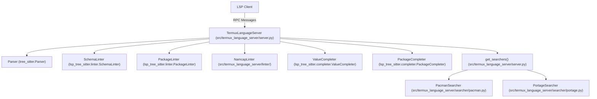

<!-- source: DeepWiki mcp.deepwiki.com · repo termux/termux-language-server · page 1 Overview · fetched 2026-10-26 -->

# Overview

Relevant source files

The following files were used as context for generating this wiki page:

- [LICENSE](LICENSE)
- [README.md](README.md)
- [src/termux_language_server/server.py](src/termux_language_server/server.py)

`termux-language-server` is a specialized language server designed to provide rich IDE features—such as diagnostics, autocomplete, hover documentation, and document links—for specialized build systems, package management scripts, and configuration files. Built on top of the `lsp-tree-sitter` framework, it leverages Tree-sitter grammar parsing and JSON schemas to analyze shell scripts and configuration formats across Android Termux, Arch Linux, Gentoo, Debian/Ubuntu, and Zsh.

Sources: `README.md:39-68`, `src/termux_language_server/server.py:1-77`

---

## Supported File Types and Ecosystems

The language server targets several distinct package management and system configuration ecosystems, supporting script extensions and configuration formats including:

- **Android Termux**: `build.sh` and `*.subpackage.sh` package creation scripts [README.md:41-43]().
- **Arch Linux & MSYS2**: `PKGBUILD`, `*.install`, and `makepkg.conf` [README.md:44-47]().
- **Gentoo**: `*.ebuild`, `*.eclass`, `make.conf`, and `color.map` [README.md:48-52]().
- **Debian / Ubuntu**: `devscripts.conf` and `.devscripts` [README.md:53-54]().
- **Zsh**: `*.mdd` module definition files [README.md:55-56]().

For a complete breakdown of each ecosystem, its associated JSON schemas, searchers, and linters, see [Supported File Types and Ecosystems](#1.2).

Sources: `README.md:39-57`

---

## High-Level Architecture

The core runtime of the language server is anchored by the `TermuxLanguageServer` class defined in `src/termux_language_server/server.py`, which extends `TreeSitterLanguageServer` from `lsp-tree-sitter` [src/termux_language_server/server.py:12-19](). During initialization, the server loads a Tree-sitter Bash parser instance, parses JSON schema definitions from internal assets, and wires up linters (`SchemaLinter`, `PackageLinter`, and optional `NamcapLinter`), completers (`ValueCompleter`, `PackageCompleter`), and ecosystem-specific package searchers (`PacmanSearcher`, `PortageSearcher`) [src/termux_language_server/server.py:19-77]().

Sources: `src/termux_language_server/server.py:1-77`

---

## Child Pages

For more detailed information regarding installation, configuration, and specific subsystems, refer to the following child pages:
- [Getting Started & Installation](#1.1) — Installation via pip/AUR/NUR, optional extras, editor/LSP client integration, and CLI usage.
- [Supported File Types and Ecosystems](#1.2) — Detailed mapping of schemas, searchers, and linters for each ecosystem.

---

