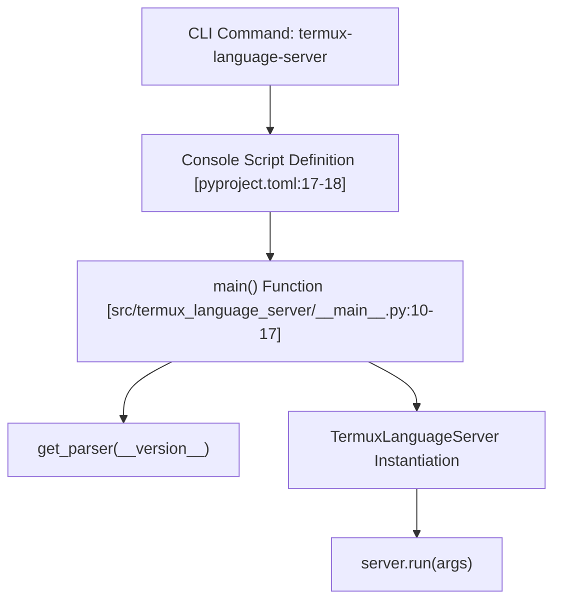
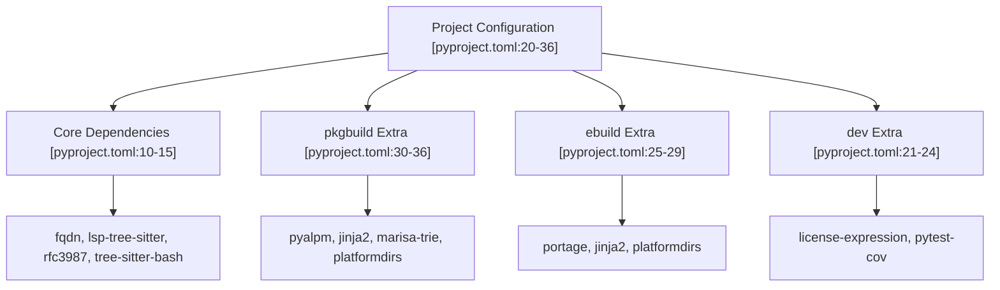

<!-- source: DeepWiki mcp.deepwiki.com · repo termux/termux-language-server · page 1.1 Getting Started & Installation · fetched 2026-10-26 -->

# Getting Started & Installation

<details>
<summary>Relevant source files</summary>

The following files were used as context for generating this wiki page:

- [README.md](README.md)
- [pyproject.toml](pyproject.toml)
- [src/termux_language_server/__main__.py](src/termux_language_server/__main__.py)

</details>


## Purpose and Scope

This document provides complete instructions for installing, configuring, and executing `termux-language-server`. It covers installation workflows via package managers and `pip` (including optional feature extras), command-line interface execution details, and editor integration setups. It targets developers and system administrators setting up the language server runtime environment.

---

## Installation Methods

`termux-language-server` can be installed via standard Python packaging tools or through Linux distribution user repositories (AUR / NUR) for Arch Linux and NixOS environments.

### Installing via `pip` or `uv`

The base package and its optional feature extras can be installed directly from PyPI using `pip` or `uv`:

```bash
pip install termux-language-server
```

To enable ecosystem-specific features such as package validation and searching for Arch Linux (`PKGBUILD`) or Gentoo (`ebuild`), install the corresponding optional extras defined in `pyproject.toml:20-36`:

```bash
pip install "termux-language-server[pkgbuild,ebuild]"
```

### Optional Extras Overview

The project defines three optional dependency groups in `pyproject.toml`:
- `dev`: Development and testing tools (`license-expression`, `pytest-cov`) [pyproject.toml:21-24]().
- `ebuild`: Gentoo ebuild support (`portage`, `jinja2`, `platformdirs`) [pyproject.toml:25-29]().
- `pkgbuild`: Arch Linux PKGBUILD support (`pyalpm`, `jinja2`, `marisa-trie`, `platformdirs`) [pyproject.toml:30-36]().

### Distribution Packages

- **AUR (Arch User Repository):** Maintained packages for Arch Linux allow installation alongside `namcap` and `pacman` toolchains.
- **NUR (Nix User Repository):** Declarative setup for NixOS and Nix environments utilizing python package overlays.

Sources: [pyproject.toml:1-41]()

---

## CLI Usage & Entrypoint Execution

The package registers a console script entry point named `termux-language-server` which resolves to the `main()` function [pyproject.toml:17-18](). 

When invoked, the command line arguments are parsed using `lsp_tree_sitter` parser utilities, initializing the `TermuxLanguageServer` class with the current package version `__version__`, and subsequently executing `server.run(args)` [src/termux_language_server/__main__.py:10-17]().

### Diagram: CLI Entrypoint and Execution Flow



Sources: [pyproject.toml:17-18](), [src/termux_language_server/__main__.py:10-17]()

---

## Optional Dependencies and Extras Resolution

Depending on the target build scripts you intend to edit, you must install the matching optional extras to unlock features like local package database queries, tree-sitter queries, and document linters.

### Diagram: Optional Dependencies and Extras Resolution



Sources: [pyproject.toml:10-36]()

---

## Editor and LSP Client Configuration

To bind `termux-language-server` to your editor (e.g., Neovim, VS Code, or Helix), configure your LSP client to launch the executable with standard I/O transport.

### Neovim Configuration Example

Using `lspconfig` or native `vim.lsp`:

```lua
require'lspconfig'.termux_language_server.setup{
  cmd = { "termux-language-server", "--stdio" },
  filetypes = { "sh", "bash", "pkgbuild", "ebuild" },
  root_dir = function(fname)
    return vim.fs.dirname(vim.fs.find({ 'PKGBUILD', 'build.sh', '.git' }, { upward = true })[1])
  end,
}
```

Ensure that the appropriate optional dependencies (such as `pkgbuild` for `pyalpm` or `ebuild` for `portage`) are installed in the Python environment executing the language server binary.

Sources: [pyproject.toml:1-41](), [src/termux_language_server/__main__.py:1-21]()

---

