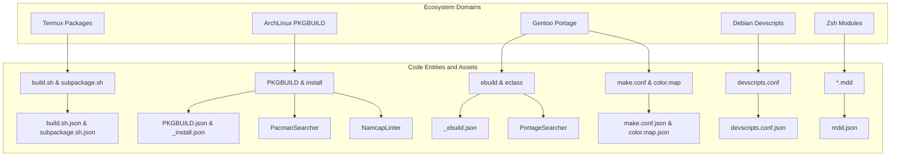
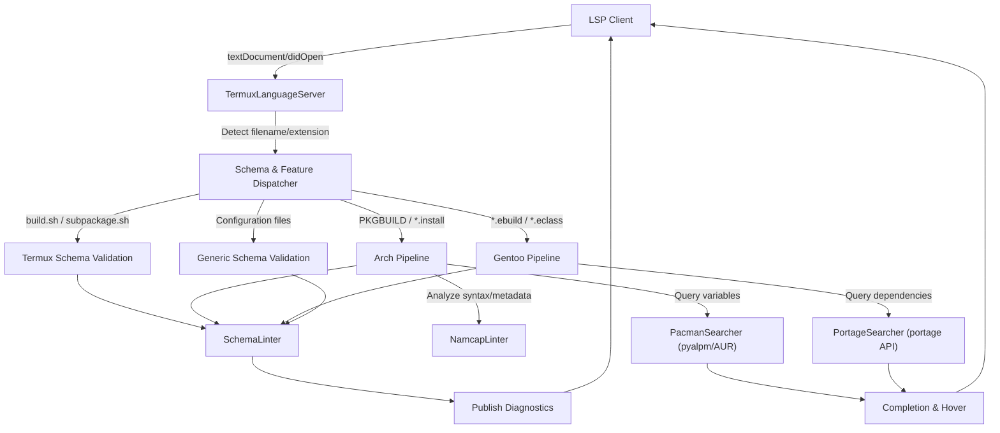

<!-- source: DeepWiki mcp.deepwiki.com · repo termux/termux-language-server · page 1.2 Supported File Types and Ecosystems · fetched 2026-10-26 -->

# Supported Field Types and Ecosystems

Relevant source files

The following files were used as context for generating this wiki page:

- [README.md](README.md)
- [src/termux_language_server/assets/json/_devscripts.json](src/termux_language_server/assets/json/_devscripts.json)
- [src/termux_language_server/assets/json/_mdd.json](src/termux_language_server/assets/json/_mdd.json)
- [src/termux_language_server/assets/json/_subpackage.sh.json](src/termux_language_server/assets/json/_subpackage.sh.json)
- [src/termux_language_server/assets/json/color.map.json](src/termux_language_server/assets/json/color.map.json)
- [src/termux_language_server/assets/json/devscripts.conf.json](src/termux_language_server/assets/json/devscripts.conf.json)
- [src/termux_language_server/assets/json/make.conf.json](src/termux_language_server/assets/json/make.conf.json)

## Purpose and Scope

This page maps out each file type, extension, and packaging ecosystem supported by `termux-language-server`. The language server processes specialized shell scripts and configuration files across Android (Termux), Arch Linux, Gentoo, Debian/Ubuntu, and Zsh. For each file type, the system associates a corresponding JSON Schema for validation and completion, a package searcher for dependency lookups and hover documentation, and an ecosystem-specific linter.

Sources: [README.md:39-57]()

---

## Ecosystem and File Type Mapping

The language server recognizes specific filenames and glob patterns, routing them to appropriate handlers within the server architecture. Below is the complete mapping of supported ecosystems, file types, schemas, searchers, and linters.

| Ecosystem | Filename / Pattern | JSON Schema Asset | Searcher Subsystem | Linter Subsystem |
| :--- | :--- | :--- | :--- | :--- |
| **Android (Termux)** | `build.sh` | `build.sh.json` | None (Basic value completion) | SchemaLinter |
| **Android (Termux)** | `*.subpackage.sh` | `subpackage.sh.json` (`_subpackage.sh.json`) | None | SchemaLinter |
| **Arch Linux / MSYS2** | `PKGBUILD` | `PKGBUILD.json` | `PacmanSearcher` | `NamcapLinter` / SchemaLinter |
| **Arch Linux / MSYS2** | `*.install` | `_install.json` | None | SchemaLinter |
| **Arch Linux / MSYS2** | `makepkg.conf` | `makepkg.conf.json` | None | SchemaLinter |
| **Gentoo** | `*.ebuild` | `_ebuild.json` | `PortageSearcher` | SchemaLinter |
| **Gentoo** | `*.eclass` | `_ebuild.json` | `PortageSearcher` | SchemaLinter |
| **Gentoo** | `make.conf` | `make.conf.json` | None | SchemaLinter |
| **Gentoo** | `color.map` | `color.map.json` | None | SchemaLinter |
| **Debian / Ubuntu** | `devscripts.conf`, `.devscripts` | `devscripts.conf.json` (`_devscripts.json`) | None | SchemaLinter |
| **Zsh** | `*.mdd` | `mdd.json` (`_mdd.json`) | None | SchemaLinter |

Sources: [README.md:39-67](), [src/termux_language_server/assets/json/devscripts.conf.json:1-4](), [src/termux_language_server/assets/json/_devscripts.json:1-4](), [src/termux_language_server/assets/json/_subpackage.sh.json:1-4](), [src/termux_language_server/assets/json/color.map.json:1-4](), [src/termux_language_server/assets/json/make.conf.json:1-4](), [src/termux_language_server/assets/json/_mdd.json:1-4]()

---

## Ecosystem-to-Code Entity Architecture

The following diagram bridges the natural language description of packaging ecosystems to their concrete code entities (schemas, searchers, and linters) implemented in the codebase.

Sources: [README.md:39-68](), [src/termux_language_server/assets/json/_subpackage.sh.json:1-9](), [src/termux_language_server/assets/json/color.map.json:1-6](), [src/termux_language_server/assets/json/make.conf.json:1-6](), [src/termux_language_server/assets/json/_mdd.json:1-6]()

---

## File Processing and Dispatch Data Flow

When a document is opened or edited, the server inspects the filename and path to dispatch the correct schema getter, searcher backend, and linter modules.

Sources: [README.md:60-68](), [src/termux_language_server/assets/json/devscripts.conf.json:1-12](), [src/termux_language_server/assets/json/make.conf.json:1-10]()

---

## Detailed Ecosystem Specifications

### 1. Termux (`build.sh`, `*.subpackage.sh`)
* **Purpose**: Automates cross-compilation of packages for the Android Termux environment.
* **Schema**: Driven by `build.sh.json` and `subpackage.sh.json` (`_subpackage.sh.json`), which mandate `TERMUX_PKG_*` prefix variables (e.g., `TERMUX_PKG_DESCRIPTION`, `TERMUX_PKG_DEPENDS`) and forbid internal builder variables from being overridden.
* **Linters & Searchers**: Uses `SchemaLinter` for static variable validation against the schema. Package searchers are not currently implemented for Termux packages.

Sources: [README.md:41-43](), [src/termux_language_server/assets/json/_subpackage.sh.json:6-48]()

### 2. Arch Linux / MSYS2 (`PKGBUILD`, `*.install`, `makepkg.conf`)
* **Purpose**: Defines source retrieval, build instructions, and packaging metadata for pacman-based distributions.
* **Schema**: `PKGBUILD.json`, `_install.json`, and `makepkg.conf.json`.
* **Linters & Searchers**: 
  * `PacmanSearcher` integrates with `pyalpm` and local AUR caches for package dependency completion and hover cards.
  * `NamcapLinter` executes `namcap` static analysis checks against `PKGBUILD` files.

Sources: [README.md:44-47](), [README.md:63-67]()

### 3. Gentoo (`*.ebuild`, `*.eclass`, `make.conf`, `color.map`)
* **Purpose**: Ebuild scripts define metadata and compilation steps for Portage; `make.conf` and `color.map` manage global build flags and console styling.
* **Schema**: `_ebuild.json`, `make.conf.json`, and `color.map.json`.
* **Linters & Searchers**:
  * `PortageSearcher` queries the live `portage` Python API for `DEPEND`-family variables (`DEPEND`, `RDEPEND`, `BDEPEND`).
  * `SchemaLinter` validates `make.conf` options and `color.map` token identifiers against defined constants.

Sources: [README.md:48-52](), [README.md:64](), [src/termux_language_server/assets/json/color.map.json:7-103](), [src/termux_language_server/assets/json/make.conf.json:7-14]()

### 4. Debian / Ubuntu (`devscripts.conf`, `.devscripts`)
* **Purpose**: Configuration for Debian developer scripts (e.g., `debchange`, `bts`).
* **Schema**: `devscripts.conf.json` (`_devscripts.json`).
* **Linters & Searchers**: Validated via `SchemaLinter`.

Sources: [README.md:53-54](), [src/termux_language_server/assets/json/devscripts.conf.json:1-12]()

### 5. Zsh (`*.mdd`)
* **Purpose**: Module definition files (`.mdd`) describing Zsh loadable modules, their dependencies, objects, and autofeatures.
* **Schema**: `mdd.json` (`_mdd.json`), capturing fields like `name`, `link`, `load`, `moddeps`, and `autofeatures`.
* **Linters & Searchers**: Validated via `SchemaLinter`.

Sources: [README.md:55-56](), [src/termux_language_server/assets/json/_mdd.json:1-61]()

---

