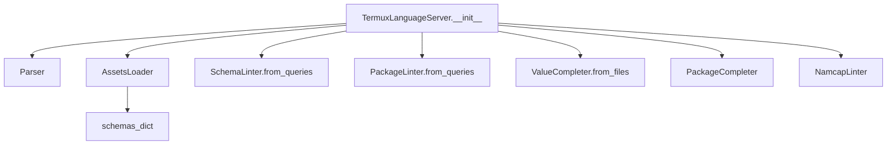

<!-- source: DeepWiki mcp.deepwiki.com · repo termux/termux-language-server · page 2 Server Architecture · fetched 2026-10-26 -->

# Server Architecture

<details>
<summary>Relevant source files</summary>

The following files were used as context for generating this wiki page:

- [src/termux_language_server/__init__.py](src/termux_language_server/__init__.py)
- [src/termux_language_server/server.py](src/termux_language_server/server.py)

</details>


The `termux-language-server` runtime is built on top of the `lsp-tree-sitter` framework, providing language server protocol (LSP) features for shell-based ecosystem build files (`build.sh`, `PKGBUILD`, `ebuild`, etc.). The core orchestration logic resides in `src/termux_language_server/server.py`, which defines the `TermuxLanguageServer` class [src/termux_language_server/server.py:19-52] and wires together tree-sitter parsers, schema definitions, linters, completers, and searchers.

For detailed breakdowns of specific architectural components, refer to the following child pages:
- [Entrypoint and CLI](#2.1) — Details on command-line execution, argument parsing via `lsp_tree_sitter`, and version handling.
- [TermuxLanguageServer Initialization](#2.2) — In-depth look at parser setup, asset loading, schema/searcher getters, and conditional linter registration.
- [Tree-sitter Queries](#2.3) — Documentation on `.scm` query files used for extracting schema variables and package dependencies.

---

```mermaid
graph TD
    "NaturalLanguageSpace" --> "CodeEntitySpace"
    subgraph CodeEntitySpace
        A["TermuxLanguageServer"] --> B["TreeSitterLanguageServer"]
        A --> C["SchemaLinter"]
        A --> D["PackageLinter"]
        A --> E["NamcapLinter"]
        A --> F["ValueCompleter"]
        A --> G["PackageCompleter"]
        A --> H["PacmanSearcher"]
        A --> I["PortageSearcher"]
    end
```
*Figure 1: Mapping architectural concepts from language server requirements to concrete Python classes in `src/termux_language_server/server.py`.*

Sources: `src/termux_language_server/server.py:19-77`

---

## 2.1. Entrypoint and CLI

The server is launched via the Python module execution interface (`python -m termux_language_server`), which delegates argument parsing and process management to the underlying `lsp_tree_sitter` library. Version handling exposes the package version defined in `src/termux_language_server/__init__.py` [src/termux_language_server/__init__.py:5-5].

For full implementation details, see [Entrypoint and CLI](#2.1).

Sources: `src/termux_language_server/__init__.py:5-5`

---

## 2.2. TermuxLanguageServer Initialization

The `TermuxLanguageServer` class inherits from `TreeSitterLanguageServer` [src/termux_language_server/server.py:12,19]. During initialization (`__init__`), it instantiates a Tree-sitter `Parser` configured with the Bash language pointer [src/termux_language_server/server.py:21-23], loads JSON schemas from the package assets directory [src/termux_language_server/server.py:25-31], and registers linters and completers [src/termux_language_server/server.py:33-52]. 

It also dynamically registers platform-specific searchers like `PacmanSearcher` and `PortageSearcher`, as well as optional linters like `NamcapLinter` using defensive `try/except` or `suppress(ImportError)` blocks [src/termux_language_server/server.py:53-77].

For full implementation details, see [TermuxLanguageServer Initialization](#2.2).


*Figure 2: Component wiring flow inside `TermuxLanguageServer.__init__`.*

Sources: `src/termux_language_server/server.py:19-77`

---

## 2.3. Tree-sitter Queries

Tree-sitter `.scm` query files are utilized by the linters and searchers to extract syntactic structures, variables, functions, and dependency fields (such as `@package.PKGBUILD` and `@package._ebuild`) from the abstract syntax tree (AST) produced by the Bash parser.

For full implementation details, see [Tree-sitter Queries](#2.3).

Sources: `src/termux_language_server/server.py:33-38`

---

