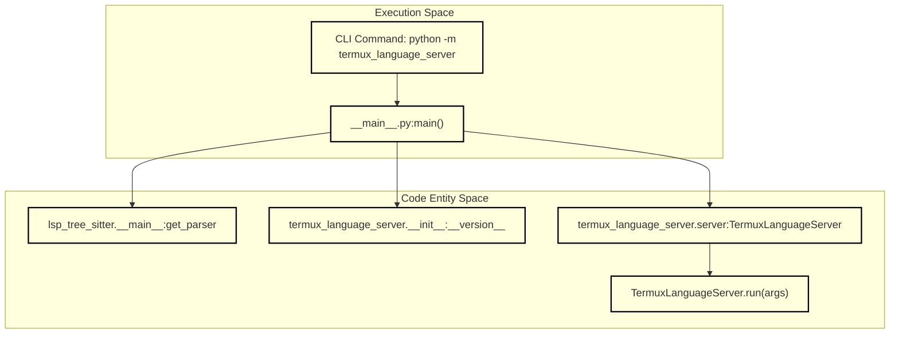
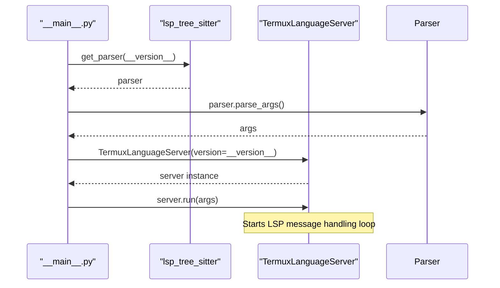

<!-- source: DeepWiki mcp.deepwiki.com · repo termux/termux-language-server · page 2.1 Entrypoint and CLI · fetched 2026-10-26 -->

# Entrypoint and CLI

Relevant source files

The following files were used as context for generating this wiki page:

- [src/termux_language_server/__init__.py](src/termux_language_server/__init__.py)
- [src/termux_language_server/__main__.py](src/termux_language_server/__main__.py)
- [src/termux_language_server/py.typed](src/termux_language_server/py.typed)

This section covers the execution entrypoint and command-line interface (CLI) for `termux-language-server`. It details how the package is invoked via `python -m termux_language_server`, how command-line arguments are parsed using `lsp_tree_sitter`, how version metadata is handled, and how the language server runtime is initialized and executed.

Sources: `[src/termux_language_server/__main__.py:1-21]()`, `[src/termux_language_server/__init__.py:1-5]()`

---

## Module Invocation and `__main__.py`

When the language server is invoked from the command line using the Python module execution flag, Python locates and executes `src/termux_language_server/__main__.py`. This module acts as the thin bootstrap layer connecting standard LSP runtime wrappers to the custom `TermuxLanguageServer` implementation.

The entry point is defined by the `main()` function, which is triggered when the module is executed directly [src/termux_language_server/__main__.py:10-21]().

Sources: `[src/termux_language_server/__main__.py:1-21]()`

---

## CLI Argument Parsing and Version Handling

The CLI parser is delegated to the `lsp_tree_sitter` package via its `get_parser` function [src/termux_language_server/__main__.py:5](). Version handling relies on the module-level `__version__` string defined in `src/termux_language_server/__init__.py` [src/termux_language_server/__init__.py:5](), which is passed directly into the parser constructor [src/termux_language_server/__main__.py:11]().

### Argument Parsing Lifecycle

| Step | Function / Class | Source File | Role |
| :--- | :--- | :--- | :--- |
| **Version Retrieval** | `__version__` | `src/termux_language_server/__init__.py` | Provides the semantic version string (`0.1.9`) for CLI flags and server identity. |
| **Parser Generation** | `get_parser()` | `lsp_tree_sitter.__main__` | Constructs the `argparse.ArgumentParser` configured with standard LSP transport options (stdio, TCP, etc.). |
| **Argument Parsing** | `parser.parse_args()` | `src/termux_language_server/__main__.py:12` | Evaluates command-line arguments provided by the user or LSP client. |

Sources: `[src/termux_language_server/__init__.py:1-6]`, `[src/termux_language_server/__main__.py:1-13]()`

---

## Server Initialization and Execution

Once command-line arguments are parsed, the entrypoint imports the `TermuxLanguageServer` class from `.server` [src/termux_language_server/__main__.py:14](). It instantiates the server class passing the application version, and invokes the `.run(args)` method to start the event loop and communicate via the configured transport [src/termux_language_server/__main__.py:16-17]().

Sources: `[src/termux_language_server/__main__.py:10-18]()`

---

