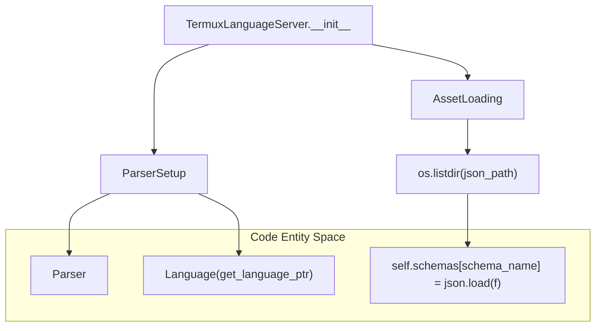
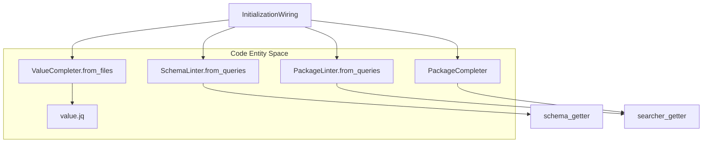
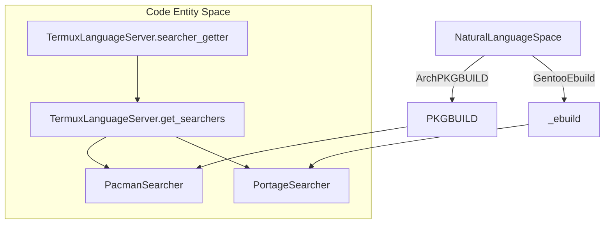
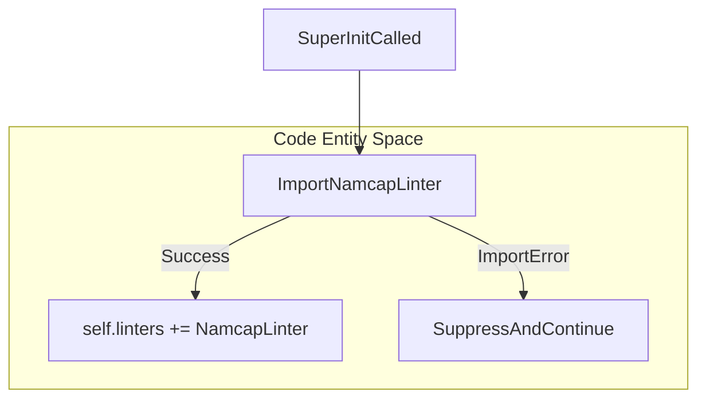

<!-- source: DeepWiki mcp.deepwiki.com · repo termux/termux-language-server · page 2.2 TermuxLanguageServer Initialization · fetched 2026-10-26 -->

# TermuxLanguageServer Initialization

Relevant source files

The following files were used as context for generating this wiki page:

- [src/termux_language_server/assets/jq/value.jq](src/termux_language_server/assets/jq/value.jq)
- [src/termux_language_server/server.py](src/termux_language_server/server.py)

This page details the initialization sequence of the `TermuxLanguageServer` class within the `termux-language-server` codebase. It covers the setup of the Tree-sitter Bash parser, JSON asset loading, linter and completer registration via `lsp-tree-sitter`, dynamic searcher discovery, and conditional linter integration.

---

## 1. Parser and Asset Loading

When `TermuxLanguageServer` is instantiated, it first initializes a Tree-sitter `Parser` instance configured with the Bash language binding (`get_language_ptr`) [src/termux_language_server/server.py:20-23](). 

Following the parser setup, the server loads JSON schema definitions from the built-in assets directory (`src/termux_language_server/assets/json/`) [src/termux_language_server/server.py:25-32](). It iterates over all JSON files in that directory, derives each schema's key from its filename, and stores them in the `self.schemas` dictionary [src/termux_language_server/server.py:26-31]().

*Sources: [src/termux_language_server/server.py:20-32]()*

---

## 2. Linters, Completers, and Queries Wiring

Once schemas are loaded into memory, the server sets up diagnostic linters and completion providers using query files and JSON schemas [src/termux_language_server/server.py:33-44]():

* **`SchemaLinter`**: Created via `SchemaLinter.from_queries`, linking the Tree-sitter language, `queries` module, and the `self.schema_getter` callback [src/termux_language_server/server.py:33-35]().
* **`PackageLinter`**: Created via `PackageLinter.from_queries`, utilizing the language, queries, and `self.searcher_getter` callback [src/termux_language_server/server.py:36-38]().
* **`ValueCompleter`**: Instantiated from files using `value.jq` (`src/termux_language_server/assets/jq/value.jq`), the schema getter, and a trigger prefix `^` [src/termux_language_server/server.py:39-42]().
* **`PackageCompleter`**: Initialized with `self.searcher_getter` [src/termux_language_server/server.py:44]().

Finally, the base class `TreeSitterLanguageServer.__init__` is invoked with the parser, linter tuple, and completer tuple [src/termux_language_server/server.py:46-52]().

*Sources: [src/termux_language_server/server.py:33-52](), [src/termux_language_server/assets/jq/value.jq:1-24]()*

---

## 3. Getter Methods and Ecosystem Searchers

To route schema lookups and package searches based on the active file path, `TermuxLanguageServer` implements two key retrieval methods and a searcher discovery static method [src/termux_language_server/server.py:58-77]():

* **`schema_getter`**: Determines the file type using `PackageSearcher.get_filetype` against `self.schemas` and returns the corresponding schema dictionary [src/termux_language_server/server.py:58-60]().
* **`searcher_getter`**: Resolves the file type against `self.searchers` to return a registered `PackageSearcher` instance [src/termux_language_server/server.py:62-64]().
* **`get_searchers`**: Dynamically imports and maps ecosystem searchers (such as `PacmanSearcher` for `PKGBUILD` and `PortageSearcher` for `_ebuild`) inside a suppression block to gracefully handle missing native dependencies [src/termux_language_server/server.py:66-77]().

*Sources: [src/termux_language_server/server.py:58-77]()*

---

## 4. Conditional Linter Registration

After calling `super().__init__`, the server checks for optional analysis tools by attempting to import `NamcapLinter` [src/termux_language_server/server.py:53-57](). If the import succeeds (i.e., `namcap` and its environment are available), `NamcapLinter` is appended to `self.linters` [src/termux_language_server/server.py:53-57]().

*Sources: [src/termux_language_server/server.py:53-57]()*

---

