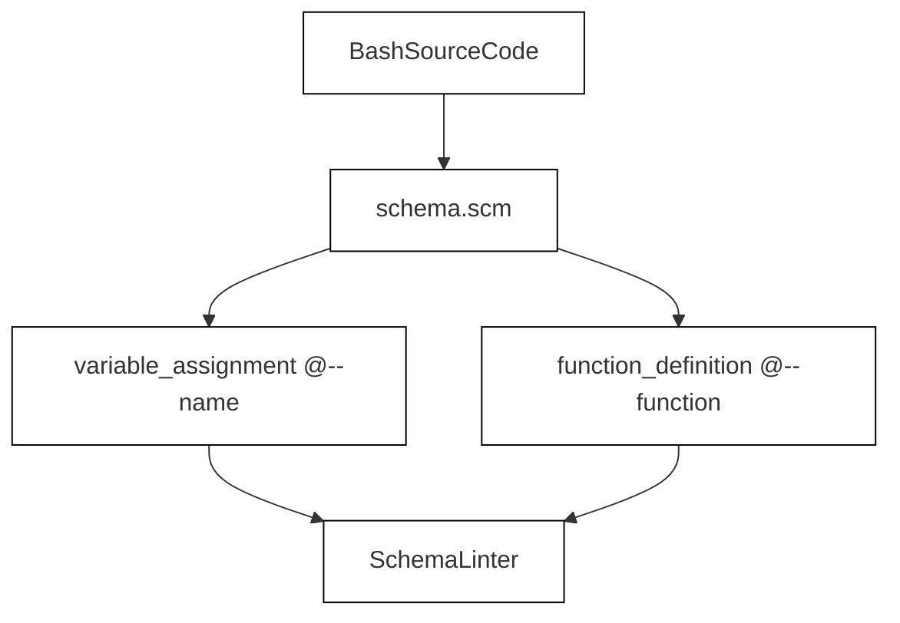
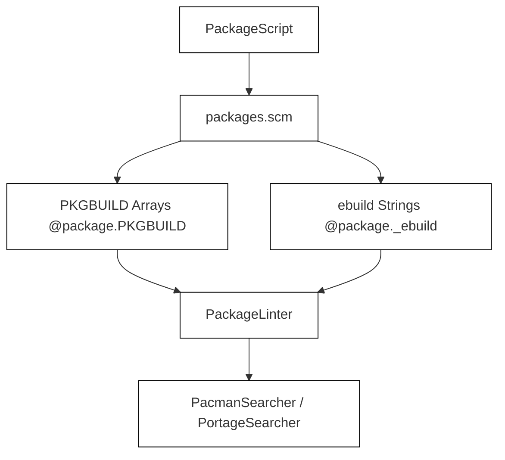
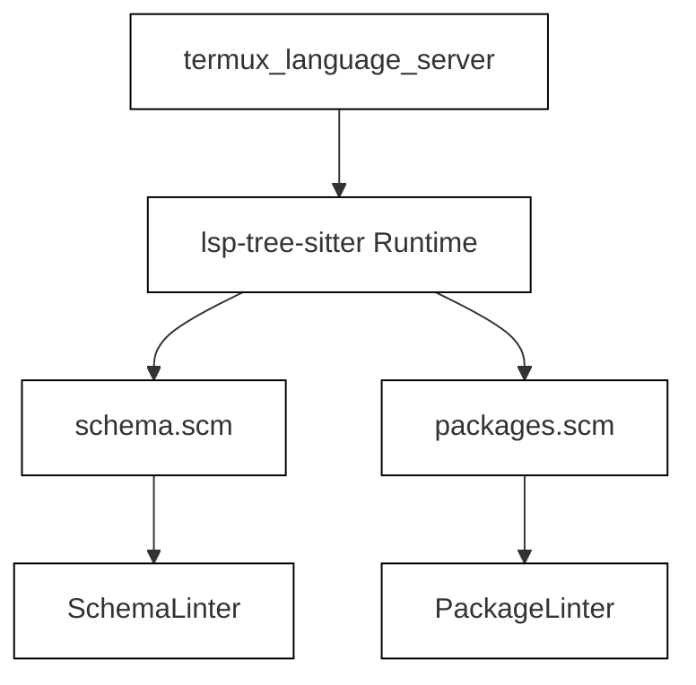

<!-- source: DeepWiki mcp.deepwiki.com · repo termux/termux-language-server · page 2.3 Tree-sitter Queries · fetched 2026-10-26 -->

# Tree-sitter Queries

Relevant source files

The following files were used as context for generating this wiki page:

- [src/termux_language_server/queries/packages.scm](src/termux_language_server/queries/packages.scm)
- [src/termux_language_server/queries/schema.scm](src/termux_language_server/queries/schema.scm)

This leaf page details the implementation and schema structure of the Tree-sitter query files (`.scm`) used within `termux-language-server`. These declarative query files are processed by `lsp-tree-sitter` to parse shell-based scripts, extracting variable assignments, function definitions, and ecosystem-specific dependency references (such as Arch Linux `PKGBUILD` and Gentoo `ebuild` files).

---

## 1. Variable and Function Extraction (`schema.scm`)

The `schema.scm` query file is responsible for structural extraction of shell scripts, capturing both scalar/array variable assignments and function definitions. It relies on specialized capture names interpreted by the language server framework to handle shell tokenization, shlex expansion, and integer-valued metadata.

### Query Breakdown
* **Scalar Assignments:** Matches `variable_assignment` nodes containing words, raw strings, standard strings, or concatenated expressions, exposing them via `@--name` and `@-name` tags [src/termux_language_server/queries/schema.scm:1-16]().
* **Array Assignments:** Matches array declarations containing words, strings, or concatenations, parsing individual elements for validation [src/termux_language_server/queries/schema.scm:17-36]().
* **Function Definitions:** Identifies shell functions using `function_definition` and annotates them with integer evaluation properties (`#set! -function.--integer 0`) [src/termux_language_server/queries/schema.scm:37-39]().

*Sources: [src/termux_language_server/queries/schema.scm:1-39]()*

---

## 2. Package and Dependency Captures (`packages.scm`)

The `packages.scm` query file targets packaging metadata fields across different distribution ecosystems. It uses Tree-sitter predicates (`#any-of?`) to isolate array elements and string values belonging to dependency variables.

### Ecosystem Rules
* **Arch Linux (`PKGBUILD`):** Captures package references from array variables (`depends`, `makedepends`, `optdepends`, `conflicts`, `provides`, `replaces`) formatted as words, raw strings, or string contents, tagging them as `@package.PKGBUILD` [src/termux_language_server/queries/packages.scm:1-19]().
* **Gentoo (`ebuild`):** Captures package specifiers from scalar string variables in the dependency family (`DEPEND`, `RDEPEND`, `BDEPEND`, `IDEPEND`, `PDEPEND`), tagging them as `@package._ebuild` [src/termux_language_server/queries/packages.scm:20-24]().

*Sources: [src/termux_language_server/queries/packages.scm:1-24]()*

---

## 3. Query Processing and Runtime Integration

The language server loads these `.scm` files during initialization, feeding them into the underlying `lsp-tree-sitter` runtime engine. The engine uses the query matches to construct AST representations that drive both `SchemaLinter` and `PackageLinter` diagnostics.

*Sources: [src/termux_language_server/queries/schema.scm:1-39](), [src/termux_language_server/queries/packages.scm:1-24]()*

---

