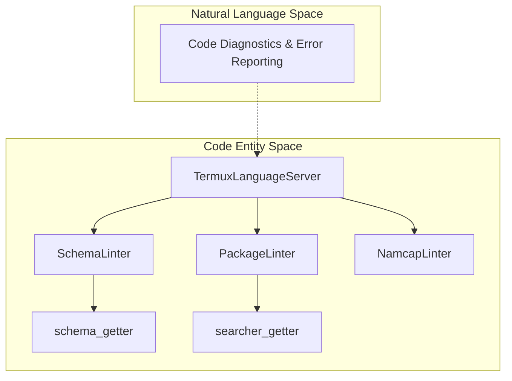
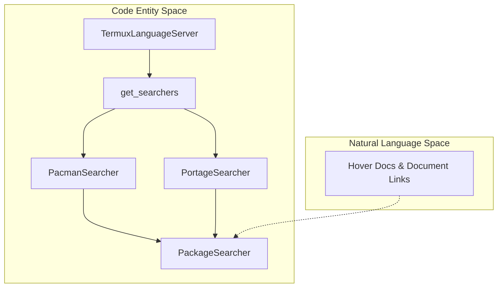

<!-- source: DeepWiki mcp.deepwiki.com · repo termux/termux-language-server · page 3 Language Features · fetched 2026-10-26 -->

# Language Features

Relevant source files

The following files were used as context for generating this wiki page:

- [README.md](README.md)
- [src/termux_language_server/server.py](src/termux_language_server/server.py)

This page provides a high-level overview of the core language features supported by `termux-language-server`, including diagnostics, completion, hover documentation, and document links. These features are powered by tree-sitter queries, JSON schemas, and ecosystem-specific package searchers wired through `lsp-tree-sitter`.

For details, see the child pages:
- [Diagnostics and Linters](#3.1)
- [Package Searchers](#3.2)
- [Completion and JQ Value Filters](#3.3)

---

## 3.1 Diagnostics and Linters

Diagnostics identify syntax errors, invalid property assignments, and package dependency issues across supported scripts. The server integrates multiple linter components initialized within `TermuxLanguageServer`:

- **`SchemaLinter`**: Validates parsed script variables and structure against ecosystem JSON schemas [src/termux_language_server/server.py:33-35]().
- **`PackageLinter`**: Validates package references in dependency fields using registered searchers [src/termux_language_server/server.py:36-38]().
- **`NamcapLinter`**: Performs optional static analysis on Arch Linux `PKGBUILD` files using `namcap` [src/termux_language_server/server.py:53-56]().

For deep technical details, schema validation rules, and linter wiring, see [Diagnostics and Linters](#3.1).

*Figure 1: Bridging diagnostic features to linter classes.*

Sources: `src/termux_language_server/server.py:19-57`

---

## 3.2 Package Searchers

Package searchers abstract package manager databases and upstream metadata repositories. They power package completion, hover documentation cards, and clickable document links for dependency fields.

- **`PacmanSearcher`**: Queries local `pyalpm` databases and caches for Arch Linux and MSYS2 ecosystems [src/termux_language_server/server.py:69-72]().
- **`PortageSearcher`**: Interacts with Gentoo's `portage` API for ebuilds and make.conf [src/termux_language_server/server.py:73-76]().

For details on database querying, virtual package resolution, and doc rendering, see [Package Searchers](#3.2).

*Figure 2: Bridging hover and linking features to searcher classes.*

Sources: `src/termux_language_server/server.py:62-77`

---

## 3.3 Completion and JQ Value Filters

Completion features assist users by suggesting valid property names, enumeration values, and installable package names. 

- **`ValueCompleter`**: Evaluates JSON schemas using `assets/jq/value.jq` to extract valid candidate values for script variables [src/termux_language_server/server.py:39-42]().
- **`PackageCompleter`**: Supplies ecosystem-specific package names dynamically via `searcher_getter` [src/termux_language_server/server.py:44]().

For details on JQ query execution and completion wiring, see [Completion and JQ Value Filters](#3.3).

Sources: `src/termux_language_server/server.py:39-52`

---

