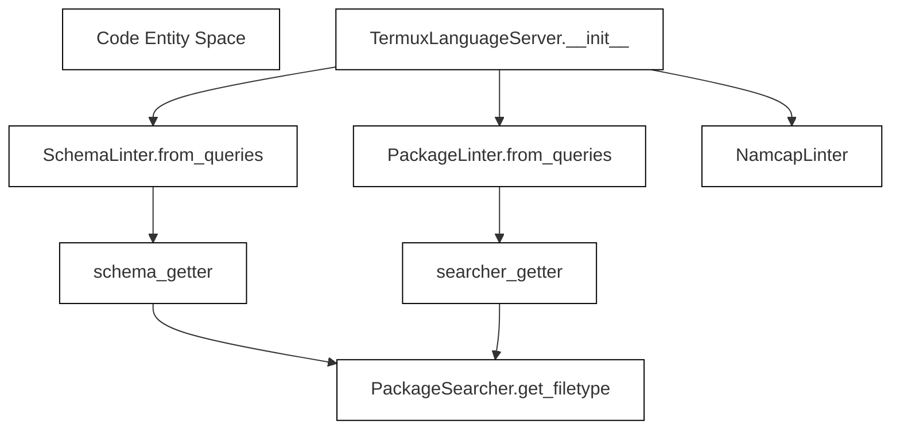
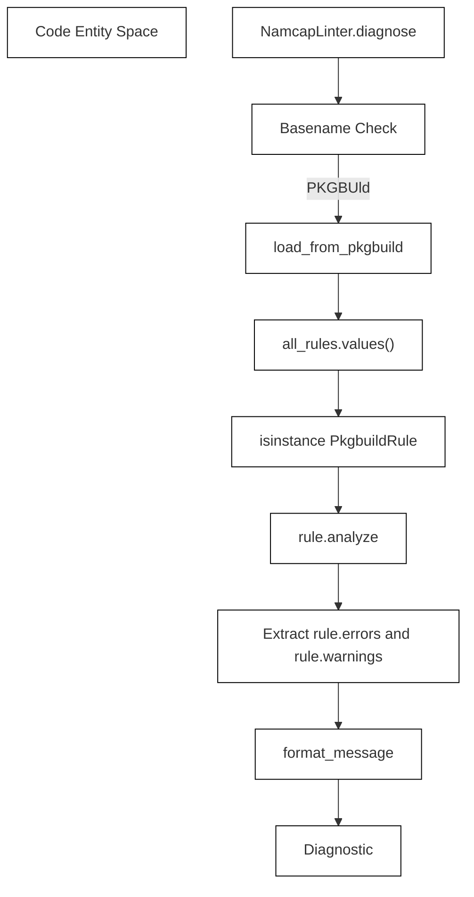

<!-- source: DeepWiki mcp.deepwiki.com · repo termux/termux-language-server · page 3.1 Diagnostics and Linters · fetched 2026-10-26 -->

# Diagnostics and Linters

Relevant source files

The following files were used as context for generating this wiki page:

- [src/termux_language_server/linter.py](src/termux_language_server/linter.py)
- [src/termux_language_server/server.py](src/termux_language_server/server.py)

## Purpose and Scope

This section covers the diagnostic subsystems and linters wired into `TermuxLanguageServer`. It details how `SchemaLinter` and `PackageLinter` are instantiated using tree-sitter queries and schema/searcher getters, and explains the implementation of `NamcapLinter` for static analysis of Arch Linux `PKGBUILD` files via the upstream `Namcap` package.

Sources: [src/termux_language_server/server.py:1-77](), [src/termux_language_server/linter.py:1-47]()

---

## Core Linter Architecture and Wiring

The language server delegates syntax validation and structural constraints to `SchemaLinter` and dependency verification to `PackageLinter`, both provided by `lsp_tree_sitter`. During the initialization of `TermuxLanguageServer`, these linters are wired using tree-sitter language pointers, query modules, and lookup getters.

`SchemaLinter` validates node structures against loaded JSON schemas, while `PackageLinter` utilizes searchers to verify package availability and reference correctness.

*Figure 1: Linter wiring architecture bridging system initialization to `SchemaLinter`, `PackageLinter`, and `NamcapLinter`.*

Sources: [src/termux_language_server/server.py:19-57]()

---

## NamcapLinter Implementation

The `NamcapLinter` class extends `LinterBase` to provide specialized linting for Arch Linux `PKGBUILD` files [src/termux_language_server/linter.py:26-27](). It integrates the external `Namcap` library to apply packaging rules and report warnings or errors.

### Execution Flow

When a document's syntax tree is evaluated, `NamcapLinter.diagnose` executes the following sequence:
1. Verifies that the target file's basename equals `PKGBUILD` [src/termux_language_server/linter.py:28-31]().
2. Extracts source node text and loads package metadata via `load_from_pkgbuild(path)` [src/termux_language_server/linter.py:32-33]().
3. Iterates over all available Namcap rules (`all_rules.values()`) filtering for instances of `PkgbuildRule` [src/termux_language_server/linter.py:35-37]().
4. Executes `rule.analyze(pkginfo, "PKGBUILD")` [src/termux_language_server/linter.py:38]().
5. Collects errors and warnings, mapping them to LSP `DiagnosticSeverity.Error` and `DiagnosticSeverity.Warning` respectively [src/termux_language_server/linter.py:39-42]().
6. Constructs and returns a list of LSP `Diagnostic` objects [src/termux_language_server/linter.py:44-47]().

*Figure 2: Data flow inside `NamcapLinter.diagnose`.*

Sources: [src/termux_language_server/linter.py:26-47]()

---

## Conditional Linter Registration

`NamcapLinter` is registered conditionally within `TermuxLanguageServer.__init__` using a suppressed `ImportError` block [src/termux_language_server/server.py:53-56](). If the `Namcap` package is absent from the Python environment, the linter is omitted without disrupting core language server operations.

Sources: [src/termux_language_server/server.py:53-57]()

---

