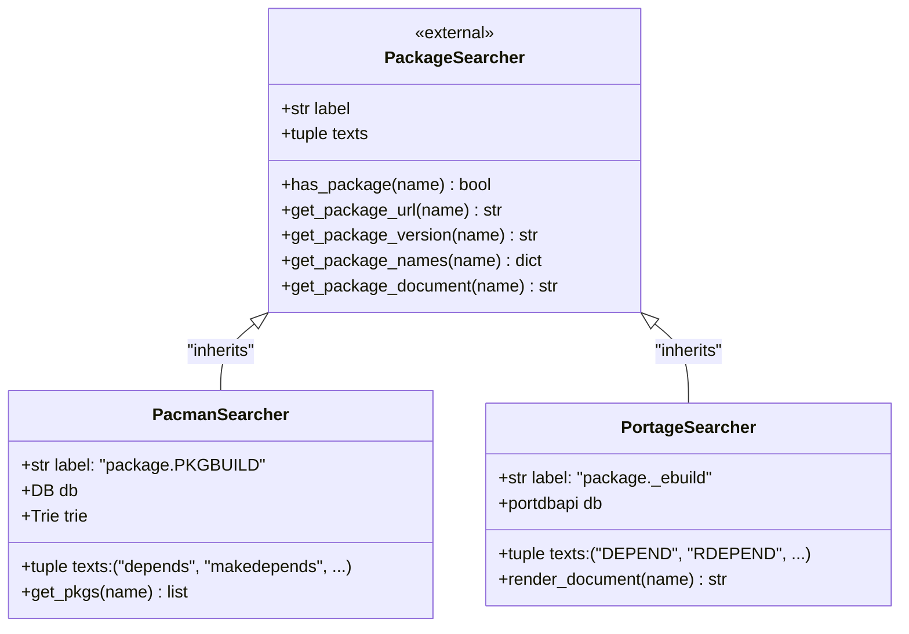

<!-- source: DeepWiki mcp.deepwiki.com · repo termux/termux-language-server · page 3.2 Package Searchers · fetched 2026-10-26 -->

# Package Searchers

Relevant source files

The following files were used as context for generating this wiki page:

- [src/termux_language_server/searcher/pacman.py](src/termux_language_server/searcher/pacman.py)
- [src/termux_language_server/searcher/portage.py](src/termux_language_server/searcher/portage.py)

The package searcher subsystem provides intelligent package resolution, completion candidate generation, documentation rendering, and document link creation for package manager dependency fields. By integrating with underlying system package managers (`pyalpm` for Arch Linux and `portage` for Gentoo), the language server maps dependency strings to local database records, virtual packages, and upstream repositories (such as the AUR).

For details on specific implementations, refer to the child pages:
- [PacmanSearcher (Arch/PKGBUILD)](#3.2.1)
- [PortageSearcher (Gentoo/ebuild)](#3.2.2)

---

## Subsystem Architecture

The package searcher infrastructure is built upon the `PackageSearcher` base class provided by the external `lsp-tree-sitter` library [src/termux_language_server/searcher/pacman.py:10](). Subclasses define specific tree-sitter node label associations and field names (such as `depends` or `DEPEND`) that trigger package-aware features like hover tooltips and completions.

*Figure 1: Class hierarchy of package searchers bridging natural language queries to backend package database implementations.*

Sources: `src/termux_language_server/searcher/pacman.py:10-48`, `src/termux_language_server/searcher/portage.py:11-37`

---

## PacmanSearcher (Arch Linux / PKGBUILD)

The `PacmanSearcher` class handles package metadata resolution for Arch Linux `PKGBUILD` files [src/termux_language_server/searcher/pacman.py:34-108](). It interfaces with local `libalpm` databases via `pyalpm` [src/termux_language_server/searcher/pacman.py:45-47]() and optionally queries AUR caches backed by `marisa-trie` [src/termux_language_server/searcher/pacman.py:24-30](). Jinja2 templates are used to format package hover documentation [src/termux_language_server/searcher/pacman.py:17-21]().

For deep technical details, virtual package resolution logic, and configuration overrides, see [PacmanSearcher (Arch/PKGBUILD)](#3.2.1).

Sources: `src/termux_language_server/searcher/pacman.py:1-109`

---

## PortageSearcher (Gentoo / ebuild)

The `PortageSearcher` class manages package queries for Gentoo `ebuild` files [src/termux_language_server/searcher/portage.py:25-70](). It queries the Portage porttree API (`portdbapi`) to resolve dependencies across `DEPEND`-family variables (`DEPEND`, `RDEPEND`, `BDEPEND`, `IDEPEND`, `PDEPEND`) [src/termux_language_server/searcher/portage.py:27-36]() and delegates asynchronous documentation rendering using Jinja templates [src/termux_language_server/searcher/portage.py:17-21](), `ThreadPoolExecutor` [src/termux_language_server/searcher/portage.py:37](), and Portage auxiliary metadata (`aux_get`) [src/termux_language_server/searcher/portage.py:58-60]().

For deep technical details, keyword parsing, and template configuration, see [PortageSearcher (Gentoo/ebuild)](#3.2.2).

Sources: `src/termux_language_server/searcher/portage.py:1-71`

---

