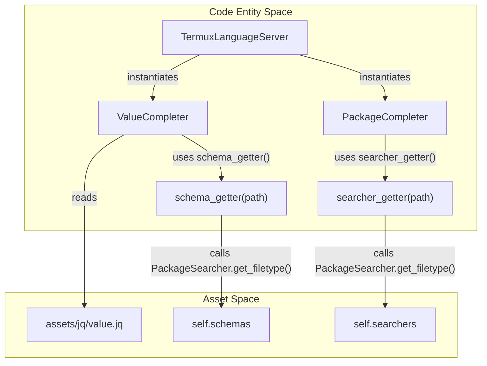
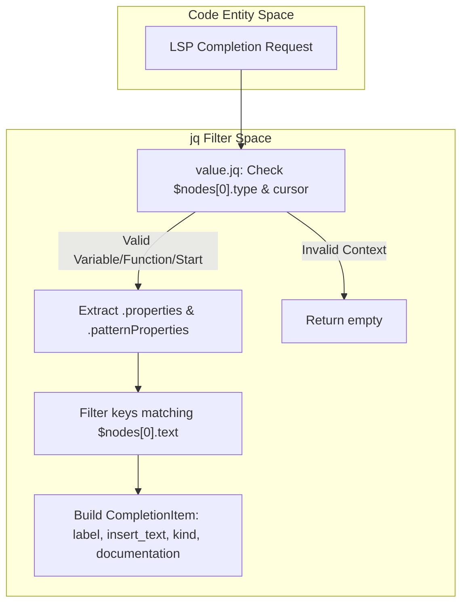
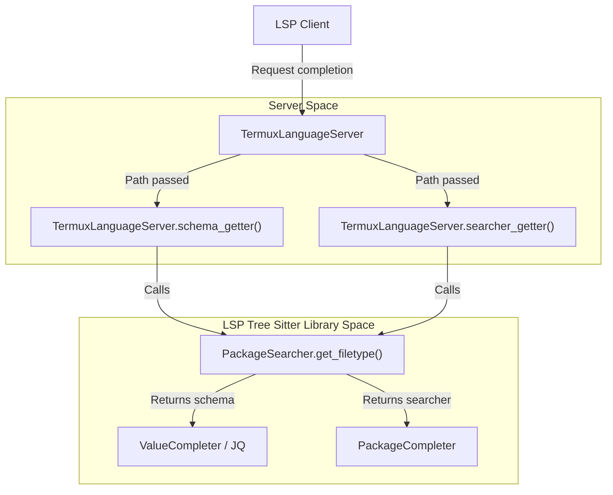

<!-- source: DeepWiki mcp.deepwiki.com · repo termux/termux-language-server · page 3.3 Completion and JQ Value Filters · fetched 2026-10-26 -->

# Completion and JQ Value Filters

Relevant source files

The following files were used as context for generating this wiki page:

- [src/termux_language_server/assets/jq/value.jq](src/termux_language_server/assets/jq/value.jq)
- [src/termux_language_server/server.py](src/termux_language_server/server.py)

## Purpose and Scope

This page details the completion subsystem within `termux-language-server`. It covers how `lsp-tree-sitter`'s `ValueCompleter` and `PackageCompleter` are initialized within `TermuxLanguageServer`, how file types are mapped to schemas and searchers, and the internals of `assets/jq/value.jq`, which uses `jq` to extract and format candidate completion values directly from JSON schemas based on AST node context.

Sources: [src/termux_language_server/server.py:39-50]()

---

## Completer Initialization and Wiring

The completion subsystem is initialized inside `TermuxLanguageServer.__init__` in `src/termux_language_server/server.py`. It instantiates two primary completers provided by `lsp-tree-sitter`:

1. `ValueCompleter`: Configured via `ValueCompleter.from_files`, which loads `assets/jq/value.jq` [src/termux_language_server/server.py:39-42](). It uses `self.schema_getter` to retrieve the active schema based on the document path and a trigger prefix (`"^"`).
2. `PackageCompleter`: Initialized with `self.searcher_getter` to supply ecosystem-specific package suggestions (such as from Pacman or Portage) [src/termux_language_server/server.py:44]().

Sources: [src/termux_language_server/server.py:39-65]()

---

## JQ Value Filter Mechanics (`value.jq`)

The script `src/termux_language_server/assets/jq/value.jq` processes incoming schema definitions and evaluates AST context ($nodes, $cursor, $complete) to dynamically generate completion items.

### Execution Flow and Logic

1. **Context Inspection**: The script inspects the primary node type `$nodes[0].type` and cursor position `$cursor[1]` [src/termux_language_server/assets/jq/value.jq:1-2]().
2. **Property Extraction**: If the cursor is at the beginning of a line, or if the node type is a `variable_name` or a function definition `word`, it combines the schema's `.properties` and transformed `.patternProperties` (stripping regex anchors `[$^]` and capturing groups) into a unified property map [src/termux_language_server/assets/jq/value.jq:3-5]().
3. **Filtering & Mapping**: Each property is evaluated against the current token text ($nodes[0].text) and completion flag ($complete) [src/termux_language_server/assets/jq/value.jq:6-7](). Matching keys yield an LSP `CompletionItem` containing:
   - `label` and `insert_text` [src/termux_language_server/assets/jq/value.jq:9-10]()
   - `kind`: Mapped dynamically to `Variable`, `Function`, or `Constant` depending on `$type` [src/termux_language_server/assets/jq/value.jq:11-19]()
   - `documentation`: Extracted from the schema's `.value.description` field formatted as Markdown [src/termux_language_server/assets/jq/value.jq:20]()

Sources: [src/termux_language_server/assets/jq/value.jq:1-24]()

---

## Schema and Searcher Retrieval Helpers

To determine which schema or package searcher applies to a given document path, `TermuxLanguageServer` relies on helper methods that interface with `PackageSearcher.get_filetype` [src/termux_language_server/server.py:58-64]():

- `schema_getter(path: str)`: Resolves the file type from `self.schemas` using `PackageSearcher.get_filetype(path, self.schemas)` and returns the matching JSON schema dictionary [src/termux_language_server/server.py:58-60]().
- `searcher_getter(path: str)`: Resolves the file type from `self.searchers` using `PackageSearcher.get_filetype(path, self.searchers)` to locate ecosystem-specific handlers such as `PacmanSearcher` or `PortageSearcher` [src/termux_language_server/server.py:62-77]().

Sources: [src/termux_language_server/server.py:58-77]()

---

