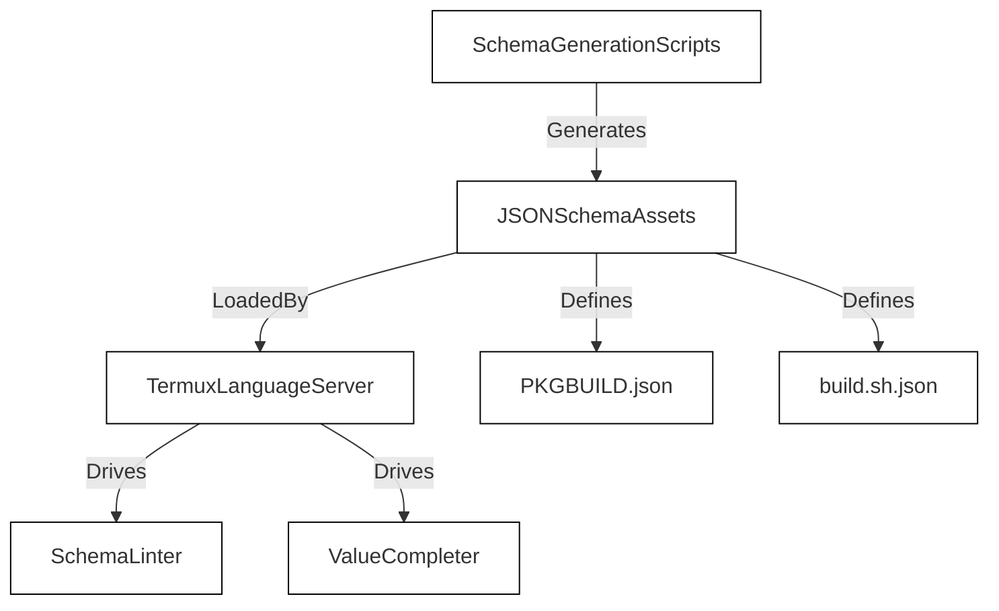
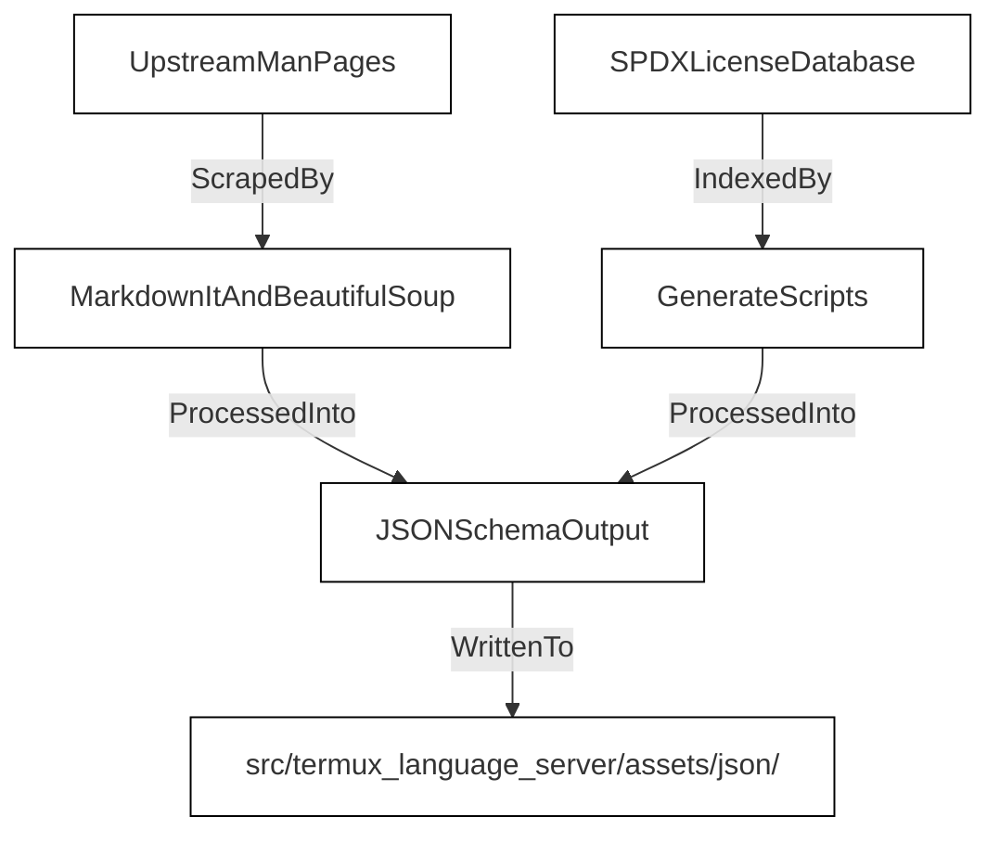

<!-- source: DeepWiki mcp.deepwiki.com · repo termux/termux-language-server · page 4 Schema Assets · fetched 2026-10-26 -->

# Schema Assets

Relevant source files

The following files were used as context for generating this wiki page:

- [src/termux_language_server/assets/json/PKGBUILD.json](src/termux_language_server/assets/json/PKGBUILD.json)
- [src/termux_language_server/assets/json/build.sh.json](src/termux_language_server/assets/json/build.sh.json)
- [tests/PKGBUILD](tests/PKGBUILD)
- [tests/build.sh](tests/build.sh)

The `termux-language-server` utilizes a collection of declarative JSON Schema files located under `src/termux_language_server/assets/json/` to drive structural validation, hover documentation, and autocomplete value filtering across supported packaging ecosystems [src/termux_language_server/assets/json/PKGBUILD.json:1-10, src/termux_language_server/assets/json/build.sh.json:1-12](). These assets separate schema definitions from runtime logic, enabling dynamic reloading and automated code generation from upstream documentation sources.

This parent page provides a high-level overview of the JSON Schema assets and their relationships to validation components. For detailed properties, structural breakdowns, and generation pipelines, refer to the respective child pages:
- [PKGBUILD and Arch Schemas](#4.1)
- [Termux build.sh Schema](#4.2)
- [Gentoo and Misc Schemas](#4.3)
- [Schema Generation Scripts](#4.4)

*Figure 1: Schema Asset Lifecycle and Code Entity Integration*

Sources: [src/termux_language_server/assets/json/PKGBUILD.json:1-10](), [src/termux_language_server/assets/json/build.sh.json:1-12]()

---

## 4.1. PKGBUILD and Arch Schemas

Arch Linux packaging assets include `PKGBUILD.json`, `_install.json`, and `makepkg.conf.json`. These schemas validate package metadata fields (e.g., `pkgname`, `pkgver`, `pkgrel`), restrict licensing values using SPDX expression lists, enforce lifecycle function pattern properties (`package`, `prepare`, `build`, `check`), and validate build architecture arrays [src/termux_language_server/assets/json/PKGBUILD.json:1-75](). 

For full details on metadata properties, pattern properties for lifecycle hooks, license lists, and companion configuration files, see [PKGBUILD and Arch Schemas](#4.1).

Sources: [src/termux_language_server/assets/json/PKGBUILD.json:1-75](), [tests/PKGBUILD:1-19]()

---

## 4.2. Termux build.sh Schema

The `build.sh.json` asset governs Termux build scripts (`build.sh`). It enforces required package configuration variables such as `TERMUX_PKG_HOMEPAGE`, `TERMUX_PKG_DESCRIPTION`, `TERMUX_PKG_LICENSE`, `TERMUX_PKG_VERSION`, and `TERMUX_PKG_AUTO_UPDATE`, while specifying disallowed internal builder functions and subpackage structures [src/termux_language_server/assets/json/build.sh.json:1-12]().

For a complete breakdown of required `TERMUX_PKG_*` properties, subpackage definitions, and builder validation rules, see [Termux build.sh Schema](#4.2).

Sources: [src/termux_language_server/assets/json/build.sh.json:1-12](), [tests/build.sh:1-38]()

---

## 4.3. Gentoo and Misc Schemas

Gentoo and miscellaneous ecosystems are supported via schemas including `_ebuild.json`, `make.conf.json`, `color.map.json`, `devscripts.conf.json`, and `_mdd.json`. These schemas map variable constraints, ebuild phase functions, and configuration flags to their respective upstream documentation references.

For information on ebuild syntax rules, configuration file properties, and source documentation mappings, see [Gentoo and Misc Schemas](#4.3).

Sources: [src/termux_language_server/assets/json/PKGBUILD.json:1-5]()

---

## 4.4. Schema Generation Scripts

Schema assets are not maintained manually; instead, they are regenerated via Python scripts located in `scripts/`. These scripts utilize tools like `markdown-it` and `BeautifulSoup` to scrape upstream man pages and wikis, parse SPDX license expression indexes, and output standardized JSON schemas into `src/termux_language_server/assets/json/`.

*Figure 2: Upstream Scraping and Schema Generation Pipeline*

For implementation details on scrapers, SPDX parsing routines, and asset regeneration workflows, see [Schema Generation Scripts](#4.4).

Sources: [src/termux_language_server/assets/json/PKGBUILD.json:1-5](), [src/termux_language_server/assets/json/build.sh.json:1-5]()

---

