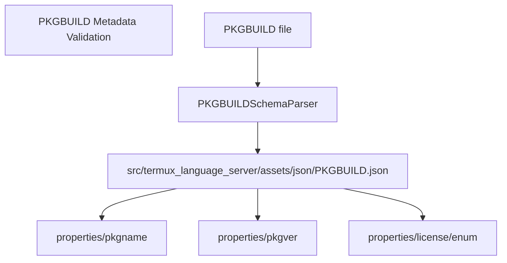
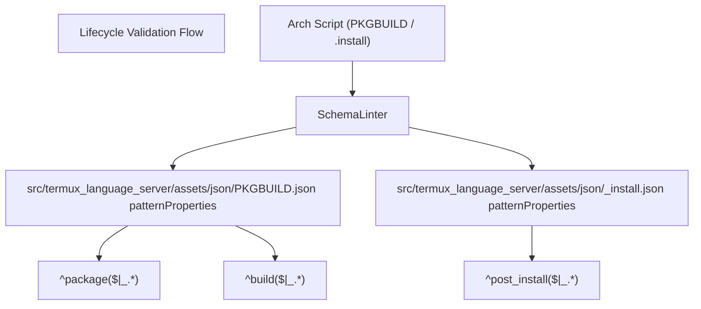

<!-- source: DeepWiki mcp.deepwiki.com · repo termux/termux-language-server · page 4.1 PKGBUILD and Arch Schemas · fetched 2026-10-26 -->

# PKGBUILD and Arch Schemas

<details>
<summary>Relevant source files</summary>

The following files were used as context for generating this wiki page:

- [src/termux_language_server/assets/json/PKGBUILD.json](src/termux_language_server/assets/json/PKGBUILD.json)
- [src/termux_language_server/assets/json/_install.json](src/termux_language_server/assets/json/_install.json)
- [src/termux_language_server/assets/json/makepkg.conf.json](src/termux_language_server/assets/json/makepkg.conf.json)
- [tests/PKGBUILD](tests/PKGBUILD)

</details>


## Purpose and Scope

This page details the JSON Schema specifications that govern Arch Linux build files, package installation scripts, and configuration files within `termux-language-server`. These schemas are located in `src/termux_language_server/assets/json/` and drive validation, hover documentation, and auto-completion for `PKGBUILD`, `makepkg.conf`, and `.install` scripts.

---

## 1. `PKGBUILD.json` Structure and Metadata Properties

The `PKGBUILD.json` schema defines the structure of Arch Linux packaging build scripts. It enforces constraints on core metadata variables such as `pkgname`, `pkgver`, `pkgrel`, `epoch`, `pkgdesc`, `url`, and `license` [src/termux_language_server/assets/json/PKGBUILD.json:24-70].

- **`pkgname`**: Accepts either a single string or a unique array of strings representing split packages [src/termux_language_server/assets/json/PKGBUILD.json:25-39].
- **`pkgver`**: Validates version strings containing no colons, forward slashes, hyphens, or whitespace, or allows a integer constant `0` for dynamic versioning [src/termux_language_server/assets/json/PKGBUILD.json:40-50].
- **`pkgrel`**: Specifies the distribution-specific release number as a positive integer or subrelease format [src/termux_language_server/assets/json/PKGBUILD.json:51-54].
- **`license`**: An array containing strings constrained by an extensive list of valid SPDX license identifiers and common exceptions [src/termux_language_server/assets/json/PKGBUILD.json:68-135].


*Sources: `src/termux_language_server/assets/json/PKGBUILD.json`*

---

## 2. Lifecycle Pattern Properties

To validate lifecycle functions within `PKGBUILD` scripts and `.install` scripts, the schemas rely on regular expression-based `patternProperties`.

### `PKGBUILD.json` Lifecycle Functions
The `PKGBUILD.json` schema defines pattern matching for mandatory and optional packaging hooks [src/termux_language_server/assets/json/PKGBUILD.json:6-23]:
- `^package($|_.*)`: Validates the packaging phase executed via `fakeroot` [src/termux_language_server/assets/json/PKGBUILD.json:7-10].
- `^prepare($|_.*)`: Validates source preparation and patching [src/termux_language_server/assets/json/PKGBUILD.json:11-14].
- `^build($|_.*)`: Validates compilation steps [src/termux_language_server/assets/json/PKGBUILD.json:15-18].
- `^check($|_.*)`: Validates test-suite execution phases [src/termux_language_server/assets/json/PKGBUILD.json:19-22].

### `_install.json` Package Scripts
The `_install.json` schema defines patterns for Arch package install/upgrade/removal hooks (`pre_install`, `post_install`, `pre_upgrade`, `post_upgrade`, `pre_remove`, `post_remove`) [src/termux_language_server/assets/json/_install.json:6-31].


*Sources: `src/termux_language_server/assets/json/PKGBUILD.json`, `src/termux_language_server/assets/json/_install.json`*

---

## 3. Configuration with `makepkg.conf.json`

The `makepkg.conf.json` schema regulates configuration options for the package build environment [src/termux_language_server/assets/json/makepkg.conf.json:5-90]. 

| Property | Type | Description |
| :--- | :--- | :--- |
| `DLAGENTS` | `array` | Protocol-specific download agents and options [src/termux_language_server/assets/json/makepkg.conf.json:7-14] |
| `VCSCLIENTS` | `array` | Required packages for fetching VCS sources [src/termux_language_server/assets/json/makepkg.conf.json:15-22] |
| `CFLAGS` / `CXXFLAGS` | `string` | Flags passed to C and C++ compilers [src/termux_language_server/assets/json/makepkg.conf.json:35-42] |
| `BUILDENV` | `array` (enum) | Environment flags such as `distcc`, `!distcc`, `ccache`, `check`, `sign` [src/termux_language_server/assets/json/makepkg.conf.json:71-90] |

*Sources: `src/termux_language_server/assets/json/makepkg.conf.json`*

---

## 4. Schema Generation and Maintenance

As noted in the comment headers of each schema asset, these files are auto-generated and should not be edited directly [src/termux_language_server/assets/json/PKGBUILD.json:4]:

```json
"$comment": "Don't edit this file directly! It is generated by `termux-language-server --generate-schema=PKGBUILD`."
```

Updates to upstream Arch Linux specifications or changes to enum values require regenerating the assets via the generation scripts pipeline.

*Sources: `src/termux_language_server/assets/json/PKGBUILD.json`, `src/termux_language_server/assets/json/makepkg.conf.json`*

---

