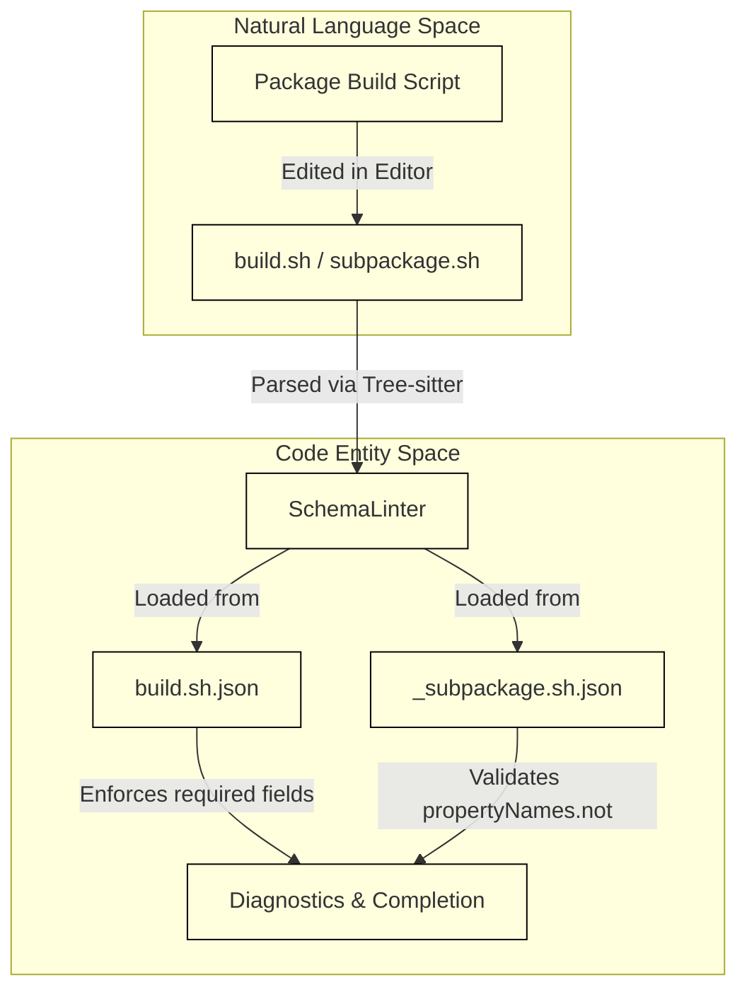
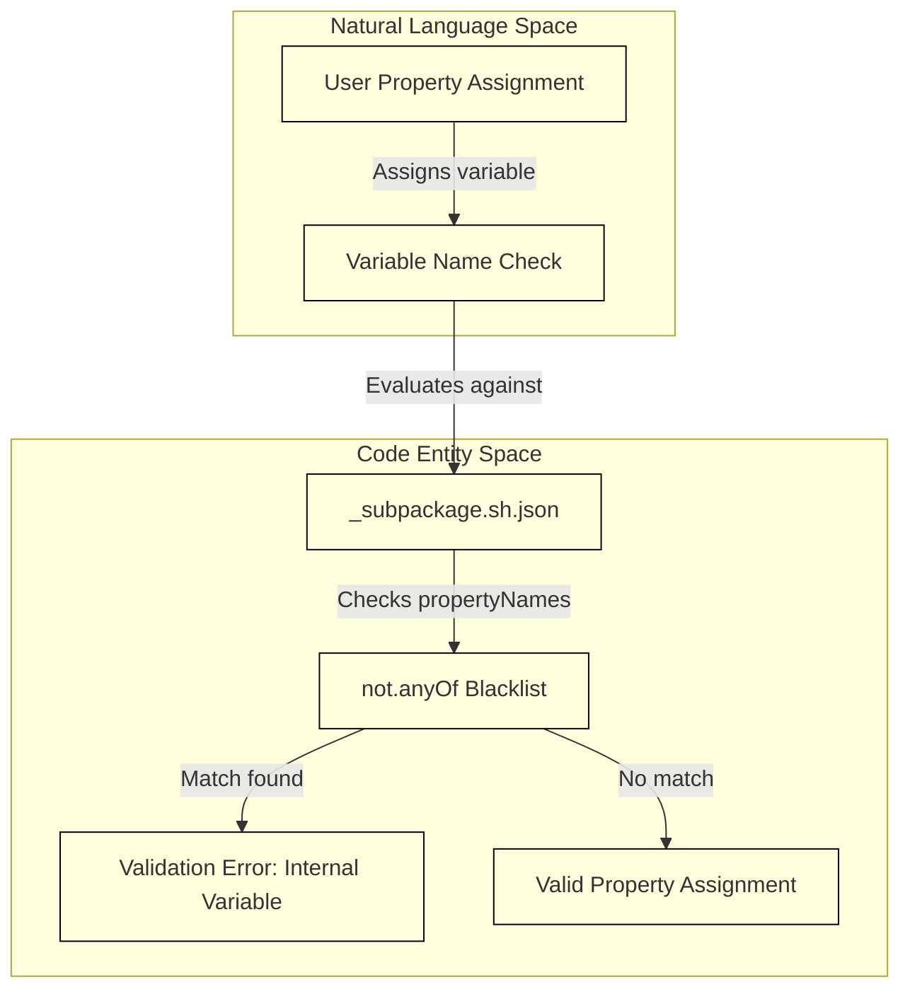

<!-- source: DeepWiki mcp.deepwiki.com · repo termux/termux-language-server · page 4.2 Termux build.sh Schema · fetched 2026-10-26 -->

# Termux build.sh Schema

<details>
<summary>Relevant source files</summary>

The following files were used as context for generating this wiki page:

- [src/termux_language_server/assets/json/_devscripts.json](src/termux_language_server/assets/json/_devscripts.json)
- [src/termux_language_server/assets/json/_subpackage.sh.json](src/termux_language_server/assets/json/_subpackage.sh.json)
- [src/termux_language_server/assets/json/build.sh.json](src/termux_language_server/assets/json/build.sh.json)
- [src/termux_language_server/assets/json/devscripts.conf.json](src/termux_language_server/assets/json/devscripts.conf.json)
- [tests/build.sh](tests/build.sh)

</details>


## Purpose and Scope

This page details the JSON schema definitions that drive validation, completion, and linting for Termux package build scripts (`build.sh`) and subpackage configurations (`_subpackage.sh.json`). These schemas (`build.sh.json` and `_subpackage.sh.json`) establish the contract for required `TERMUX_PKG_*` and `TERMUX_SUBPKG_*` properties, restrict disallowed internal builder variables, and define step hook structures.

---

## 1. `build.sh.json` Structure and Required Properties

The primary schema for package definitions is defined in `src/termux_language_server/assets/json/build.sh.json`. This schema is automatically generated via the language server's generation pipeline (`termux-language-server --generate-schema=build.sh`).

Every standard Termux package `build.sh` script must define a baseline set of mandatory metadata properties. The JSON schema enforces these requirements under its `required` array:

```json
  "required": [
    "TERMUX_PKG_HOMEPAGE",
    "TERMUX_PKG_DESCRIPTION",
    "TERMUX_PKG_LICENSE",
    "TERMUX_PKG_VERSION",
    "TERMUX_PKG_AUTO_UPDATE"
  ]
``` [src/termux_language_server/assets/json/build.sh.json:6-12]()

As demonstrated in concrete package definitions like `tests/build.sh`, these variables—along with source retrieval fields (`TERMUX_PKG_SRCURL`, `TERMUX_PKG_SHA256`) and dependency declarations (`TERMUX_PKG_DEPENDS`, `TERMUX_PKG_RECOMMENDS`)—form the core structure validated by the language server [tests/build.sh:2-16]().

Sources:
- `src/termux_language_server/assets/json/build.sh.json`
- `tests/build.sh`

---

## 2. Disallowed Internal Builder Functions and Variables

Termux build scripts execute within an internal build engine framework (`./build-package.sh`). To prevent package scripts from improperly mutating internal engine states, the schema utilizes `propertyNames` with `not` constraints to blacklist internal runner variables, paths, and platform configurations.

Similar to the constraints implemented in subpackages, top-level build scripts and subpackages prohibit variables such as:
- `TERMUX_ON_DEVICE_BUILD` [src/termux_language_server/assets/json/_subpackage.sh.json:70-72]()
- `TERMUX_HOST_PLATFORM` [src/termux_language_server/assets/json/_subpackage.sh.json:82-84]()
- `TERMUX_PKG_BUILDDIR`, `TERMUX_PKG_SRCDIR`, `TERMUX_PKG_TMPDIR` [src/termux_language_server/assets/json/_subpackage.sh.json:86-116]()
- `TERMUX_SCRIPTDIR` [src/termux_language_server/assets/json/_subpackage.sh.json:122-124]()

Attempting to assign values to these internal properties triggers schema validation diagnostics within the editor LSP client.

Sources:
- `src/termux_language_server/assets/json/_subpackage.sh.json`

---

## 3. Subpackage Schema (`_subpackage.sh.json`)

Subpackages in the Termux packaging system allow splitting a single build into multiple `.deb` artifacts. Their configuration schema is defined in `src/termux_language_server/assets/json/_subpackage.sh.json`.

### Required Subpackage Properties
A subpackage definition requires a description and an inclusion rule specifying which files are captured from the parent installation staging directory:

```json
  "required": [
    "TERMUX_SUBPKG_DESCRIPTION",
    "TERMUX_SUBPKG_INCLUDE"
  ]
``` [src/termux_language_server/assets/json/_subpackage.sh.json:6-9]()

### Subpackage Properties and Patterns
The schema defines specific pattern constraints for dependency and relationship fields (`TERMUX_SUBPKG_DEPENDS`, `TERMUX_SUBPKG_BREAKS`, `TERMUX_SUBPKG_CONFLICTS`, `TERMUX_SUBPKG_REPLACES`), ensuring comma-separated package names adhere to valid naming conventions [src/termux_language_server/assets/json/_subpackage.sh.json:19-38](). Boolean flags like `TERMUX_SUBPKG_ESSENTIAL` and `TERMUX_SUBPKG_PLATFORM_INDEPENDENT` are restricted via strict `enum` values (`true`/`false`) [src/termux_language_server/assets/json/_subpackage.sh.json:39-56]().

Sources:
- `src/termux_language_server/assets/json/_subpackage.sh.json`

---

## 4. Schema Validation and Property Mapping Architecture

The following diagrams illustrate how the schema assets bridge natural language expectations to concrete code structures inside `src/termux_language_server/` and validation logic.

### Diagram: Schema Validation Data Flow

Sources:
- `src/termux_language_server/assets/json/build.sh.json`
- `src/termux_language_server/assets/json/_subpackage.sh.json`

### Diagram: Property Constraint & Blacklist Enforcement

Sources:
- `src/termux_language_server/assets/json/_subpackage.sh.json`
- `tests/build.sh`

---

