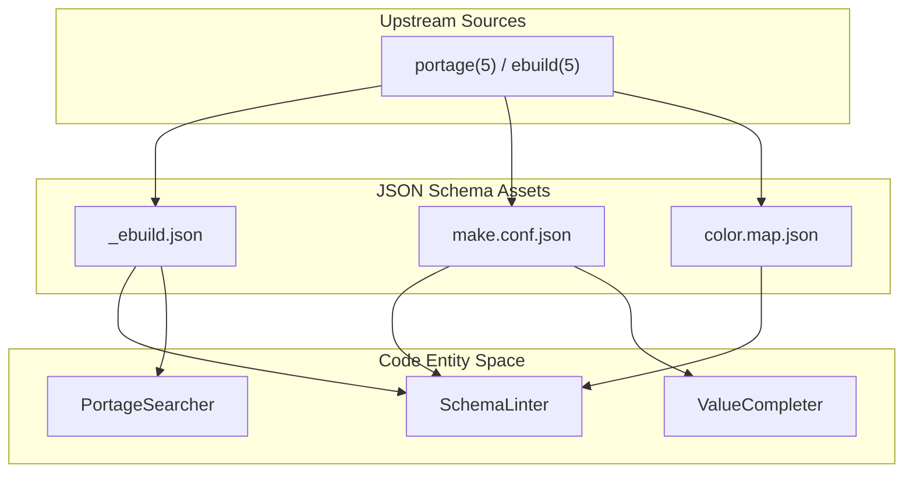
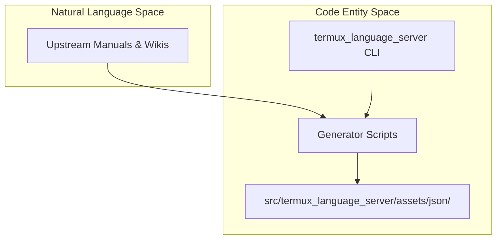

<!-- source: DeepWiki mcp.deepwiki.com · repo termux/termux-language-server · page 4.3 Gentoo and Misc Schemas · fetched 2026-10-26 -->

# Gentoo and Misc Schemas

<details>
<summary>Relevant source files</summary>

The following files were used as context for generating this wiki page:

- [src/termux_language_server/assets/json/_ebuild.json](src/termux_language_server/assets/json/_ebuild.json)
- [src/termux_language_server/assets/json/_mdd.json](src/termux_language_server/assets/json/_mdd.json)
- [src/termux_language_server/assets/json/color.map.json](src/termux_language_server/assets/json/color.map.json)
- [src/termux_language_server/assets/json/make.conf.json](src/termux_language_server/assets/json/make.conf.json)

</details>


## Purpose and Scope

This page details the JSON Schema assets used by `termux-language-server` for Gentoo Linux ecosystems and miscellaneous configuration files. Specifically, this covers `_ebuild.json`, `make.conf.json`, `color.map.json`, `devscripts.conf.json`, and `_mdd.json`. These schemas drive language validation, autocompletion, hover documentation, and syntax checking for ebuilds, Portage configuration files, color mappings, and Zsh module description (`.mdd`) files. All schemas comply with JSON Schema Draft-07 and are automatically synchronized with upstream documentation via generation scripts.

Sources: `[src/termux_language_server/assets/json/_ebuild.json:1-4](), [src/termux_language_server/assets/json/make.conf.json:1-5](), [src/termux_language_server/assets/json/color.map.json:1-4](), [src/termux_language_server/assets/json/_mdd.json:1-4]()`

---

## Gentoo Portage and Ebuild Schemas

The Gentoo support suite relies on three core JSON schemas that formalize environment variables, global Portage configurations, and console color mappings:

1. **`_ebuild.json`**: Defines standard Portage metadata variables available during ebuild execution (`ARCH`, `P`, `PN`, `PV`, `PR`, `PVR`, `PF`, `CATEGORY`, `WORKDIR`, `FILESDIR`, `EBUILD_PHASE`, `EPREFIX`, `S`, `T`, `D`, `ED`, etc.) [src/termux_language_server/assets/json/_ebuild.json:6-103]().
2. **`make.conf.json`**: Specifies configuration variables for `make.conf` (`ACCEPT_CHOSTS`, `ACCEPT_KEYWORDS`, `ACCEPT_LICENSE`, `BINPKG_FORMAT`, `BINPKG_COMPRESS`, `CFLAGS`, `CHOST`, etc.) [src/termux_language_server/assets/json/make.conf.json:6-83]().
3. **`color.map.json`**: Maps Portage output color variables (`NORMAL`, `BAD`, `BRACKET`, `GOOD`, `HILITE`, `INFORM`, `PKG_BLOCKER`, `WARN`, etc.) to their respective default values and contexts [src/termux_language_server/assets/json/color.map.json:6-102]().

### Diagram: Portage Schema Integration Architecture


Sources: `[src/termux_language_server/assets/json/_ebuild.json:1-103](), [src/termux_language_server/assets/json/make.conf.json:1-83](), [src/termux_language_server/assets/json/color.map.json:1-102]()`

---

## Miscellaneous Schemas (`_mdd.json`)

The miscellaneous category includes specialized configuration files such as Zsh module description files (`.mdd`). 

- **`_mdd.json`**: Implements the schema specification derived from the Zsh development guide (`Etc/zsh-development-guide`) [src/termux_language_server/assets/json/_mdd.json:1-4](). It structures metadata properties for module compilation and loading:
  - `name`: Module name string [src/termux_language_server/assets/json/_mdd.json:7-10]().
  - `link`: Link strategy (`static`, `dynamic`, `no`, or `either`) [src/termux_language_server/assets/json/_mdd.json:11-15]().
  - `load`: Automatic loading hook indicator (`yes` or `no`) [src/termux_language_server/assets/json/_mdd.json:16-20]().
  - `moddeps`: Dependency list of other modules [src/termux_language_server/assets/json/_mdd.json:21-24]().
  - `nozshdep`, `alwayslink`, `autofeatures`, `autofeatures_emu`, `objects`, `proto`, `headers`, `hdrdeps`, and `otherincs` [src/termux_language_server/assets/json/_mdd.json:25-61]().

Sources: `[src/termux_language_server/assets/json/_mdd.json:1-62]()`

---

## Schema Generation and Maintenance

As noted in the schema comment headers (`$comment`), these assets must not be edited manually. They are programmatically generated using internal generator flags on the server CLI:

```json
"$comment": "Don't edit this file directly! It is generated by `termux-language-server --generate-schema=color.map`."
```
[src/termux_language_server/assets/json/color.map.json:1-4]()

### Diagram: Schema Generation Pipeline


Sources: `[src/termux_language_server/assets/json/color.map.json:1-4](), [src/termux_language_server/assets/json/make.conf.json:1-4]()`

---

