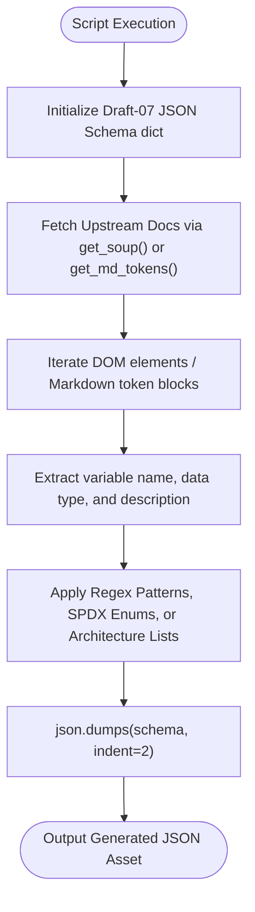

<!-- source: DeepWiki mcp.deepwiki.com · repo termux/termux-language-server · page 4.4 Schema Generation Scripts · fetched 2026-10-26 -->

# Schema Generation Scripts

Relevant source files

The following files were used as context for generating this wiki page:

- [scripts/generate-PKGBUILD.json.py](scripts/generate-PKGBUILD.json.py)
- [scripts/generate-_ebuild.json.py](scripts/generate-_ebuild.json.py)
- [scripts/generate-build.sh.json.py](scripts/generate-build.sh.json.py)
- [scripts/generate-color.map.json.py](scripts/generate-color.map.json.py)
- [scripts/generate-make.conf.json.py](scripts/generate-make.conf.json.py)
- [scripts/generate-makepkg.conf.json.py](scripts/generate-makepkg.conf.json.py)

## Purpose and Scope

The `scripts/generate-*.py` utility suite compiles upstream human-readable documentation—such as packaging wikis, man pages, and configuration manuals—into machine-readable Draft-07 JSON Schema assets (`src/termux_language_server/assets/json/`). These generated schemas power validation, code completion, hover documentation, and structural constraints across all supported language ecosystems (`build.sh`, `PKGBUILD`, `ebuild`, `make.conf`, `makepkg.conf`, `color.map`). 

This document details the architecture, data extraction workflows, scraping libraries (`markdown-it-py` and `BeautifulSoup`), SPDX license indexing via `license_expression`, and schema output formatting implemented across the generation scripts.

Sources:
- [scripts/generate-PKGBUILD.json.py:1-212]()
- [scripts/generate-_ebuild.json.py:1-51]()
- [scripts/generate-build.sh.json.py:1-168]()

---

## Generator Pipeline Architecture

The schema generation pipeline bridges upstream natural language spaces (wikis, web documentation, local package manager queries) with the internal code entity space (`termux_language_server` JSON assets). 

```mermaid
graph TD
    subgraph "NaturalLanguageSpace"
        ArchWiki["Arch Linux PKGBUILD Wiki"]
        TermuxWiki["Termux Packages Wikis"]
        GentooManual["Gentoo DevManual / Man Pages"]
        MSYS2Docs["MSYS2 PKGBUILD Docs"]
        SPDXRepo["SPDX License Index"]
        PortageDB["Gentoo Portage Local Repo"]
    end

    subgraph "CodeEntitySpace"
        GenPkg["scripts/generate-PKGBUILD.json.py"]
        GenBuild["scripts/generate-build.sh.json.py"]
        GenEbuild["scripts/generate-_ebuild.json.py"]
        GenMake["scripts/generate-make.conf.json.py"]
        GenMakepkg["scripts/generate-makepkg.conf.json.py"]
        GenColor["scripts/generate-color.map.json.py"]
        
        LibMisc["lsp_tree_sitter.misc (get_soup, get_md_tokens)"]
        LibLicense["license_expression (get_license_index)"]

        AssetPKGBUILD["PKGBUILD.json"]
        AssetBuildSh["build.sh.json & subpackage.sh.json"]
        AssetEbuild["_ebuild.json"]
        AssetMakeConf["make.conf.json"]
        AssetMakepkgConf["makepkg.conf.json"]
        AssetColorMap["color.map.json"]
    end

    ArchWiki -->|MarkdownTokens| GenPkg
    MSYS2Docs -->|HTMLSoup| GenPkg
    SPDXRepo -->|Licenses| GenPkg
    SPDXRepo -->|Licenses| GenBuild
    TermuxWiki -->|HTMLSoup| GenBuild
    GentooManual -->|HTMLSoup| GenEbuild
    PortageDB -->|Atoms| GenEbuild
    GentooManual -->|HTMLSoup| GenMake
    GentooManual -->|HTMLSoup| GenColor
    GentooManual -->|HTMLSoup| GenMakepkg

    GenPkg --> LibMisc
    GenPkg --> LibLicense
    GenBuild --> LibMisc
    GenBuild --> LibLicense
    GenEbuild --> LibMisc
    GenMake --> LibMisc
    GenMakepkg --> LibMisc

    GenPkg --> AssetPKGBUILD
    GenBuild --> AssetBuildSh
    GenEbuild --> AssetEbuild
    GenMake --> AssetMakeConf
    GenMakepkg --> AssetMakepkgConf
    GenColor --> AssetColorMap
```

Sources:
- [scripts/generate-PKGBUILD.json.py:1-174]()
- [scripts/generate-build.sh.json.py:1-168]()
- [scripts/generate-_ebuild.json.py:1-51]()

---

## Data Flow and Parsing Implementation

Each generation script follows a standardized lifecycle: establishing a JSON Schema skeleton containing `$id`, `$schema`, `$comment` notices, and target property dictionaries, followed by scraping target documents, parsing tokens or DOM elements, enforcing type constraints, and serializing to standard output.

Sources:
- [scripts/generate-PKGBUILD.json.py:32-47]()
- [scripts/generate-_ebuild.json.py:11-23]()
- [scripts/generate-build.sh.json.py:26-47]()
- [scripts/generate-color.map.json.py:8-20]()
- [scripts/generate-make.conf.json.py:9-21]()
- [scripts/generate-makepkg.conf.json.py:8-20]()

---

## Ecosystem-Specific Generation Scripts

### PKGBUILD and MSYS2 Generation (`generate-PKGBUILD.json.py`)
This script parses both Arch Linux markdown documentation and MSYS2 developer documentation. It leverages `markdown_it` tokens to extract level-1 headers corresponding to directive variables and functions [scripts/generate-PKGBUILD.json.py:49-75]().
- **SPDX Integration**: Queries `license_expression.get_license_index()` to build a comprehensive list of allowed SPDX license strings, filtering out internal scancode references [scripts/generate-PKGBUILD.json.py:11-16]().
- **Split Packages and Functions**: Automatically categorizes `pre_install`, `post_install`, and package functions into `patternProperties` with execution constraints [scripts/generate-PKGBUILD.json.py:93-103]().
- **Architectures**: Injects valid architecture enums (`x86_64`, `aarch64`, `armv7h`, etc.) and MSYS2 mingw architectures (`mingw64`, `ucrt64`, `clang64`) [scripts/generate-PKGBUILD.json.py:131-144, 175-182]().

Sources:
- [scripts/generate-PKGBUILD.json.py:1-212]()

### Termux Build and Subpackage Generation (`generate-build.sh.json.py`)
Scrapes Termux wiki pages covering package creation, building, and auto-updating (`Creating-new-package`, `Building-packages`, `Auto-updating-packages`) [scripts/generate-build.sh.json.py:20-24]().
- **Required Variables**: Extracts table rows indicating required `TERMUX_PKG_*` parameters and populates the schema's `required` array [scripts/generate-build.sh.json.py:51-61]().
- **Function Overrides**: Differentiates between overrideable build functions (`const: 0`) and protected internal builder functions excluded via `propertyNames.not.anyOf` rules [scripts/generate-build.sh.json.py:120-141]().
- **Subpackage Schema**: Generates both `build.sh.json` and `subpackage.sh.json` from the shared parsing pipeline [scripts/generate-build.sh.json.py:27-47]().

Sources:
- [scripts/generate-build.sh.json.py:1-168]()

### Gentoo Ebuild and Configuration Generation (`generate-_ebuild.json.py`, `generate-make.conf.json.py`, `generate-color.map.json.py`)
Gentoo-focused scripts parse definition lists (`<dl>`, `<dt>`, `<dd>`) from official documentation using `BeautifulSoup` [scripts/generate-_ebuild.json.py:24-28]().
- **Portage Integration**: `generate-_ebuild.json.py` executes `portageq get_repo_path` via subprocess to inspect the local Gentoo repository path and dynamically construct valid `LICENSE` atoms from category/eclass directories [scripts/generate-_ebuild.json.py:43-50]().
- **Configuration Maps**: `generate-make.conf.json.py` and `generate-color.map.json.py` extract uppercase configuration variables and embed code-block examples directly into documentation strings [scripts/generate-make.conf.json.py:22-39](), [scripts/generate-color.map.json.py:21-34]().

Sources:
- [scripts/generate-_ebuild.json.py:1-51]()
- [scripts/generate-make.conf.json.py:1-40]()
- [scripts/generate-color.map.json.py:1-35]()

### Arch Makepkg Configuration Generation (`generate-makepkg.conf.json.py`)
Parses `makepkg.conf` wiki blocks using `BeautifulSoup`, identifying variable assignment structures, handling array vs. string types, and extracting compression flag options (`COMPRESSLZO`, etc.) [scripts/generate-makepkg.conf.json.py:21-78]().

Sources:
- [scripts/generate-makepkg.conf.json.py:1-79]()

---

