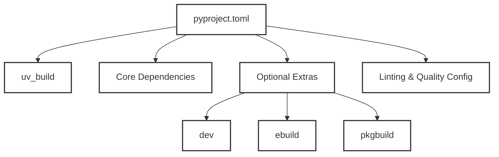
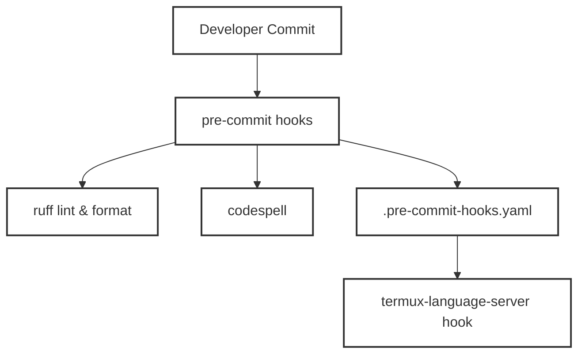
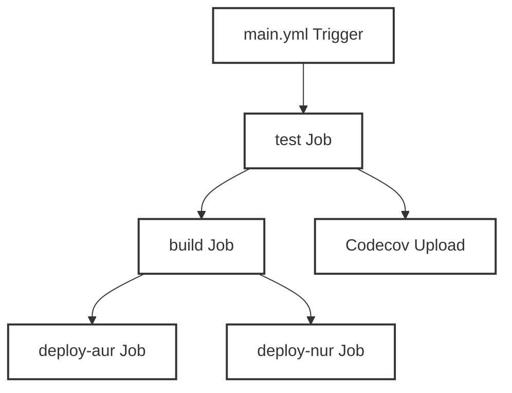

<!-- source: DeepWiki mcp.deepwiki.com · repo termux/termux-language-server · page 5 Development and Project Infrastructure · fetched 2026-10-26 -->

# Development and Project Infrastructure

Relevant source files

The following files were used as context for generating this wiki page:

- [.github/workflows/main.yml](.github/workflows/main.yml)
- [pyproject.toml](pyproject.toml)

This page provides a high-level overview of the build tooling, packaging, quality gates, continuous integration/deployment (CI/CD), and testing architecture for `termux-language-server`. Detailed technical specifications for each sub-topic are delegated to their respective child pages.

## 5.1 Packaging and Dependencies

The project relies on modern Python packaging standards defined in `pyproject.toml` [pyproject.toml:1-41]. It utilizes the `uv_build` backend [pyproject.toml:38-41] for fast, standards-compliant builds. Dependencies are split into core requirements (such as `lsp-tree-sitter` and `tree-sitter-bash`) [pyproject.toml:10-15] and optional feature extras (`dev`, `ebuild`, `pkgbuild`) [pyproject.toml:20-36] that pull in domain-specific libraries like `pyalpm`, `portage`, `jinja2`, and `marisa-trie`.

Static analysis, linting, formatting, and docstring configurations are centralized here, including rules for `ruff`, `codespell`, `coverage`, and `doq` templates located in `templates/` [pyproject.toml:42-82].

For details, see [Packaging and Dependencies](#5.1).

*Sources: [pyproject.toml:1-82]*

## 5.2 Code Quality Hooks

Code quality is enforced automatically via pre-commit hooks and the repository's `.pre-commit-hooks.yaml` configuration. The repository exposes itself as a pre-commit hook, enabling the language server or its linters to be integrated directly into development workflows and external repositories.

For details, see [Code Quality Hooks](#5.2).

*Sources: [pyproject.toml:42-82]*

## 5.3 CI/CD Pipeline

Continuous integration and deployment are orchestrated using GitHub Actions in `.github/workflows/main.yml` [.github/workflows/main.yml:1-77]. The pipeline coordinates test suites, build artifacts, automated releases, and deployments to package registries (AUR and NUR) [.github/workflows/main.yml:18-77].

*Sources: [.github/workflows/main.yml:1-77]*

The workflow runs a sequence of jobs:
- **`test`**: Sets up Python using `setup-uv`, installs dev dependencies, runs `pytest --cov`, and uploads coverage reports [.github/workflows/main.yml:19-32].
- **`build`**: Builds distribution packages using `uv build` and publishes or uploads artifacts [.github/workflows/main.yml:33-54].
- **`deploy-aur` & `deploy-nur`**: Automatically updates Arch User Repository and Nix User Repository packages upon git tag creation [.github/workflows/main.yml:55-77].

For details, see [CI/CD Pipeline](#5.3).

## 5.4 Testing and Fixtures

Testing validation relies on `tests/test_server.py` paired with target fixture files representing real-world package configurations (`PKGBUILD`, `build.sh`, and `neovim-0.9.4.ebuild`). These fixtures validate schema adherence, completion providers, diagnostics, and searcher behavior across different target ecosystems.

For details, see [Testing and Fixtures](#5.4).

---

