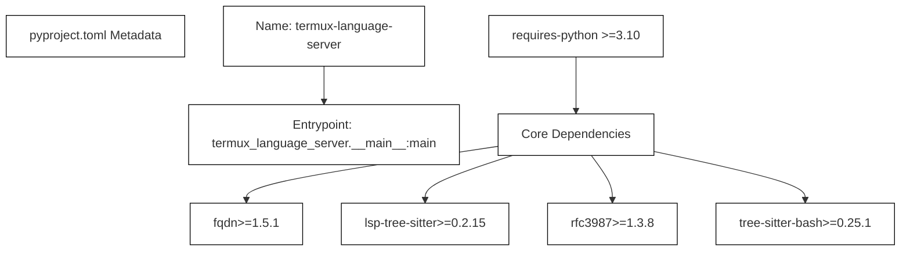
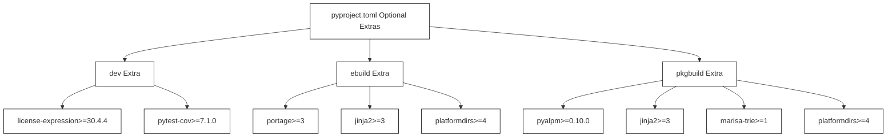
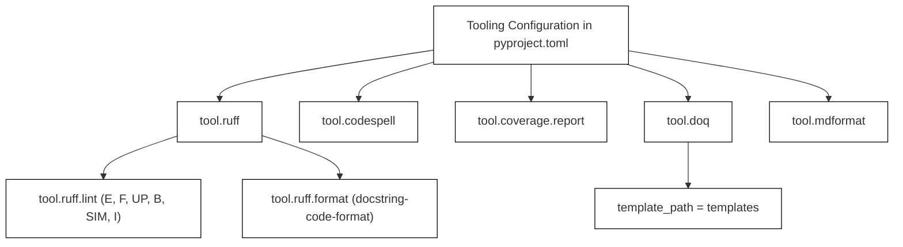
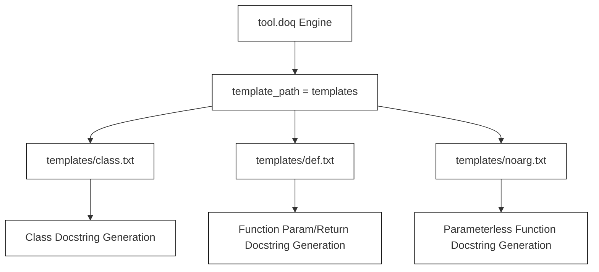

<!-- source: DeepWiki mcp.deepwiki.com · repo termux/termux-language-server · page 5.1 Packaging and Dependencies · fetched 2026-10-26 -->

# Packaging and Dependencies

Relevant source files

The following files were used as context for generating this wiki page:

- [.gitignore](.gitignore)
- [pyproject.toml](pyproject.toml)
- [templates/class.txt](templates/class.txt)
- [templates/def.txt](templates/def.txt)
- [templates/noarg.txt](templates/noarg.txt)

## Purpose and Scope
This page details the packaging infrastructure, project configuration, dependency topology, and quality control toolchains defined in `pyproject.toml` [pyproject.toml:1-81](), version control ignore rules (`.gitignore`) [.gitignore:1-128](), and docstring generation templates (`templates/`) [templates/class.txt:1-2](). It governs how `termux-language-server` is built, packaged via the `uv_build` backend, extended for specific package ecosystems (`pkgbuild` and `ebuild`), and validated under Ruff, Codespell, and Pytest.

---

## 1. Project Metadata and Core Dependencies
The project is configured under PEP 621 standards within `pyproject.toml` [pyproject.toml:1-16](). It specifies python requirements, runtime core dependencies for parsing and LSP integration, and the console script entrypoint [pyproject.toml:17-19]() that maps directly to the server startup routine in `termux_language_server.__main__:main`.

*Figure 1: Core packaging metadata and runtime dependency mapping.*

Sources: `pyproject.toml` [pyproject.toml:1-19]()

---

## 2. Optional Dependencies (Extras)
To support different Linux packaging ecosystems without forcing heavy or platform-specific native dependencies onto base installations, `pyproject.toml` defines discrete optional extras [pyproject.toml:20-36]().

* **`dev`**: Pulls in development and testing utilities including `license-expression` and `pytest-cov` [pyproject.toml:21-24]().
* **`ebuild`**: Installs Gentoo Portage bindings (`portage`), template rendering (`jinja2`), and path resolution (`platformdirs`) required by `PortageSearcher` [pyproject.toml:25-29]().
* **`pkgbuild`**: Installs Arch Linux ALPM bindings (`pyalpm`), prefix trie structures (`marisa-trie`), `jinja2`, and `platformdirs` required by `PacmanSearcher` and `NamcapLinter` [pyproject.toml:30-36]().

*Figure 2: Optional dependency extras structure in `pyproject.toml`.*

Sources: `pyproject.toml` [pyproject.toml:20-36]()

---

## 3. Build System Backend
The project utilizes modern Python packaging tooling via `uv_build` [pyproject.toml:38-41](). The build system table constrains the backend version to ensure deterministic wheel generation.

* Build backend: `uv_build` [pyproject.toml:40-40]()
* Required build system requirement: `uv_build<0.12` [pyproject.toml:39-39]()

Sources: `pyproject.toml` [pyproject.toml:38-41]()

---

## 4. Code Quality, Testing, and Linter Configuration
Static analysis and testing behavior are strictly enforced through dedicated tool blocks inside `pyproject.toml` [pyproject.toml:42-81]().

### Codespell and Coverage
* **`[tool.codespell]`**: Ignores false positives specific to packaging domain terminology like `"namd, doman"` [pyproject.toml:42-43]().
* **`[tool.coverage.report]`**: Excludes type checking blocks, main execution guards, and dynamic imports from test coverage computations [pyproject.toml:45-50]().

### Ruff Linter and Formatter
* **`[tool.ruff]`**: Enforces a strict line length limit of 79 characters [pyproject.toml:58-59]().
* **`[tool.ruff.lint]`**: Enables error (`E`), pyflakes (`F`), pyupgrade (`UP`), bugbear (`B`), simplify (`SIM`), and isort (`I`) rule sets under preview mode while ignoring specific docstring rules (`D205`, `D400`) [pyproject.toml:61-77]().
* **`[tool.ruff.format]`**: Enables docstring code snippet formatting under preview rules [pyproject.toml:79-81]().

*Figure 3: Quality assurance tool configuration mapping.*

Sources: `pyproject.toml` [pyproject.toml:42-81]()

---

## 5. Docstring Templates and Generation Pipeline
Docstrings across modules and functions are automatically maintained using `doq`, configured via `[tool.doq]` to read templates from the `templates/` directory [pyproject.toml:52-54]().

* **`templates/class.txt`**: Defines the raw docstring template format for classes, capitalizing and cleaning up snake_case class identifiers [templates/class.txt:1-2]().
* **`templates/def.txt`**: Defines the function/method docstring template, iterating over parameters (`p.argument`, `p.annotation`) and return types (`return_type`) [templates/def.txt:1-12]().
* **`templates/noarg.txt`**: Defines argument-less function docstring formats [templates/noarg.txt:1]().

*Figure 4: Docstring generation pipeline bridging `doq` configurations to template assets.*

Sources: `pyproject.toml` [pyproject.toml:52-54](), `templates/class.txt` [templates/class.txt:1-2](), `templates/def.txt` [templates/def.txt:1-12](), `templates/noarg.txt` [templates/noarg.txt:1]()

---

## 6. Version Control Exclusions (.gitignore)
The `.gitignore` file excludes build artifacts, virtual environments, lock files, local databases, and test runner outputs from version control tracking [.gitignore:1-128](). Key patterns include:
* Dependency lock files: `uv.lock` [.gitignore:1-1]()
* Python compiled bytecode and shared extensions: `__pycache__/`, `*.py[co]`, `*.so` [.gitignore:5-11]()
* Distribution directories: `build/`, `dist/`, `*.egg-info/` [.gitignore:15-29]()
* Test and coverage caches: `.pytest_cache/`, `.coverage`, `htmlcov/` [.gitignore:44-55]()
* Local virtual environments: `.venv/`, `env/`, `venv/` [.gitignore:103-110]()

Sources: `.gitignore` [pyproject.toml:1-81]()

---

