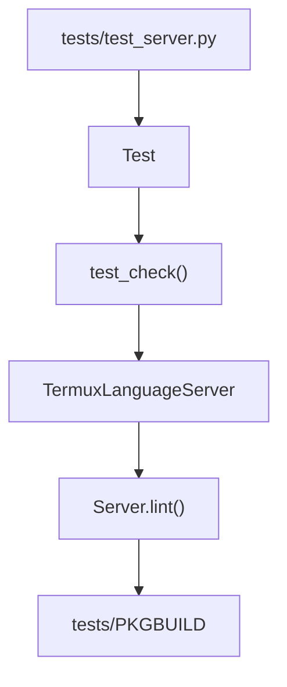
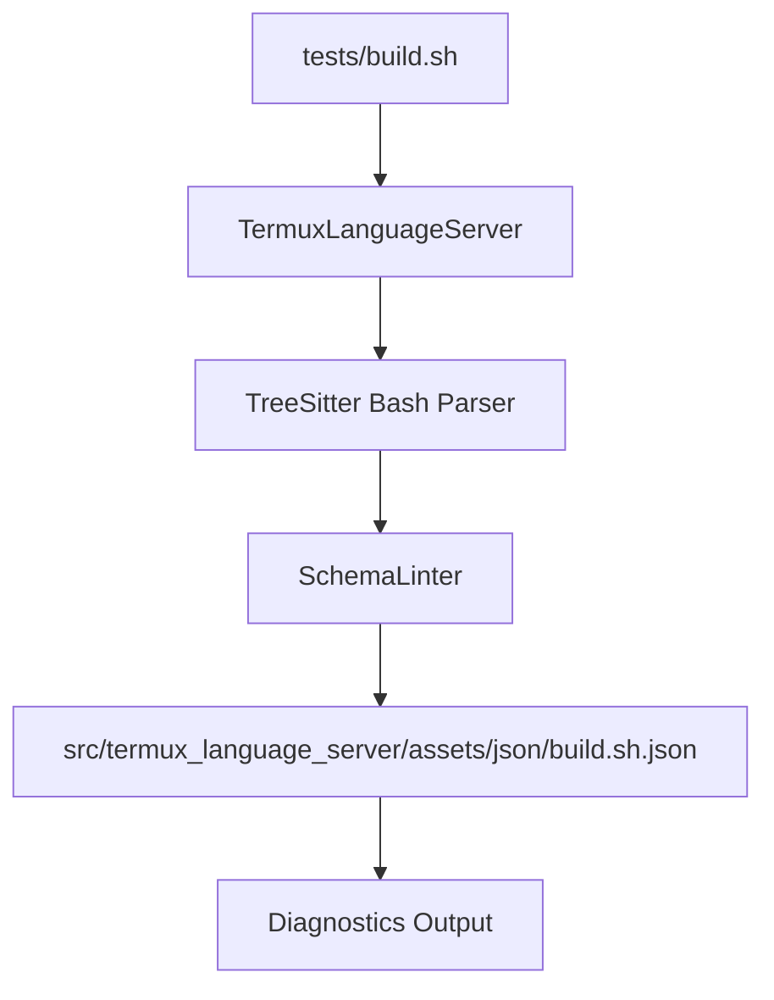

<!-- source: DeepWiki mcp.deepwiki.com · repo termux/termux-language-server · page 5.4 Testing and Fixtures · fetched 2026-10-26 -->

# Testing and Fixtures

Relevant source files

The following files were used as context for generating this wiki page:

- [.github/FUNDING.yml](.github/FUNDING.yml)
- [src/termux_language_server/assets/json/build.sh.json](src/termux_language_server/assets/json/build.sh.json)
- [tests/build.sh](tests/build.sh)
- [tests/neovim-0.9.4.ebuild](tests/neovim-0.9.4.ebuild)
- [tests/test_server.py](tests/test_server.py)

## Purpose and Scope

This page details the testing infrastructure and test fixtures used within `termux-language-server`. Specifically, it covers the test suite implementation in `tests/test_server.py` and the core validation fixture files (`tests/PKGBUILD`, `tests/build.sh`, and `tests/neovim-0.9.4.ebuild`). These components validate syntax, schema compliance, tree-sitter query extraction, and linter diagnostics across supported ecosystem files.

Sources: `tests/test_server.py:1-14()`, `tests/build.sh:1-39()`, `tests/neovim-0.9.4.ebuild:1-120()`

---

## Test Runner Architecture (`tests/test_server.py`)

The test suite is structured to instantiate the language server runtime and execute diagnostic validation against sample fixtures. The primary test runner is located in `tests/test_server.py:1-14()`.

### Key Components

- **`Server` Alias**: Imports `TermuxLanguageServer` from `termux_language_server.server` and initializes it with an empty workspace root `Server("")` [tests/test_server.py:3-5()].
- **File Resolution**: Resolves target fixture paths relative to the test directory, such as `tests/PKGBUILD` [tests/test_server.py:6-6()].
- **`Test` Class**: A static test container holding test cases [tests/test_server.py:9-11()].
- **`test_check()`**: Executes the linter pass by invoking `server.lint(file)[file]` and asserting the presence of diagnostics [tests/test_server.py:11-14()].

Sources: `tests/test_server.py:1-14()`

---

## Test Fixtures and Ecosystem Coverage

To ensure robustness across distinct package management formats, the codebase maintains dedicated fixture files representing different build systems.

### Termux `build.sh` Fixture
`tests/build.sh` serves as the integration fixture for Termux package specifications [tests/build.sh:1-39()]. It defines required package metadata properties (`TERMUX_PKG_LICENSE`, `TERMUX_PKG_HOMEPAGE`, `TERMUX_PKG_DESCRIPTION`, `TERMUX_PKG_MAINTAINER`, `TERMUX_PKG_SRCURL`, `TERMUX_PKG_SHA256`) [tests/build.sh:2-7()], dependency arrays (`TERMUX_PKG_DEPENDS`, `TERMUX_PKG_RECOMMENDS`) [tests/build.sh:8-9()], architecture exclusions (`TERMUX_PKG_EXCLUDED_ARCHES`) [tests/build.sh:20-20()], and shell hook functions (`termux_pkg_auto_update`, `termux_step_post_make_install`) [tests/build.sh:22-38()].

### Gentoo Ebuild Fixture
`tests/neovim-0.9.4.ebuild` validates the server's handling of Portage ebuild scripts [tests/neovim-0.9.4.ebuild:1-120()]. It exercises EAPI declarations, global variables (`DESCRIPTION`, `HOMEPAGE`, `LICENSE`, `SLOT`, `IUSE`, `DEPEND`, `RDEPEND`, `BDEPEND`) [tests/neovim-0.9.4.ebuild:4-66()], and phase functions (`src_prepare`, `src_configure`, `src_install`) [tests/neovim-0.9.4.ebuild:74-110()].

Sources: `tests/build.sh:1-39()`, `tests/neovim-0.9.4.ebuild:1-120()`, `tests/test_server.py:1-14()`

---

## Validation Data Flow and Schema Integration

When tests execute, fixtures flow through the parsing, schema verification, and linting subsystems. JSON schema definitions—such as `src/termux_language_server/assets/json/build.sh.json`—provide the underlying validation constraints enforced by `SchemaLinter`.

Sources: `tests/test_server.py:1-14()`, `tests/build.sh:1-39()`, `src/termux_language_server/assets/json/build.sh.json:1-25()`

---

