# Page: Overview

# Overview

<details>
<summary>Relevant source files</summary>

The following files were used as context for generating this wiki page:

- [LICENSE](LICENSE)
- [README.md](README.md)
- [src/termux_language_server/server.py](src/termux_language_server/server.py)

</details>


`termux-language-server` is a specialized language server designed to provide rich IDE features—such as diagnostics, autocomplete, hover documentation, and document links—for specialized build systems, package management scripts, and configuration files. Built on top of the `lsp-tree-sitter` framework, it leverages Tree-sitter grammar parsing and JSON schemas to analyze shell scripts and configuration formats across Android Termux, Arch Linux, Gentoo, Debian/Ubuntu, and Zsh.

Sources: `README.md:39-68`, `src/termux_language_server/server.py:1-77`

---

## Supported File Types and Ecosystems

The language server targets several distinct package management and system configuration ecosystems, supporting script extensions and configuration formats including:

- **Android Termux**: `build.sh` and `*.subpackage.sh` package creation scripts [README.md:41-43]().
- **Arch Linux & MSYS2**: `PKGBUILD`, `*.install`, and `makepkg.conf` [README.md:44-47]().
- **Gentoo**: `*.ebuild`, `*.eclass`, `make.conf`, and `color.map` [README.md:48-52]().
- **Debian / Ubuntu**: `devscripts.conf` and `.devscripts` [README.md:53-54]().
- **Zsh**: `*.mdd` module definition files [README.md:55-56]().

For a complete breakdown of each ecosystem, its associated JSON schemas, searchers, and linters, see [Supported File Types and Ecosystems](#1.2).

Sources: `README.md:39-57`

---

## High-Level Architecture

The core runtime of the language server is anchored by the `TermuxLanguageServer` class defined in `src/termux_language_server/server.py`, which extends `TreeSitterLanguageServer` from `lsp-tree-sitter` [src/termux_language_server/server.py:12-19](). During initialization, the server loads a Tree-sitter Bash parser instance, parses JSON schema definitions from internal assets, and wires up linters (`SchemaLinter`, `PackageLinter`, and optional `NamcapLinter`), completers (`ValueCompleter`, `PackageCompleter`), and ecosystem-specific package searchers (`PacmanSearcher`, `PortageSearcher`) [src/termux_language_server/server.py:19-77]().

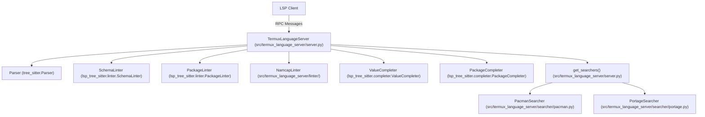

Sources: `src/termux_language_server/server.py:1-77`

---

## Child Pages

For more detailed information regarding installation, configuration, and specific subsystems, refer to the following child pages:
- [Getting Started & Installation](#1.1) — Installation via pip/AUR/NUR, optional extras, editor/LSP client integration, and CLI usage.
- [Supported File Types and Ecosystems](#1.2) — Detailed mapping of schemas, searchers, and linters for each ecosystem.

---

# Page: Getting Started & Installation

# Getting Started & Installation

<details>
<summary>Relevant source files</summary>

The following files were used as context for generating this wiki page:

- [README.md](README.md)
- [pyproject.toml](pyproject.toml)
- [src/termux_language_server/__main__.py](src/termux_language_server/__main__.py)

</details>


## Purpose and Scope

This document provides complete instructions for installing, configuring, and executing `termux-language-server`. It covers installation workflows via package managers and `pip` (including optional feature extras), command-line interface execution details, and editor integration setups. It targets developers and system administrators setting up the language server runtime environment.

---

## Installation Methods

`termux-language-server` can be installed via standard Python packaging tools or through Linux distribution user repositories (AUR / NUR) for Arch Linux and NixOS environments.

### Installing via `pip` or `uv`

The base package and its optional feature extras can be installed directly from PyPI using `pip` or `uv`:

```bash
pip install termux-language-server
```

To enable ecosystem-specific features such as package validation and searching for Arch Linux (`PKGBUILD`) or Gentoo (`ebuild`), install the corresponding optional extras defined in `pyproject.toml:20-36`:

```bash
pip install "termux-language-server[pkgbuild,ebuild]"
```

### Optional Extras Overview

The project defines three optional dependency groups in `pyproject.toml`:
- `dev`: Development and testing tools (`license-expression`, `pytest-cov`) [pyproject.toml:21-24]().
- `ebuild`: Gentoo ebuild support (`portage`, `jinja2`, `platformdirs`) [pyproject.toml:25-29]().
- `pkgbuild`: Arch Linux PKGBUILD support (`pyalpm`, `jinja2`, `marisa-trie`, `platformdirs`) [pyproject.toml:30-36]().

### Distribution Packages

- **AUR (Arch User Repository):** Maintained packages for Arch Linux allow installation alongside `namcap` and `pacman` toolchains.
- **NUR (Nix User Repository):** Declarative setup for NixOS and Nix environments utilizing python package overlays.

Sources: [pyproject.toml:1-41]()

---

## CLI Usage & Entrypoint Execution

The package registers a console script entry point named `termux-language-server` which resolves to the `main()` function [pyproject.toml:17-18](). 

When invoked, the command line arguments are parsed using `lsp_tree_sitter` parser utilities, initializing the `TermuxLanguageServer` class with the current package version `__version__`, and subsequently executing `server.run(args)` [src/termux_language_server/__main__.py:10-17]().

### Diagram: CLI Entrypoint and Execution Flow

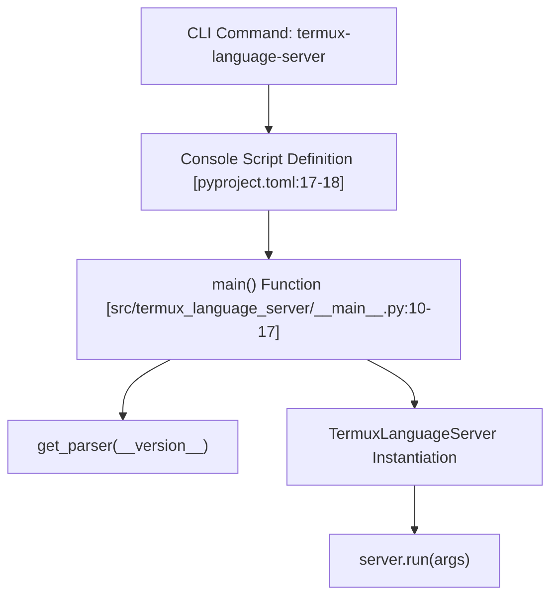

Sources: [pyproject.toml:17-18](), [src/termux_language_server/__main__.py:10-17]()

---

## Optional Dependencies and Extras Resolution

Depending on the target build scripts you intend to edit, you must install the matching optional extras to unlock features like local package database queries, tree-sitter queries, and document linters.

### Diagram: Optional Dependencies and Extras Resolution

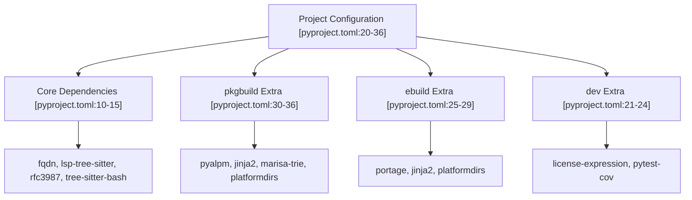

Sources: [pyproject.toml:10-36]()

---

## Editor and LSP Client Configuration

To bind `termux-language-server` to your editor (e.g., Neovim, VS Code, or Helix), configure your LSP client to launch the executable with standard I/O transport.

### Neovim Configuration Example

Using `lspconfig` or native `vim.lsp`:

```lua
require'lspconfig'.termux_language_server.setup{
  cmd = { "termux-language-server", "--stdio" },
  filetypes = { "sh", "bash", "pkgbuild", "ebuild" },
  root_dir = function(fname)
    return vim.fs.dirname(vim.fs.find({ 'PKGBUILD', 'build.sh', '.git' }, { upward = true })[1])
  end,
}
```

Ensure that the appropriate optional dependencies (such as `pkgbuild` for `pyalpm` or `ebuild` for `portage`) are installed in the Python environment executing the language server binary.

Sources: [pyproject.toml:1-41](), [src/termux_language_server/__main__.py:1-21]()

---

# Page: Supported File Types and Ecosystems

# Supported Field Types and Ecosystems

<details>
<summary>Relevant source files</summary>

The following files were used as context for generating this wiki page:

- [README.md](README.md)
- [src/termux_language_server/assets/json/_devscripts.json](src/termux_language_server/assets/json/_devscripts.json)
- [src/termux_language_server/assets/json/_mdd.json](src/termux_language_server/assets/json/_mdd.json)
- [src/termux_language_server/assets/json/_subpackage.sh.json](src/termux_language_server/assets/json/_subpackage.sh.json)
- [src/termux_language_server/assets/json/color.map.json](src/termux_language_server/assets/json/color.map.json)
- [src/termux_language_server/assets/json/devscripts.conf.json](src/termux_language_server/assets/json/devscripts.conf.json)
- [src/termux_language_server/assets/json/make.conf.json](src/termux_language_server/assets/json/make.conf.json)

</details>


## Purpose and Scope

This page maps out each file type, extension, and packaging ecosystem supported by `termux-language-server`. The language server processes specialized shell scripts and configuration files across Android (Termux), Arch Linux, Gentoo, Debian/Ubuntu, and Zsh. For each file type, the system associates a corresponding JSON Schema for validation and completion, a package searcher for dependency lookups and hover documentation, and an ecosystem-specific linter.

Sources: [README.md:39-57]()

---

## Ecosystem and File Type Mapping

The language server recognizes specific filenames and glob patterns, routing them to appropriate handlers within the server architecture. Below is the complete mapping of supported ecosystems, file types, schemas, searchers, and linters.

| Ecosystem | Filename / Pattern | JSON Schema Asset | Searcher Subsystem | Linter Subsystem |
| :--- | :--- | :--- | :--- | :--- |
| **Android (Termux)** | `build.sh` | `build.sh.json` | None (Basic value completion) | SchemaLinter |
| **Android (Termux)** | `*.subpackage.sh` | `subpackage.sh.json` (`_subpackage.sh.json`) | None | SchemaLinter |
| **Arch Linux / MSYS2** | `PKGBUILD` | `PKGBUILD.json` | `PacmanSearcher` | `NamcapLinter` / SchemaLinter |
| **Arch Linux / MSYS2** | `*.install` | `_install.json` | None | SchemaLinter |
| **Arch Linux / MSYS2** | `makepkg.conf` | `makepkg.conf.json` | None | SchemaLinter |
| **Gentoo** | `*.ebuild` | `_ebuild.json` | `PortageSearcher` | SchemaLinter |
| **Gentoo** | `*.eclass` | `_ebuild.json` | `PortageSearcher` | SchemaLinter |
| **Gentoo** | `make.conf` | `make.conf.json` | None | SchemaLinter |
| **Gentoo** | `color.map` | `color.map.json` | None | SchemaLinter |
| **Debian / Ubuntu** | `devscripts.conf`, `.devscripts` | `devscripts.conf.json` (`_devscripts.json`) | None | SchemaLinter |
| **Zsh** | `*.mdd` | `mdd.json` (`_mdd.json`) | None | SchemaLinter |

Sources: [README.md:39-67](), [src/termux_language_server/assets/json/devscripts.conf.json:1-4](), [src/termux_language_server/assets/json/_devscripts.json:1-4](), [src/termux_language_server/assets/json/_subpackage.sh.json:1-4](), [src/termux_language_server/assets/json/color.map.json:1-4](), [src/termux_language_server/assets/json/make.conf.json:1-4](), [src/termux_language_server/assets/json/_mdd.json:1-4]()

---

## Ecosystem-to-Code Entity Architecture

The following diagram bridges the natural language description of packaging ecosystems to their concrete code entities (schemas, searchers, and linters) implemented in the codebase.

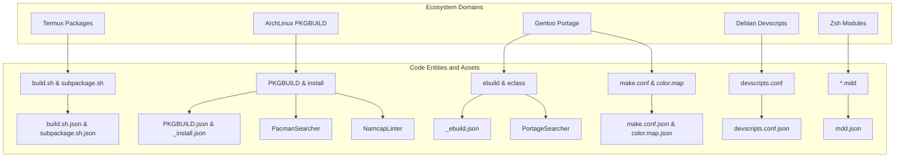

Sources: [README.md:39-68](), [src/termux_language_server/assets/json/_subpackage.sh.json:1-9](), [src/termux_language_server/assets/json/color.map.json:1-6](), [src/termux_language_server/assets/json/make.conf.json:1-6](), [src/termux_language_server/assets/json/_mdd.json:1-6]()

---

## File Processing and Dispatch Data Flow

When a document is opened or edited, the server inspects the filename and path to dispatch the correct schema getter, searcher backend, and linter modules.

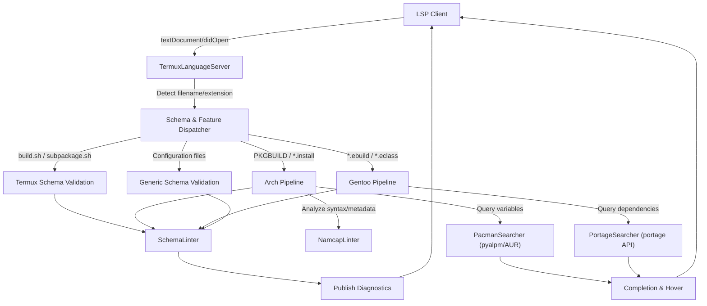

Sources: [README.md:60-68](), [src/termux_language_server/assets/json/devscripts.conf.json:1-12](), [src/termux_language_server/assets/json/make.conf.json:1-10]()

---

## Detailed Ecosystem Specifications

### 1. Termux (`build.sh`, `*.subpackage.sh`)
* **Purpose**: Automates cross-compilation of packages for the Android Termux environment.
* **Schema**: Driven by `build.sh.json` and `subpackage.sh.json` (`_subpackage.sh.json`), which mandate `TERMUX_PKG_*` prefix variables (e.g., `TERMUX_PKG_DESCRIPTION`, `TERMUX_PKG_DEPENDS`) and forbid internal builder variables from being overridden.
* **Linters & Searchers**: Uses `SchemaLinter` for static variable validation against the schema. Package searchers are not currently implemented for Termux packages.

Sources: [README.md:41-43](), [src/termux_language_server/assets/json/_subpackage.sh.json:6-48]()

### 2. Arch Linux / MSYS2 (`PKGBUILD`, `*.install`, `makepkg.conf`)
* **Purpose**: Defines source retrieval, build instructions, and packaging metadata for pacman-based distributions.
* **Schema**: `PKGBUILD.json`, `_install.json`, and `makepkg.conf.json`.
* **Linters & Searchers**: 
  * `PacmanSearcher` integrates with `pyalpm` and local AUR caches for package dependency completion and hover cards.
  * `NamcapLinter` executes `namcap` static analysis checks against `PKGBUILD` files.

Sources: [README.md:44-47](), [README.md:63-67]()

### 3. Gentoo (`*.ebuild`, `*.eclass`, `make.conf`, `color.map`)
* **Purpose**: Ebuild scripts define metadata and compilation steps for Portage; `make.conf` and `color.map` manage global build flags and console styling.
* **Schema**: `_ebuild.json`, `make.conf.json`, and `color.map.json`.
* **Linters & Searchers**:
  * `PortageSearcher` queries the live `portage` Python API for `DEPEND`-family variables (`DEPEND`, `RDEPEND`, `BDEPEND`).
  * `SchemaLinter` validates `make.conf` options and `color.map` token identifiers against defined constants.

Sources: [README.md:48-52](), [README.md:64](), [src/termux_language_server/assets/json/color.map.json:7-103](), [src/termux_language_server/assets/json/make.conf.json:7-14]()

### 4. Debian / Ubuntu (`devscripts.conf`, `.devscripts`)
* **Purpose**: Configuration for Debian developer scripts (e.g., `debchange`, `bts`).
* **Schema**: `devscripts.conf.json` (`_devscripts.json`).
* **Linters & Searchers**: Validated via `SchemaLinter`.

Sources: [README.md:53-54](), [src/termux_language_server/assets/json/devscripts.conf.json:1-12]()

### 5. Zsh (`*.mdd`)
* **Purpose**: Module definition files (`.mdd`) describing Zsh loadable modules, their dependencies, objects, and autofeatures.
* **Schema**: `mdd.json` (`_mdd.json`), capturing fields like `name`, `link`, `load`, `moddeps`, and `autofeatures`.
* **Linters & Searchers**: Validated via `SchemaLinter`.

Sources: [README.md:55-56](), [src/termux_language_server/assets/json/_mdd.json:1-61]()

---

# Page: Server Architecture

# Server Architecture

<details>
<summary>Relevant source files</summary>

The following files were used as context for generating this wiki page:

- [src/termux_language_server/__init__.py](src/termux_language_server/__init__.py)
- [src/termux_language_server/server.py](src/termux_language_server/server.py)

</details>


The `termux-language-server` runtime is built on top of the `lsp-tree-sitter` framework, providing language server protocol (LSP) features for shell-based ecosystem build files (`build.sh`, `PKGBUILD`, `ebuild`, etc.). The core orchestration logic resides in `src/termux_language_server/server.py`, which defines the `TermuxLanguageServer` class [src/termux_language_server/server.py:19-52] and wires together tree-sitter parsers, schema definitions, linters, completers, and searchers.

For detailed breakdowns of specific architectural components, refer to the following child pages:
- [Entrypoint and CLI](#2.1) — Details on command-line execution, argument parsing via `lsp_tree_sitter`, and version handling.
- [TermuxLanguageServer Initialization](#2.2) — In-depth look at parser setup, asset loading, schema/searcher getters, and conditional linter registration.
- [Tree-sitter Queries](#2.3) — Documentation on `.scm` query files used for extracting schema variables and package dependencies.

---

```mermaid
graph TD
    "NaturalLanguageSpace" --> "CodeEntitySpace"
    subgraph CodeEntitySpace
        A["TermuxLanguageServer"] --> B["TreeSitterLanguageServer"]
        A --> C["SchemaLinter"]
        A --> D["PackageLinter"]
        A --> E["NamcapLinter"]
        A --> F["ValueCompleter"]
        A --> G["PackageCompleter"]
        A --> H["PacmanSearcher"]
        A --> I["PortageSearcher"]
    end
```
*Figure 1: Mapping architectural concepts from language server requirements to concrete Python classes in `src/termux_language_server/server.py`.*

Sources: `src/termux_language_server/server.py:19-77`

---

## 2.1. Entrypoint and CLI

The server is launched via the Python module execution interface (`python -m termux_language_server`), which delegates argument parsing and process management to the underlying `lsp_tree_sitter` library. Version handling exposes the package version defined in `src/termux_language_server/__init__.py` [src/termux_language_server/__init__.py:5-5].

For full implementation details, see [Entrypoint and CLI](#2.1).

Sources: `src/termux_language_server/__init__.py:5-5`

---

## 2.2. TermuxLanguageServer Initialization

The `TermuxLanguageServer` class inherits from `TreeSitterLanguageServer` [src/termux_language_server/server.py:12,19]. During initialization (`__init__`), it instantiates a Tree-sitter `Parser` configured with the Bash language pointer [src/termux_language_server/server.py:21-23], loads JSON schemas from the package assets directory [src/termux_language_server/server.py:25-31], and registers linters and completers [src/termux_language_server/server.py:33-52]. 

It also dynamically registers platform-specific searchers like `PacmanSearcher` and `PortageSearcher`, as well as optional linters like `NamcapLinter` using defensive `try/except` or `suppress(ImportError)` blocks [src/termux_language_server/server.py:53-77].

For full implementation details, see [TermuxLanguageServer Initialization](#2.2).

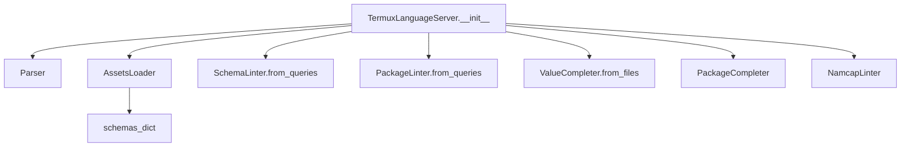
*Figure 2: Component wiring flow inside `TermuxLanguageServer.__init__`.*

Sources: `src/termux_language_server/server.py:19-77`

---

## 2.3. Tree-sitter Queries

Tree-sitter `.scm` query files are utilized by the linters and searchers to extract syntactic structures, variables, functions, and dependency fields (such as `@package.PKGBUILD` and `@package._ebuild`) from the abstract syntax tree (AST) produced by the Bash parser.

For full implementation details, see [Tree-sitter Queries](#2.3).

Sources: `src/termux_language_server/server.py:33-38`

---

# Page: Entrypoint and CLI

# Entrypoint and CLI

<details>
<summary>Relevant source files</summary>

The following files were used as context for generating this wiki page:

- [src/termux_language_server/__init__.py](src/termux_language_server/__init__.py)
- [src/termux_language_server/__main__.py](src/termux_language_server/__main__.py)
- [src/termux_language_server/py.typed](src/termux_language_server/py.typed)

</details>


This section covers the execution entrypoint and command-line interface (CLI) for `termux-language-server`. It details how the package is invoked via `python -m termux_language_server`, how command-line arguments are parsed using `lsp_tree_sitter`, how version metadata is handled, and how the language server runtime is initialized and executed.

Sources: `[src/termux_language_server/__main__.py:1-21]()`, `[src/termux_language_server/__init__.py:1-5]()`

---

## Module Invocation and `__main__.py`

When the language server is invoked from the command line using the Python module execution flag, Python locates and executes `src/termux_language_server/__main__.py`. This module acts as the thin bootstrap layer connecting standard LSP runtime wrappers to the custom `TermuxLanguageServer` implementation.

The entry point is defined by the `main()` function, which is triggered when the module is executed directly [src/termux_language_server/__main__.py:10-21]().

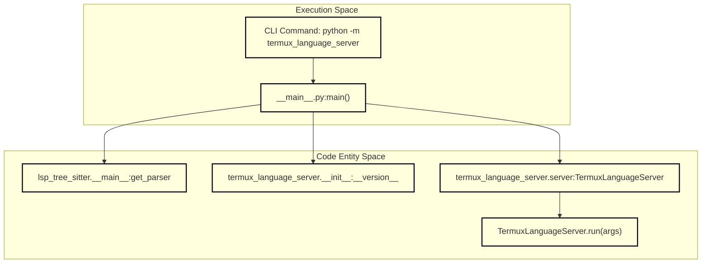

Sources: `[src/termux_language_server/__main__.py:1-21]()`

---

## CLI Argument Parsing and Version Handling

The CLI parser is delegated to the `lsp_tree_sitter` package via its `get_parser` function [src/termux_language_server/__main__.py:5](). Version handling relies on the module-level `__version__` string defined in `src/termux_language_server/__init__.py` [src/termux_language_server/__init__.py:5](), which is passed directly into the parser constructor [src/termux_language_server/__main__.py:11]().

### Argument Parsing Lifecycle

| Step | Function / Class | Source File | Role |
| :--- | :--- | :--- | :--- |
| **Version Retrieval** | `__version__` | `src/termux_language_server/__init__.py` | Provides the semantic version string (`0.1.9`) for CLI flags and server identity. |
| **Parser Generation** | `get_parser()` | `lsp_tree_sitter.__main__` | Constructs the `argparse.ArgumentParser` configured with standard LSP transport options (stdio, TCP, etc.). |
| **Argument Parsing** | `parser.parse_args()` | `src/termux_language_server/__main__.py:12` | Evaluates command-line arguments provided by the user or LSP client. |

Sources: `[src/termux_language_server/__init__.py:1-6]`, `[src/termux_language_server/__main__.py:1-13]()`

---

## Server Initialization and Execution

Once command-line arguments are parsed, the entrypoint imports the `TermuxLanguageServer` class from `.server` [src/termux_language_server/__main__.py:14](). It instantiates the server class passing the application version, and invokes the `.run(args)` method to start the event loop and communicate via the configured transport [src/termux_language_server/__main__.py:16-17]().

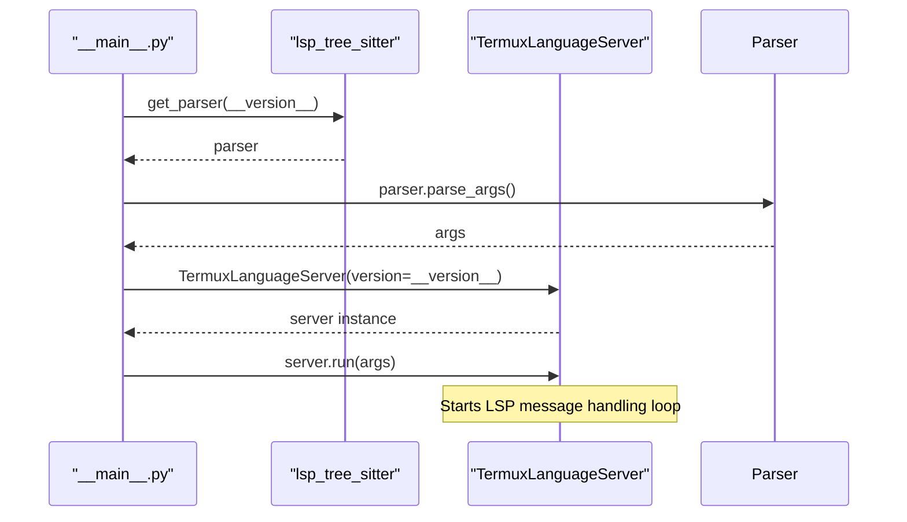

Sources: `[src/termux_language_server/__main__.py:10-18]()`

---

# Page: TermuxLanguageServer Initialization

# TermuxLanguageServer Initialization

<details>
<summary>Relevant source files</summary>

The following files were used as context for generating this wiki page:

- [src/termux_language_server/assets/jq/value.jq](src/termux_language_server/assets/jq/value.jq)
- [src/termux_language_server/server.py](src/termux_language_server/server.py)

</details>


This page details the initialization sequence of the `TermuxLanguageServer` class within the `termux-language-server` codebase. It covers the setup of the Tree-sitter Bash parser, JSON asset loading, linter and completer registration via `lsp-tree-sitter`, dynamic searcher discovery, and conditional linter integration.

---

## 1. Parser and Asset Loading

When `TermuxLanguageServer` is instantiated, it first initializes a Tree-sitter `Parser` instance configured with the Bash language binding (`get_language_ptr`) [src/termux_language_server/server.py:20-23](). 

Following the parser setup, the server loads JSON schema definitions from the built-in assets directory (`src/termux_language_server/assets/json/`) [src/termux_language_server/server.py:25-32](). It iterates over all JSON files in that directory, derives each schema's key from its filename, and stores them in the `self.schemas` dictionary [src/termux_language_server/server.py:26-31]().

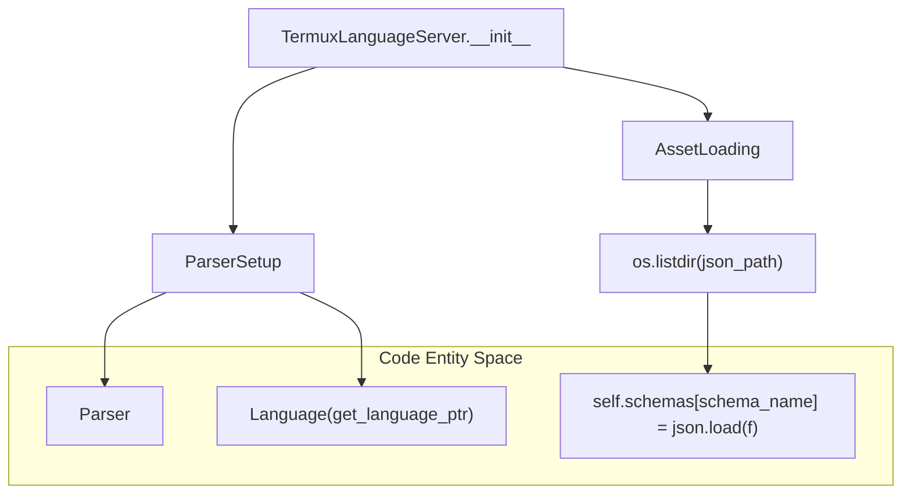
*Sources: [src/termux_language_server/server.py:20-32]()*

---

## 2. Linters, Completers, and Queries Wiring

Once schemas are loaded into memory, the server sets up diagnostic linters and completion providers using query files and JSON schemas [src/termux_language_server/server.py:33-44]():

* **`SchemaLinter`**: Created via `SchemaLinter.from_queries`, linking the Tree-sitter language, `queries` module, and the `self.schema_getter` callback [src/termux_language_server/server.py:33-35]().
* **`PackageLinter`**: Created via `PackageLinter.from_queries`, utilizing the language, queries, and `self.searcher_getter` callback [src/termux_language_server/server.py:36-38]().
* **`ValueCompleter`**: Instantiated from files using `value.jq` (`src/termux_language_server/assets/jq/value.jq`), the schema getter, and a trigger prefix `^` [src/termux_language_server/server.py:39-42]().
* **`PackageCompleter`**: Initialized with `self.searcher_getter` [src/termux_language_server/server.py:44]().

Finally, the base class `TreeSitterLanguageServer.__init__` is invoked with the parser, linter tuple, and completer tuple [src/termux_language_server/server.py:46-52]().

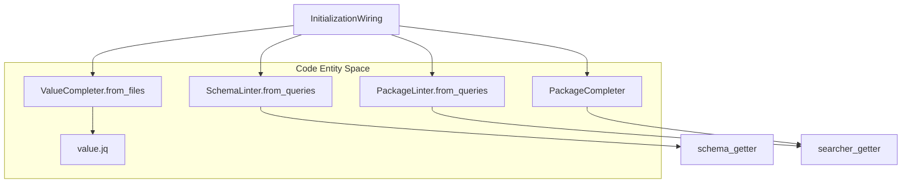
*Sources: [src/termux_language_server/server.py:33-52](), [src/termux_language_server/assets/jq/value.jq:1-24]()*

---

## 3. Getter Methods and Ecosystem Searchers

To route schema lookups and package searches based on the active file path, `TermuxLanguageServer` implements two key retrieval methods and a searcher discovery static method [src/termux_language_server/server.py:58-77]():

* **`schema_getter`**: Determines the file type using `PackageSearcher.get_filetype` against `self.schemas` and returns the corresponding schema dictionary [src/termux_language_server/server.py:58-60]().
* **`searcher_getter`**: Resolves the file type against `self.searchers` to return a registered `PackageSearcher` instance [src/termux_language_server/server.py:62-64]().
* **`get_searchers`**: Dynamically imports and maps ecosystem searchers (such as `PacmanSearcher` for `PKGBUILD` and `PortageSearcher` for `_ebuild`) inside a suppression block to gracefully handle missing native dependencies [src/termux_language_server/server.py:66-77]().

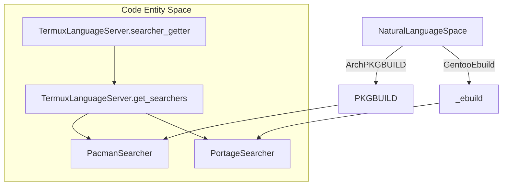
*Sources: [src/termux_language_server/server.py:58-77]()*

---

## 4. Conditional Linter Registration

After calling `super().__init__`, the server checks for optional analysis tools by attempting to import `NamcapLinter` [src/termux_language_server/server.py:53-57](). If the import succeeds (i.e., `namcap` and its environment are available), `NamcapLinter` is appended to `self.linters` [src/termux_language_server/server.py:53-57]().

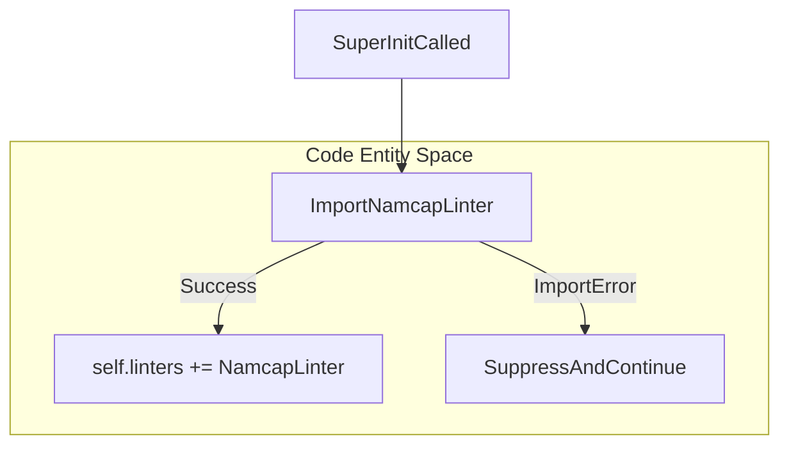
*Sources: [src/termux_language_server/server.py:53-57]()*

---

# Page: Tree-sitter Queries

# Tree-sitter Queries

<details>
<summary>Relevant source files</summary>

The following files were used as context for generating this wiki page:

- [src/termux_language_server/queries/packages.scm](src/termux_language_server/queries/packages.scm)
- [src/termux_language_server/queries/schema.scm](src/termux_language_server/queries/schema.scm)

</details>


This leaf page details the implementation and schema structure of the Tree-sitter query files (`.scm`) used within `termux-language-server`. These declarative query files are processed by `lsp-tree-sitter` to parse shell-based scripts, extracting variable assignments, function definitions, and ecosystem-specific dependency references (such as Arch Linux `PKGBUILD` and Gentoo `ebuild` files).

---

## 1. Variable and Function Extraction (`schema.scm`)

The `schema.scm` query file is responsible for structural extraction of shell scripts, capturing both scalar/array variable assignments and function definitions. It relies on specialized capture names interpreted by the language server framework to handle shell tokenization, shlex expansion, and integer-valued metadata.

### Query Breakdown
* **Scalar Assignments:** Matches `variable_assignment` nodes containing words, raw strings, standard strings, or concatenated expressions, exposing them via `@--name` and `@-name` tags [src/termux_language_server/queries/schema.scm:1-16]().
* **Array Assignments:** Matches array declarations containing words, strings, or concatenations, parsing individual elements for validation [src/termux_language_server/queries/schema.scm:17-36]().
* **Function Definitions:** Identifies shell functions using `function_definition` and annotates them with integer evaluation properties (`#set! -function.--integer 0`) [src/termux_language_server/queries/schema.scm:37-39]().

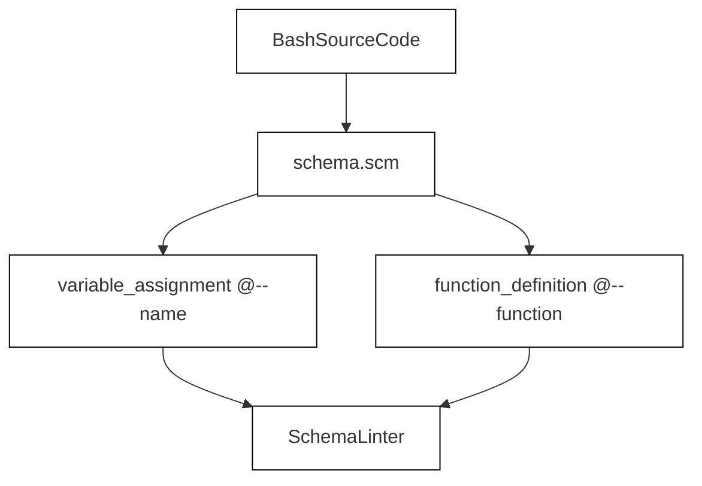

*Sources: [src/termux_language_server/queries/schema.scm:1-39]()*

---

## 2. Package and Dependency Captures (`packages.scm`)

The `packages.scm` query file targets packaging metadata fields across different distribution ecosystems. It uses Tree-sitter predicates (`#any-of?`) to isolate array elements and string values belonging to dependency variables.

### Ecosystem Rules
* **Arch Linux (`PKGBUILD`):** Captures package references from array variables (`depends`, `makedepends`, `optdepends`, `conflicts`, `provides`, `replaces`) formatted as words, raw strings, or string contents, tagging them as `@package.PKGBUILD` [src/termux_language_server/queries/packages.scm:1-19]().
* **Gentoo (`ebuild`):** Captures package specifiers from scalar string variables in the dependency family (`DEPEND`, `RDEPEND`, `BDEPEND`, `IDEPEND`, `PDEPEND`), tagging them as `@package._ebuild` [src/termux_language_server/queries/packages.scm:20-24]().

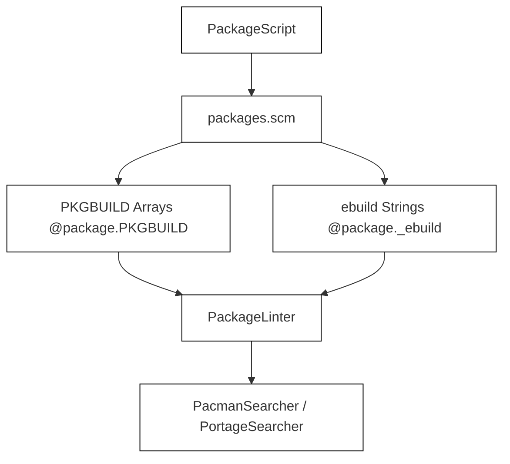

*Sources: [src/termux_language_server/queries/packages.scm:1-24]()*

---

## 3. Query Processing and Runtime Integration

The language server loads these `.scm` files during initialization, feeding them into the underlying `lsp-tree-sitter` runtime engine. The engine uses the query matches to construct AST representations that drive both `SchemaLinter` and `PackageLinter` diagnostics.

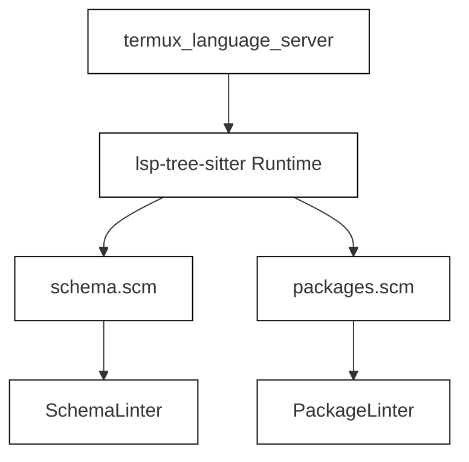

*Sources: [src/termux_language_server/queries/schema.scm:1-39](), [src/termux_language_server/queries/packages.scm:1-24]()*

---

# Page: Language Features

# Language Features

<details>
<summary>Relevant source files</summary>

The following files were used as context for generating this wiki page:

- [README.md](README.md)
- [src/termux_language_server/server.py](src/termux_language_server/server.py)

</details>


This page provides a high-level overview of the core language features supported by `termux-language-server`, including diagnostics, completion, hover documentation, and document links. These features are powered by tree-sitter queries, JSON schemas, and ecosystem-specific package searchers wired through `lsp-tree-sitter`.

For details, see the child pages:
- [Diagnostics and Linters](#3.1)
- [Package Searchers](#3.2)
- [Completion and JQ Value Filters](#3.3)

---

## 3.1 Diagnostics and Linters

Diagnostics identify syntax errors, invalid property assignments, and package dependency issues across supported scripts. The server integrates multiple linter components initialized within `TermuxLanguageServer`:

- **`SchemaLinter`**: Validates parsed script variables and structure against ecosystem JSON schemas [src/termux_language_server/server.py:33-35]().
- **`PackageLinter`**: Validates package references in dependency fields using registered searchers [src/termux_language_server/server.py:36-38]().
- **`NamcapLinter`**: Performs optional static analysis on Arch Linux `PKGBUILD` files using `namcap` [src/termux_language_server/server.py:53-56]().

For deep technical details, schema validation rules, and linter wiring, see [Diagnostics and Linters](#3.1).

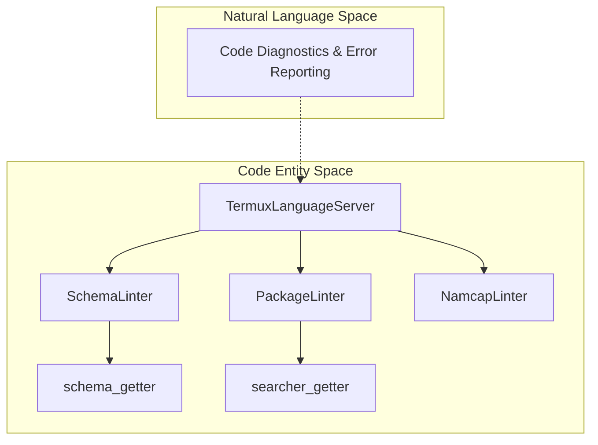
*Figure 1: Bridging diagnostic features to linter classes.*

Sources: `src/termux_language_server/server.py:19-57`

---

## 3.2 Package Searchers

Package searchers abstract package manager databases and upstream metadata repositories. They power package completion, hover documentation cards, and clickable document links for dependency fields.

- **`PacmanSearcher`**: Queries local `pyalpm` databases and caches for Arch Linux and MSYS2 ecosystems [src/termux_language_server/server.py:69-72]().
- **`PortageSearcher`**: Interacts with Gentoo's `portage` API for ebuilds and make.conf [src/termux_language_server/server.py:73-76]().

For details on database querying, virtual package resolution, and doc rendering, see [Package Searchers](#3.2).

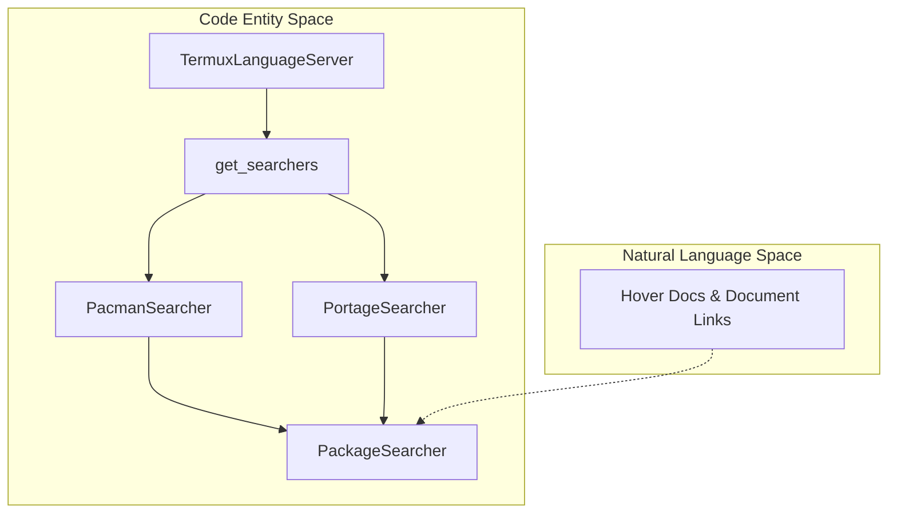
*Figure 2: Bridging hover and linking features to searcher classes.*

Sources: `src/termux_language_server/server.py:62-77`

---

## 3.3 Completion and JQ Value Filters

Completion features assist users by suggesting valid property names, enumeration values, and installable package names. 

- **`ValueCompleter`**: Evaluates JSON schemas using `assets/jq/value.jq` to extract valid candidate values for script variables [src/termux_language_server/server.py:39-42]().
- **`PackageCompleter`**: Supplies ecosystem-specific package names dynamically via `searcher_getter` [src/termux_language_server/server.py:44]().

For details on JQ query execution and completion wiring, see [Completion and JQ Value Filters](#3.3).

Sources: `src/termux_language_server/server.py:39-52`

---

# Page: Diagnostics and Linters

# Diagnostics and Linters

<details>
<summary>Relevant source files</summary>

The following files were used as context for generating this wiki page:

- [src/termux_language_server/linter.py](src/termux_language_server/linter.py)
- [src/termux_language_server/server.py](src/termux_language_server/server.py)

</details>


## Purpose and Scope

This section covers the diagnostic subsystems and linters wired into `TermuxLanguageServer`. It details how `SchemaLinter` and `PackageLinter` are instantiated using tree-sitter queries and schema/searcher getters, and explains the implementation of `NamcapLinter` for static analysis of Arch Linux `PKGBUILD` files via the upstream `Namcap` package.

Sources: [src/termux_language_server/server.py:1-77](), [src/termux_language_server/linter.py:1-47]()

---

## Core Linter Architecture and Wiring

The language server delegates syntax validation and structural constraints to `SchemaLinter` and dependency verification to `PackageLinter`, both provided by `lsp_tree_sitter`. During the initialization of `TermuxLanguageServer`, these linters are wired using tree-sitter language pointers, query modules, and lookup getters.

`SchemaLinter` validates node structures against loaded JSON schemas, while `PackageLinter` utilizes searchers to verify package availability and reference correctness.

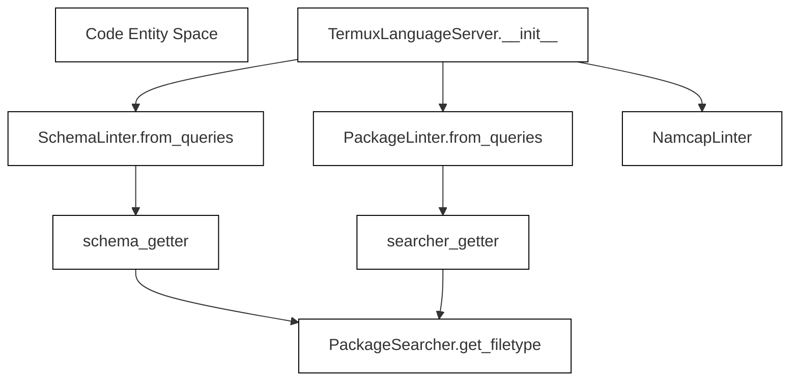
*Figure 1: Linter wiring architecture bridging system initialization to `SchemaLinter`, `PackageLinter`, and `NamcapLinter`.*

Sources: [src/termux_language_server/server.py:19-57]()

---

## NamcapLinter Implementation

The `NamcapLinter` class extends `LinterBase` to provide specialized linting for Arch Linux `PKGBUILD` files [src/termux_language_server/linter.py:26-27](). It integrates the external `Namcap` library to apply packaging rules and report warnings or errors.

### Execution Flow

When a document's syntax tree is evaluated, `NamcapLinter.diagnose` executes the following sequence:
1. Verifies that the target file's basename equals `PKGBUILD` [src/termux_language_server/linter.py:28-31]().
2. Extracts source node text and loads package metadata via `load_from_pkgbuild(path)` [src/termux_language_server/linter.py:32-33]().
3. Iterates over all available Namcap rules (`all_rules.values()`) filtering for instances of `PkgbuildRule` [src/termux_language_server/linter.py:35-37]().
4. Executes `rule.analyze(pkginfo, "PKGBUILD")` [src/termux_language_server/linter.py:38]().
5. Collects errors and warnings, mapping them to LSP `DiagnosticSeverity.Error` and `DiagnosticSeverity.Warning` respectively [src/termux_language_server/linter.py:39-42]().
6. Constructs and returns a list of LSP `Diagnostic` objects [src/termux_language_server/linter.py:44-47]().

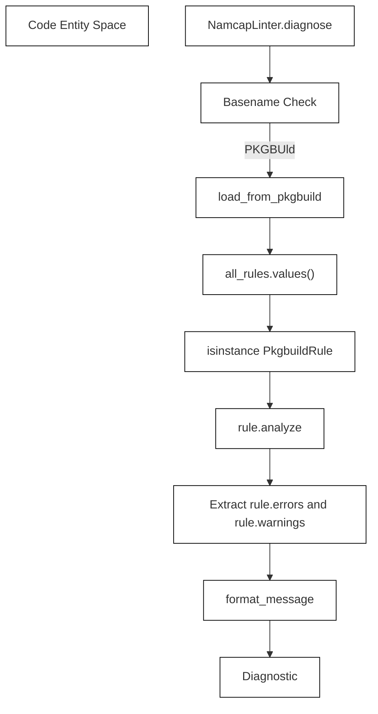
*Figure 2: Data flow inside `NamcapLinter.diagnose`.*

Sources: [src/termux_language_server/linter.py:26-47]()

---

## Conditional Linter Registration

`NamcapLinter` is registered conditionally within `TermuxLanguageServer.__init__` using a suppressed `ImportError` block [src/termux_language_server/server.py:53-56](). If the `Namcap` package is absent from the Python environment, the linter is omitted without disrupting core language server operations.

Sources: [src/termux_language_server/server.py:53-57]()

---

# Page: Package Searchers

# Package Searchers

<details>
<summary>Relevant source files</summary>

The following files were used as context for generating this wiki page:

- [src/termux_language_server/searcher/pacman.py](src/termux_language_server/searcher/pacman.py)
- [src/termux_language_server/searcher/portage.py](src/termux_language_server/searcher/portage.py)

</details>


The package searcher subsystem provides intelligent package resolution, completion candidate generation, documentation rendering, and document link creation for package manager dependency fields. By integrating with underlying system package managers (`pyalpm` for Arch Linux and `portage` for Gentoo), the language server maps dependency strings to local database records, virtual packages, and upstream repositories (such as the AUR).

For details on specific implementations, refer to the child pages:
- [PacmanSearcher (Arch/PKGBUILD)](#3.2.1)
- [PortageSearcher (Gentoo/ebuild)](#3.2.2)

---

## Subsystem Architecture

The package searcher infrastructure is built upon the `PackageSearcher` base class provided by the external `lsp-tree-sitter` library [src/termux_language_server/searcher/pacman.py:10](). Subclasses define specific tree-sitter node label associations and field names (such as `depends` or `DEPEND`) that trigger package-aware features like hover tooltips and completions.

```mermaid
classDiagram
    direction TB
    class PackageSearcher {
        <<external>>
        +str label
        +tuple texts
        +has_package(name) bool
        +get_package_url(name) str
        +get_package_version(name) str
        +get_package_names(name) dict
        +get_package_document(name) str
    }
    class PacmanSearcher {
        +str label: "package.PKGBUILD"
        +tuple texts: ("depends", "makedepends", ...)
        +DB db
        +Trie trie
        +get_pkgs(name) list
    }
    class PortageSearcher {
        +str label: "package._ebuild"
        +tuple texts: ("DEPEND", "RDEPEND", ...)
        +portdbapi db
        +render_document(name) str
    }

    PackageSearcher <|-- PacmanSearcher : "inherits"
    PackageSearcher <|-- PortageSearcher : "inherits"
```
*Figure 1: Class hierarchy of package searchers bridging natural language queries to backend package database implementations.*

Sources: `src/termux_language_server/searcher/pacman.py:10-48`, `src/termux_language_server/searcher/portage.py:11-37`

---

## PacmanSearcher (Arch Linux / PKGBUILD)

The `PacmanSearcher` class handles package metadata resolution for Arch Linux `PKGBUILD` files [src/termux_language_server/searcher/pacman.py:34-108](). It interfaces with local `libalpm` databases via `pyalpm` [src/termux_language_server/searcher/pacman.py:45-47]() and optionally queries AUR caches backed by `marisa-trie` [src/termux_language_server/searcher/pacman.py:24-30](). Jinja2 templates are used to format package hover documentation [src/termux_language_server/searcher/pacman.py:17-21]().

For deep technical details, virtual package resolution logic, and configuration overrides, see [PacmanSearcher (Arch/PKGBUILD)](#3.2.1).

Sources: `src/termux_language_server/searcher/pacman.py:1-109`

---

## PortageSearcher (Gentoo / ebuild)

The `PortageSearcher` class manages package queries for Gentoo `ebuild` files [src/termux_language_server/searcher/portage.py:25-70](). It queries the Portage porttree API (`portdbapi`) to resolve dependencies across `DEPEND`-family variables (`DEPEND`, `RDEPEND`, `BDEPEND`, `IDEPEND`, `PDEPEND`) [src/termux_language_server/searcher/portage.py:27-36]() and delegates asynchronous documentation rendering using Jinja templates [src/termux_language_server/searcher/portage.py:17-21](), `ThreadPoolExecutor` [src/termux_language_server/searcher/portage.py:37](), and Portage auxiliary metadata (`aux_get`) [src/termux_language_server/searcher/portage.py:58-60]().

For deep technical details, keyword parsing, and template configuration, see [PortageSearcher (Gentoo/ebuild)](#3.2.2).

Sources: `src/termux_language_server/searcher/portage.py:1-71`

---

# Page: PacmanSearcher (Arch/PKGBUILD)

# PacmanSearcher (Arch/PKGBUILD)

<details>
<summary>Relevant source files</summary>

The following files were used as context for generating this wiki page:

- [src/termux_language_server/assets/jinja/PKGBUILD.md.jinja](src/termux_language_server/assets/jinja/PKGBUILD.md.jinja)
- [src/termux_language_server/searcher/pacman.py](src/termux_language_server/searcher/pacman.py)

</details>


## Purpose and Scope

The `PacmanSearcher` component provides package lookup, completion data, version resolution, URL generation, and hover documentation for Arch Linux `PKGBUILD` files within the language server ecosystem. It interfaces directly with the local pacman database via `pyalpm`, integrates AUR (Arch User Repository) package caches using `marisa-trie`, and renders rich Markdown documentation through Jinja2 templates.

Sources: `src/termux_language_server/searcher/pacman.py:1-109`, `src/termux_language_server/assets/jinja/PKGBUILD.md.jinja:1-34`

---

## Class Architecture & Initialization

`PacmanSearcher` inherits from `PackageSearcher` (provided by `lsp_tree_sitter.completer`) and targets dependency-related fields in `PKGBUILD` scripts (`depends`, `makedepends`, `optdepends`, `conflicts`, `provides`, `replaces`) [src/termux_language_server/searcher/pacman.py:33-43]().

```
Sources: src/termux_language_server/searcher/pacman.py:17-49
```

Helper functions manage asset locations and trie caches:
* `get_template(name: str)`: Loads user-configured Jinja templates from `user_config_path("pacman")` or falls back to built-in assets at `src/termux_language_server/assets/jinja/PKGBUILD.md.jinja` [src/termux_language_server/searcher/pacman.py:17-21]().
* `get_trie()`: Loads precompiled AUR package lists from `user_cache_dir("paru", version="packages.aur")` into a `marisa_trie.Trie` instance [src/termux_language_server/searcher/pacman.py:24-30]().

### Configuration Attributes Table

| Attribute | Type | Default Value / Source | Description |
| :--- | :--- | :--- | :--- |
| `label` | `str` | `"package.PKGBUILD"` [src/termux_language_server/searcher/pacman.py:35]() | Tree-sitter capture label handled by this searcher. |
| `texts` | `tuple[str, ...]` | `("depends", "makedepends", ...)` [src/termux_language_server/searcher/pacman.py:36-43]() | PKGBUILD fields activated for completion/search. |
| `template` | `Template` | `get_template()` [src/termux_language_server/searcher/pacman.py:44]() | Jinja2 template for rendering package hover documentation. |
| `db` | `DB` | `Handle(".", "/var/lib/pacman").get_localdb()` [src/termux_language_server/searcher/pacman.py:45-47]() | Local `pyalpm` database handle. |
| `trie` | `Trie \| None` | `get_trie()` [src/termux_language_server/searcher/pacman.py:48]() | AUR cache trie for remote package resolution. |

Sources: `src/termux_language_server/searcher/pacman.py:17-49`

---

## Database Queries & Virtual Package Resolution

Package resolution queries local system state via `pyalpm` and handles virtual package relationships (`provides`).

```
Sources: src/termux_language_server/searcher/pacman.py:50-70
```

* `__call__(node: Node | None)`: Normalizes tree-sitter string nodes before evaluation [src/termux_language_server/searcher/pacman.py:50-53]().
* `get_pkgs(name: str)`: Queries exact package matches using `self.db.get_pkg(name)`. If unassigned, searches the local DB and iterates over `pkg.provides` to resolve virtual package providers [src/termux_language_server/searcher/pacman.py:54-63]().
* `has_package(name: str)`: Validates package existence by checking local matches and falling back to `self.trie.keys(name)` if available [src/termux_language_server/searcher/pacman.py:65-70]().

---

## AUR Integration & Trie-Based Cache

When packages are not present in the local pacman database, `PacmanSearcher` relies on `marisa_trie` to query the AUR index.

```
Sources: src/termux_language_server/searcher/pacman.py:65-100
```

* `get_package_url(name: str)`: Resolves a package URL. If the package exists locally or in the AUR trie, it returns `https://aur.archlinux.org/packages/{name}` or falls back to `https://archlinux.org/packages/{name}` [src/termux_language_server/searcher/pacman.py:72-80]().
* `get_package_version(name: str)`: Retrieves version strings from `pyalpm.Package`, formatting multi-provider or divergent package names when necessary [src/termux_language_server/searcher/pacman.py:81-89]().
* `get_package_names(name: str)`: Aggregates completion candidates from local database searches (rendered via Jinja templates) and supplements them with keys from the AUR trie [src/termux_language_server/searcher/pacman.py:90-100]().

---

## Documentation Rendering via Jinja2

Hover information and documentation payloads are generated using `get_package_document(name: str)`, which renders package properties against `PKGBUILD.md.jinja` [src/termux_language_server/searcher/pacman.py:102-108]().

The template extracts fields such as description, version, architecture, URLs, licenses, groups, dependencies, optdepends, provides, conflicts, and replaces [src/termux_language_server/assets/jinja/PKGBUILD.md.jinja:1-33]().

Sources: `src/termux_language_server/searcher/pacman.py:102-108`, `src/termux_language_server/assets/jinja/PKGBUILD.md.jinja:1-34`

---

## Architecture and Data Flow Diagrams

### Diagram: Natural Language Space to Code Entity Space (Package Search & Resolution)

```mermaid
graph TD
    UserRequest["User Query Input"] --> PacmanSearcherCall["PacmanSearcher.__call__"]
    PacmanSearcherCall --> GetPkgs["PacmanSearcher.get_pkgs"]
    
    GetPkgs --> LocalDB{"pyalpm.DB.get_pkg"}
    LocalDB -- "Found" --> ReturnPackage["Return pyalpm.Package"]
    LocalDB -- "Not Found" --> SearchVirtual["pyalpm.DB.search & pkg.provides"]
    
    SearchVirtual --> HasPackage{"PacmanSearcher.has_package"}
    HasPackage -- "Local/Virtual Found" --> GenDoc["PacmanSearcher.get_package_document"]
    HasPackage -- "Not Local" --> TrieCheck{"marisa_trie.Trie"}
    
    TrieCheck -- "Found in AUR" --> AurUrl["PacmanSearcher.get_package_url (AUR)"]
    TrieCheck -- "Not Found" --> EmptyResult["Return Empty/Fallback"]

    GenDoc --> JinjaRender["Template.render (PKGBUILD.md.jinja)"]
    JinjaRender --> FinalOutput["Markdown Documentation Payload"]

    classDef default fill:#fff,stroke:#333,stroke-width:2px;
    class UserRequest,PacmanSearcherCall,GetPkgs,LocalDB,SearchVirtual,HasPackage,TrieCheck,GenDoc,JinjaRender default;
```

Sources: `src/termux_language_server/searcher/pacman.py:33-109`, `src/termux_language_server/assets/jinja/PKGBUILD.md.jinja:1-34`

### Diagram: Component Interaction Topology

```mermaid
graph LR
    LSPClient["LSP Client"] --> TreeSitter["tree_sitter.Node"]
    TreeSitter --> PacmanSearcher["searcher.pacman.PacmanSearcher"]
    
    PacmanSearcher --> PyAlpm["pyalpm.Handle / DB"]
    PacmanSearcher --> MarisaTrie["marisa_trie.Trie"]
    PacmanSearcher --> JinjaEngine["jinja2.Template"]
    
    PyAlpm --> LocalDbData["Local Package DB (/var/lib/pacman)"]
    MarisaTrie --> AurCacheData["AUR Cache (paru packages.aur)"]
    JinjaEngine --> JinjaAsset["PKGBUILD.md.jinja"]

    classDef default fill:#fff,stroke:#333,stroke-width:2px;
    class LSPClient,TreeSitter,PacmanSearcher,PyAlpm,MarisaTrie,JinjaEngine default;
```

Sources: `src/termux_language_server/searcher/pacman.py:17-49`, `src/termux_language_server/assets/jinja/PKGBUILD.md.jinja:1-34`

---

# Page: PortageSearcher (Gentoo/ebuild)

# PortageSearcher (Gentoo/ebuild)

<details>
<summary>Relevant source files</summary>

The following files were used as context for generating this wiki page:

- [src/termux_language_server/assets/jinja/_ebuild.md.jinja](src/termux_language_server/assets/jinja/_ebuild.md.jinja)
- [src/termux_language_server/searcher/portage.py](src/termux_language_server/searcher/portage.py)

</details>


This page documents the `PortageSearcher` implementation, which provides portage-backed package lookup, version resolution, document rendering, and URL generation for Gentoo ebuild files within the language server.

## Purpose and Scope

`PortageSearcher` integrates Gentoo's package management system (`portage`) into the `lsp-tree-sitter` completion and hover framework. It handles package completion, documentation popups, and document links specifically for DEPEND-family variables (`DEPEND`, `RDEPEND`, `BDEPEND`, `IDEPEND`, `PDEPEND`) found in ebuild files.

## Implementation Details

`PortageSearcher` inherits from `lsp_tree_sitter.completer.PackageSearcher` [src/termux_language_server/searcher/portage.py:25](). It leverages the `portage` Python API to query local package databases (`portdbapi`) and renders hover documentation utilizing Jinja templates.

### Class Attributes & Configuration

- `label`: Binds the searcher to the tree-sitter capture label `package._ebuild` [src/termux_language_server/searcher/portage.py:26]().
- `texts`: Restricts package searching and context matching to Gentoo dependency variables (`DEPEND`, `RDEPEND`, `BDEPEND`, `IDEPEND`, `PDEPEND`) [src/termux_language_server/searcher/portage.py:27-33]().
- `url_template`: Formats package web URLs using `https://packages.gentoo.org/packages/{}` [src/termux_language_server/searcher/portage.py:34]().
- `db`: Initializes the portage tree database client using `db[root]["porttree"].dbapi` [src/termux_language_server/searcher/portage.py:36]().
- `executor`: A `ThreadPoolExecutor` with `max_workers=1` used to asynchronously or safely execute blocking auxiliary metadata lookups [src/termux_language_server/searcher/portage.py:37]().

### Key Methods

- `has_package(name: str) -> bool`: Checks if any category/package (`cp`) matches the given query using `self.db.cp_list(name)` [src/termux_language_server/searcher/portage.py:39-40]().
- `get_package_url(name: str) -> str`: Returns the Gentoo packages URL for a given package name [src/termux_language_server/searcher/portage.py:42-43]().
- `get_package_version(name: str) -> str`: Retrieves the latest Category-Package-Version (`CPV`) string for a package name [src/termux_language_server/searcher/portage.py:45-48]().
- `get_package_names(name: str) -> dict[str, str]`: Filters all available canonical package names (`cp_all`) matching the prefix [src/termux_language_server/searcher/portage.py:50-51]().
- `get_package_document(name: str) -> str`: Submits `render_document` to the `ThreadPoolExecutor` to fetch auxiliary metadata without blocking the main thread [src/termux_language_server/searcher/portage.py:53-54]().
- `render_document(name: str) -> str`: Queries auxiliary metadata (`DESCRIPTION`, `HOMEPAGE`, `LICENSE`, `SLOT`, `KEYWORDS`) via `self.db.aux_get()` and renders it through the Jinja template [src/termux_language_server/searcher/portage.py:56-70]().

Sources: [src/termux_language_server/searcher/portage.py:1-70]()

---

## Template Rendering

Hover documentation is formatted using Jinja templates. The system first checks the user configuration path (`portage/_ebuild.md.jinja`), falling back to the built-in package asset if not present [src/termux_language_server/searcher/portage.py:17-21]().

```markdown
{{ pkg.description }}

- version: **{{ pkg.version }}**
- slot: **{{ pkg.slot }}**
- homepage: <{{ pkg.homepage }}>
- license: *{{ pkg.license }}*
- keywords: {{ pkg.keywords }}
```
Sources: [src/termux_language_server/assets/jinja/_ebuild.md.jinja:1-7]()

---

## Architecture and Data Flow

### PortageSearcher Code Entity Mapping

The diagram below connects natural language requirements and architectural components of PortageSearcher to their corresponding symbols and classes in the codebase.

```mermaid
graph TD
    A["Ebuild Dependency Fields"] -->|Captured by query| B["package._ebuild"]
    B -->|Wired to| C["PortageSearcher"]
    C -->|Inherits| D["PackageSearcher"]
    C -->|Queries DB| E["portdbapi"]
    C -->|Renders Docs| F["get_template"]
    F -->|Uses Asset| G["_ebuild.md.jinja"]
    C -->|Executes via| H["ThreadPoolExecutor"]
```
Sources: [src/termux_language_server/searcher/portage.py:11-37](), [src/termux_language_server/assets/jinja/_ebuild.md.jinja:1-7]()

### Package Verification and Documentation Flow

```mermaid
sequenceDiagram
    participant LSP as Language Server Client
    participant PS as PortageSearcher
    participant DB as portdbapi
    participant TPL as Jinja Template

    LSP->>PS: get_package_document(name)
    PS->>PS: executor.submit(render_document, name)
    PS->>DB: get_package_version(name)
    DB-->>PS: cpv (Category/Package-Version)
    PS->>DB: aux_get(cpv, [DESCRIPTION, HOMEPAGE, ...])
    DB-->>PS: metadata values
    PS->>Tpl: template.render(pkg=pkg)
    Tpl-->>PS: Markdown string
    PS-->>LSP: Rendered Documentation
```
Sources: [src/termux_language_server/searcher/portage.py:37-70]()

---

# Page: Completion and JQ Value Filters

# Completion and JQ Value Filters

<details>
<summary>Relevant source files</summary>

The following files were used as context for generating this wiki page:

- [src/termux_language_server/assets/jq/value.jq](src/termux_language_server/assets/jq/value.jq)
- [src/termux_language_server/server.py](src/termux_language_server/server.py)

</details>


## Purpose and Scope

This page details the completion subsystem within `termux-language-server`. It covers how `lsp-tree-sitter`'s `ValueCompleter` and `PackageCompleter` are initialized within `TermuxLanguageServer`, how file types are mapped to schemas and searchers, and the internals of `assets/jq/value.jq`, which uses `jq` to extract and format candidate completion values directly from JSON schemas based on AST node context.

Sources: [src/termux_language_server/server.py:39-50]()

---

## Completer Initialization and Wiring

The completion subsystem is initialized inside `TermuxLanguageServer.__init__` in `src/termux_language_server/server.py`. It instantiates two primary completers provided by `lsp-tree-sitter`:

1. `ValueCompleter`: Configured via `ValueCompleter.from_files`, which loads `assets/jq/value.jq` [src/termux_language_server/server.py:39-42](). It uses `self.schema_getter` to retrieve the active schema based on the document path and a trigger prefix (`"^"`).
2. `PackageCompleter`: Initialized with `self.searcher_getter` to supply ecosystem-specific package suggestions (such as from Pacman or Portage) [src/termux_language_server/server.py:44]().

```mermaid
graph TD
    LS["TermuxLanguageServer"] -->|"instantiates"| VC["ValueCompleter"]
    LS -->|"instantiates"| PC["PackageCompleter"]
    VC -->|"reads"| JQ["assets/jq/value.jq"]
    VC -->|"uses schema_getter()"| SG["schema_getter(path)"]
    PC -->|"uses searcher_getter()"| SS["searcher_getter(path)"]
    SG -->|"calls PackageSearcher.get_filetype()"| Sch["self.schemas"]
    SS -->|"calls PackageSearcher.get_filetype()"| Srch["self.searchers"]

    subgraph "Code Entity Space"
        LS
        VC
        PC
        SG
        SS
    end
    subgraph "Asset Space"
        JQ
        Sch
        Srch
    end
```

Sources: [src/termux_language_server/server.py:39-65]()

---

## JQ Value Filter Mechanics (`value.jq`)

The script `src/termux_language_server/assets/jq/value.jq` processes incoming schema definitions and evaluates AST context ($nodes, $cursor, $complete) to dynamically generate completion items.

### Execution Flow and Logic

1. **Context Inspection**: The script inspects the primary node type `$nodes[0].type` and cursor position `$cursor[1]` [src/termux_language_server/assets/jq/value.jq:1-2]().
2. **Property Extraction**: If the cursor is at the beginning of a line, or if the node type is a `variable_name` or a function definition `word`, it combines the schema's `.properties` and transformed `.patternProperties` (stripping regex anchors `[$^]` and capturing groups) into a unified property map [src/termux_language_server/assets/jq/value.jq:3-5]().
3. **Filtering & Mapping**: Each property is evaluated against the current token text ($nodes[0].text) and completion flag ($complete) [src/termux_language_server/assets/jq/value.jq:6-7](). Matching keys yield an LSP `CompletionItem` containing:
   - `label` and `insert_text` [src/termux_language_server/assets/jq/value.jq:9-10]()
   - `kind`: Mapped dynamically to `Variable`, `Function`, or `Constant` depending on `$type` [src/termux_language_server/assets/jq/value.jq:11-19]()
   - `documentation`: Extracted from the schema's `.value.description` field formatted as Markdown [src/termux_language_server/assets/jq/value.jq:20]()

```mermaid
graph TD
    Start["LSP Completion Request"] --> CheckContext["value.jq: Check $nodes[0].type & cursor"]
    CheckContext -->|Valid Variable/Function/Start| ExtractProps["Extract .properties & .patternProperties"]
    CheckContext -->|Invalid Context| Empty["Return empty"]
    ExtractProps --> FilterKeys["Filter keys matching $nodes[0].text"]
    FilterKeys --> BuildItem["Build CompletionItem: label, insert_text, kind, documentation"]

    subgraph "Code Entity Space"
        Start
    end
    subgraph "jq Filter Space"
        CheckContext
        ExtractProps
        FilterKeys
        BuildItem
        Empty
    end
```

Sources: [src/termux_language_server/assets/jq/value.jq:1-24]()

---

## Schema and Searcher Retrieval Helpers

To determine which schema or package searcher applies to a given document path, `TermuxLanguageServer` relies on helper methods that interface with `PackageSearcher.get_filetype` [src/termux_language_server/server.py:58-64]():

- `schema_getter(path: str)`: Resolves the file type from `self.schemas` using `PackageSearcher.get_filetype(path, self.schemas)` and returns the matching JSON schema dictionary [src/termux_language_server/server.py:58-60]().
- `searcher_getter(path: str)`: Resolves the file type from `self.searchers` using `PackageSearcher.get_filetype(path, self.searchers)` to locate ecosystem-specific handlers such as `PacmanSearcher` or `PortageSearcher` [src/termux_language_server/server.py:62-77]().

```mermaid
graph TD
    Client["LSP Client"] -->|Request completion| Srv["TermuxLanguageServer"]
    Srv -->|Path passed| SG["TermuxLanguageServer.schema_getter()"]
    Srv -->|Path passed| SS["TermuxLanguageServer.searcher_getter()"]
    SG -->|Calls| PS["PackageSearcher.get_filetype()"]
    SS -->|Calls| PS
    PS -->|Returns schema| VComp["ValueCompleter / JQ"]
    PS -->|Returns searcher| PComp["PackageCompleter"]

    subgraph "Server Space"
        Srv
        SG
        SS
    end
    subgraph "LSP Tree Sitter Library Space"
        PS
        VComp
        PComp
    end
```

Sources: [src/termux_language_server/server.py:58-77]()

---

# Page: Schema Assets

# Schema Assets

<details>
<summary>Relevant source files</summary>

The following files were used as context for generating this wiki page:

- [src/termux_language_server/assets/json/PKGBUILD.json](src/termux_language_server/assets/json/PKGBUILD.json)
- [src/termux_language_server/assets/json/build.sh.json](src/termux_language_server/assets/json/build.sh.json)
- [tests/PKGBUILD](tests/PKGBUILD)
- [tests/build.sh](tests/build.sh)

</details>


The `termux-language-server` utilizes a collection of declarative JSON Schema files located under `src/termux_language_server/assets/json/` to drive structural validation, hover documentation, and autocomplete value filtering across supported packaging ecosystems [src/termux_language_server/assets/json/PKGBUILD.json:1-10, src/termux_language_server/assets/json/build.sh.json:1-12](). These assets separate schema definitions from runtime logic, enabling dynamic reloading and automated code generation from upstream documentation sources.

This parent page provides a high-level overview of the JSON Schema assets and their relationships to validation components. For detailed properties, structural breakdowns, and generation pipelines, refer to the respective child pages:
- [PKGBUILD and Arch Schemas](#4.1)
- [Termux build.sh Schema](#4.2)
- [Gentoo and Misc Schemas](#4.3)
- [Schema Generation Scripts](#4.4)

```mermaid
graph TD
  A["SchemaGenerationScripts"] -->|Generates| B["JSONSchemaAssets"]
  B -->|LoadedBy| C["TermuxLanguageServer"]
  C -->|Drives| D["SchemaLinter"]
  C -->|Drives| E["ValueCompleter"]
  B -->|Defines| F["PKGBUILD.json"]
  B -->|Defines| G["build.sh.json"]
  
  classDef default stroke:#000,fill:none;
```
*Figure 1: Schema Asset Lifecycle and Code Entity Integration*

Sources: [src/termux_language_server/assets/json/PKGBUILD.json:1-10](), [src/termux_language_server/assets/json/build.sh.json:1-12]()

---

## 4.1. PKGBUILD and Arch Schemas

Arch Linux packaging assets include `PKGBUILD.json`, `_install.json`, and `makepkg.conf.json`. These schemas validate package metadata fields (e.g., `pkgname`, `pkgver`, `pkgrel`), restrict licensing values using SPDX expression lists, enforce lifecycle function pattern properties (`package`, `prepare`, `build`, `check`), and validate build architecture arrays [src/termux_language_server/assets/json/PKGBUILD.json:1-75](). 

For full details on metadata properties, pattern properties for lifecycle hooks, license lists, and companion configuration files, see [PKGBUILD and Arch Schemas](#4.1).

Sources: [src/termux_language_server/assets/json/PKGBUILD.json:1-75](), [tests/PKGBUILD:1-19]()

---

## 4.2. Termux build.sh Schema

The `build.sh.json` asset governs Termux build scripts (`build.sh`). It enforces required package configuration variables such as `TERMUX_PKG_HOMEPAGE`, `TERMUX_PKG_DESCRIPTION`, `TERMUX_PKG_LICENSE`, `TERMUX_PKG_VERSION`, and `TERMUX_PKG_AUTO_UPDATE`, while specifying disallowed internal builder functions and subpackage structures [src/termux_language_server/assets/json/build.sh.json:1-12]().

For a complete breakdown of required `TERMUX_PKG_*` properties, subpackage definitions, and builder validation rules, see [Termux build.sh Schema](#4.2).

Sources: [src/termux_language_server/assets/json/build.sh.json:1-12](), [tests/build.sh:1-38]()

---

## 4.3. Gentoo and Misc Schemas

Gentoo and miscellaneous ecosystems are supported via schemas including `_ebuild.json`, `make.conf.json`, `color.map.json`, `devscripts.conf.json`, and `_mdd.json`. These schemas map variable constraints, ebuild phase functions, and configuration flags to their respective upstream documentation references.

For information on ebuild syntax rules, configuration file properties, and source documentation mappings, see [Gentoo and Misc Schemas](#4.3).

Sources: [src/termux_language_server/assets/json/PKGBUILD.json:1-5]()

---

## 4.4. Schema Generation Scripts

Schema assets are not maintained manually; instead, they are regenerated via Python scripts located in `scripts/`. These scripts utilize tools like `markdown-it` and `BeautifulSoup` to scrape upstream man pages and wikis, parse SPDX license expression indexes, and output standardized JSON schemas into `src/termux_language_server/assets/json/`.

```mermaid
graph TD
  A["UpstreamManPages"] -->|ScrapedBy| B["MarkdownItAndBeautifulSoup"]
  C["SPDXLicenseDatabase"] -->|IndexedBy| D["GenerateScripts"]
  B -->|ProcessedInto| E["JSONSchemaOutput"]
  D -->|ProcessedInto| E
  E -->|WrittenTo| F["src/termux_language_server/assets/json/"]

  classDef default stroke:#000,fill:none;
```
*Figure 2: Upstream Scraping and Schema Generation Pipeline*

For implementation details on scrapers, SPDX parsing routines, and asset regeneration workflows, see [Schema Generation Scripts](#4.4).

Sources: [src/termux_language_server/assets/json/PKGBUILD.json:1-5](), [src/termux_language_server/assets/json/build.sh.json:1-5]()

---

# Page: PKGBUILD and Arch Schemas

# PKGBUILD and Arch Schemas

<details>
<summary>Relevant source files</summary>

The following files were used as context for generating this wiki page:

- [src/termux_language_server/assets/json/PKGBUILD.json](src/termux_language_server/assets/json/PKGBUILD.json)
- [src/termux_language_server/assets/json/_install.json](src/termux_language_server/assets/json/_install.json)
- [src/termux_language_server/assets/json/makepkg.conf.json](src/termux_language_server/assets/json/makepkg.conf.json)
- [tests/PKGBUILD](tests/PKGBUILD)

</details>


## Purpose and Scope

This page details the JSON Schema specifications that govern Arch Linux build files, package installation scripts, and configuration files within `termux-language-server`. These schemas are located in `src/termux_language_server/assets/json/` and drive validation, hover documentation, and auto-completion for `PKGBUILD`, `makepkg.conf`, and `.install` scripts.

---

## 1. `PKGBUILD.json` Structure and Metadata Properties

The `PKGBUILD.json` schema defines the structure of Arch Linux packaging build scripts. It enforces constraints on core metadata variables such as `pkgname`, `pkgver`, `pkgrel`, `epoch`, `pkgdesc`, `url`, and `license` [src/termux_language_server/assets/json/PKGBUILD.json:24-70].

- **`pkgname`**: Accepts either a single string or a unique array of strings representing split packages [src/termux_language_server/assets/json/PKGBUILD.json:25-39].
- **`pkgver`**: Validates version strings containing no colons, forward slashes, hyphens, or whitespace, or allows a integer constant `0` for dynamic versioning [src/termux_language_server/assets/json/PKGBUILD.json:40-50].
- **`pkgrel`**: Specifies the distribution-specific release number as a positive integer or subrelease format [src/termux_language_server/assets/json/PKGBUILD.json:51-54].
- **`license`**: An array containing strings constrained by an extensive list of valid SPDX license identifiers and common exceptions [src/termux_language_server/assets/json/PKGBUILD.json:68-135].

```mermaid
graph TD
    subnames["PKGBUILD Metadata Validation"]
    A["PKGBUILD file"] --> B["PKGBUILDSchemaParser"]
    B --> C["src/termux_language_server/assets/json/PKGBUILD.json"]
    C --> D["properties/pkgname"]
    C --> E["properties/pkgver"]
    C --> F["properties/license/enum"]
```
*Sources: `src/termux_language_server/assets/json/PKGBUILD.json`*

---

## 2. Lifecycle Pattern Properties

To validate lifecycle functions within `PKGBUILD` scripts and `.install` scripts, the schemas rely on regular expression-based `patternProperties`.

### `PKGBUILD.json` Lifecycle Functions
The `PKGBUILD.json` schema defines pattern matching for mandatory and optional packaging hooks [src/termux_language_server/assets/json/PKGBUILD.json:6-23]:
- `^package($|_.*)`: Validates the packaging phase executed via `fakeroot` [src/termux_language_server/assets/json/PKGBUILD.json:7-10].
- `^prepare($|_.*)`: Validates source preparation and patching [src/termux_language_server/assets/json/PKGBUILD.json:11-14].
- `^build($|_.*)`: Validates compilation steps [src/termux_language_server/assets/json/PKGBUILD.json:15-18].
- `^check($|_.*)`: Validates test-suite execution phases [src/termux_language_server/assets/json/PKGBUILD.json:19-22].

### `_install.json` Package Scripts
The `_install.json` schema defines patterns for Arch package install/upgrade/removal hooks (`pre_install`, `post_install`, `pre_upgrade`, `post_upgrade`, `pre_remove`, `post_remove`) [src/termux_language_server/assets/json/_install.json:6-31].

```mermaid
graph TD
    sublifecycle["Lifecycle Validation Flow"]
    Script["Arch Script (PKGBUILD / .install)"] --> Matcher["SchemaLinter"]
    Matcher --> Patterns["src/termux_language_server/assets/json/PKGBUILD.json patternProperties"]
    Matcher --> InstallPatterns["src/termux_language_server/assets/json/_install.json patternProperties"]
    Patterns --> FuncPackage["^package($|_.*)"]
    Patterns --> FuncBuild["^build($|_.*)"]
    InstallPatterns --> HookInstall["^post_install($|_.*)"]
```
*Sources: `src/termux_language_server/assets/json/PKGBUILD.json`, `src/termux_language_server/assets/json/_install.json`*

---

## 3. Configuration with `makepkg.conf.json`

The `makepkg.conf.json` schema regulates configuration options for the package build environment [src/termux_language_server/assets/json/makepkg.conf.json:5-90]. 

| Property | Type | Description |
| :--- | :--- | :--- |
| `DLAGENTS` | `array` | Protocol-specific download agents and options [src/termux_language_server/assets/json/makepkg.conf.json:7-14] |
| `VCSCLIENTS` | `array` | Required packages for fetching VCS sources [src/termux_language_server/assets/json/makepkg.conf.json:15-22] |
| `CFLAGS` / `CXXFLAGS` | `string` | Flags passed to C and C++ compilers [src/termux_language_server/assets/json/makepkg.conf.json:35-42] |
| `BUILDENV` | `array` (enum) | Environment flags such as `distcc`, `!distcc`, `ccache`, `check`, `sign` [src/termux_language_server/assets/json/makepkg.conf.json:71-90] |

*Sources: `src/termux_language_server/assets/json/makepkg.conf.json`*

---

## 4. Schema Generation and Maintenance

As noted in the comment headers of each schema asset, these files are auto-generated and should not be edited directly [src/termux_language_server/assets/json/PKGBUILD.json:4]:

```json
"$comment": "Don't edit this file directly! It is generated by `termux-language-server --generate-schema=PKGBUILD`."
```

Updates to upstream Arch Linux specifications or changes to enum values require regenerating the assets via the generation scripts pipeline.

*Sources: `src/termux_language_server/assets/json/PKGBUILD.json`, `src/termux_language_server/assets/json/makepkg.conf.json`*

---

# Page: Termux build.sh Schema

# Termux build.sh Schema

<details>
<summary>Relevant source files</summary>

The following files were used as context for generating this wiki page:

- [src/termux_language_server/assets/json/_devscripts.json](src/termux_language_server/assets/json/_devscripts.json)
- [src/termux_language_server/assets/json/_subpackage.sh.json](src/termux_language_server/assets/json/_subpackage.sh.json)
- [src/termux_language_server/assets/json/build.sh.json](src/termux_language_server/assets/json/build.sh.json)
- [src/termux_language_server/assets/json/devscripts.conf.json](src/termux_language_server/assets/json/devscripts.conf.json)
- [tests/build.sh](tests/build.sh)

</details>


## Purpose and Scope

This page details the JSON schema definitions that drive validation, completion, and linting for Termux package build scripts (`build.sh`) and subpackage configurations (`_subpackage.sh.json`). These schemas (`build.sh.json` and `_subpackage.sh.json`) establish the contract for required `TERMUX_PKG_*` and `TERMUX_SUBPKG_*` properties, restrict disallowed internal builder variables, and define step hook structures.

---

## 1. `build.sh.json` Structure and Required Properties

The primary schema for package definitions is defined in `src/termux_language_server/assets/json/build.sh.json`. This schema is automatically generated via the language server's generation pipeline (`termux-language-server --generate-schema=build.sh`).

Every standard Termux package `build.sh` script must define a baseline set of mandatory metadata properties. The JSON schema enforces these requirements under its `required` array:

```json
  "required": [
    "TERMUX_PKG_HOMEPAGE",
    "TERMUX_PKG_DESCRIPTION",
    "TERMUX_PKG_LICENSE",
    "TERMUX_PKG_VERSION",
    "TERMUX_PKG_AUTO_UPDATE"
  ]
``` [src/termux_language_server/assets/json/build.sh.json:6-12]()

As demonstrated in concrete package definitions like `tests/build.sh`, these variables—along with source retrieval fields (`TERMUX_PKG_SRCURL`, `TERMUX_PKG_SHA256`) and dependency declarations (`TERMUX_PKG_DEPENDS`, `TERMUX_PKG_RECOMMENDS`)—form the core structure validated by the language server [tests/build.sh:2-16]().

Sources:
- `src/termux_language_server/assets/json/build.sh.json`
- `tests/build.sh`

---

## 2. Disallowed Internal Builder Functions and Variables

Termux build scripts execute within an internal build engine framework (`./build-package.sh`). To prevent package scripts from improperly mutating internal engine states, the schema utilizes `propertyNames` with `not` constraints to blacklist internal runner variables, paths, and platform configurations.

Similar to the constraints implemented in subpackages, top-level build scripts and subpackages prohibit variables such as:
- `TERMUX_ON_DEVICE_BUILD` [src/termux_language_server/assets/json/_subpackage.sh.json:70-72]()
- `TERMUX_HOST_PLATFORM` [src/termux_language_server/assets/json/_subpackage.sh.json:82-84]()
- `TERMUX_PKG_BUILDDIR`, `TERMUX_PKG_SRCDIR`, `TERMUX_PKG_TMPDIR` [src/termux_language_server/assets/json/_subpackage.sh.json:86-116]()
- `TERMUX_SCRIPTDIR` [src/termux_language_server/assets/json/_subpackage.sh.json:122-124]()

Attempting to assign values to these internal properties triggers schema validation diagnostics within the editor LSP client.

Sources:
- `src/termux_language_server/assets/json/_subpackage.sh.json`

---

## 3. Subpackage Schema (`_subpackage.sh.json`)

Subpackages in the Termux packaging system allow splitting a single build into multiple `.deb` artifacts. Their configuration schema is defined in `src/termux_language_server/assets/json/_subpackage.sh.json`.

### Required Subpackage Properties
A subpackage definition requires a description and an inclusion rule specifying which files are captured from the parent installation staging directory:

```json
  "required": [
    "TERMUX_SUBPKG_DESCRIPTION",
    "TERMUX_SUBPKG_INCLUDE"
  ]
``` [src/termux_language_server/assets/json/_subpackage.sh.json:6-9]()

### Subpackage Properties and Patterns
The schema defines specific pattern constraints for dependency and relationship fields (`TERMUX_SUBPKG_DEPENDS`, `TERMUX_SUBPKG_BREAKS`, `TERMUX_SUBPKG_CONFLICTS`, `TERMUX_SUBPKG_REPLACES`), ensuring comma-separated package names adhere to valid naming conventions [src/termux_language_server/assets/json/_subpackage.sh.json:19-38](). Boolean flags like `TERMUX_SUBPKG_ESSENTIAL` and `TERMUX_SUBPKG_PLATFORM_INDEPENDENT` are restricted via strict `enum` values (`true`/`false`) [src/termux_language_server/assets/json/_subpackage.sh.json:39-56]().

Sources:
- `src/termux_language_server/assets/json/_subpackage.sh.json`

---

## 4. Schema Validation and Property Mapping Architecture

The following diagrams illustrate how the schema assets bridge natural language expectations to concrete code structures inside `src/termux_language_server/` and validation logic.

### Diagram: Schema Validation Data Flow
```mermaid
graph TD
    subgraph "Natural Language Space"
        A["Package Build Script"] -->|"Edited in Editor"| B["build.sh / subpackage.sh"]
    end

    subgraph "Code Entity Space"
        B -->|"Parsed via Tree-sitter"| C["SchemaLinter"]
        C -->|"Loaded from"| D["build.sh.json"]
        C -->|"Loaded from"| E["_subpackage.sh.json"]
        D -->|"Enforces required fields"| F["Diagnostics & Completion"]
        E -->|"Validates propertyNames.not"| F
    end

    classDef default fill:none,stroke:#000,stroke-width:1px;
```
Sources:
- `src/termux_language_server/assets/json/build.sh.json`
- `src/termux_language_server/assets/json/_subpackage.sh.json`

### Diagram: Property Constraint & Blacklist Enforcement
```mermaid
graph TD
    subgraph "Natural Language Space"
        A["User Property Assignment"] -->|"Assigns variable"| B["Variable Name Check"]
    end

    subgraph "Code Entity Space"
        B -->|"Evaluates against"| C["_subpackage.sh.json"]
        C -->|"Checks propertyNames"| D["not.anyOf Blacklist"]
        D -->|Match found| E["Validation Error: Internal Variable"]
        D -->|No match| F["Valid Property Assignment"]
    end

    classDef default fill:none,stroke:#000,stroke-width:1px;
```
Sources:
- `src/termux_language_server/assets/json/_subpackage.sh.json`
- `tests/build.sh`

---

# Page: Gentoo and Misc Schemas

# Gentoo and Misc Schemas

<details>
<summary>Relevant source files</summary>

The following files were used as context for generating this wiki page:

- [src/termux_language_server/assets/json/_ebuild.json](src/termux_language_server/assets/json/_ebuild.json)
- [src/termux_language_server/assets/json/_mdd.json](src/termux_language_server/assets/json/_mdd.json)
- [src/termux_language_server/assets/json/color.map.json](src/termux_language_server/assets/json/color.map.json)
- [src/termux_language_server/assets/json/make.conf.json](src/termux_language_server/assets/json/make.conf.json)

</details>


## Purpose and Scope

This page details the JSON Schema assets used by `termux-language-server` for Gentoo Linux ecosystems and miscellaneous configuration files. Specifically, this covers `_ebuild.json`, `make.conf.json`, `color.map.json`, `devscripts.conf.json`, and `_mdd.json`. These schemas drive language validation, autocompletion, hover documentation, and syntax checking for ebuilds, Portage configuration files, color mappings, and Zsh module description (`.mdd`) files. All schemas comply with JSON Schema Draft-07 and are automatically synchronized with upstream documentation via generation scripts.

Sources: `[src/termux_language_server/assets/json/_ebuild.json:1-4](), [src/termux_language_server/assets/json/make.conf.json:1-5](), [src/termux_language_server/assets/json/color.map.json:1-4](), [src/termux_language_server/assets/json/_mdd.json:1-4]()`

---

## Gentoo Portage and Ebuild Schemas

The Gentoo support suite relies on three core JSON schemas that formalize environment variables, global Portage configurations, and console color mappings:

1. **`_ebuild.json`**: Defines standard Portage metadata variables available during ebuild execution (`ARCH`, `P`, `PN`, `PV`, `PR`, `PVR`, `PF`, `CATEGORY`, `WORKDIR`, `FILESDIR`, `EBUILD_PHASE`, `EPREFIX`, `S`, `T`, `D`, `ED`, etc.) [src/termux_language_server/assets/json/_ebuild.json:6-103]().
2. **`make.conf.json`**: Specifies configuration variables for `make.conf` (`ACCEPT_CHOSTS`, `ACCEPT_KEYWORDS`, `ACCEPT_LICENSE`, `BINPKG_FORMAT`, `BINPKG_COMPRESS`, `CFLAGS`, `CHOST`, etc.) [src/termux_language_server/assets/json/make.conf.json:6-83]().
3. **`color.map.json`**: Maps Portage output color variables (`NORMAL`, `BAD`, `BRACKET`, `GOOD`, `HILITE`, `INFORM`, `PKG_BLOCKER`, `WARN`, etc.) to their respective default values and contexts [src/termux_language_server/assets/json/color.map.json:6-102]().

### Diagram: Portage Schema Integration Architecture

```mermaid
graph TD
    subgraph "Upstream Sources"
        GentooPortageMan["portage(5) / ebuild(5)"]
    end
    subgraph "JSON Schema Assets"
        EbuildJson["_ebuild.json"]
        MakeConfJson["make.conf.json"]
        ColorMapJson["color.map.json"]
    end
    subgraph "Code Entity Space"
        SchemaLinter["SchemaLinter"]
        PortageSearcher["PortageSearcher"]
        ValueCompleter["ValueCompleter"]
    end

    GentooPortageMan --> EbuildJson
    GentooPortageMan --> MakeConfJson
    GentooPortageMan --> ColorMapJson
    EbuildJson --> SchemaLinter
    MakeConfJson --> SchemaLinter
    ColorMapJson --> SchemaLinter
    EbuildJson --> PortageSearcher
    MakeConfJson --> ValueCompleter
```
Sources: `[src/termux_language_server/assets/json/_ebuild.json:1-103](), [src/termux_language_server/assets/json/make.conf.json:1-83](), [src/termux_language_server/assets/json/color.map.json:1-102]()`

---

## Miscellaneous Schemas (`_mdd.json`)

The miscellaneous category includes specialized configuration files such as Zsh module description files (`.mdd`). 

- **`_mdd.json`**: Implements the schema specification derived from the Zsh development guide (`Etc/zsh-development-guide`) [src/termux_language_server/assets/json/_mdd.json:1-4](). It structures metadata properties for module compilation and loading:
  - `name`: Module name string [src/termux_language_server/assets/json/_mdd.json:7-10]().
  - `link`: Link strategy (`static`, `dynamic`, `no`, or `either`) [src/termux_language_server/assets/json/_mdd.json:11-15]().
  - `load`: Automatic loading hook indicator (`yes` or `no`) [src/termux_language_server/assets/json/_mdd.json:16-20]().
  - `moddeps`: Dependency list of other modules [src/termux_language_server/assets/json/_mdd.json:21-24]().
  - `nozshdep`, `alwayslink`, `autofeatures`, `autofeatures_emu`, `objects`, `proto`, `headers`, `hdrdeps`, and `otherincs` [src/termux_language_server/assets/json/_mdd.json:25-61]().

Sources: `[src/termux_language_server/assets/json/_mdd.json:1-62]()`

---

## Schema Generation and Maintenance

As noted in the schema comment headers (`$comment`), these assets must not be edited manually. They are programmatically generated using internal generator flags on the server CLI:

```json
"$comment": "Don't edit this file directly! It is generated by `termux-language-server --generate-schema=color.map`."
```
[src/termux_language_server/assets/json/color.map.json:1-4]()

### Diagram: Schema Generation Pipeline

```mermaid
graph TD
    subgraph "Natural Language Space"
        UpstreamDocs["Upstream Manuals & Wikis"]
    end
    subgraph "Code Entity Space"
        CLIParser["termux_language_server CLI"]
        GeneratorScript["Generator Scripts"]
        AssetFiles["src/termux_language_server/assets/json/"]
    end

    UpstreamDocs --> GeneratorScript
    CLIParser --> GeneratorScript
    GeneratorScript --> AssetFiles
```
Sources: `[src/termux_language_server/assets/json/color.map.json:1-4](), [src/termux_language_server/assets/json/make.conf.json:1-4]()`

---

# Page: Schema Generation Scripts

# Schema Generation Scripts

<details>
<summary>Relevant source files</summary>

The following files were used as context for generating this wiki page:

- [scripts/generate-PKGBUILD.json.py](scripts/generate-PKGBUILD.json.py)
- [scripts/generate-_ebuild.json.py](scripts/generate-_ebuild.json.py)
- [scripts/generate-build.sh.json.py](scripts/generate-build.sh.json.py)
- [scripts/generate-color.map.json.py](scripts/generate-color.map.json.py)
- [scripts/generate-make.conf.json.py](scripts/generate-make.conf.json.py)
- [scripts/generate-makepkg.conf.json.py](scripts/generate-makepkg.conf.json.py)

</details>


## Purpose and Scope

The `scripts/generate-*.py` utility suite compiles upstream human-readable documentation—such as packaging wikis, man pages, and configuration manuals—into machine-readable Draft-07 JSON Schema assets (`src/termux_language_server/assets/json/`). These generated schemas power validation, code completion, hover documentation, and structural constraints across all supported language ecosystems (`build.sh`, `PKGBUILD`, `ebuild`, `make.conf`, `makepkg.conf`, `color.map`). 

This document details the architecture, data extraction workflows, scraping libraries (`markdown-it-py` and `BeautifulSoup`), SPDX license indexing via `license_expression`, and schema output formatting implemented across the generation scripts.

Sources:
- [scripts/generate-PKGBUILD.json.py:1-212]()
- [scripts/generate-_ebuild.json.py:1-51]()
- [scripts/generate-build.sh.json.py:1-168]()

---

## Generator Pipeline Architecture

The schema generation pipeline bridges upstream natural language spaces (wikis, web documentation, local package manager queries) with the internal code entity space (`termux_language_server` JSON assets). 

```mermaid
graph TD
    subgraph "NaturalLanguageSpace"
        ArchWiki["Arch Linux PKGBUILD Wiki"]
        TermuxWiki["Termux Packages Wikis"]
        GentooManual["Gentoo DevManual / Man Pages"]
        MSYS2Docs["MSYS2 PKGBUILD Docs"]
        SPDXRepo["SPDX License Index"]
        PortageDB["Gentoo Portage Local Repo"]
    end

    subgraph "CodeEntitySpace"
        GenPkg["scripts/generate-PKGBUILD.json.py"]
        GenBuild["scripts/generate-build.sh.json.py"]
        GenEbuild["scripts/generate-_ebuild.json.py"]
        GenMake["scripts/generate-make.conf.json.py"]
        GenMakepkg["scripts/generate-makepkg.conf.json.py"]
        GenColor["scripts/generate-color.map.json.py"]
        
        LibMisc["lsp_tree_sitter.misc (get_soup, get_md_tokens)"]
        LibLicense["license_expression (get_license_index)"]

        AssetPKGBUILD["PKGBUILD.json"]
        AssetBuildSh["build.sh.json & subpackage.sh.json"]
        AssetEbuild["_ebuild.json"]
        AssetMakeConf["make.conf.json"]
        AssetMakepkgConf["makepkg.conf.json"]
        AssetColorMap["color.map.json"]
    end

    ArchWiki -->|MarkdownTokens| GenPkg
    MSYS2Docs -->|HTMLSoup| GenPkg
    SPDXRepo -->|Licenses| GenPkg
    SPDXRepo -->|Licenses| GenBuild
    TermuxWiki -->|HTMLSoup| GenBuild
    GentooManual -->|HTMLSoup| GenEbuild
    PortageDB -->|Atoms| GenEbuild
    GentooManual -->|HTMLSoup| GenMake
    GentooManual -->|HTMLSoup| GenColor
    GentooManual -->|HTMLSoup| GenMakepkg

    GenPkg --> LibMisc
    GenPkg --> LibLicense
    GenBuild --> LibMisc
    GenBuild --> LibLicense
    GenEbuild --> LibMisc
    GenMake --> LibMisc
    GenMakepkg --> LibMisc

    GenPkg --> AssetPKGBUILD
    GenBuild --> AssetBuildSh
    GenEbuild --> AssetEbuild
    GenMake --> AssetMakeConf
    GenMakepkg --> AssetMakepkgConf
    GenColor --> AssetColorMap
```

Sources:
- [scripts/generate-PKGBUILD.json.py:1-174]()
- [scripts/generate-build.sh.json.py:1-168]()
- [scripts/generate-_ebuild.json.py:1-51]()

---

## Data Flow and Parsing Implementation

Each generation script follows a standardized lifecycle: establishing a JSON Schema skeleton containing `$id`, `$schema`, `$comment` notices, and target property dictionaries, followed by scraping target documents, parsing tokens or DOM elements, enforcing type constraints, and serializing to standard output.

```mermaid
graph TD
    Start([Script Execution]) --> LoadSkeleton["Initialize Draft-07 JSON Schema dict"]
    LoadSkeleton --> FetchSource["Fetch Upstream Docs via get_soup() or get_md_tokens()"]
    FetchSource --> ParseContent["Iterate DOM elements / Markdown token blocks"]
    ParseContent --> ExtractMetadata["Extract variable name, data type, and description"]
    ExtractMetadata --> EnrichConstraints["Apply Regex Patterns, SPDX Enums, or Architecture Lists"]
    EnrichConstraints --> Serialize["json.dumps(schema, indent=2)"]
    Serialize --> End([Output Generated JSON Asset])
```

Sources:
- [scripts/generate-PKGBUILD.json.py:32-47]()
- [scripts/generate-_ebuild.json.py:11-23]()
- [scripts/generate-build.sh.json.py:26-47]()
- [scripts/generate-color.map.json.py:8-20]()
- [scripts/generate-make.conf.json.py:9-21]()
- [scripts/generate-makepkg.conf.json.py:8-20]()

---

## Ecosystem-Specific Generation Scripts

### PKGBUILD and MSYS2 Generation (`generate-PKGBUILD.json.py`)
This script parses both Arch Linux markdown documentation and MSYS2 developer documentation. It leverages `markdown_it` tokens to extract level-1 headers corresponding to directive variables and functions [scripts/generate-PKGBUILD.json.py:49-75]().
- **SPDX Integration**: Queries `license_expression.get_license_index()` to build a comprehensive list of allowed SPDX license strings, filtering out internal scancode references [scripts/generate-PKGBUILD.json.py:11-16]().
- **Split Packages and Functions**: Automatically categorizes `pre_install`, `post_install`, and package functions into `patternProperties` with execution constraints [scripts/generate-PKGBUILD.json.py:93-103]().
- **Architectures**: Injects valid architecture enums (`x86_64`, `aarch64`, `armv7h`, etc.) and MSYS2 mingw architectures (`mingw64`, `ucrt64`, `clang64`) [scripts/generate-PKGBUILD.json.py:131-144, 175-182]().

Sources:
- [scripts/generate-PKGBUILD.json.py:1-212]()

### Termux Build and Subpackage Generation (`generate-build.sh.json.py`)
Scrapes Termux wiki pages covering package creation, building, and auto-updating (`Creating-new-package`, `Building-packages`, `Auto-updating-packages`) [scripts/generate-build.sh.json.py:20-24]().
- **Required Variables**: Extracts table rows indicating required `TERMUX_PKG_*` parameters and populates the schema's `required` array [scripts/generate-build.sh.json.py:51-61]().
- **Function Overrides**: Differentiates between overrideable build functions (`const: 0`) and protected internal builder functions excluded via `propertyNames.not.anyOf` rules [scripts/generate-build.sh.json.py:120-141]().
- **Subpackage Schema**: Generates both `build.sh.json` and `subpackage.sh.json` from the shared parsing pipeline [scripts/generate-build.sh.json.py:27-47]().

Sources:
- [scripts/generate-build.sh.json.py:1-168]()

### Gentoo Ebuild and Configuration Generation (`generate-_ebuild.json.py`, `generate-make.conf.json.py`, `generate-color.map.json.py`)
Gentoo-focused scripts parse definition lists (`<dl>`, `<dt>`, `<dd>`) from official documentation using `BeautifulSoup` [scripts/generate-_ebuild.json.py:24-28]().
- **Portage Integration**: `generate-_ebuild.json.py` executes `portageq get_repo_path` via subprocess to inspect the local Gentoo repository path and dynamically construct valid `LICENSE` atoms from category/eclass directories [scripts/generate-_ebuild.json.py:43-50]().
- **Configuration Maps**: `generate-make.conf.json.py` and `generate-color.map.json.py` extract uppercase configuration variables and embed code-block examples directly into documentation strings [scripts/generate-make.conf.json.py:22-39](), [scripts/generate-color.map.json.py:21-34]().

Sources:
- [scripts/generate-_ebuild.json.py:1-51]()
- [scripts/generate-make.conf.json.py:1-40]()
- [scripts/generate-color.map.json.py:1-35]()

### Arch Makepkg Configuration Generation (`generate-makepkg.conf.json.py`)
Parses `makepkg.conf` wiki blocks using `BeautifulSoup`, identifying variable assignment structures, handling array vs. string types, and extracting compression flag options (`COMPRESSLZO`, etc.) [scripts/generate-makepkg.conf.json.py:21-78]().

Sources:
- [scripts/generate-makepkg.conf.json.py:1-79]()

---

# Page: Development and Project Infrastructure

# Development and Project Infrastructure

<details>
<summary>Relevant source files</summary>

The following files were used as context for generating this wiki page:

- [.github/workflows/main.yml](.github/workflows/main.yml)
- [pyproject.toml](pyproject.toml)

</details>


This page provides a high-level overview of the build tooling, packaging, quality gates, continuous integration/deployment (CI/CD), and testing architecture for `termux-language-server`. Detailed technical specifications for each sub-topic are delegated to their respective child pages.

## 5.1 Packaging and Dependencies

The project relies on modern Python packaging standards defined in `pyproject.toml` [pyproject.toml:1-41]. It utilizes the `uv_build` backend [pyproject.toml:38-41] for fast, standards-compliant builds. Dependencies are split into core requirements (such as `lsp-tree-sitter` and `tree-sitter-bash`) [pyproject.toml:10-15] and optional feature extras (`dev`, `ebuild`, `pkgbuild`) [pyproject.toml:20-36] that pull in domain-specific libraries like `pyalpm`, `portage`, `jinja2`, and `marisa-trie`.

Static analysis, linting, formatting, and docstring configurations are centralized here, including rules for `ruff`, `codespell`, `coverage`, and `doq` templates located in `templates/` [pyproject.toml:42-82].

For details, see [Packaging and Dependencies](#5.1).

```mermaid
graph TD
    A["pyproject.toml"] --> B["uv_build"]
    A --> C["Core Dependencies"]
    A --> D["Optional Extras"]
    A --> E["Linting & Quality Config"]
    D --> F["dev"]
    D --> G["ebuild"]
    D --> H["pkgbuild"]

    classDef default fill:none,stroke:#333,stroke-width:2px;
```
*Sources: [pyproject.toml:1-82]*

## 5.2 Code Quality Hooks

Code quality is enforced automatically via pre-commit hooks and the repository's `.pre-commit-hooks.yaml` configuration. The repository exposes itself as a pre-commit hook, enabling the language server or its linters to be integrated directly into development workflows and external repositories.

For details, see [Code Quality Hooks](#5.2).

```mermaid
graph TD
    A["Developer Commit"] --> B["pre-commit hooks"]
    B --> C["ruff lint & format"]
    B --> D["codespell"]
    B --> E[".pre-commit-hooks.yaml"]
    E --> F["termux-language-server hook"]

    classDef default fill:none,stroke:#333,stroke-width:2px;
```
*Sources: [pyproject.toml:42-82]*

## 5.3 CI/CD Pipeline

Continuous integration and deployment are orchestrated using GitHub Actions in `.github/workflows/main.yml` [.github/workflows/main.yml:1-77]. The pipeline coordinates test suites, build artifacts, automated releases, and deployments to package registries (AUR and NUR) [.github/workflows/main.yml:18-77].

```mermaid
graph TD
    A["main.yml Trigger"] --> B["test Job"]
    B --> C["build Job"]
    C --> D["deploy-aur Job"]
    C --> E["deploy-nur Job"]
    B --> F["Codecov Upload"]

    classDef default fill:none,stroke:#333,stroke-width:2px;
```
*Sources: [.github/workflows/main.yml:1-77]*

The workflow runs a sequence of jobs:
- **`test`**: Sets up Python using `setup-uv`, installs dev dependencies, runs `pytest --cov`, and uploads coverage reports [.github/workflows/main.yml:19-32].
- **`build`**: Builds distribution packages using `uv build` and publishes or uploads artifacts [.github/workflows/main.yml:33-54].
- **`deploy-aur` & `deploy-nur`**: Automatically updates Arch User Repository and Nix User Repository packages upon git tag creation [.github/workflows/main.yml:55-77].

For details, see [CI/CD Pipeline](#5.3).

## 5.4 Testing and Fixtures

Testing validation relies on `tests/test_server.py` paired with target fixture files representing real-world package configurations (`PKGBUILD`, `build.sh`, and `neovim-0.9.4.ebuild`). These fixtures validate schema adherence, completion providers, diagnostics, and searcher behavior across different target ecosystems.

For details, see [Testing and Fixtures](#5.4).

---

# Page: Packaging and Dependencies

# Packaging and Dependencies

<details>
<summary>Relevant source files</summary>

The following files were used as context for generating this wiki page:

- [.gitignore](.gitignore)
- [pyproject.toml](pyproject.toml)
- [templates/class.txt](templates/class.txt)
- [templates/def.txt](templates/def.txt)
- [templates/noarg.txt](templates/noarg.txt)

</details>


## Purpose and Scope
This page details the packaging infrastructure, project configuration, dependency topology, and quality control toolchains defined in `pyproject.toml` [pyproject.toml:1-81](), version control ignore rules (`.gitignore`) [.gitignore:1-128](), and docstring generation templates (`templates/`) [templates/class.txt:1-2](). It governs how `termux-language-server` is built, packaged via the `uv_build` backend, extended for specific package ecosystems (`pkgbuild` and `ebuild`), and validated under Ruff, Codespell, and Pytest.

---

## 1. Project Metadata and Core Dependencies
The project is configured under PEP 621 standards within `pyproject.toml` [pyproject.toml:1-16](). It specifies python requirements, runtime core dependencies for parsing and LSP integration, and the console script entrypoint [pyproject.toml:17-19]() that maps directly to the server startup routine in `termux_language_server.__main__:main`.

```mermaid
graph TD
    subproject["pyproject.toml Metadata"]
    name["Name: termux-language-server"] --> target["Entrypoint: termux_language_server.__main__:main"]
    req["requires-python >=3.10"] --> coredeps["Core Dependencies"]
    coredeps --> fqdn["fqdn>=1.5.1"]
    coredeps --> lsp["lsp-tree-sitter>=0.2.15"]
    coredeps --> rfc["rfc3987>=1.3.8"]
    coredeps --> tsbash["tree-sitter-bash>=0.25.1"]

    classDef default stroke:#000,fill:#fff;
```
*Figure 1: Core packaging metadata and runtime dependency mapping.*

Sources: `pyproject.toml` [pyproject.toml:1-19]()

---

## 2. Optional Dependencies (Extras)
To support different Linux packaging ecosystems without forcing heavy or platform-specific native dependencies onto base installations, `pyproject.toml` defines discrete optional extras [pyproject.toml:20-36]().

* **`dev`**: Pulls in development and testing utilities including `license-expression` and `pytest-cov` [pyproject.toml:21-24]().
* **`ebuild`**: Installs Gentoo Portage bindings (`portage`), template rendering (`jinja2`), and path resolution (`platformdirs`) required by `PortageSearcher` [pyproject.toml:25-29]().
* **`pkgbuild`**: Installs Arch Linux ALPM bindings (`pyalpm`), prefix trie structures (`marisa-trie`), `jinja2`, and `platformdirs` required by `PacmanSearcher` and `NamcapLinter` [pyproject.toml:30-36]().

```mermaid
graph TD
    pkg["pyproject.toml Optional Extras"] --> dev["dev Extra"]
    pkg --> ebuild["ebuild Extra"]
    pkg --> pkgbuild["pkgbuild Extra"]

    dev --> le["license-expression>=30.4.4"]
    dev --> pc["pytest-cov>=7.1.0"]

    ebuild --> portage["portage>=3"]
    ebuild --> jinjaE["jinja2>=3"]
    ebuild --> pdE["platformdirs>=4"]

    pkgbuild --> pyalpm["pyalpm>=0.10.0"]
    pkgbuild --> jinjaP["jinja2>=3"]
    pkgbuild --> marisa["marisa-trie>=1"]
    pkgbuild --> pdP["platformdirs>=4"]

    classDef default stroke:#000,fill:#fff;
```
*Figure 2: Optional dependency extras structure in `pyproject.toml`.*

Sources: `pyproject.toml` [pyproject.toml:20-36]()

---

## 3. Build System Backend
The project utilizes modern Python packaging tooling via `uv_build` [pyproject.toml:38-41](). The build system table constrains the backend version to ensure deterministic wheel generation.

* Build backend: `uv_build` [pyproject.toml:40-40]()
* Required build system requirement: `uv_build<0.12` [pyproject.toml:39-39]()

Sources: `pyproject.toml` [pyproject.toml:38-41]()

---

## 4. Code Quality, Testing, and Linter Configuration
Static analysis and testing behavior are strictly enforced through dedicated tool blocks inside `pyproject.toml` [pyproject.toml:42-81]().

### Codespell and Coverage
* **`[tool.codespell]`**: Ignores false positives specific to packaging domain terminology like `"namd, doman"` [pyproject.toml:42-43]().
* **`[tool.coverage.report]`**: Excludes type checking blocks, main execution guards, and dynamic imports from test coverage computations [pyproject.toml:45-50]().

### Ruff Linter and Formatter
* **`[tool.ruff]`**: Enforces a strict line length limit of 79 characters [pyproject.toml:58-59]().
* **`[tool.ruff.lint]`**: Enables error (`E`), pyflakes (`F`), pyupgrade (`UP`), bugbear (`B`), simplify (`SIM`), and isort (`I`) rule sets under preview mode while ignoring specific docstring rules (`D205`, `D400`) [pyproject.toml:61-77]().
* **`[tool.ruff.format]`**: Enables docstring code snippet formatting under preview rules [pyproject.toml:79-81]().

```mermaid
graph TD
    quality["Tooling Configuration in pyproject.toml"] --> ruff["tool.ruff"]
    quality --> codespell["tool.codespell"]
    quality --> coverage["tool.coverage.report"]
    quality --> doq["tool.doq"]
    quality --> mdformat["tool.mdformat"]

    ruff --> lint["tool.ruff.lint (E, F, UP, B, SIM, I)"]
    ruff --> fmt["tool.ruff.format (docstring-code-format)"]
    doq --> templatePath["template_path = templates"]

    classDef default stroke:#000,fill:#fff;
```
*Figure 3: Quality assurance tool configuration mapping.*

Sources: `pyproject.toml` [pyproject.toml:42-81]()

---

## 5. Docstring Templates and Generation Pipeline
Docstrings across modules and functions are automatically maintained using `doq`, configured via `[tool.doq]` to read templates from the `templates/` directory [pyproject.toml:52-54]().

* **`templates/class.txt`**: Defines the raw docstring template format for classes, capitalizing and cleaning up snake_case class identifiers [templates/class.txt:1-2]().
* **`templates/def.txt`**: Defines the function/method docstring template, iterating over parameters (`p.argument`, `p.annotation`) and return types (`return_type`) [templates/def.txt:1-12]().
* **`templates/noarg.txt`**: Defines argument-less function docstring formats [templates/noarg.txt:1]().

```mermaid
graph TD
    doqTool["tool.doq Engine"] --> pathConfig["template_path = templates"]
    pathConfig --> classTpl["templates/class.txt"]
    pathConfig --> defTpl["templates/def.txt"]
    pathConfig --> noargTpl["templates/noarg.txt"]

    classTpl --> classDoc["Class Docstring Generation"]
    defTpl --> defDoc["Function Param/Return Docstring Generation"]
    noargTpl --> noargDoc["Parameterless Function Docstring Generation"]

    classDef default stroke:#000,fill:#fff;
```
*Figure 4: Docstring generation pipeline bridging `doq` configurations to template assets.*

Sources: `pyproject.toml` [pyproject.toml:52-54](), `templates/class.txt` [templates/class.txt:1-2](), `templates/def.txt` [templates/def.txt:1-12](), `templates/noarg.txt` [templates/noarg.txt:1]()

---

## 6. Version Control Exclusions (.gitignore)
The `.gitignore` file excludes build artifacts, virtual environments, lock files, local databases, and test runner outputs from version control tracking [.gitignore:1-128](). Key patterns include:
* Dependency lock files: `uv.lock` [.gitignore:1-1]()
* Python compiled bytecode and shared extensions: `__pycache__/`, `*.py[co]`, `*.so` [.gitignore:5-11]()
* Distribution directories: `build/`, `dist/`, `*.egg-info/` [.gitignore:15-29]()
* Test and coverage caches: `.pytest_cache/`, `.coverage`, `htmlcov/` [.gitignore:44-55]()
* Local virtual environments: `.venv/`, `env/`, `venv/` [.gitignore:103-110]()

Sources: `.gitignore` [pyproject.toml:1-81]()

---

# Page: Code Quality Hooks

# Code Quality Hooks

<details>
<summary>Relevant source files</summary>

The following files were used as context for generating this wiki page:

- [.pre-commit-config.yaml](.pre-commit-config.yaml)
- [.pre-commit-hooks.yaml](.pre-commit-hooks.yaml)

</details>


This page details the code quality enforcement infrastructure for `termux-language-server`, covering the repository's `pre-commit` configuration (`.pre-commit-config.yaml`), the complete inventory of integrated static analysis hooks, and the repository's own `.pre-commit-hooks.yaml` configuration which exposes the language server as a standalone pre-commit hook.

---

## 1. Repository Hook Inventory (`.pre-commit-config.yaml`)

The repository enforces strict code quality gates via `pre-commit`. Files matching the template path pattern are explicitly excluded from these checks [.pre-commit-config.yaml:2-2](). 

The configured hooks span several categories:
* **Standard File & Git Checks:** Provided by `pre-commit/pre-commit-hooks` [.pre-commit-config.yaml:4-24]() covering large files, trailing whitespace [.pre-commit-config.yaml:13-13](), merge conflicts [.pre-commit-config.yaml:12-12](), YAML/JSON/TOML validation [.pre-commit-config.yaml:22-24](), and AST parsing [.pre-commit-config.yaml:18-18](). CRLF line endings are explicitly stripped using `Lucas-C/pre-commit-hooks` [.pre-commit-config.yaml:25-28]().
* **Spelling & Git Message Quality:** `codespell` checks for common misspellings with `tomli` dependency support [.pre-commit-config.yaml:29-34](), while `gitlint` validates commit message structure [.pre-commit-config.yaml:35-40]().
* **Editor & Syntax Linters:** `editorconfig-checker` enforces `.editorconfig` rules [.pre-commit-config.yaml:41-44](), `check-mailmap` validates mailmap entries [.pre-commit-config.yaml:45-48](), `actionlint` lints GitHub Actions workflow files [.pre-commit-config.yaml:49-52](), and `yamllint` checks YAML file formatting [.pre-commit-config.yaml:53-56]().
* **Markdown Formatting:** `mdformat` (with extensive plugins for GFM, MyST, TOC, and Ruff) [.pre-commit-config.yaml:57-70]() paired with `markdownlint-cli2` [.pre-commit-config.yaml:71-76]() ensure documentation consistency.
* **Python Code Quality:** `astral-sh/ruff-pre-commit` executes `ruff-check` and `ruff-format` for high-performance linting and formatting [.pre-commit-config.yaml:77-81]().

```
Sources: [.pre-commit-config.yaml:1-89]()
```

---

## 2. Exposing the Server as a Hook (`.pre-commit-hooks.yaml`)

To allow external repositories or local development workflows to run static analysis using the language server's parsing and validation logic, the repository defines a custom pre-commit hook manifest in `.pre-commit-hooks.yaml` [.pre-commit-hooks.yaml:1-9]().

### Hook Definition (`termux-language-server-check`)
* **ID:** `termux-language-server-check` [.pre-commit-hooks.yaml:2-2]()
* **Name:** `termux language server check` [.pre-commit-hooks.yaml:3-3]()
* **Language:** `python` [.pre-commit-hooks.yaml:6-6]()
* **Target File Types:** `bash` [.pre-commit-hooks.yaml:7-8]()
* **Execution Entry Point:** `termux-language-server --check` [.pre-commit-hooks.yaml:9-9]()

```
Sources: [.pre-commit-hooks.yaml:1-9]()
```

---

## 3. Architecture and Data Flow

### Diagram: Pre-Core Quality Integration Architecture
The following diagram maps the logical pre-commit orchestration to the specific configuration files and code entities responsible for code quality enforcement.

```mermaid
title "Pre-Commit Code Quality Architecture"
graph TD
    subgraph "NaturalLanguageSpace"
        A["Developer Commit"] --> B["Pre-Commit Framework"]
    end

    subgraph "CodeEntitySpace"
        B --> C[".pre-commit-config.yaml"]
        B --> D[".pre-commit-hooks.yaml"]
        
        C --> E["ruff-check"]
        C --> F["codespell"]
        C --> G["actionlint"]
        C --> H["mdformat"]
        
        D --> I["termux-language-server-check"]
        I --> J["termux_language_server"]
    end

    style A fill:#fff,stroke:#333,stroke-width:2px
    style B fill:#fff,stroke:#333,stroke-width:2px
    style C fill:#fff,stroke:#333,stroke-width:2px
    style D fill:#fff,stroke:#333,stroke-width:2px
```

```
Sources: [.pre-commit-config.yaml:1-89](), [.pre-commit-hooks.yaml:1-9]()
```

### Diagram: Check Hook Execution Data Flow
This diagram illustrates how the `termux-language-server-check` hook intercepts target files and executes the validation routine.

```mermaid
title "Check Hook Execution Pipeline"
sequenceDiagram
    participant User as "Developer/Git"
    participant Framework as "pre-commit runner"
    participant Manifest as ".pre-commit-hooks.yaml"
    participant Server as "termux-language-server"

    User->>Framework: "git commit"
    Framework->>Manifest: "Read hook definition"
    Note over Manifest: "id: termux-language-server-check"
    Framework->>Server: "Execute termux-language-server --check [files]"
    Server->>Server: "Parse AST with tree-sitter & SchemaLinter"
    alt "Validation Fails"
        Server-->>Framework: "Exit Code 1 (Diagnostics emitted)"
        Framework-->>User: "Abort Commit"
    else "Validation Passes"
        Server-->>Framework: "Exit Code 0"
        Framework-->>User: "Proceed with Commit"
    end
```

```
Sources: [.pre-commit-config.yaml:1-89](), [.pre-commit-hooks.yaml:1-9]()
```

---

# Page: CI/CD Pipeline

# CI/CD Pipeline

<details>
<summary>Relevant source files</summary>

The following files were used as context for generating this wiki page:

- [.github/FUNDING.yml](.github/FUNDING.yml)
- [.github/workflows/main.yml](.github/workflows/main.yml)
- [tests/neovim-0.9.4.ebuild](tests/neovim-0.9.4.ebuild)

</details>


The CI/CD pipeline for `termux-language-server` is fully automated using GitHub Actions defined in `[.github/workflows/main.yml]()`. It handles code validation, test coverage reporting, package compilation, PyPI publishing via trusted publishing, automated AUR updates, NUR synchronization, and repository funding configurations.

---

## 1. Workflow Triggers and Permissions

The pipeline triggers automatically on git pushes and pull requests, excluding Markdown and documentation changes, and supports manual workflow dispatch `[.github/workflows/main.yml:1-12]()`. 

The workflow explicitly declares GitHub token permissions for repository contents modification and OpenID Connect (OIDC) ID token generation required for secure PyPI trusted publishing `[.github/workflows/main.yml:13-17]()`.

```mermaid
graph TD
    sub:trigger[""Workflow Triggers""] -->|Push / PR| ignore[""paths-ignore: **.md, docs/*""]
    sub:trigger -->|Manual| disp[""workflow_dispatch""]
    sub:trigger --> perms[""permissions: contents:write, id-token:write""]

    Sources: ".github/workflows/main.yml:1-17"
```

*Sources: [.github/workflows/main.yml:1-17]()*

---

## 2. Job Topology and Execution Graph

The pipeline consists of four sequential and conditional jobs: `test`, `build`, `deploy-aur`, and `deploy-nur`. The execution order enforces that tests must pass before building, and deployment jobs only run for tagged release commits `[.github/workflows/main.yml:18-77]`.

```mermaid
graph TD
    sub:test[""Job: test""] -->|"success"| sub:build[""Job: build""]
    sub:build -->|"tag push"| sub:aur[""Job: deploy-aur""]
    sub:build -->|"tag push"| sub:nur[""Job: deploy-nur""]

    sub:test -->|actions/checkout@v4| steps1[""uv sync --extra=dev & pytest --cov""]
    sub:build -->|uv build| steps2[""pypa/gh-action-pypi-publish & action-gh-release""]
    sub:aur -->|Freed-Wu/update-aur-package@v1.0.11| steps3[""AUR SSH Push""]
    sub:nur -->|GitHub API Dispatch| steps4[""nur-packages/actions/workflows/version.yml""]

    Sources: ".github/workflows/main.yml:18-77"
```

*Sources: [.github/workflows/main.yml:18-76]()*

---

## 3. Detailed Job Specifications

### Test Job
The `test` job executes on `ubuntu-latest` `[.github/workflows/main.yml:19-20]()`. It checks out the repository, sets up the Astral `uv` package manager via `astral-sh/setup-uv` `[.github/workflows/main.yml:22-23]`, installs development dependencies with `uv sync --extra=dev` `[.github/workflows/main.yml:24-26]`, and runs the test suite with coverage tracking via `pytest --cov` `[.github/workflows/main.yml:27-30]`. Test coverage reports are uploaded to Codecov using `codecov/codecov-action` `[.github/workflows/main.yml:31-32]`.

*Sources: [.github/workflows/main.yml:19-32]()*

### Build Job
The `build` job depends on the completion of the `test` job `[.github/workflows/main.yml:33-34]()`. Running on `ubuntu-latest` `[.github/workflows/main.yml:35]`, it uses `uv build` to construct wheel and source distribution packages `[.github/workflows/main.yml:37-41]`. 
- For tagged commits (`startsWith(github.ref, 'refs/tags/')`), it publishes to PyPI using `pypa/gh-action-pypi-publish` and creates a GitHub Release with attached assets via `softprops/action-gh-release` `[.github/workflows/main.yml:42-43,49-54]()`.
- For non-tag pushes, built distributions are uploaded as workflow artifacts using `actions/upload-artifact` `[.github/workflows/main.yml:44-48]`.

*Sources: [.github/workflows/main.yml:33-54]()*

### Deployment Jobs (`deploy-aur` and `deploy-nur`)
Both deployment jobs trigger exclusively on tagged commits after the `build` job succeeds `[.github/workflows/main.yml:55-70]()`:
- **AUR Deployment (`deploy-aur`):** Invokes `Freed-Wu/update-aur-package` using the `AUR_SSH_PRIVATE_KEY` secret to update the Arch User Repository package metadata and PKGBUILD sources `[.github/workflows/main.yml:55-65]()`.
- **NUR Deployment (`deploy-nur`):** Dispatches a repository workflow event via the GitHub REST API to `Freed-Wu/nur-packages` (`version.yml`) using a personal access token (`GH_TOKEN`) to update the Nix User Repository expression `[.github/workflows/main.yml:66-76]()`.

*Sources: [.github/workflows/main.yml:55-76]()*

---

## 4. Repository Funding Configuration

Project financial support and sponsorship links are configured via `[.github/FUNDING.yml]()`. It defines a Patreon integration and custom QR code image assets for alternate funding channels `[.github/FUNDING.yml:1-6]()`.

*Sources: [.github/FUNDING.yml:1-6]()*

---

# Page: Testing and Fixtures

# Testing and Fixtures

<details>
<summary>Relevant source files</summary>

The following files were used as context for generating this wiki page:

- [.github/FUNDING.yml](.github/FUNDING.yml)
- [src/termux_language_server/assets/json/build.sh.json](src/termux_language_server/assets/json/build.sh.json)
- [tests/build.sh](tests/build.sh)
- [tests/neovim-0.9.4.ebuild](tests/neovim-0.9.4.ebuild)
- [tests/test_server.py](tests/test_server.py)

</details>


## Purpose and Scope

This page details the testing infrastructure and test fixtures used within `termux-language-server`. Specifically, it covers the test suite implementation in `tests/test_server.py` and the core validation fixture files (`tests/PKGBUILD`, `tests/build.sh`, and `tests/neovim-0.9.4.ebuild`). These components validate syntax, schema compliance, tree-sitter query extraction, and linter diagnostics across supported ecosystem files.

Sources: `tests/test_server.py:1-14()`, `tests/build.sh:1-39()`, `tests/neovim-0.9.4.ebuild:1-120()`

---

## Test Runner Architecture (`tests/test_server.py`)

The test suite is structured to instantiate the language server runtime and execute diagnostic validation against sample fixtures. The primary test runner is located in `tests/test_server.py:1-14()`.

### Key Components

- **`Server` Alias**: Imports `TermuxLanguageServer` from `termux_language_server.server` and initializes it with an empty workspace root `Server("")` [tests/test_server.py:3-5()].
- **File Resolution**: Resolves target fixture paths relative to the test directory, such as `tests/PKGBUILD` [tests/test_server.py:6-6()].
- **`Test` Class**: A static test container holding test cases [tests/test_server.py:9-11()].
- **`test_check()`**: Executes the linter pass by invoking `server.lint(file)[file]` and asserting the presence of diagnostics [tests/test_server.py:11-14()].

```mermaid
graph TD
    TestFile["tests/test_server.py"] --> TestClass["Test"]
    TestClass --> TestStatic["test_check()"]
    TestStatic --> ServerInstance["TermuxLanguageServer"]
    ServerInstance --> LintMethod["Server.lint()"]
    LintMethod --> FixturePath["tests/PKGBUILD"]
```
Sources: `tests/test_server.py:1-14()`

---

## Test Fixtures and Ecosystem Coverage

To ensure robustness across distinct package management formats, the codebase maintains dedicated fixture files representing different build systems.

### Termux `build.sh` Fixture
`tests/build.sh` serves as the integration fixture for Termux package specifications [tests/build.sh:1-39()]. It defines required package metadata properties (`TERMUX_PKG_LICENSE`, `TERMUX_PKG_HOMEPAGE`, `TERMUX_PKG_DESCRIPTION`, `TERMUX_PKG_MAINTAINER`, `TERMUX_PKG_SRCURL`, `TERMUX_PKG_SHA256`) [tests/build.sh:2-7()], dependency arrays (`TERMUX_PKG_DEPENDS`, `TERMUX_PKG_RECOMMENDS`) [tests/build.sh:8-9()], architecture exclusions (`TERMUX_PKG_EXCLUDED_ARCHES`) [tests/build.sh:20-20()], and shell hook functions (`termux_pkg_auto_update`, `termux_step_post_make_install`) [tests/build.sh:22-38()].

### Gentoo Ebuild Fixture
`tests/neovim-0.9.4.ebuild` validates the server's handling of Portage ebuild scripts [tests/neovim-0.9.4.ebuild:1-120()]. It exercises EAPI declarations, global variables (`DESCRIPTION`, `HOMEPAGE`, `LICENSE`, `SLOT`, `IUSE`, `DEPEND`, `RDEPEND`, `BDEPEND`) [tests/neovim-0.9.4.ebuild:4-66()], and phase functions (`src_prepare`, `src_configure`, `src_install`) [tests/neovim-0.9.4.ebuild:74-110()].

Sources: `tests/build.sh:1-39()`, `tests/neovim-0.9.4.ebuild:1-120()`, `tests/test_server.py:1-14()`

---

## Validation Data Flow and Schema Integration

When tests execute, fixtures flow through the parsing, schema verification, and linting subsystems. JSON schema definitions—such as `src/termux_language_server/assets/json/build.sh.json`—provide the underlying validation constraints enforced by `SchemaLinter`.

```mermaid
graph TD
    FixtureScript["tests/build.sh"] --> ServerRuntime["TermuxLanguageServer"]
    ServerRuntime --> TreeSitterParser["TreeSitter Bash Parser"]
    TreeSitterParser --> SchemaLinterEngine["SchemaLinter"]
    SchemaLinterEngine --> JsonSchemaAsset["src/termux_language_server/assets/json/build.sh.json"]
    JsonSchemaAsset --> DiagnosticResults["Diagnostics Output"]
```
Sources: `tests/test_server.py:1-14()`, `tests/build.sh:1-39()`, `src/termux_language_server/assets/json/build.sh.json:1-25()`

---

# Page: Glossary

# Glossary

<details>
<summary>Relevant source files</summary>

The following files were used as context for generating this wiki page:

- [README.md](README.md)
- [src/termux_language_server/linter.py](src/termux_language_server/linter.py)
- [src/termux_language_server/searcher/pacman.py](src/termux_language_server/searcher/pacman.py)
- [src/termux_language_server/server.py](src/termux_language_server/server.py)

</details>


## Purpose and Scope
This page defines the core domain terms, protocols, libraries, file formats, and Python classes utilized across `termux-language-server`. It serves as a comprehensive reference linking high-level concepts to their concrete implementations and code pointers within the repository.

---

## Language Server Protocol and Parsing Foundations

### LSP (Language Server Protocol)
An open, JSON-RPC-based protocol standardized by Microsoft that defines the communication between a source code editor (the client) and a language analysis process (the server). It decouples language features like diagnostics, code completion, and hover documentation from specific editors.

Sources: [README.md:1-91]()

### tree-sitter
An incremental parsing library that builds a concrete syntax tree for source files and efficiently updates the tree as the file changes. In this project, tree-sitter parses shell scripts and package configuration formats using the Bash grammar.

Sources: [src/termux_language_server/server.py:13-24]()

### lsp-tree-sitter
The underlying Python framework package that bridges `tree-sitter` parse trees with LSP capabilities. It provides abstract base classes such as `TreeSitterLanguageServer`, `LinterBase`, `PackageSearcher`, `ValueCompleter`, and `PackageCompleter`.

Sources: [src/termux_language_server/server.py:9-12]()

### .scm Query
Tree-sitter query files written in Scheme-like syntax (`.scm`) located in the queries module. They define pattern matches against the syntax tree to extract variable bindings, declarations, and package dependencies (such as `@package.PKGBUILD` and `@package._ebuild`).

Sources: [src/termux_language_server/server.py:16-38]()

---

## Server Classes and Components

### SchemaLinter
A linter class provided by `lsp-tree-sitter` and instantiated in `TermuxLanguageServer` using tree-sitter queries and a schema getter function to validate configuration variables against JSON schemas.

```mermaid
graph TD
    A["TermuxLanguageServer"] -->|passes queries and schema_getter| B["SchemaLinter"]
    B -->|parses via| C["tree-sitter"]
    B -->|validates against| D["JSON Schemas"]

    subcode ["Code Entity Space"]
    style subcode fill:none,stroke:none
```
Sources: [src/termux_language_server/server.py:33-35]()

### PackageLinter
A linter class responsible for checking package dependencies and metadata fields against registered package searchers.

```mermaid
graph TD
    A["TermuxLanguageServer"] -->|passes queries and searcher_getter| B["PackageLinter"]
    B -->|queries package index via| C["PackageSearcher"]

    subcode ["Code Entity Space"]
    style subcode fill:none,stroke:none
```
Sources: [src/termux_language_server/server.py:36-38]()

### NamcapLinter
A custom linter implemented in `src/termux_language_server/linter.py` that delegates PKGBUILD analysis to Arch Linux's `Namcap` package validation library.

```mermaid
graph TD
    A["TermuxLanguageServer"] -->|conditionally adds| B["NamcapLinter"]
    B -->|loads PKGBUILD via| C["Namcap.package.load_from_pkgbuild"]
    B -->|executes rules via| D["Namcap.rules.all_rules"]
    B -->|extracts diagnostics| E["DiagnosticSeverity"]

    subcode ["Code Entity Space"]
    style subcode fill:none,stroke:none
```
Sources: [src/termux_language_server/linter.py:27-47](), [src/termux_language_server/server.py:53-57]()

### ValueCompleter
A completer component initialized with a jq filter file (`value.jq`) and a schema getter that provides value suggestions based on JSON schemas.

Sources: [src/termux_language_server/server.py:39-42]()

### PackageCompleter
A completer component that uses `searcher_getter` to provide package name completions inside dependency arrays.

Sources: [src/termux_language_server/server.py:44]()

### PackageSearcher
An abstract base class implemented in `lsp-tree-sitter` and subclassed by ecosystem-specific searchers to handle package lookup, version resolution, and URL generation.

```mermaid
graph TD
    A["PackageSearcher"] -->|subclassed by| B["PacmanSearcher"]
    A -->|subclassed by| C["PortageSearcher"]
    B -->|queries local db via| D["pyalpm.DB"]
    B -->|queries aur via| E["marisa_trie.Trie"]
    C -->|queries via| F["Portage"]

    subcode ["Code Entity Space"]
    style subcode fill:none,stroke:none
```
Sources: [src/termux_language_server/server.py:11](), [src/termux_language_server/searcher/pacman.py:34-49](), [src/termux_language_server/server.py:74-76]()

---

## Ecosystem File Formats and Variables

| Term | Description / Target Ecosystem | Code Pointer / Asset |
| :--- | :--- | :--- |
| **PKGBUILD** | Arch Linux package build script describing metadata and packaging steps. | `src/termux_language_server/server.py:72` |
| **ebuild** | Gentoo package build script containing metadata and build phases. | `src/termux_language_server/server.py:76` |
| **eclass** | Gentoo shared build function library included by ebuilds. | [README.md:50]() |
| **build.sh** | Termux package build script for cross-compiling Android packages. | [README.md:42]() |
| **subpackage.sh** | Termux script defining secondary/split package properties (`*.subpackage.sh`). | [README.md:43]() |
| **TERMUX_PKG_\*** | Namespace prefix for all package configuration variables in Termux build scripts. | [README.md:39-43]() |
| **makepkg.conf** | Arch Linux build configuration file defining compiler flags and build options. | [README.md:47]() |
| **make.conf** | Gentoo global configuration file for Portage build options and USE flags. | [README.md:51]() |
| **color.map** | Gentoo configuration file mapping console output colors for Portage. | [README.md:52]() |
| **devscripts.conf** | Debian/Ubuntu package maintainer utility configuration (`.devscripts`). | [README.md:54]() |
| **.mdd** | Zsh module definition description file used in the zsh source tree. | [README.md:56]() |

Sources: [README.md:39-56](), [src/termux_language_server/server.py:67-77]()

---

## External Libraries, Databases, and Infrastructure

### pyalpm
A Python binding for libalpm (Arch Linux package manager library) utilized by `PacmanSearcher` to query local package databases and verify installed dependencies.

Sources: [README.md:63](), [src/termux_language_server/searcher/pacman.py:13]()

### portage
Gentoo's package management system and Python API used by `PortageSearcher` to lookup ebuild metadata and dependencies.

Sources: [README.md:64](), [src/termux_language_server/server.py:74-76]()

### namcap
Arch Linux package analysis utility used by `NamcapLinter` to inspect PKGBUILDs and built packages for common errors, styling issues, and policy violations.

Sources: [README.md:67](), [src/termux_language_server/linter.py:17-20]()

### marisa-trie
A memory-efficient Trie implementation in Python/C++ used to cache and search the Arch User Repository (AUR) package list in `PacmanSearcher`.

Sources: [src/termux_language_server/searcher/pacman.py:11](), [src/termux_language_server/searcher/pacman.py:24-30]()

### AUR
Arch User Repository — a community-driven repository for Arch Linux users, integrated into package search and completion via `marisa-trie`.

Sources: [src/termux_language_server/searcher/pacman.py:24-30]()

### NUR
NixOS User Repository — community-maintained package repository ecosystem referenced in CI/CD deployment pipelines.

Sources: [README.md:4]()

### uv
An extremely fast Python package installer and resolver written in Rust, configured as the build backend in `pyproject.toml`.

Sources: [README.md:1-38]()

### jq Value Filter
A jq expression script (`value.jq`) located in assets that extracts candidate completion values from JSON schema definitions.

Sources: [src/termux_language_server/server.py:39-42]()