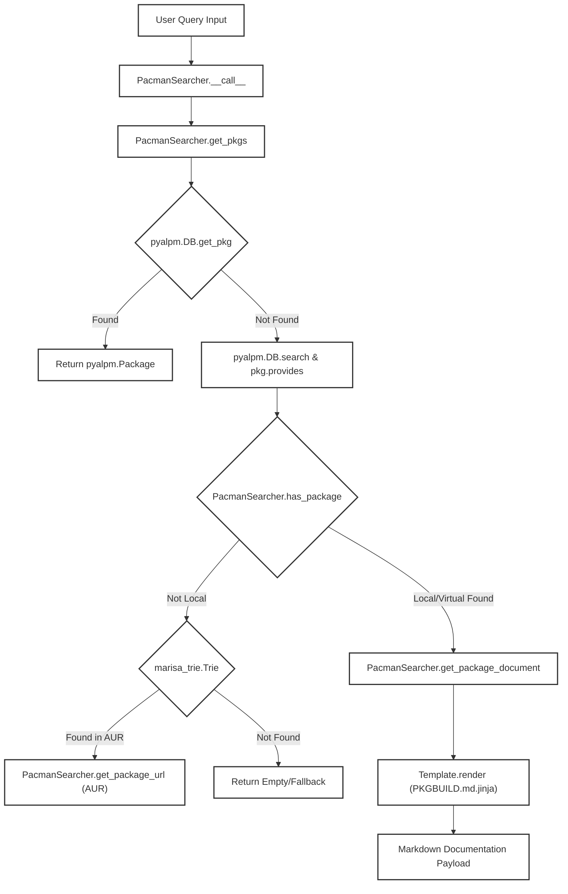
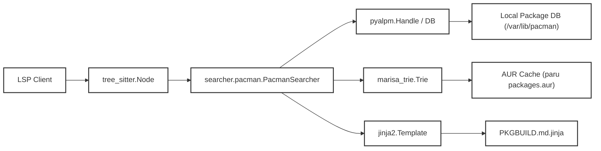

<!-- source: DeepWiki mcp.deepwiki.com · repo termux/termux-language-server · extra page PacmanSearcher (Arch/PKGBUILD) · fetched 2026-10-26 -->

# PacmanSearcher (Arch/PKGBUILD)

<details>
<summary>Relevant source files</summary>

The following files were used as context for generating this wiki page:

- [src/termux_language_server/assets/jinja/PKGBUILD.md.jinja](src/termux_language_server/assets/jinja/PKGBUILD.md.jinja)
- [src/termux_language_server/searcher/pacman.py](src/termux_language_server/searcher/pacman.py)

</details>


## Purpose and Scope

The `PacmanSearcher` component provides package lookup, completion data, version resolution, URL generation, and hover documentation for Arch Linux `PKGBUILD` files within the language server ecosystem. It interfaces directly with the local pacman database via `pyalpm`, integrates AUR (Arch User Repository) package caches using `marisa-trie`, and renders rich Markdown documentation through Jinja2 templates.

Sources: `src/termux_language_server/searcher/pacman.py:1-109`, `src/termux_language_server/assets/jinja/PKGBUILD.md.jinja:1-34`

---

## Class Architecture & Initialization

`PacmanSearcher` inherits from `PackageSearcher` (provided by `lsp_tree_sitter.completer`) and targets dependency-related fields in `PKGBUILD` scripts (`depends`, `makedepends`, `optdepends`, `conflicts`, `provides`, `replaces`) [src/termux_language_server/searcher/pacman.py:33-43]().

```
Sources: src/termux_language_server/searcher/pacman.py:17-49
```

Helper functions manage asset locations and trie caches:
* `get_template(name: str)`: Loads user-configured Jinja templates from `user_config_path("pacman")` or falls back to built-in assets at `src/termux_language_server/assets/jinja/PKGBUILD.md.jinja` [src/termux_language_server/searcher/pacman.py:17-21]().
* `get_trie()`: Loads precompiled AUR package lists from `user_cache_dir("paru", version="packages.aur")` into a `marisa_trie.Trie` instance [src/termux_language_server/searcher/pacman.py:24-30]().

### Configuration Attributes Table

| Attribute | Type | Default Value / Source | Description |
| :--- | :--- | :--- | :--- |
| `label` | `str` | `"package.PKGBUILD"` [src/termux_language_server/searcher/pacman.py:35]() | Tree-sitter capture label handled by this searcher. |
| `texts` | `tuple[str, ...]` | `("depends", "makedepends", ...)` [src/termux_language_server/searcher/pacman.py:36-43]() | PKGBUILD fields activated for completion/search. |
| `template` | `Template` | `get_template()` [src/termux_language_server/searcher/pacman.py:44]() | Jinja2 template for rendering package hover documentation. |
| `db` | `DB` | `Handle(".", "/var/lib/pacman").get_localdb()` [src/termux_language_server/searcher/pacman.py:45-47]() | Local `pyalpm` database handle. |
| `trie` | `Trie \| None` | `get_trie()` [src/termux_language_server/searcher/pacman.py:48]() | AUR cache trie for remote package resolution. |

Sources: `src/termux_language_server/searcher/pacman.py:17-49`

---

## Database Queries & Virtual Package Resolution

Package resolution queries local system state via `pyalpm` and handles virtual package relationships (`provides`).

```
Sources: src/termux_language_server/searcher/pacman.py:50-70
```

* `__call__(node: Node | None)`: Normalizes tree-sitter string nodes before evaluation [src/termux_language_server/searcher/pacman.py:50-53]().
* `get_pkgs(name: str)`: Queries exact package matches using `self.db.get_pkg(name)`. If unassigned, searches the local DB and iterates over `pkg.provides` to resolve virtual package providers [src/termux_language_server/searcher/pacman.py:54-63]().
* `has_package(name: str)`: Validates package existence by checking local matches and falling back to `self.trie.keys(name)` if available [src/termux_language_server/searcher/pacman.py:65-70]().

---

## AUR Integration & Trie-Based Cache

When packages are not present in the local pacman database, `PacmanSearcher` relies on `marisa_trie` to query the AUR index.

```
Sources: src/termux_language_server/searcher/pacman.py:65-100
```

* `get_package_url(name: str)`: Resolves a package URL. If the package exists locally or in the AUR trie, it returns `https://aur.archlinux.org/packages/{name}` or falls back to `https://archlinux.org/packages/{name}` [src/termux_language_server/searcher/pacman.py:72-80]().
* `get_package_version(name: str)`: Retrieves version strings from `pyalpm.Package`, formatting multi-provider or divergent package names when necessary [src/termux_language_server/searcher/pacman.py:81-89]().
* `get_package_names(name: str)`: Aggregates completion candidates from local database searches (rendered via Jinja templates) and supplements them with keys from the AUR trie [src/termux_language_server/searcher/pacman.py:90-100]().

---

## Documentation Rendering via Jinja2

Hover information and documentation payloads are generated using `get_package_document(name: str)`, which renders package properties against `PKGBUILD.md.jinja` [src/termux_language_server/searcher/pacman.py:102-108]().

The template extracts fields such as description, version, architecture, URLs, licenses, groups, dependencies, optdepends, provides, conflicts, and replaces [src/termux_language_server/assets/jinja/PKGBUILD.md.jinja:1-33]().

Sources: `src/termux_language_server/searcher/pacman.py:102-108`, `src/termux_language_server/assets/jinja/PKGBUILD.md.jinja:1-34`

---

## Architecture and Data Flow Diagrams

### Diagram: Natural Language Space to Code Entity Space (Package Search & Resolution)



Sources: `src/termux_language_server/searcher/pacman.py:33-109`, `src/termux_language_server/assets/jinja/PKGBUILD.md.jinja:1-34`

### Diagram: Component Interaction Topology



Sources: `src/termux_language_server/searcher/pacman.py:17-49`, `src/termux_language_server/assets/jinja/PKGBUILD.md.jinja:1-34`

---

