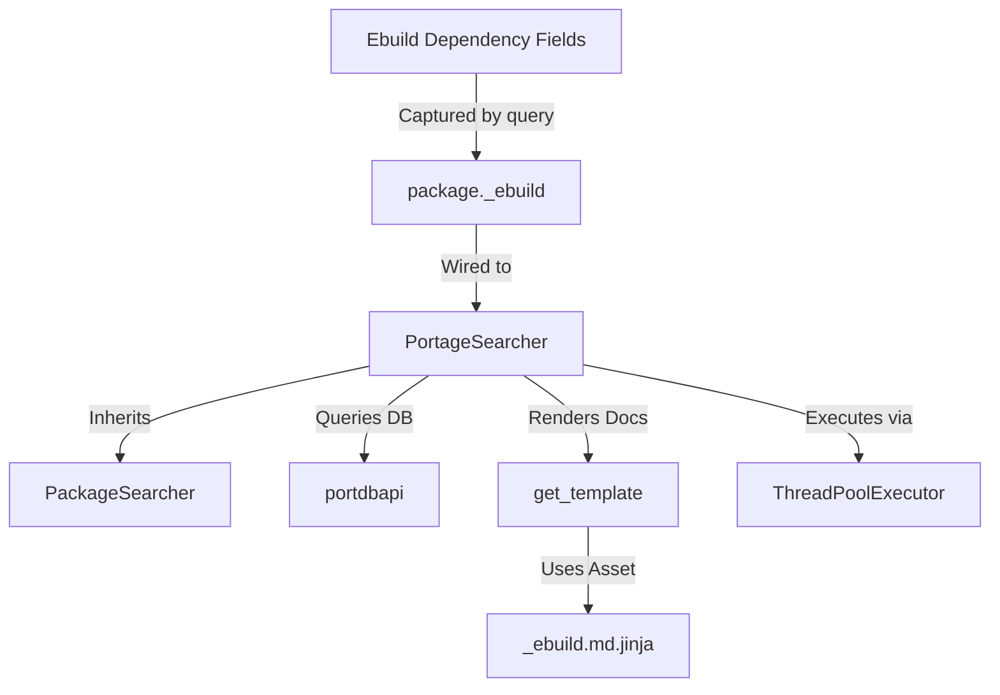
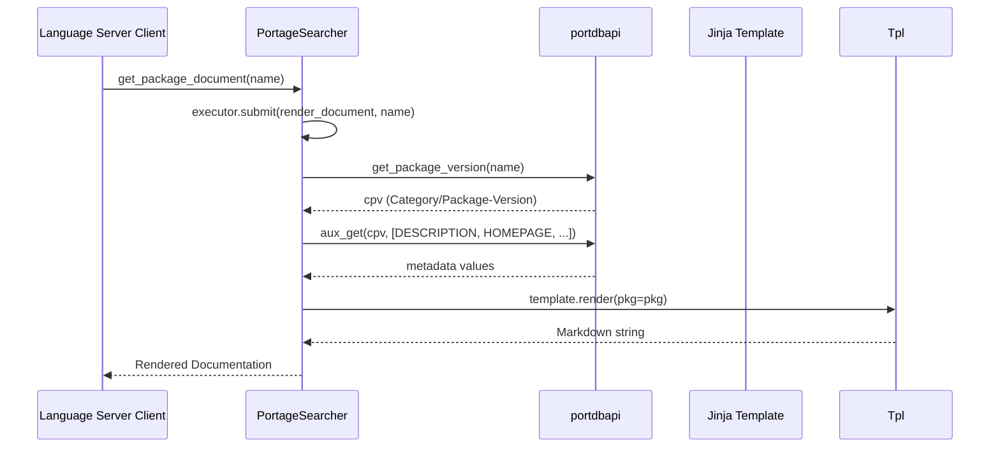

<!-- source: DeepWiki mcp.deepwiki.com · repo termux/termux-language-server · extra page PortageSearcher (Gentoo/ebuild) · fetched 2026-10-26 -->

# PortageSearcher (Gentoo/ebuild)

<details>
<summary>Relevant source files</summary>

The following files were used as context for generating this wiki page:

- [src/termux_language_server/assets/jinja/_ebuild.md.jinja](src/termux_language_server/assets/jinja/_ebuild.md.jinja)
- [src/termux_language_server/searcher/portage.py](src/termux_language_server/searcher/portage.py)

</details>


This page documents the `PortageSearcher` implementation, which provides portage-backed package lookup, version resolution, document rendering, and URL generation for Gentoo ebuild files within the language server.

## Purpose and Scope

`PortageSearcher` integrates Gentoo's package management system (`portage`) into the `lsp-tree-sitter` completion and hover framework. It handles package completion, documentation popups, and document links specifically for DEPEND-family variables (`DEPEND`, `RDEPEND`, `BDEPEND`, `IDEPEND`, `PDEPEND`) found in ebuild files.

## Implementation Details

`PortageSearcher` inherits from `lsp_tree_sitter.completer.PackageSearcher` [src/termux_language_server/searcher/portage.py:25](). It leverages the `portage` Python API to query local package databases (`portdbapi`) and renders hover documentation utilizing Jinja templates.

### Class Attributes & Configuration

- `label`: Binds the searcher to the tree-sitter capture label `package._ebuild` [src/termux_language_server/searcher/portage.py:26]().
- `texts`: Restricts package searching and context matching to Gentoo dependency variables (`DEPEND`, `RDEPEND`, `BDEPEND`, `IDEPEND`, `PDEPEND`) [src/termux_language_server/searcher/portage.py:27-33]().
- `url_template`: Formats package web URLs using `https://packages.gentoo.org/packages/{}` [src/termux_language_server/searcher/portage.py:34]().
- `db`: Initializes the portage tree database client using `db[root]["porttree"].dbapi` [src/termux_language_server/searcher/portage.py:36]().
- `executor`: A `ThreadPoolExecutor` with `max_workers=1` used to asynchronously or safely execute blocking auxiliary metadata lookups [src/termux_language_server/searcher/portage.py:37]().

### Key Methods

- `has_package(name: str) -> bool`: Checks if any category/package (`cp`) matches the given query using `self.db.cp_list(name)` [src/termux_language_server/searcher/portage.py:39-40]().
- `get_package_url(name: str) -> str`: Returns the Gentoo packages URL for a given package name [src/termux_language_server/searcher/portage.py:42-43]().
- `get_package_version(name: str) -> str`: Retrieves the latest Category-Package-Version (`CPV`) string for a package name [src/termux_language_server/searcher/portage.py:45-48]().
- `get_package_names(name: str) -> dict[str, str]`: Filters all available canonical package names (`cp_all`) matching the prefix [src/termux_language_server/searcher/portage.py:50-51]().
- `get_package_document(name: str) -> str`: Submits `render_document` to the `ThreadPoolExecutor` to fetch auxiliary metadata without blocking the main thread [src/termux_language_server/searcher/portage.py:53-54]().
- `render_document(name: str) -> str`: Queries auxiliary metadata (`DESCRIPTION`, `HOMEPAGE`, `LICENSE`, `SLOT`, `KEYWORDS`) via `self.db.aux_get()` and renders it through the Jinja template [src/termux_language_server/searcher/portage.py:56-70]().

Sources: [src/termux_language_server/searcher/portage.py:1-70]()

---

## Template Rendering

Hover documentation is formatted using Jinja templates. The system first checks the user configuration path (`portage/_ebuild.md.jinja`), falling back to the built-in package asset if not present [src/termux_language_server/searcher/portage.py:17-21]().

```markdown
{{ pkg.description }}

- version: **{{ pkg.version }}**
- slot: **{{ pkg.slot }}**
- homepage: <{{ pkg.homepage }}>
- license: *{{ pkg.license }}*
- keywords: {{ pkg.keywords }}
```
Sources: [src/termux_language_server/assets/jinja/_ebuild.md.jinja:1-7]()

---

## Architecture and Data Flow

### PortageSearcher Code Entity Mapping

The diagram below connects natural language requirements and architectural components of PortageSearcher to their corresponding symbols and classes in the codebase.


Sources: [src/termux_language_server/searcher/portage.py:11-37](), [src/termux_language_server/assets/jinja/_ebuild.md.jinja:1-7]()

### Package Verification and Documentation Flow


Sources: [src/termux_language_server/searcher/portage.py:37-70]()

---

