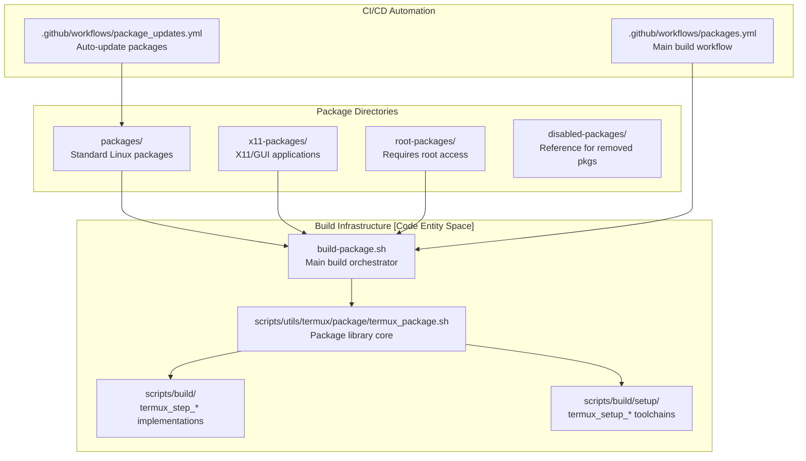
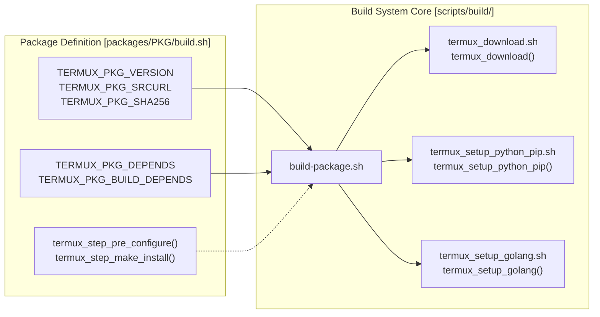

<!-- source: DeepWiki mcp.deepwiki.com · repo termux/termux-packages · page 1 Overview · fetched 2026-10-26 -->

# Overview

Relevant source files

The following files were used as context for generating this wiki page:

- [CODEOWNERS](CODEOWNERS)
- [build-package.sh](build-package.sh)
- [disabled-packages/protobuf-static/build.sh](disabled-packages/protobuf-static/build.sh)
- [packages/bash-completion/build.sh](packages/bash-completion/build.sh)
- [packages/command-not-found/build.sh](packages/command-not-found/build.sh)
- [packages/dialog/build.sh](packages/dialog/build.sh)
- [packages/diffutils/build.sh](packages/diffutils/build.sh)
- [packages/docbook-xml/build.sh](packages/docbook-xml/build.sh)
- [packages/docbook-xsl/build.sh](packages/docbook-xsl/build.sh)
- [packages/dos2unix/build.sh](packages/dos2unix/build.sh)
- [packages/eza/build.sh](packages/eza/build.sh)
- [packages/git-crypt/build.sh](packages/git-crypt/build.sh)
- [packages/git-delta/build.sh](packages/git-delta/build.sh)
- [packages/git-lfs/build.sh](packages/git-lfs/build.sh)
- [packages/git-sizer/build.sh](packages/git-sizer/build.sh)
- [packages/git/build.sh](packages/git/build.sh)
- [packages/gopass/build.sh](packages/gopass/build.sh)
- [packages/gopls/build.sh](packages/gopls/build.sh)
- [packages/ldns/build.sh](packages/ldns/build.sh)
- [packages/libprotobuf/build.sh](packages/libprotobuf/build.sh)
- [packages/libprotobuf/retain-linker-array.patch](packages/libprotobuf/retain-linker-array.patch)
- [packages/libyaml/build.sh](packages/libyaml/build.sh)
- [packages/npm/build.sh](packages/npm/build.sh)
- [packages/tmux/build.sh](packages/tmux/build.sh)
- [scripts/build/configure/termux_step_configure_meson.sh](scripts/build/configure/termux_step_configure_meson.sh)
- [scripts/build/setup/python-crossenv-PYTHONPATH.patch](scripts/build/setup/python-crossenv-PYTHONPATH.patch)
- [scripts/build/setup/python-crossenv-fix-shebang.patch](scripts/build/setup/python-crossenv-fix-shebang.patch)
- [scripts/build/setup/python-crossenv-pip-android-api-level.patch](scripts/build/setup/python-crossenv-pip-android-api-level.patch)
- [scripts/build/setup/termux_setup_protobuf.sh](scripts/build/setup/termux_setup_protobuf.sh)
- [scripts/build/setup/termux_setup_python_pip.sh](scripts/build/setup/termux_setup_python_pip.sh)
- [scripts/build/termux_download_deb_pac.sh](scripts/build/termux_download_deb_pac.sh)
- [scripts/build/termux_step_massage.sh](scripts/build/termux_step_massage.sh)
- [scripts/build/termux_step_override_config_scripts.sh](scripts/build/termux_step_override_config_scripts.sh)
- [scripts/properties.sh](scripts/properties.sh)
- [scripts/setup-termux.sh](scripts/setup-termux.sh)
- [scripts/setup-ubuntu.sh](scripts/setup-ubuntu.sh)

## Purpose and Scope

The Termux Packages repository ([https://github.com/termux/termux-packages](https://github.com/termux/termux-packages)) is a collection of build scripts and tooling infrastructure for cross-compiling software packages for the Termux terminal environment on Android. This repository does not contain pre-built binaries; instead, it provides standardized `build.sh` scripts for each package that define how to download, patch, configure, compile, and package software for Android's AArch64, ARM, i686, and x86-64 architectures.

This page provides an architectural overview of the repository structure, build system conventions, and distribution pipeline.

**Sources:** [build-package.sh:1-49](), [packages/command-not-found/build.sh:1-15]()

---

## Repository Organization

The repository is organized into three primary package directories, a centralized build system, and CI/CD automation infrastructure.

### System Architecture Diagram
The following diagram bridges the high-level repository structure to the core scripts that drive the build process.

**Directory Structure:**

| Directory | Purpose | Example Packages |
|-----------|---------|------------------|
| `packages/` | Standard Linux utilities, compilers, and CLI tools | `git`, `tmux`, `npm`, `gopls` |
| `x11-packages/` | GUI applications requiring X11 display server | `vim-gtk`, `mpv-x` |
| `root-packages/` | System utilities requiring root privileges | `iptables`, `docker` |
| `disabled-packages/` | Packages that were removed but kept for reference | `protobuf-static` |
| `scripts/` | Build system core: step functions and toolchain setup | `scripts/build/setup/termux_setup_rust.sh` |

**Sources:** [build-package.sh:23-34](), [packages/git/build.sh:1-94](), [packages/tmux/build.sh:1-38](), [CODEOWNERS:1-173]()

---

## Build System Interface

Every package implements a standardized interface through its `build.sh` file. This interface consists of **configuration variables** (`TERMUX_PKG_*`) and **lifecycle hooks** (`termux_step_*` functions).

### Data Flow: Package Definition to Build Execution
This diagram shows how package-specific variables and hooks interact with the central build system.

**Common Configuration Variables:**

| Variable | Purpose | Example |
|----------|---------|---------|
| `TERMUX_PKG_HOMEPAGE` | Upstream project URL | `https://git-scm.com/` |
| `TERMUX_PKG_VERSION` | Package version | `2.54.0` |
| `TERMUX_PKG_DEPENDS` | Runtime dependencies | `libcurl, openssl, pcre2` |
| `TERMUX_PKG_AUTO_UPDATE` | Enable auto-update logic | `true` |

**Lifecycle Hooks:**

Packages override specific `termux_step_*` functions to customize the build process.
- `termux_step_pre_configure()`: Used for environment setup, like calling `termux_setup_nodejs` [packages/command-not-found/build.sh:11-15]() or `termux_setup_rust` [packages/eza/build.sh:14-28]().
- `termux_step_make()`: Custom compilation logic, often used for Go packages [packages/gopls/build.sh:12-17]().
- `termux_step_post_make_install()`: Post-installation tasks like installing manpages or completions [packages/git/build.sh:58-87]().
- `termux_pkg_auto_update()`: Custom logic to fetch the latest version from upstream APIs [packages/npm/build.sh:16-26]().

**Sources:** [packages/git/build.sh:1-37](), [packages/npm/build.sh:1-14](), [packages/command-not-found/build.sh:1-15](), [packages/eza/build.sh:1-28]()

---

## Cross-Compilation Architecture

Termux packages are cross-compiled on x86_64 Linux hosts (typically Ubuntu) for four Android target architectures: `aarch64`, `arm`, `i686`, and `x86_64`.

### Host Environment Setup
The host build environment requires specific Ubuntu packages to be installed to support the cross-compilation of various toolchains.
- **Base Tools**: `curl`, `git`, `tar`, `unzip`, `pkg-config` [scripts/setup-ubuntu.sh:13-49]().
- **Compilers**: `g++`, `autoconf`, `automake`, `bison`, `flex` [scripts/setup-ubuntu.sh:33-40]().
- **Language Runtimes**: `python3`, `ruby`, `lua5.4`, `php`, `openjdk-17` [scripts/setup-ubuntu.sh:72-282]().

### Build Toolchain Integration
The build system provides helper functions to initialize language-specific cross-compilation environments:
- **Python**: `termux_setup_python_pip` sets up a `crossenv` virtual environment to allow pip-based installation for the target architecture [scripts/build/setup/termux_setup_python_pip.sh:6-84]().
- **Rust**: `termux_setup_rust` configures Cargo for cross-compilation [packages/eza/build.sh:15]().
- **Go**: `termux_setup_golang` configures the Go toolchain [packages/gopls/build.sh:13]().

**Sources:** [scripts/setup-ubuntu.sh:1-310](), [scripts/build/setup/termux_setup_python_pip.sh:1-85](), [build-package.sh:103-157]()

---

## Automated Maintenance

The repository includes mechanisms for automated version updates and health monitoring.

### Auto-Update Mechanism
Packages can define a `termux_pkg_auto_update` function to programmatically determine the latest version. For example, the `npm` package queries the GitHub API to find the latest tag matching its current major version [packages/npm/build.sh:16-26]().

### Repository Ownership
Maintenance responsibilities are distributed among contributors via the `CODEOWNERS` file, which maps package directories and build system scripts to specific GitHub handles [CODEOWNERS:1-173]().

**Sources:** [packages/npm/build.sh:16-26](), [CODEOWNERS:1-173](), [packages/git-delta/build.sh:8]()

---

