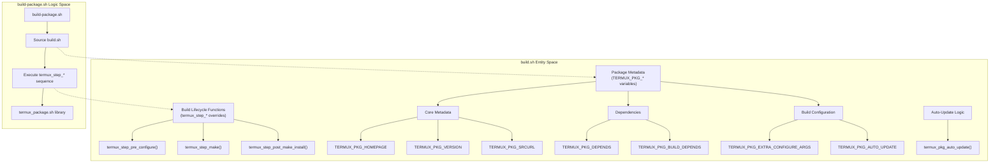
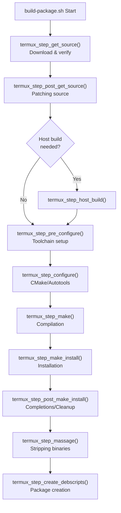
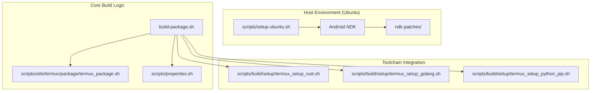

<!-- source: DeepWiki mcp.deepwiki.com · repo termux/termux-packages · page 2 Build System · fetched 2026-10-26 -->

# Build System

<details>
<summary>Relevant source files</summary>

The following files were used as context for generating this wiki page:

- [build-package.sh](build-package.sh)
- [disabled-packages/protobuf-static/build.sh](disabled-packages/protobuf-static/build.sh)
- [packages/findomain/build.sh](packages/findomain/build.sh)
- [packages/findomain/headless-chrome.patch](packages/findomain/headless-chrome.patch)
- [packages/findomain/hickory-resolver.diff](packages/findomain/hickory-resolver.diff)
- [packages/flatbuffers/build.sh](packages/flatbuffers/build.sh)
- [packages/flex/build.sh](packages/flex/build.sh)
- [packages/fm/build.sh](packages/fm/build.sh)
- [packages/libprotobuf/build.sh](packages/libprotobuf/build.sh)
- [packages/libprotobuf/retain-linker-array.patch](packages/libprotobuf/retain-linker-array.patch)
- [packages/llama-cpp/0002-do-not-install-backend-libs.patch](packages/llama-cpp/0002-do-not-install-backend-libs.patch)
- [packages/llama-cpp/build.sh](packages/llama-cpp/build.sh)
- [packages/minidlna/build.sh](packages/minidlna/build.sh)
- [packages/minimodem/build.sh](packages/minimodem/build.sh)
- [packages/miniserve/build.sh](packages/miniserve/build.sh)
- [packages/minisign/build.sh](packages/minisign/build.sh)
- [packages/rust-analyzer/build.sh](packages/rust-analyzer/build.sh)
- [scripts/build/configure/termux_step_configure_meson.sh](scripts/build/configure/termux_step_configure_meson.sh)
- [scripts/build/setup/python-crossenv-PYTHONPATH.patch](scripts/build/setup/python-crossenv-PYTHONPATH.patch)
- [scripts/build/setup/python-crossenv-fix-shebang.patch](scripts/build/setup/python-crossenv-fix-shebang.patch)
- [scripts/build/setup/python-crossenv-pip-android-api-level.patch](scripts/build/setup/python-crossenv-pip-android-api-level.patch)
- [scripts/build/setup/termux_setup_protobuf.sh](scripts/build/setup/termux_setup_protobuf.sh)
- [scripts/build/setup/termux_setup_python_pip.sh](scripts/build/setup/termux_setup_python_pip.sh)
- [scripts/build/termux_download_deb_pac.sh](scripts/build/termux_download_deb_pac.sh)
- [scripts/build/termux_step_massage.sh](scripts/build/termux_step_massage.sh)
- [scripts/build/termux_step_override_config_scripts.sh](scripts/build/termux_step_override_config_scripts.sh)
- [scripts/properties.sh](scripts/properties.sh)
- [scripts/setup-termux.sh](scripts/setup-termux.sh)
- [scripts/setup-ubuntu.sh](scripts/setup-ubuntu.sh)

</details>


## Purpose and Scope

The Termux build system provides a standardized framework for compiling software packages for Android. This document covers the core architecture, including the interface that all packages must implement through `TERMUX_PKG_*` variables and `termux_step_*` lifecycle functions. 

For detailed information about specific topics, see:
- Build lifecycle hooks and their execution order: [Package Build Lifecycle](#2.1)
- Complete reference of configuration variables: [Build Configuration Variables](#2.2)
- Language-specific toolchain integration: [Language Toolchain Integration](#2.3)
- Cross-compilation setup and host builds: [Cross-Compilation and Host Builds](#2.4)
- Android-specific patches and adaptations: [Platform Adaptations and Patches](#2.5)
- Automated version tracking: [Auto-Update Mechanisms](#2.6)

## Package Build Scripts

Each package in the repository is defined by a `build.sh` file located in one of several directories:

| Directory | Purpose | Example Packages |
|-----------|---------|------------------|
| `packages/` | Core packages without X11 dependencies | `llama-cpp`, `rust-analyzer`, `flatbuffers` |
| `x11-packages/` | Packages requiring X11/desktop environment | `vim-gtk`, `mpv-x` |
| `root-packages/` | Packages requiring root access | `tsu`, `docker`, `iptables` |
| `disabled-packages/` | Reference for removed or broken packages | `protobuf-static` |

Each `build.sh` file defines package metadata through `TERMUX_PKG_*` variables and customizes the build process through `termux_step_*` functions.

**Sources:** [packages/llama-cpp/build.sh:1-91](), [packages/rust-analyzer/build.sh:1-67](), [packages/flatbuffers/build.sh:1-16](), [disabled-packages/protobuf-static/build.sh:1-12]()

## Build Script Anatomy

The following diagram illustrates the structure of a typical package build script and how it maps to the core build script `build-package.sh`.

**Diagram: Package Build Script Structure**



**Sources:** [packages/llama-cpp/build.sh:1-91](), [packages/rust-analyzer/build.sh:1-67](), [build-package.sh:1-34]()

## Package Metadata Variables

Package metadata is declared using `TERMUX_PKG_*` variables. These are validated against rules defined in `scripts/properties.sh` to ensure safe pathing and valid shell variable names.

### Core Metadata Example

```bash
# From packages/llama-cpp/build.sh
TERMUX_PKG_HOMEPAGE=https://github.com/ggml-org/llama.cpp
TERMUX_PKG_DESCRIPTION="LLM inference in C/C++"
TERMUX_PKG_LICENSE="MIT"
TERMUX_PKG_VERSION="0.0.0-b9131"
TERMUX_PKG_SRCURL="https://github.com/ggml-org/llama.cpp/archive/refs/tags/${TERMUX_PKG_VERSION#*-}.tar.gz"
TERMUX_PKG_SHA256=eac3ee4110a740dd2133624079f6bc1661d30754b9dd6e9f133f5125e0f0a43a
```

### Dependency Declarations

```bash
# From packages/llama-cpp/build.sh
TERMUX_PKG_DEPENDS="libandroid-spawn, libc++, libcurl"
TERMUX_PKG_BUILD_DEPENDS="ocl-icd, opencl-headers, spirv-headers, vulkan-headers"
TERMUX_PKG_SUGGESTS="llama-cpp-backend-vulkan, llama-cpp-backend-opencl"
```

### Build Configuration

```bash
# From packages/findomain/build.sh
TERMUX_PKG_BUILD_IN_SRC=true
TERMUX_PKG_AUTO_UPDATE=true
```

For a complete reference of all available variables and validation logic, see [Build Configuration Variables](#2.2).

**Sources:** [packages/llama-cpp/build.sh:1-12](), [packages/findomain/build.sh:9-11](), [scripts/properties.sh:15-107]()

## Build Lifecycle

The build system executes a series of lifecycle functions. The main entry point `build-package.sh` sources these functions from `scripts/build/`.

**Diagram: Build Lifecycle Execution Flow**



### Default Behavior and Overrides

Most steps have defaults. For instance, `termux_step_configure` automatically detects if it should run `cmake` or `./configure`. Packages override these to inject logic:

```bash
# Rust override example from packages/rust-analyzer/build.sh
termux_step_make() {
	export CFG_RELEASE=1
	cargo build --jobs "${TERMUX_PKG_MAKE_PROCESSES}" --target "${CARGO_TARGET_NAME}" --release
}
```

For detailed documentation of each lifecycle function, see [Package Build Lifecycle](#2.1).

**Sources:** [packages/rust-analyzer/build.sh:59-62](), [scripts/build/termux_step_massage.sh:1-5]()

## Toolchain Setup Functions

The build system provides `termux_setup_*` helpers to configure language environments. These are typically called in `termux_step_pre_configure`.

| Function | Purpose | Example |
|----------|---------|---------|
| `termux_setup_rust` | Sets up Cargo/Rust cross-env | [packages/rust-analyzer/build.sh:56]() |
| `termux_setup_golang` | Sets up Go toolchain | [scripts/build/setup/termux_setup_golang.sh:1]() |
| `termux_setup_python_pip` | Sets up Python cross-compilation | [scripts/build/setup/termux_setup_python_pip.sh:6]() |
| `termux_setup_cmake` | Standard CMake configuration | [scripts/setup-termux.sh:23]() |

For details on toolchain integration, see [Language Toolchain Integration](#2.3).

**Sources:** [packages/rust-analyzer/build.sh:55-57](), [scripts/build/setup/termux_setup_python_pip.sh:1-84]()

## Build System Architecture

The following diagram bridges the high-level build process to the specific shell scripts and toolchain components.

**Diagram: Build System Component Interaction**



**Sources:** [build-package.sh:1-34](), [scripts/setup-ubuntu.sh:1-50](), [scripts/build/setup/termux_setup_python_pip.sh:1-10]()

## Package Scripts (debscripts)

Packages can define maintenance scripts using `termux_step_create_debscripts()`. This is often used to generate shell completions or manpages at install-time on the device.

```bash
# From packages/miniserve/build.sh
termux_step_create_debscripts() {
	cat <<- EOF > ./postinst
	#!$TERMUX_PREFIX/bin/sh
	miniserve --print-completions bash \
		> "$TERMUX_PREFIX"/share/bash-completion/completions/miniserve
	EOF
}
```

**Sources:** [packages/miniserve/build.sh:27-46]()

## Platform Adaptations

The build system handles Android-specific pathing and linking requirements. For example, it overrides configuration scripts like `llvm-config` or `pg_config` to ensure they return Termux-specific paths rather than host paths.

```bash
# From scripts/build/termux_step_override_config_scripts.sh
termux_step_override_config_scripts() {
    # Redirects /bin/sh to host /bin/sh during build
    ln -sf /bin/sh "$TERMUX_PREFIX/bin/sh"
    # Generates a wrapper for llvm-config with target triple
    sed "$TERMUX_SCRIPTDIR/packages/libllvm/llvm-config.in" ...
}
```

For comprehensive documentation, see [Platform Adaptations and Patches](#2.5).

**Sources:** [scripts/build/termux_step_override_config_scripts.sh:1-30]()

## Auto-Update System

Packages can implement custom version tracking logic. The system provides `termux_pkg_upgrade_version` to handle the version bump and checksum update.

```bash
# From packages/rust-analyzer/build.sh
termux_pkg_auto_update() {
	local api_url="https://api.github.com/repos/rust-lang/rust-analyzer/tags"
    # ... logic to find latest_version ...
	termux_pkg_upgrade_version "${latest_version}" --skip-version-check
}
```

Some packages like `llama-cpp` implement throttling to avoid excessive updates.

For detailed auto-update strategies, see [Auto-Update Mechanisms](#2.6).

**Sources:** [packages/rust-analyzer/build.sh:16-53](), [packages/llama-cpp/build.sh:31-73]()

## Summary

The Termux build system provides:
- **Standardized Interface**: Via `TERMUX_PKG_*` and `termux_step_*`.
- **Cross-Compilation**: Building on x86_64 Linux for Android architectures (`aarch64`, `arm`, `i686`, `x86_64`).
- **Extensibility**: Support for complex toolchains (Rust, Go, Python, .NET).
- **Automation**: Integrated version tracking and update mechanisms.

Refer to the child pages for implementation details of each subsystem.

---

