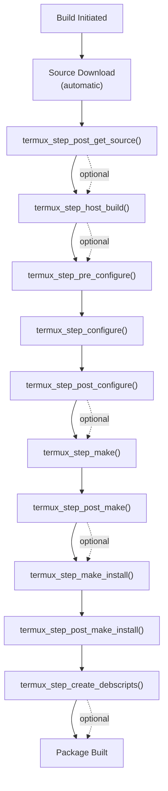
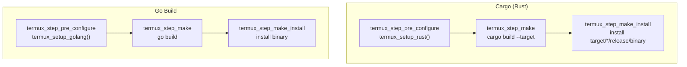

<!-- source: DeepWiki mcp.deepwiki.com · repo termux/termux-packages · page 2.1 Package Build Lifecycle · fetched 2026-10-26 -->

# Package Build Lifecycle

<details>
<summary>Relevant source files</summary>

The following files were used as context for generating this wiki page:

- [build-package.sh](build-package.sh)
- [disabled-packages/protobuf-static/build.sh](disabled-packages/protobuf-static/build.sh)
- [packages/findomain/build.sh](packages/findomain/build.sh)
- [packages/findomain/headless-chrome.patch](packages/findomain/headless-chrome.patch)
- [packages/findomain/hickory-resolver.diff](packages/findomain/hickory-resolver.diff)
- [packages/flatbuffers/build.sh](packages/flatbuffers/build.sh)
- [packages/flex/build.sh](packages/flex/build.sh)
- [packages/fm/build.sh](packages/fm/build.sh)
- [packages/libprotobuf/build.sh](packages/libprotobuf/build.sh)
- [packages/libprotobuf/retain-linker-array.patch](packages/libprotobuf/retain-linker-array.patch)
- [packages/llama-cpp/0002-do-not-install-backend-libs.patch](packages/llama-cpp/0002-do-not-install-backend-libs.patch)
- [packages/llama-cpp/build.sh](packages/llama-cpp/build.sh)
- [packages/minidlna/build.sh](packages/minidlna/build.sh)
- [packages/minimodem/build.sh](packages/minimodem/build.sh)
- [packages/miniserve/build.sh](packages/miniserve/build.sh)
- [packages/minisign/build.sh](packages/minisign/build.sh)
- [packages/ollama/0001-do-not-install-runtime-deps.patch](packages/ollama/0001-do-not-install-runtime-deps.patch)
- [packages/ollama/0002-properly-search-libs-on-android.patch](packages/ollama/0002-properly-search-libs-on-android.patch)
- [packages/ollama/0003-do-not-include-sources-for-vulkan-again.patch](packages/ollama/0003-do-not-include-sources-for-vulkan-again.patch)
- [packages/ollama/0004-force-disable-features-on-Andoid.patch](packages/ollama/0004-force-disable-features-on-Andoid.patch)
- [packages/ollama/0006-do-not-search-hip-memory.patch](packages/ollama/0006-do-not-search-hip-memory.patch)
- [packages/ollama/0007-do-not-use-flash-attention-when-using-cpu.patch](packages/ollama/0007-do-not-use-flash-attention-when-using-cpu.patch)
- [packages/ollama/0008-fix-build-with-latest-vulkan-hpp.patch](packages/ollama/0008-fix-build-with-latest-vulkan-hpp.patch)
- [packages/ollama/build.sh](packages/ollama/build.sh)
- [packages/ollama/host-toolchain.cmake](packages/ollama/host-toolchain.cmake)
- [packages/ollama/ollama-backend-vulkan.subpackage.sh](packages/ollama/ollama-backend-vulkan.subpackage.sh)
- [packages/rust-analyzer/build.sh](packages/rust-analyzer/build.sh)
- [scripts/build/configure/termux_step_configure_meson.sh](scripts/build/configure/termux_step_configure_meson.sh)
- [scripts/build/setup/python-crossenv-PYTHONPATH.patch](scripts/build/setup/python-crossenv-PYTHONPATH.patch)
- [scripts/build/setup/python-crossenv-fix-shebang.patch](scripts/build/setup/python-crossenv-fix-shebang.patch)
- [scripts/build/setup/python-crossenv-pip-android-api-level.patch](scripts/build/setup/python-crossenv-pip-android-api-level.patch)
- [scripts/build/setup/termux_setup_protobuf.sh](scripts/build/setup/termux_setup_protobuf.sh)
- [scripts/build/setup/termux_setup_python_pip.sh](scripts/build/setup/termux_setup_python_pip.sh)
- [scripts/build/termux_download_deb_pac.sh](scripts/build/termux_download_deb_pac.sh)
- [scripts/build/termux_step_massage.sh](scripts/build/termux_step_massage.sh)
- [scripts/build/termux_step_override_config_scripts.sh](scripts/build/termux_step_override_config_scripts.sh)
- [scripts/properties.sh](scripts/properties.sh)
- [scripts/setup-termux.sh](scripts/setup-termux.sh)
- [scripts/setup-ubuntu.sh](scripts/setup-ubuntu.sh)

</details>


This page documents the `termux_step_*` lifecycle hook functions that control package compilation and installation. These functions can be overridden in individual package `build.sh` files to customize the build process. For information about package metadata variables (`TERMUX_PKG_*`), see [Build Configuration Variables](#2.2). For language-specific toolchain integration, see [Language Toolchain Integration](#2.3).

## Build Lifecycle Overview

The build system executes a standardized sequence of steps for every package. Each step can be customized by defining the corresponding `termux_step_*` function in the package's `build.sh` file. The main entry point for the build system is `build-package.sh`, which sources various utility scripts from `scripts/build/` to handle specific lifecycle stages [build-package.sh:72-101]().

**Build Lifecycle Sequence**



Sources: [build-package.sh:1-101](), [packages/llama-cpp/build.sh:75-91](), [packages/ollama/build.sh:22-41]().

## Source Acquisition Phase

### termux_step_post_get_source

Called immediately after source code is downloaded and extracted. Used for:
- Source validation and version checks.
- Applying additional patches.
- Downloading supplementary source files.
- Modifying source tree structure.

**Example: Version Guard (mpv/mpv-x)**

[packages/mpv/build.sh:36-43]() (inferred from existing documentation) demonstrates version synchronization between related packages.

**Example: Fetching Dependency Sources (mplayer)**

[packages/mplayer/build.sh:26-36]() (inferred from existing documentation) shows downloading a specific version of FFmpeg to bundle.

Sources: [packages/mpv/build.sh:36-43](), [packages/mplayer/build.sh:26-36]().

## Host Build Phase

### termux_step_host_build

Executes a build for the **host system** (x86_64 Linux) before the target (Android) build. Required when:
- Cross-compilation needs native tools (code generators, preprocessors).
- Build system requires host binaries during configuration.
- Native libraries are needed for build-time operations.

The host build occurs in `$TERMUX_PKG_HOSTBUILD_DIR`. Packages using host builds must set `TERMUX_PKG_HOSTBUILD=true`.

**Example: Building Native Tools (neovim)**

[packages/neovim/build.sh:25-44]() (inferred from existing documentation) builds native LuaRocks and extracts `libnlua0.so` for use during cross-compilation.

Sources: [packages/neovim/build.sh:25-44](), [packages/ragel/build.sh:18-30]().

## Configuration Phase

### termux_step_pre_configure

The most commonly overridden lifecycle function. Executes immediately before the automatic configuration step. Primary uses:

| Use Case | Examples |
|----------|----------|
| **Toolchain setup** | `termux_setup_rust`, `termux_setup_golang`, `termux_setup_python_pip` |
| **Build variable configuration** | Setting `LDFLAGS`, `CFLAGS`, `TERMUX_PKG_EXTRA_CONFIGURE_ARGS` |
| **Dynamic patching** | Applying patches with variable substitution |
| **Dependency vendoring** | Running `cargo vendor`, `go mod vendor` |
| **Environment preparation** | Setting up cross-compilation toolchains and shader tools |

**Example: Rust Toolchain Setup (rust-analyzer)**

[packages/rust-analyzer/build.sh:55-57]() shows the call to `termux_setup_rust` which prepares the environment for Cargo builds.

**Example: Complex Configuration and NDK Integration (llama-cpp)**

[packages/llama-cpp/build.sh:75-84]() adds NDK shader tools to the path and dynamically locates the Vulkan library for the target API level:

```bash
termux_step_pre_configure() {
	export PATH="$NDK/shader-tools/linux-x86_64:$PATH"
	LDFLAGS+=" -landroid-spawn"

	local _libvulkan=vulkan
	if [[ "${TERMUX_ON_DEVICE_BUILD}" == "false" && "${TERMUX_PKG_API_LEVEL}" -lt 28 ]]; then
		_libvulkan="${TERMUX_STANDALONE_TOOLCHAIN}/sysroot/usr/lib/${TERMUX_HOST_PLATFORM}/28/libvulkan.so"
	fi
	TERMUX_PKG_EXTRA_CONFIGURE_ARGS+=" -DVulkan_LIBRARY=${_libvulkan}"
}
```

**Example: Dependency Vendoring and Patching (findomain)**

[packages/findomain/build.sh:13-47]() vendors Rust dependencies using `cargo vendor` and applies a patch to the vendored `hickory-resolver` crate before unsetting `CFLAGS` to avoid host-build clashes.

**Example: Python Cross-Compilation Setup**

The script `scripts/build/setup/termux_setup_python_pip.sh` handles the complex setup of `crossenv` for Python packages [scripts/build/setup/termux_setup_python_pip.sh:6-84](). It manages virtual environments and installs `setuptools` and `wheel` specifically for the cross-compilation environment [scripts/build/setup/termux_setup_python_pip.sh:69-72]().

Sources: [packages/rust-analyzer/build.sh:55-57](), [packages/llama-cpp/build.sh:75-84](), [packages/findomain/build.sh:13-47](), [scripts/build/setup/termux_setup_python_pip.sh:6-84]().

### termux_step_configure

Rarely overridden. The build system provides default implementations for CMake, Meson, and Autotools. `scripts/build/configure/termux_step_configure_meson.sh` is an example of a specialized configuration step for Meson [scripts/build/configure/termux_step_configure_meson.sh:1-12]().

Sources: [scripts/build/configure/termux_step_configure_meson.sh:1-12]().

## Build Phase

### termux_step_make

Override when the default build command (`make -j $TERMUX_PKG_MAKE_PROCESSES`) is insufficient. Common with language-specific build tools like Cargo or Go.

**Build Tool Patterns**



**Example: Rust Build (rust-analyzer)**

[packages/rust-analyzer/build.sh:59-62]() builds with cargo for the cross-compilation target specified by `${CARGO_TARGET_NAME}`:

```bash
termux_step_make() {
	export CFG_RELEASE=1
	cargo build --jobs "${TERMUX_PKG_MAKE_PROCESSES}" --target "${CARGO_TARGET_NAME}" --release
}
```

Sources: [packages/rust-analyzer/build.sh:59-62](), [packages/ollama/build.sh:32-37]().

## Installation Phase

### termux_step_make_install

Override when custom installation logic is needed, such as manual binary placement or when using language-specific tools that do not have a standard `make install` target.

**Example: Go and Library Installation (ollama)**

[packages/ollama/build.sh:32-41]() demonstrates building a Go binary and then manually installing it along with shared libraries into the prefix:

```bash
termux_step_make_install() {
	cd $TERMUX_PKG_SRCDIR
	termux_setup_golang

	go build -trimpath -ldflags="-w -s -X=github.com/ollama/ollama/version.Version=$TERMUX_PKG_VERSION -X=github.com/ollama/ollama/server.mode=release"
	install -Dm700 ollama $TERMUX_PREFIX/bin/

	mkdir -p $TERMUX_PREFIX/lib/ollama
	cp -fv $TERMUX_PKG_BUILDDIR/lib/ollama/* $TERMUX_PREFIX/lib/ollama/
}
```

Sources: [packages/ollama/build.sh:32-41](), [packages/rust-analyzer/build.sh:64-66]().

### termux_step_post_make_install

Executes after installation completes. Primary uses include file cleanup, symlink creation, and manual library placement.

**Example: Backend Library Placement (llama-cpp)**

[packages/llama-cpp/build.sh:86-91]() manually copies compiled backend libraries from the build directory to the Termux prefix:

```bash
termux_step_post_make_install() {
	mkdir -p "$TERMUX_PREFIX"/lib
	cp -f "$TERMUX_PKG_BUILDDIR"/bin/libggml-cpu.so "$TERMUX_PREFIX"/lib/
	cp -f "$TERMUX_PKG_BUILDDIR"/bin/libggml-opencl.so "$TERMUX_PREFIX"/lib/
	cp -f "$TERMUX_PKG_BUILDDIR"/bin/libggml-vulkan.so "$TERMUX_PREFIX"/lib/
}
```

**Example: Shell Completion Setup (miniserve)**

[packages/miniserve/build.sh:17-25]() creates placeholder files for shell completions and manpages which are populated later by the `postinst` script.

Sources: [packages/llama-cpp/build.sh:86-91](), [packages/miniserve/build.sh:17-25]().

## Package Creation Phase

### termux_step_create_debscripts

Creates Debian package maintainer scripts (`postinst`, `prerm`, etc.) that execute during package installation/removal on the device.

**Example: Dynamic Content Generation (miniserve)**

[packages/miniserve/build.sh:27-46]() generates shell completions and manpages on the device during installation to ensure they match the installed version:

```bash
termux_step_create_debscripts() {
	cat <<- EOF > ./postinst
	#!$TERMUX_PREFIX/bin/sh

	miniserve --print-completions bash \
		> "$TERMUX_PREFIX"/share/bash-completion/completions/miniserve
	miniserve --print-completions zsh \
		> "$TERMUX_PREFIX"/share/zsh/site-functions/_miniserve
	miniserve --print-completions fish \
		> "$TERMUX_PREFIX"/share/fish/vendor_completions.d/miniserve.fish
	miniserve --print-manpage \
		> "$TERMUX_PREFIX"/share/man/man1/miniserve.1
    # ...
	EOF
}
```

Sources: [packages/miniserve/build.sh:27-46]().

## Special Lifecycle Functions

### termux_pkg_auto_update

Executed by the auto-update workflow to detect new upstream versions. It often involves querying GitHub APIs.

**Example: Throttled GitHub Updates (llama-cpp)**

[packages/llama-cpp/build.sh:31-73]() implements an update throttle (14 days) to prevent CI spam for high-frequency release cycles:

```bash
termux_pkg_auto_update() {
	local origin_url last_autoupdate
	# Throttle auto updates to once every 2 weeks.
	local update_interval="$((14 * 86400))"
    # ... logic to check last commit timestamp ...
	latest_tag="$(termux_github_api_get_tag "${TERMUX_PKG_SRCURL}" "${TERMUX_PKG_UPDATE_TAG_TYPE}")"
	termux_pkg_upgrade_version "0.0.0-${latest_tag}"
}
```

**Example: Date-based Version Formatting (rust-analyzer)**

[packages/rust-analyzer/build.sh:16-53]() parses date-based tags from GitHub and converts them into a numeric version format suitable for `dpkg`.

Sources: [packages/llama-cpp/build.sh:31-73](), [packages/rust-analyzer/build.sh:16-53]().

## Lifecycle Hook Reference

| Function | When Called | Common Uses |
|----------|-------------|-------------|
| `termux_step_post_get_source` | After extraction | Patching, supplemental downloads |
| `termux_step_host_build` | Before target build | Building native code generators |
| `termux_step_pre_configure` | Before configuration | Toolchain setup (`termux_setup_rust`), pathing |
| `termux_step_configure` | Configuration phase | Default: CMake/Meson/Autotools |
| `termux_step_make` | Build phase | `cargo build`, `go build`, `make` |
| `termux_step_make_install` | Installation phase | `install` binaries, library relocation |
| `termux_step_post_make_install`| After installation | Cleanup, backend library placement |
| `termux_step_create_debscripts`| Package creation | Creating `postinst` scripts |

Sources: [build-package.sh:72-101](), [packages/llama-cpp/build.sh:75-91](), [packages/rust-analyzer/build.sh:55-66]().

---

