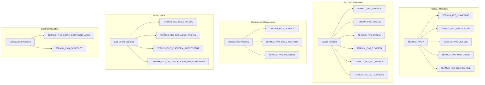
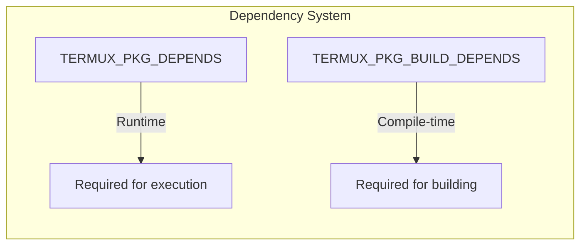
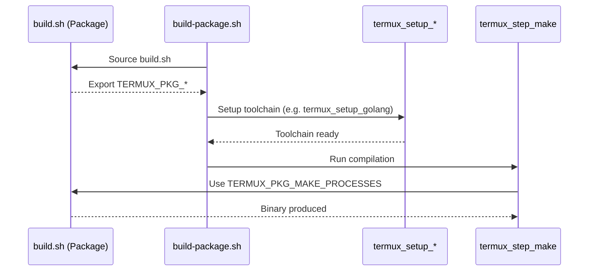

<!-- source: DeepWiki mcp.deepwiki.com · repo termux/termux-packages · page 2.2 Build Configuration Variables · fetched 2026-10-26 -->

# Build Configuration Variables

<details>
<summary>Relevant source files</summary>

The following files were used as context for generating this wiki page:

- [build-package.sh](build-package.sh)
- [disabled-packages/protobuf-static/build.sh](disabled-packages/protobuf-static/build.sh)
- [packages/cabal-install/build.sh](packages/cabal-install/build.sh)
- [packages/flyctl/build.sh](packages/flyctl/build.sh)
- [packages/libprotobuf/build.sh](packages/libprotobuf/build.sh)
- [packages/libprotobuf/retain-linker-array.patch](packages/libprotobuf/retain-linker-array.patch)
- [packages/lua-lpeg/lua54-lpeg.subpackage.sh](packages/lua-lpeg/lua54-lpeg.subpackage.sh)
- [packages/luarocks/build.sh](packages/luarocks/build.sh)
- [packages/mympd/CMakeLists.txt.patch](packages/mympd/CMakeLists.txt.patch)
- [packages/mympd/build.sh](packages/mympd/build.sh)
- [packages/mympd/dist-libmpdclient-include-config.h.patch](packages/mympd/dist-libmpdclient-include-config.h.patch)
- [packages/mympd/src-lib-cacertstore.c.patch](packages/mympd/src-lib-cacertstore.c.patch)
- [packages/mympd/src-lib-http_client.c.patch](packages/mympd/src-lib-http_client.c.patch)
- [packages/nmap/build.sh](packages/nmap/build.sh)
- [packages/osm2pgsql/build.sh](packages/osm2pgsql/build.sh)
- [packages/pandoc/build.sh](packages/pandoc/build.sh)
- [packages/rnr/build.sh](packages/rnr/build.sh)
- [packages/robotfindskitten/build.sh](packages/robotfindskitten/build.sh)
- [packages/rp-pppoe/build.sh](packages/rp-pppoe/build.sh)
- [packages/rpm/build.sh](packages/rpm/build.sh)
- [packages/sassc/build.sh](packages/sassc/build.sh)
- [packages/sc-im/build.sh](packages/sc-im/build.sh)
- [packages/scc/build.sh](packages/scc/build.sh)
- [packages/sccache/build.sh](packages/sccache/build.sh)
- [packages/vis/build.sh](packages/vis/build.sh)
- [packages/vtm/build.sh](packages/vtm/build.sh)
- [scripts/build/configure/termux_step_configure_meson.sh](scripts/build/configure/termux_step_configure_meson.sh)
- [scripts/build/setup/python-crossenv-PYTHONPATH.patch](scripts/build/setup/python-crossenv-PYTHONPATH.patch)
- [scripts/build/setup/python-crossenv-fix-shebang.patch](scripts/build/setup/python-crossenv-fix-shebang.patch)
- [scripts/build/setup/python-crossenv-pip-android-api-level.patch](scripts/build/setup/python-crossenv-pip-android-api-level.patch)
- [scripts/build/setup/termux_setup_protobuf.sh](scripts/build/setup/termux_setup_protobuf.sh)
- [scripts/build/setup/termux_setup_python_pip.sh](scripts/build/setup/termux_setup_python_pip.sh)
- [scripts/build/termux_download_deb_pac.sh](scripts/build/termux_download_deb_pac.sh)
- [scripts/build/termux_step_massage.sh](scripts/build/termux_step_massage.sh)
- [scripts/build/termux_step_override_config_scripts.sh](scripts/build/termux_step_override_config_scripts.sh)
- [scripts/properties.sh](scripts/properties.sh)
- [scripts/setup-termux.sh](scripts/setup-termux.sh)
- [scripts/setup-ubuntu.sh](scripts/setup-ubuntu.sh)

</details>


This document provides comprehensive documentation of the `TERMUX_PKG_*` variables used in package `build.sh` scripts to configure the build process. These variables form the declarative interface between package maintainers and the build system core.

For information about the build lifecycle functions (`termux_step_*`), see [Package Build Lifecycle](#2.1). For language-specific toolchain setup, see [Language Toolchain Integration](#2.3).

## Variable Categories

Build configuration variables are organized into several functional categories that control different aspects of the package build process.



**Sources:** [packages/flyctl/build.sh:1-10](), [packages/vtm/build.sh:1-12](), [packages/mympd/build.sh:1-10]()

## Metadata Variables

Package metadata variables provide descriptive information about the package that appears in package managers and documentation.

### Core Metadata

| Variable | Required | Example | Purpose |
|----------|----------|---------|---------|
| `TERMUX_PKG_HOMEPAGE` | Yes | `https://fly.io` | Project homepage URL |
| `TERMUX_PKG_DESCRIPTION` | Yes | `"Terminal multiplexer..."` | Short package description |
| `TERMUX_PKG_LICENSE` | Yes | `"Apache-2.0"` or `"MIT"` | SPDX license identifier(s) |
| `TERMUX_PKG_MAINTAINER` | Yes | `"@termux"` | GitHub username of maintainer |
| `TERMUX_PKG_LICENSE_FILE` | No | `"LICENSE"` | Path to license file in source |

**Sources:** [packages/flyctl/build.sh:1-4](), [packages/vtm/build.sh:1-5](), [packages/mympd/build.sh:1-4]()

## Source Configuration

Source configuration variables define where and how to obtain package source code.

### Version and Source URL

```bash
TERMUX_PKG_VERSION="0.4.51"
TERMUX_PKG_SRCURL=https://github.com/superfly/flyctl/archive/refs/tags/v$TERMUX_PKG_VERSION.tar.gz
TERMUX_PKG_SHA256=8adb317a980803f115c3675a745bf0d5151c727bdd57d3af43bc23a350d94ffe
```

The `TERMUX_PKG_VERSION` is the upstream version. `TERMUX_PKG_SRCURL` uses this version to construct the download link. `TERMUX_PKG_SHA256` is mandatory for verifying the integrity of the downloaded archive.

**Sources:** [packages/flyctl/build.sh:5-7](), [packages/vtm/build.sh:6-8](), [packages/mympd/build.sh:5-7]()

### Checksum Verification

The build system uses `termux_download` to fetch resources and verify them against `TERMUX_PKG_SHA256`.

**Sources:** [build-package.sh:77](), [packages/sccache/build.sh:7]()

### Package Revision

```bash
TERMUX_PKG_REVISION=1
```

The `TERMUX_PKG_REVISION` variable increments when rebuilding a package without upstream version changes (e.g., to fix a build script error or apply a new patch).

**Sources:** [packages/luarocks/build.sh:6]()

## Auto-Update Configuration

Variables controlling automatic version update detection integrate with the CI/CD pipeline's update workflow.

```bash
TERMUX_PKG_AUTO_UPDATE=true
```

When set to `true`, the `update-packages` script will periodically check upstream repositories for newer tags or releases.

**Sources:** [packages/flyctl/build.sh:8](), [packages/vtm/build.sh:11](), [packages/mympd/build.sh:8]()

## Dependency Management

Dependency variables define relationships between packages during build and runtime.



### Runtime Dependencies

```bash
TERMUX_PKG_DEPENDS="freetype, harfbuzz, libc++, lua54, lunasvg"
```

The `TERMUX_PKG_DEPENDS` variable lists packages required at runtime. These are automatically installed when the package is installed via the package manager.

**Sources:** [packages/vtm/build.sh:9](), [packages/mympd/build.sh:9](), [packages/pandoc/build.sh:8]()

### Build Dependencies

```bash
TERMUX_PKG_BUILD_DEPENDS="libandroid-spawn, stb"
```

The `TERMUX_PKG_BUILD_DEPENDS` variable lists packages needed during compilation but not at runtime. For example, `aosp-libs` is often required for cross-compiling Haskell packages.

**Sources:** [packages/vtm/build.sh:10](), [packages/pandoc/build.sh:9]()

## Build Control Flags

Build control variables modify the build process behavior and architecture support.

### Build in Source

```bash
TERMUX_PKG_BUILD_IN_SRC=true
```

Setting `TERMUX_PKG_BUILD_IN_SRC=true` directs the build system to use the source directory as the build directory rather than a separate `$TERMUX_PKG_BUILDDIR`. This is common for Go and Rust projects.

**Sources:** [packages/flyctl/build.sh:9](), [packages/sccache/build.sh:9](), [packages/scc/build.sh:9]()

### Excluded Architectures

```bash
TERMUX_PKG_EXCLUDED_ARCHES="i686, arm"
```

The `TERMUX_PKG_EXCLUDED_ARCHES` variable prevents building for specific architectures. This is used when upstream software does not support 32-bit systems or specific instruction sets.

**Sources:** [packages/flyctl/build.sh:10](), [packages/pandoc/build.sh:19]()

### Platform Independence

```bash
TERMUX_PKG_PLATFORM_INDEPENDENT=true
```

Indicates the package contains no architecture-specific binaries (e.g., pure Lua scripts or documentation). This allows the build system to produce a single package for all architectures.

**Sources:** [packages/luarocks/build.sh:13]()

## Build Configuration Arguments

Build configuration variables pass arguments to build systems like CMake, Autotools, or Meson.

### Extra Configure Arguments

```bash
TERMUX_PKG_EXTRA_CONFIGURE_ARGS="-DSTB_INCLUDE_DIR=$TERMUX_PREFIX/include/stb"
```

The `TERMUX_PKG_EXTRA_CONFIGURE_ARGS` variable provides additional flags to the configuration step. In the case of `mympd`, it is used to disable startup scripts and link the math library.

**Sources:** [packages/vtm/build.sh:12](), [packages/mympd/build.sh:10-13]()

## Implementation and Data Flow

The `build-package.sh` script sources these variables from the package's `build.sh` and uses them to drive the build lifecycle.



**Sources:** [build-package.sh:34](), [packages/flyctl/build.sh:13](), [packages/sccache/build.sh:14]()

## Validation Rules

The `scripts/properties.sh` file (referenced by `scripts/setup-termux.sh`) contains the logic for validating these variables and ensuring they meet the repository's standards before a build proceeds.

**Sources:** [scripts/setup-termux.sh:69]()

---

