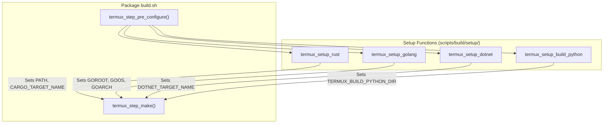
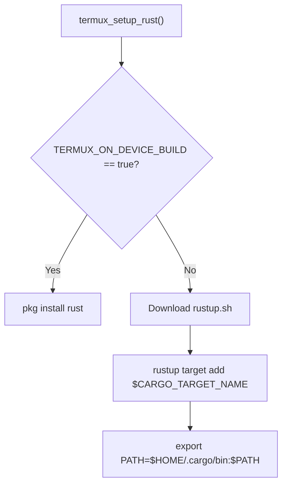

<!-- source: DeepWiki mcp.deepwiki.com · repo termux/termux-packages · page 2.3 Language Toolchain Integration · fetched 2026-10-26 -->

# Language Toolchain Integration

<details>
<summary>Relevant source files</summary>

The following files were used as context for generating this wiki page:

- [packages/flyctl/build.sh](packages/flyctl/build.sh)
- [packages/jack-example-tools/build.sh](packages/jack-example-tools/build.sh)
- [packages/jack2/build.sh](packages/jack2/build.sh)
- [packages/jackett/build.sh](packages/jackett/build.sh)
- [packages/jcal/build.sh](packages/jcal/build.sh)
- [packages/marksman/build.sh](packages/marksman/build.sh)
- [packages/marksman/version.diff](packages/marksman/version.diff)
- [packages/ncurses/build.sh](packages/ncurses/build.sh)
- [packages/ncurses/fix-paths.patch](packages/ncurses/fix-paths.patch)
- [packages/python/0001-fix-hardcoded-paths.patch](packages/python/0001-fix-hardcoded-paths.patch)
- [packages/python/0005-impl-multiprocessing.patch](packages/python/0005-impl-multiprocessing.patch)
- [packages/python/0006-disable-multiarch.patch](packages/python/0006-disable-multiarch.patch)
- [packages/python/0007-fix-pkgconfig-variable-substitution.patch](packages/python/0007-fix-pkgconfig-variable-substitution.patch)
- [packages/python/0008-fix-ctypes-util-find_library.patch](packages/python/0008-fix-ctypes-util-find_library.patch)
- [packages/python/0009-do-not-hardlink.patch](packages/python/0009-do-not-hardlink.patch)
- [packages/python/0010-fix-module-linking.patch](packages/python/0010-fix-module-linking.patch)
- [packages/python/build.sh](packages/python/build.sh)
- [packages/python/hardcode-android-api-level.diff](packages/python/hardcode-android-api-level.diff)
- [packages/rust/0004-set-TMPDIR.patch](packages/rust/0004-set-TMPDIR.patch)
- [packages/rust/0006-suppress-hard-linking-failed-warning.patch](packages/rust/0006-suppress-hard-linking-failed-warning.patch)
- [packages/rust/0007-use-emulated-tls-on-android.patch](packages/rust/0007-use-emulated-tls-on-android.patch)
- [packages/rust/0008-cross-compile-error_index_generator.patch](packages/rust/0008-cross-compile-error_index_generator.patch)
- [packages/rust/0009-always-export-emutls.patch](packages/rust/0009-always-export-emutls.patch)
- [packages/rust/bootstrap.toml](packages/rust/bootstrap.toml)
- [packages/rust/build.sh](packages/rust/build.sh)
- [packages/rust/force-allow-edit-vendor.diff](packages/rust/force-allow-edit-vendor.diff)
- [packages/rust/rust-std-wasm32-wasip3.subpackage.sh](packages/rust/rust-std-wasm32-wasip3.subpackage.sh)
- [packages/rust/tests/0001-cargo-build.sh](packages/rust/tests/0001-cargo-build.sh)
- [packages/rust/tests/0002-issue-25360.sh](packages/rust/tests/0002-issue-25360.sh)
- [packages/rust/tests/0003-issue-27402.sh](packages/rust/tests/0003-issue-27402.sh)
- [packages/swig/build.sh](packages/swig/build.sh)
- [packages/uv/build.sh](packages/uv/build.sh)
- [scripts/build/setup/termux_setup_build_python.sh](scripts/build/setup/termux_setup_build_python.sh)
- [scripts/build/setup/termux_setup_rust.sh](scripts/build/setup/termux_setup_rust.sh)

</details>


This page documents how the Termux packages repository integrates various programming language toolchains (Rust, Go, .NET, Python, CMake, Autotools) into the build system. Each language requires specific environment setup, dependency management, and cross-compilation considerations.

## Overview of Toolchain Integration

The Termux build system provides specialized setup functions that prepare the environment for specific languages. These functions are typically called within `termux_step_pre_configure` or `termux_step_post_get_source`.

### Toolchain Discovery and Setup Logic



Sources: [scripts/build/setup/termux_setup_rust.sh:2-44](), [scripts/build/setup/termux_setup_build_python.sh:11-93](), [packages/jackett/build.sh:70-73]()

---

## Rust Toolchain Integration

Rust packages in Termux use `termux_setup_rust` to configure the environment. This function handles both on-device builds (using the `rust` package) and cross-compilation from Linux hosts (using `rustup`).

### Rust Environment Setup
For cross-compilation, the system downloads the specified Rust version via `rustup` and adds the required Android targets (e.g., `aarch64-linux-android`).



Sources: [scripts/build/setup/termux_setup_rust.sh:2-44](), [packages/rust/build.sh:77-80]()

### Build Pattern: Cargo
Packages written in Rust typically invoke `cargo build` in `termux_step_make`.

| Variable/Command | Role |
| :--- | :--- |
| `termux_setup_rust` | Initializes toolchain and targets. |
| `CARGO_TARGET_NAME` | The target triple (e.g., `aarch64-linux-android`). |
| `cargo build --release` | Compiles the package for the target architecture. |

#### Example: uv Package
The `uv` package demonstrates a standard Rust build pattern:
[packages/uv/build.sh:13-22]()
```bash
termux_step_pre_configure() {
	termux_setup_cmake
	termux_setup_rust
}

termux_step_make() {
	cargo build --jobs "${TERMUX_PKG_MAKE_PROCESSES}" --target "${CARGO_TARGET_NAME}" --release
}
```

### Complex Patches for Rustc
The `rust` package itself requires extensive patching to support Android's emulated TLS and path structures.
- **Emulated TLS**: Android requires `__emutls_get_address` to be exported. [packages/rust/0009-always-export-emutls.patch:1-42]()
- **Path Fixes**: Hardcoded paths like `/data/data/com.termux` are replaced dynamically if the user builds with a custom prefix. [packages/rust/build.sh:91-113]()

---

## Go Language Configuration

Go integration focuses on setting `GOOS`, `GOARCH`, and `GOPATH` correctly for cross-compilation.

### Go Build Pattern
Most Go packages use `go build` directly or via a `Makefile`. Vendoring is a common pattern to ensure reproducible builds.

[packages/flyctl/build.sh:12-20]()
```bash
termux_step_post_get_source() {
	termux_setup_golang
	go mod tidy
	go mod vendor
}

termux_step_make() {
	go build -o bin/flyctl
}
```

Sources: [packages/flyctl/build.sh:1-25]()

---

## .NET Toolchain Integration

Termux supports .NET applications (like `jackett` and `marksman`) by using a host-side .NET SDK to "publish" assemblies for the target Android runtime.

### .NET Setup and Build
The `termux_setup_dotnet` function (typically called with a specific version like `9.0`) prepares the environment.

[packages/jackett/build.sh:70-87]()
```bash
termux_step_pre_configure() {
	TERMUX_DOTNET_VERSION=9.0
	termux_setup_dotnet
}

termux_step_make() {
	dotnet publish src/Jackett.Server \
	--framework "net${TERMUX_DOTNET_VERSION}" \
	--no-self-contained \
	--runtime "$DOTNET_TARGET_NAME" \
	--configuration Release \
	--output build/
}
```

### Runtime Integration
Since .NET binaries are `.dll` files, Termux creates a shell script wrapper in `$TERMUX_PREFIX/bin` to execute them via the `dotnet` host.
[packages/marksman/build.sh:41-44]()
```bash
cat > "$TERMUX_PREFIX/bin/marksman" <<-HERE
#!$TERMUX_PREFIX/bin/sh
exec dotnet $TERMUX_PREFIX/lib/marksman/marksman.dll "\$@"
HERE
```

Sources: [packages/jackett/build.sh:70-98](), [packages/marksman/build.sh:14-46]()

---

## Python Integration

Python integration is two-fold: building the Python interpreter itself and providing a host-side Python for cross-compiling extension modules.

### Host Python Setup
The function `termux_setup_build_python` compiles a minimal "host" Python on the x86_64 build machine. This host Python is used to run `setup.py` scripts and generate bytecode for the target.

[scripts/build/setup/termux_setup_build_python.sh:11-93]()
- **Offline Support**: Checks `TERMUX_PACKAGES_OFFLINE`. [scripts/build/setup/termux_setup_build_python.sh:33-37]()
- **Minimal Build**: Configures with `--with-ensurepip=install` and `--prefix`. [scripts/build/setup/termux_setup_build_python.sh:80-83]()

### Android-Specific Python Patches
The Python build requires significant adjustments for Android's lack of certain POSIX features:
- **Shared Memory**: Implements `shm_open` and `shm_unlink` using files in `$TERMUX_PREFIX/tmp/`. [packages/python/0005-impl-multiprocessing.patch:60-117]()
- **Semaphores**: Forces usage of `libandroid-posix-semaphore`. [packages/python/build.sh:124-124]()
- **API Level Hardcoding**: Patches Python to respect `TERMUX_PKG_API_LEVEL`. [packages/python/build.sh:72-77]()

Sources: [packages/python/build.sh:1-160](), [scripts/build/setup/termux_setup_build_python.sh:1-93]()

---

## C/C++ Build Systems (CMake & Autotools)

### Autotools (Configure/Make)
This is the default build system. Variables like `TERMUX_PKG_EXTRA_CONFIGURE_ARGS` are passed to the `./configure` script.

[packages/ncurses/build.sh:39-61]()
```bash
TERMUX_PKG_EXTRA_CONFIGURE_ARGS="
--disable-stripping
--enable-widec
--with-shared
"
```

### CMake
Packages using CMake call `termux_setup_cmake`. This configures the `CMAKE_TOOLCHAIN_FILE` to point to the Android NDK toolchain provided by Termux.

[packages/uv/build.sh:13-16]()
```bash
termux_step_pre_configure() {
	termux_setup_cmake
	termux_setup_rust
}
```

Sources: [packages/ncurses/build.sh:39-61](), [packages/uv/build.sh:1-51]()

---

## Summary of Toolchain Setup Functions

| Function | Language | Primary Action |
| :--- | :--- | :--- |
| `termux_setup_rust` | Rust | Installs `rustup` and adds Android targets. |
| `termux_setup_golang` | Go | Sets `GOROOT` and cross-compilation env vars. |
| `termux_setup_dotnet` | .NET | Configures SDK for `DOTNET_TARGET_NAME`. |
| `termux_setup_build_python` | Python | Compiles a host-side Python for cross-compilation. |
| `termux_setup_cmake` | C/C++ | Sets up CMake with NDK toolchain parameters. |

Sources: [scripts/build/setup/termux_setup_rust.sh:2-44](), [scripts/build/setup/termux_setup_build_python.sh:11-93](), [packages/jackett/build.sh:70-73]()

---

