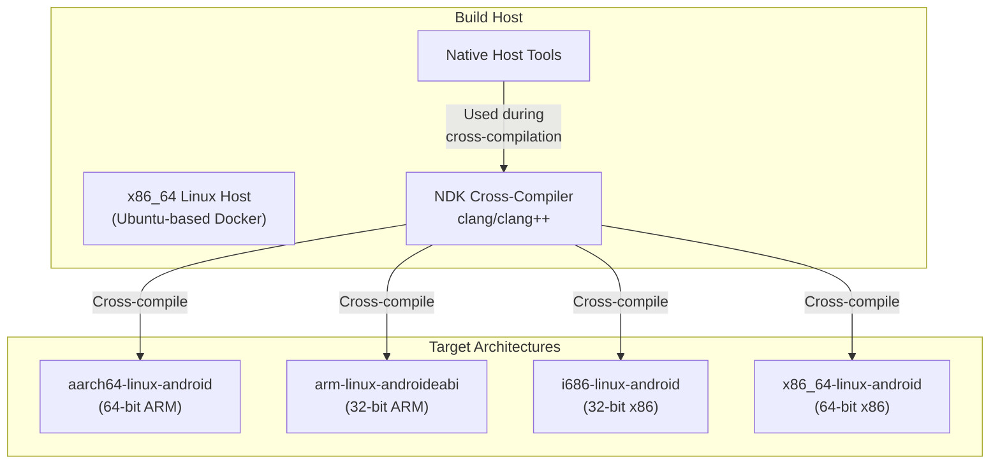
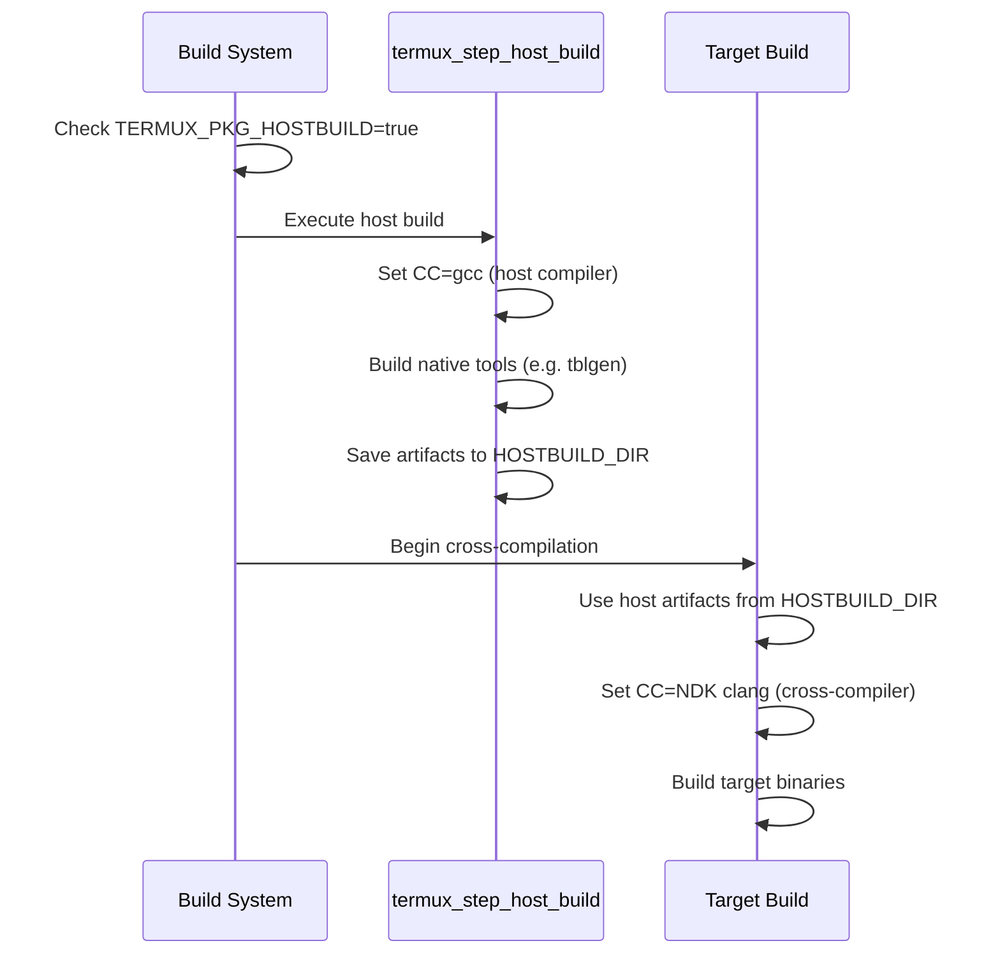
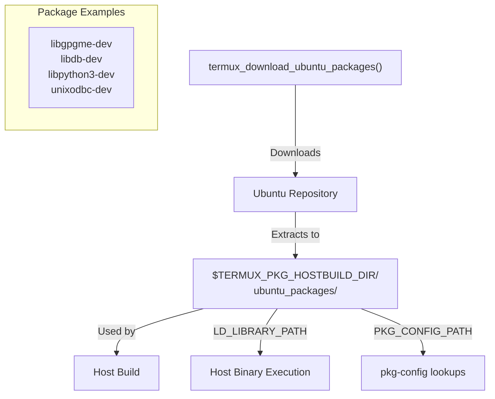
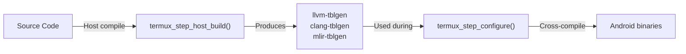

<!-- source: DeepWiki mcp.deepwiki.com · repo termux/termux-packages · page 2.4 Cross-Compilation and Host Builds · fetched 2026-10-26 -->

# Cross-Compilation and Host Builds

<details>
<summary>Relevant source files</summary>

The following files were used as context for generating this wiki page:

- [packages/ansifilter/build.sh](packages/ansifilter/build.sh)
- [packages/antibody/build.sh](packages/antibody/build.sh)
- [packages/antiword/build.sh](packages/antiword/build.sh)
- [packages/aosp-libs/build.sh](packages/aosp-libs/build.sh)
- [packages/emscripten/build.sh](packages/emscripten/build.sh)
- [packages/flang/0002-remove-some-macros-that-breaks-building.patch](packages/flang/0002-remove-some-macros-that-breaks-building.patch)
- [packages/flang/0004-do-not-call-timespec_get.patch](packages/flang/0004-do-not-call-timespec_get.patch)
- [packages/flang/0005-use-libandroid-complex-math.patch](packages/flang/0005-use-libandroid-complex-math.patch)
- [packages/flang/build.sh](packages/flang/build.sh)
- [packages/gitea/build.sh](packages/gitea/build.sh)
- [packages/gtypist/build.sh](packages/gtypist/build.sh)
- [packages/guile/build.sh](packages/guile/build.sh)
- [packages/gumbo-parser/build.sh](packages/gumbo-parser/build.sh)
- [packages/hashdeep/build.sh](packages/hashdeep/build.sh)
- [packages/libllvm/build.sh](packages/libllvm/build.sh)
- [packages/libllvm/clang-lib-Driver-ToolChain.cpp.patch](packages/libllvm/clang-lib-Driver-ToolChain.cpp.patch)
- [packages/libllvm/clang-lib-Driver-ToolChains-Linux.cpp.patch](packages/libllvm/clang-lib-Driver-ToolChains-Linux.cpp.patch)
- [packages/libllvm/clang.subpackage.sh](packages/libllvm/clang.subpackage.sh)
- [packages/libllvm/compiler-rt-lib-builtins-CMakeLists.txt.patch](packages/libllvm/compiler-rt-lib-builtins-CMakeLists.txt.patch)
- [packages/libllvm/libcompiler-rt.subpackage.sh](packages/libllvm/libcompiler-rt.subpackage.sh)
- [packages/libllvm/lldb.subpackage.sh](packages/libllvm/lldb.subpackage.sh)
- [packages/libllvm/llvm-config.in](packages/libllvm/llvm-config.in)
- [packages/libllvm/llvm-include-llvm-Demangle-ItaniumDemangle.h.patch](packages/libllvm/llvm-include-llvm-Demangle-ItaniumDemangle.h.patch)
- [packages/libllvm/llvm-lib-Support-Unix-Path.inc.patch](packages/libllvm/llvm-lib-Support-Unix-Path.inc.patch)
- [packages/libllvm/llvm-tools.subpackage.sh](packages/libllvm/llvm-tools.subpackage.sh)
- [packages/libllvm/llvm.subpackage.sh](packages/libllvm/llvm.subpackage.sh)
- [packages/lowdown/build.sh](packages/lowdown/build.sh)
- [packages/lux-cli/build.sh](packages/lux-cli/build.sh)
- [packages/mplayer/build.sh](packages/mplayer/build.sh)
- [packages/mplayer/mplayer-1.5-ffmpeg-8.patch](packages/mplayer/mplayer-1.5-ffmpeg-8.patch)
- [packages/mplayer/r38454.patch](packages/mplayer/r38454.patch)
- [packages/mplayer/r38455.patch](packages/mplayer/r38455.patch)
- [packages/mpv/build.sh](packages/mpv/build.sh)
- [packages/mruby/build.sh](packages/mruby/build.sh)
- [packages/msitools/build.sh](packages/msitools/build.sh)
- [packages/neovim-nightly/build.sh](packages/neovim-nightly/build.sh)
- [packages/neovim/build.sh](packages/neovim/build.sh)
- [packages/neovim/disable-checkhealth-locale-warning.patch](packages/neovim/disable-checkhealth-locale-warning.patch)
- [packages/neovim/sysinit.vim](packages/neovim/sysinit.vim)
- [packages/python-llvmlite/build.sh](packages/python-llvmlite/build.sh)
- [packages/python-llvmlite/ffi-build.py.patch](packages/python-llvmlite/ffi-build.py.patch)
- [packages/python-llvmlite/llvm-include-llvm-ADT-SmallVector.h.patch](packages/python-llvmlite/llvm-include-llvm-ADT-SmallVector.h.patch)
- [packages/python-llvmlite/llvm-tools-llvm-rtdyld-llvm-rtdyld.cpp.patch](packages/python-llvmlite/llvm-tools-llvm-rtdyld-llvm-rtdyld.cpp.patch)
- [packages/python-llvmlite/openmp.patch](packages/python-llvmlite/openmp.patch)
- [packages/swi-prolog/build.sh](packages/swi-prolog/build.sh)
- [packages/swi-prolog/continue-on-abi-check-failure.patch](packages/swi-prolog/continue-on-abi-check-failure.patch)
- [packages/swi-prolog/disable-installation-of-some-qlfs.patch](packages/swi-prolog/disable-installation-of-some-qlfs.patch)
- [packages/tinymist/build.sh](packages/tinymist/build.sh)
- [packages/tinymist/crates-tinymist-cli-Cargo.toml.patch](packages/tinymist/crates-tinymist-cli-Cargo.toml.patch)
- [packages/vim/build.sh](packages/vim/build.sh)
- [packages/vim/fix-writing-archive.patch](packages/vim/fix-writing-archive.patch)
- [packages/vim/revert-1fe0d1e.patch](packages/vim/revert-1fe0d1e.patch)
- [packages/vim/runtime-syntax-sh.vim.patch](packages/vim/runtime-syntax-sh.vim.patch)
- [scripts/big-pkgs.list](scripts/big-pkgs.list)
- [x11-packages/audacity/build.sh](x11-packages/audacity/build.sh)
- [x11-packages/audacity/wxwidgets-3.3.patch](x11-packages/audacity/wxwidgets-3.3.patch)
- [x11-packages/awesome-luajit/build.sh](x11-packages/awesome-luajit/build.sh)
- [x11-packages/awesome/build.sh](x11-packages/awesome/build.sh)
- [x11-packages/ibus/0001-add-python-path-for-ibus-setup.patch](x11-packages/ibus/0001-add-python-path-for-ibus-setup.patch)
- [x11-packages/ibus/0003-i18n.patch](x11-packages/ibus/0003-i18n.patch)
- [x11-packages/ibus/build.sh](x11-packages/ibus/build.sh)
- [x11-packages/mogan/build.sh](x11-packages/mogan/build.sh)
- [x11-packages/mogan/lolly.diff](x11-packages/mogan/lolly.diff)
- [x11-packages/mogan/moebius.diff](x11-packages/mogan/moebius.diff)
- [x11-packages/mogan/xmake-packages-l-lolly.patch](x11-packages/mogan/xmake-packages-l-lolly.patch)
- [x11-packages/mogan/xmake-packages-m-moebius.patch](x11-packages/mogan/xmake-packages-m-moebius.patch)
- [x11-packages/mousepad/build.sh](x11-packages/mousepad/build.sh)
- [x11-packages/mpv-x/build.sh](x11-packages/mpv-x/build.sh)
- [x11-packages/mpv-x/default-to-x11.patch](x11-packages/mpv-x/default-to-x11.patch)
- [x11-packages/vim-gtk/build.sh](x11-packages/vim-gtk/build.sh)
- [x11-packages/vim-gtk/revert-1fe0d1e.patch](x11-packages/vim-gtk/revert-1fe0d1e.patch)
- [x11-packages/wine-stable/0001-fix-paths.patch](x11-packages/wine-stable/0001-fix-paths.patch)
- [x11-packages/wine-stable/0002-fix-defines.patch](x11-packages/wine-stable/0002-fix-defines.patch)
- [x11-packages/wine-stable/0004-no-pthread_mutexattr_setprotocol.patch](x11-packages/wine-stable/0004-no-pthread_mutexattr_setprotocol.patch)
- [x11-packages/wine-stable/0005-use-__builtin_ffs.patch](x11-packages/wine-stable/0005-use-__builtin_ffs.patch)
- [x11-packages/wine-stable/9998-fix-winegcc-build-target.patch.beforehostbuild](x11-packages/wine-stable/9998-fix-winegcc-build-target.patch.beforehostbuild)
- [x11-packages/wine-stable/9999-fix-winebuild-as-type.patch.beforehostbuild](x11-packages/wine-stable/9999-fix-winebuild-as-type.patch.beforehostbuild)
- [x11-packages/wine-stable/build.sh](x11-packages/wine-stable/build.sh)
- [x11-packages/wlr-randr/build.sh](x11-packages/wlr-randr/build.sh)
- [x11-packages/xmoto/build.sh](x11-packages/xmoto/build.sh)
- [x11-packages/xmoto/installation-directories.patch](x11-packages/xmoto/installation-directories.patch)

</details>


## Purpose and Scope

This page documents the cross-compilation architecture used to build Termux packages on x86_64 Linux hosts for Android target devices. It covers the host build mechanism, Ubuntu package integration for host dependencies, and common patterns for packages that require native tools during compilation. For information about the overall build system lifecycle, see [Package Build Lifecycle](#2.1). For language-specific toolchain integration, see [Language Toolchain Integration](#2.3).

## Cross-Compilation Architecture

Termux packages are built using a cross-compilation setup where the build host (x86_64 Linux running in Docker) compiles binaries for four Android target architectures:



The build system sets `TERMUX_HOST_PLATFORM` to the appropriate target triple (e.g., `aarch64-linux-android`, `armv7a-linux-androideabi` for ARM) and configures the NDK toolchain accordingly.

Sources: [packages/lux-cli/build.sh:96-98](), [packages/vim/build.sh:103-106](), [packages/libllvm/build.sh:151-153]()

## Host Build Mechanism

### Configuration

Packages that require native tools during cross-compilation use the host build mechanism. This is triggered by setting `TERMUX_PKG_HOSTBUILD=true`.


When `TERMUX_PKG_HOSTBUILD=true` is set in `build.sh`, the build system:

1. Creates a separate build directory at `$TERMUX_PKG_HOSTBUILD_DIR`.
2. Executes `termux_step_host_build()` **before** the target build begins.
3. Provides host-built artifacts to the cross-compilation process.
4. Cleans up the host build directory after package installation if specified.

Sources: [packages/neovim-nightly/build.sh:13,56-77](), [packages/emscripten/build.sh:10](), [packages/swi-prolog/build.sh:10,58-136](), [packages/libllvm/build.sh:12,83-91]()

### Host Build Execution Flow



Sources: [packages/neovim/build.sh:25-46](), [packages/libllvm/build.sh:83-91](), [packages/flang/build.sh:71-79]()

## Ubuntu Package Integration

### termux_download_ubuntu_packages Function

The `termux_download_ubuntu_packages` function downloads and extracts Debian packages from Ubuntu repositories to provide host dependencies. This is essential for packages that need libraries or tools not present in the base Docker image during the host build phase.



Common usage pattern:

```bash
local -a ubuntu_packages=(
    "libgpgme-dev"
    "libassuan-dev"
)

termux_download_ubuntu_packages "${ubuntu_packages[@]}"

PKG_CONFIG_PATH_x86_64_unknown_linux_gnu="${TERMUX_PKG_HOSTBUILD_DIR}/ubuntu_packages/usr/lib/x86_64-linux-gnu/pkgconfig"
```

Sources: [packages/lux-cli/build.sh:53-70](), [packages/swi-prolog/build.sh:61-85]()

### Path and Symlink Management

Ubuntu packages often contain `.pc` files with hardcoded paths and symlinks that reference absolute system paths. The build scripts patch these to reference the extracted location:

```bash
# Patch pkg-config files
find "${HOSTBUILD_ROOTFS}" -type f -name '*.pc' | \
    xargs -n 1 sed -i -e "s|/usr|${HOSTBUILD_ROOTFS}/usr|g"

# Fix broken symlinks
find "${HOSTBUILD_ROOTFS}/usr/lib/x86_64-linux-gnu" -xtype l \
    -exec sh -c "ln -snvf /usr/lib/x86_64-linux-gnu/\$(readlink \$1) \$1" sh {} \;
```

Sources: [packages/swi-prolog/build.sh:89-91,96-98]()

## Common Host Build Patterns

### Pattern 1: Native Tool Compilation (TableGen)

Packages based on LLVM (like `libllvm`, `flang`, and `emscripten`) require building native "TableGen" tools to generate C++ code from domain-specific definitions during the target build.



**Example: libllvm**
[packages/libllvm/build.sh:83-91]() builds several TableGen tools natively. These are then passed to the target build using `-DLLVM_NATIVE_TOOL_DIR=$TERMUX_PKG_HOSTBUILD_DIR/bin`.

Sources: [packages/libllvm/build.sh:43,83-91](), [packages/flang/build.sh:45,71-79]()

### Pattern 2: Generator/Compiler Builds

Some packages need to run a native version of themselves or a specialized generator to produce artifacts for the target.

**Example: Neovim**
[packages/neovim/build.sh:25-46]() builds a native `nvim` and `libnlua0.so`. These are then provided to the target build via `-DNVIM_HOST_PRG` and `-DNLUA0_HOST_PRG` to generate metadata and documentation.

Sources: [packages/neovim/build.sh:21-22,25-46](), [packages/neovim-nightly/build.sh:23-24,56-77]()

**Example: SWI-Prolog**
[packages/swi-prolog/build.sh:58-136]() builds a native SWI-Prolog to produce `boot.prc` and `INDEX.pl` artifacts required for the Android build.

Sources: [packages/swi-prolog/build.sh:18,58-136]()

### Pattern 3: Shell Completion Generation

Some Rust-based packages use a host build to generate shell completion files (bash, zsh, fish) by running the native binary.

**Example: lux-cli**
[packages/lux-cli/build.sh:47-91]() runs `cargo run --package xtask --release -- dist-completions` on the host to generate completion scripts, which are then installed into the target package.

Sources: [packages/lux-cli/build.sh:47-91,128,132-134]()

## Target Architecture Configuration

### Architecture-Specific Flags and Workarounds

The build system must account for differences in architecture support, particularly for 32-bit systems (arm, i686).

| Architecture | Handling / Workarounds |
|--------------|------------------------|
| `i686` | Often requires linking `libgcc` for atomic operations. [packages/lux-cli/build.sh:105-108]() |
| `arm` | Requires specific target triple strings like `armv7a-linux-androideabi`. [packages/libllvm/build.sh:152-154]() |
| `32-bit` | May require `-DLLVM_FORCE_SMALLFILE_FOR_ANDROID=on`. [packages/libllvm/build.sh:60-63]() |

### Cross-Compilation Patches for Interpreters

Complex editors like Vim require patching to handle interpreter detection (Perl, Ruby, Tcl) during cross-compilation, as the standard detection scripts would try to run target binaries on the host.

[packages/vim/build.sh:90-107]() applies a specialized patch `configure-perl-ruby-tcl-cross-compiling.diff` that injects version information from other Termux build scripts.

Sources: [packages/vim/build.sh:90-107](), [x11-packages/vim-gtk/build.sh:93-110]()

## Architecture Variable Reference

The build system provides several variables for target architecture configuration:

| Variable | Purpose | Example Values |
|----------|---------|----------------|
| `TERMUX_ARCH` | Termux architecture name | `aarch64`, `arm`, `i686`, `x86_64` |
| `TERMUX_HOST_PLATFORM` | Target triple for cross-compilation | `aarch64-linux-android` |
| `TERMUX_PKG_API_LEVEL` | Android API level | `24` |
| `TERMUX_ARCH_BITS` | Architecture bit width | `32`, `64` |
| `CARGO_TARGET_NAME` | Rust-specific target triple | `aarch64-linux-android` |

Sources: [packages/lux-cli/build.sh:105,110](), [packages/libllvm/build.sh:29,97,151]()

## Summary of Host Build Patterns

| Pattern | Code Entity | Example Packages |
|---------|-------------|------------------|
| TableGen Tools | `llvm-tblgen`, `mlir-tblgen` | `libllvm`, `flang`, `emscripten` |
| Native Shims/Libs | `libnlua0.so`, `nvim` | `neovim`, `neovim-nightly` |
| Artifact Generators | `swipl` (native), `xtask` | `swi-prolog`, `lux-cli` |
| Ubuntu Integration | `termux_download_ubuntu_packages` | `swi-prolog`, `lux-cli` |

Sources: [packages/libllvm/build.sh:89-90](), [packages/neovim/build.sh:39-42](), [packages/swi-prolog/build.sh:85](), [packages/lux-cli/build.sh:70,84]()

---

