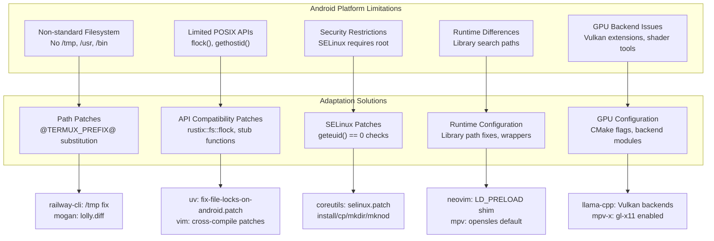
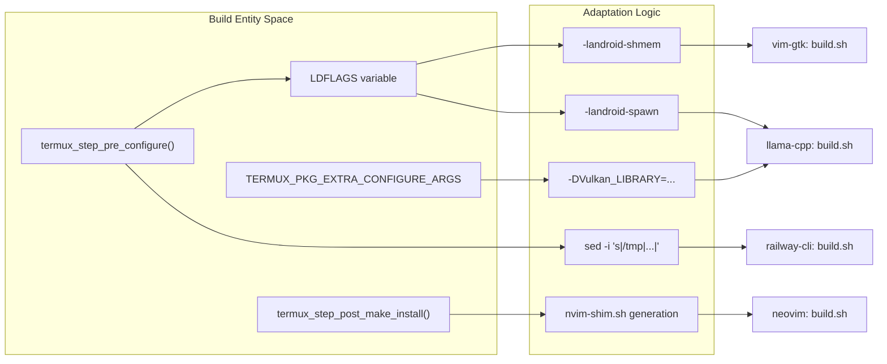

<!-- source: DeepWiki mcp.deepwiki.com · repo termux/termux-packages · page 2.5 Platform Adaptations and Patches · fetched 2026-10-26 -->

# Platform Adaptations and Patches

<details>
<summary>Relevant source files</summary>

The following files were used as context for generating this wiki page:

- [packages/findomain/build.sh](packages/findomain/build.sh)
- [packages/findomain/headless-chrome.patch](packages/findomain/headless-chrome.patch)
- [packages/findomain/hickory-resolver.diff](packages/findomain/hickory-resolver.diff)
- [packages/flatbuffers/build.sh](packages/flatbuffers/build.sh)
- [packages/flex/build.sh](packages/flex/build.sh)
- [packages/fm/build.sh](packages/fm/build.sh)
- [packages/llama-cpp/0002-do-not-install-backend-libs.patch](packages/llama-cpp/0002-do-not-install-backend-libs.patch)
- [packages/llama-cpp/build.sh](packages/llama-cpp/build.sh)
- [packages/minidlna/build.sh](packages/minidlna/build.sh)
- [packages/minimodem/build.sh](packages/minimodem/build.sh)
- [packages/miniserve/build.sh](packages/miniserve/build.sh)
- [packages/minisign/build.sh](packages/minisign/build.sh)
- [packages/mplayer/build.sh](packages/mplayer/build.sh)
- [packages/mplayer/mplayer-1.5-ffmpeg-8.patch](packages/mplayer/mplayer-1.5-ffmpeg-8.patch)
- [packages/mplayer/r38454.patch](packages/mplayer/r38454.patch)
- [packages/mplayer/r38455.patch](packages/mplayer/r38455.patch)
- [packages/mpv/build.sh](packages/mpv/build.sh)
- [packages/mruby/build.sh](packages/mruby/build.sh)
- [packages/msitools/build.sh](packages/msitools/build.sh)
- [packages/neovim-nightly/build.sh](packages/neovim-nightly/build.sh)
- [packages/neovim/build.sh](packages/neovim/build.sh)
- [packages/neovim/disable-checkhealth-locale-warning.patch](packages/neovim/disable-checkhealth-locale-warning.patch)
- [packages/neovim/sysinit.vim](packages/neovim/sysinit.vim)
- [packages/railway-cli/build.sh](packages/railway-cli/build.sh)
- [packages/rust-analyzer/build.sh](packages/rust-analyzer/build.sh)
- [packages/vim/build.sh](packages/vim/build.sh)
- [packages/vim/fix-writing-archive.patch](packages/vim/fix-writing-archive.patch)
- [packages/vim/revert-1fe0d1e.patch](packages/vim/revert-1fe0d1e.patch)
- [packages/vim/runtime-syntax-sh.vim.patch](packages/vim/runtime-syntax-sh.vim.patch)
- [x11-packages/mogan/build.sh](x11-packages/mogan/build.sh)
- [x11-packages/mogan/lolly.diff](x11-packages/mogan/lolly.diff)
- [x11-packages/mogan/moebius.diff](x11-packages/mogan/moebius.diff)
- [x11-packages/mogan/xmake-packages-l-lolly.patch](x11-packages/mogan/xmake-packages-l-lolly.patch)
- [x11-packages/mogan/xmake-packages-m-moebius.patch](x11-packages/mogan/xmake-packages-m-moebius.patch)
- [x11-packages/mousepad/build.sh](x11-packages/mousepad/build.sh)
- [x11-packages/mpv-x/build.sh](x11-packages/mpv-x/build.sh)
- [x11-packages/mpv-x/default-to-x11.patch](x11-packages/mpv-x/default-to-x11.patch)
- [x11-packages/vim-gtk/build.sh](x11-packages/vim-gtk/build.sh)
- [x11-packages/vim-gtk/revert-1fe0d1e.patch](x11-packages/vim-gtk/revert-1fe0d1e.patch)

</details>


This page documents Android-specific adaptations required to build and run packages in Termux. Android's non-standard filesystem hierarchy, limited POSIX API support, and security restrictions necessitate extensive patching and build configuration adjustments across the package repository.

For information about the build lifecycle where these patches are applied, see [Package Build Lifecycle](). For cross-compilation architecture that enables these patches to work, see [Cross-Compilation and Host Builds]().

## Overview

Android's environment differs from standard Linux distributions in several critical ways that require systematic adaptations:

- **Filesystem paths**: Android lacks `/tmp`, `/usr`, `/bin`, and other standard directories.
- **POSIX API limitations**: File locking, certain `gethostid()` functionality, and other system calls are unsupported or restricted in Bionic libc.
- **Security model**: SELinux operations require root access even when the kernel supports them.
- **Runtime library paths**: Dynamic library search paths differ from standard Linux, requiring manual configuration for backend loading.
- **GPU acceleration**: Vulkan shader compilation and backend loading require NDK-specific tools and path adjustments.

The build system addresses these issues through a combination of source patches, build-time configuration flags, and runtime wrappers.

## Adaptation Categories



Sources: [packages/railway-cli/build.sh:21-24](), [packages/llama-cpp/build.sh:13-21](), [packages/neovim/build.sh:56-64](), [x11-packages/mpv-x/build.sh:15-28]()

## Path Adaptations

### Filesystem Hierarchy Differences

Android does not provide standard Unix directories. Termux establishes its own prefix (typically `/data/data/com.termux/files/usr`), requiring all hardcoded paths in upstream sources to be patched.

| Standard Unix Path | Termux Equivalent | Affected Components |
|-------------------|-------------------|---------------------|
| `/tmp` | `$TERMUX_PREFIX/tmp` | Temporary file operations |
| `/bin/sh` | `$TERMUX_PREFIX/bin/sh` | Shell script interpreters |
| `/usr` | `$TERMUX_PREFIX` | All installed binaries/libraries |
| `/etc` | `$TERMUX_PREFIX/etc` | Configuration files |

### Rust Path Patching

Rust packages often vendor dependencies that hardcode paths. The `railway-cli` package demonstrates a pattern of using `sed` to patch vendored crates:

[packages/railway-cli/build.sh:21-25]()
```bash
find vendor/{arboard,x11rb-protocol} -type f -print0 | \
    xargs -0 sed -i \
    -e 's|android|disabling_this_because_it_is_for_building_an_apk|g' \
    -e "s|/tmp|$TERMUX_PREFIX/tmp|g"
```

This ensures that libraries like `arboard` (clipboard support) use the Termux-specific temporary directory instead of the standard Android `/tmp`.

Sources: [packages/railway-cli/build.sh:21-25]()

## File Locking and POSIX Workarounds

### Android's Unsupported std::fs::File Locking

Android's Bionic libc does not provide full POSIX file locking support. The Rust standard library's locking methods often fail on Android. Packages like `uv` apply patches to use the `rustix` crate for direct system calls, while others use shmem workarounds.

### Shared Memory and Globbing

Many multimedia and editor packages require `libandroid-shmem` or `libandroid-glob` to provide missing POSIX functionality:

- **mpv-x**: Links against `-landroid-glob` and `-landroid-shmem` [x11-packages/mpv-x/build.sh:43]().
- **vim-gtk**: Links against `-landroid-shmem` [x11-packages/vim-gtk/build.sh:81]().
- **mogan**: Depends on `libandroid-complex-math`, `libandroid-execinfo`, `libandroid-spawn`, and `libandroid-wordexp` [x11-packages/mogan/build.sh:9]().

Sources: [x11-packages/mpv-x/build.sh:43](), [x11-packages/vim-gtk/build.sh:81](), [x11-packages/mogan/build.sh:9]()

## Editor Shims and Wrappers

### Neovim LD_PRELOAD Shim

Neovim in Termux uses a wrapper script to manage library loading. The `termux_step_post_make_install` function moves the real binary to `libexec` and installs a shim:

[packages/neovim/build.sh:56-64]()
```bash
mkdir -p "$TERMUX_PREFIX/libexec/nvim"
mv "${TERMUX_PREFIX}"/bin/nvim "${TERMUX_PREFIX}"/libexec/nvim
sed -e "s|@TERMUX_PREFIX@|${TERMUX_PREFIX}|g" \
    "$TERMUX_PKG_BUILDER_DIR/nvim-shim.sh" \
    > "${TERMUX_PREFIX}/bin/nvim"
chmod 700 "${TERMUX_PREFIX}/bin/nvim"
```

### Vim Cross-Compilation Patches

Vim's build system does not natively support cross-compiling for interpreters like Perl, Ruby, and Tcl. Termux applies a complex patch that injects version information from other Termux packages:

[packages/vim/build.sh:92-106]()
```bash
perl_version="$(. "$TERMUX_SCRIPTDIR/packages/perl/build.sh"; echo "${TERMUX_PKG_VERSION[0]}")"
ruby_major_version="$(. "$TERMUX_SCRIPTDIR/packages/ruby/build.sh"; echo "${TERMUX_PKG_VERSION%\.*}")"
tcl_major_version="$(. "$TERMUX_SCRIPTDIR/packages/tcl/build.sh"; echo "${TERMUX_PKG_VERSION%\.*}")"

patch="$TERMUX_PKG_BUILDER_DIR/configure-perl-ruby-tcl-cross-compiling.diff"
sed \
    -e "s%\@PERL_VERSION\@%${perl_version}%g" \
    -e "s%\@RUBY_MAJOR_VERSION\@%${ruby_major_version}%g" \
    -e "s%\@TCL_MAJOR_VERSION\@%${tcl_major_version}%g" \
    "$patch" | patch --silent -p1
```

Sources: [packages/neovim/build.sh:56-64](), [packages/vim/build.sh:92-106]()

## GPU and Multimedia Backend Configurations

### Vulkan and OpenCL in llama-cpp

`llama-cpp` uses dynamic loading for backends. It requires the NDK's shader tools for Vulkan shader generation:

[packages/llama-cpp/build.sh:13-21]()
```bash
TERMUX_PKG_EXTRA_CONFIGURE_ARGS="
-DGGML_BACKEND_DL=ON
-DGGML_VULKAN=ON
-DGGML_VULKAN_SHADERS_GEN_TOOLCHAIN=$TERMUX_PKG_BUILDER_DIR/host-toolchain.cmake
-DGGML_OPENCL=ON
"
```

In `termux_step_pre_configure`, the path to NDK shader tools is exported:
[packages/llama-cpp/build.sh:75-76]()
```bash
termux_step_pre_configure() {
	export PATH="$NDK/shader-tools/linux-x86_64:$PATH"
}
```

### Media Player Backend Overrides

Multimedia packages often need to disable Android-specific detection in build systems (like Meson) to use Termux's Linux-like environment instead of the native Android MediaNDK:

- **mpv/mpv-x**: Disables `android-media-ndk` and forces `host_machine.system() == 'android'` to false in `meson.build` [x11-packages/mpv-x/build.sh:27, 44]().
- **mplayer**: Uses a custom `termux_step_post_get_source` to download a specific FFmpeg version and applies patches for FFmpeg 8 compatibility [packages/mplayer/build.sh:26-36]().

Sources: [packages/llama-cpp/build.sh:13-21, 75-76](), [x11-packages/mpv-x/build.sh:27, 44](), [packages/mplayer/build.sh:26-36]()

## Implementation Mapping

The following diagram bridges the high-level adaptation requirements to specific code entities in the build scripts.



Sources: [x11-packages/vim-gtk/build.sh:81](), [packages/llama-cpp/build.sh:77, 83](), [packages/railway-cli/build.sh:24](), [packages/neovim/build.sh:92-95]()

## Architecture-Specific Exclusions

Some packages cannot support 32-bit Android due to `size_t` limitations or lack of upstream support for older ABIs.

- **llama-cpp**: Excludes `arm` and `i686` because it uses `int64_t` in ways that conflict with 32-bit `size_t` [packages/llama-cpp/build.sh:23-25]().
- **mplayer**: Excludes `i686` [packages/mplayer/build.sh:24]().

Sources: [packages/llama-cpp/build.sh:23-25](), [packages/mplayer/build.sh:24]()

## Summary of Key Adaptation Functions

| Function/Variable | Purpose | Example |
|-------------------|---------|---------|
| `termux_step_pre_configure` | Inject flags and patch sources before build | [packages/railway-cli/build.sh:11]() |
| `termux_step_host_build` | Build host-side tools needed for cross-compilation | [packages/neovim/build.sh:25]() |
| `TERMUX_PKG_EXTRA_CONFIGURE_ARGS` | Pass Android-specific paths to CMake/Autotools | [packages/llama-cpp/build.sh:13]() |
| `termux_step_post_make_install` | Install shims, config files, and cleanup | [packages/neovim/build.sh:48]() |
| `termux_step_create_debscripts` | Generate `postinst` scripts for runtime setup | [packages/miniserve/build.sh:27]() |

Sources: [packages/railway-cli/build.sh:11](), [packages/neovim/build.sh:25, 48](), [packages/llama-cpp/build.sh:13](), [packages/miniserve/build.sh:27]()

---

