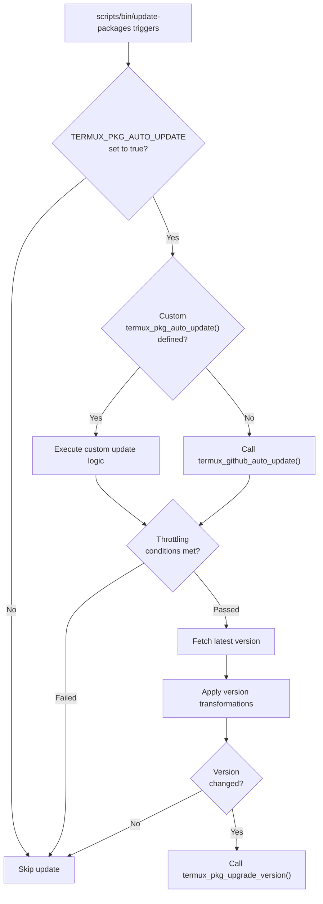
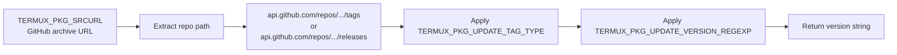
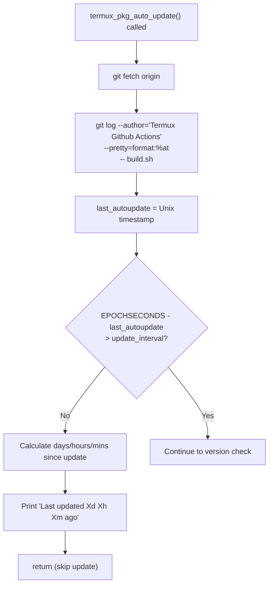

<!-- source: DeepWiki mcp.deepwiki.com · repo termux/termux-packages · page 2.6 Auto-Update Mechanisms · fetched 2026-10-26 -->

# Auto-Update Mechanisms

<details>
<summary>Relevant source files</summary>

The following files were used as context for generating this wiki page:

- [packages/asciinema/build.sh](packages/asciinema/build.sh)
- [packages/asciinema/locale.rs.patch](packages/asciinema/locale.rs.patch)
- [packages/findomain/build.sh](packages/findomain/build.sh)
- [packages/findomain/headless-chrome.patch](packages/findomain/headless-chrome.patch)
- [packages/findomain/hickory-resolver.diff](packages/findomain/hickory-resolver.diff)
- [packages/flatbuffers/build.sh](packages/flatbuffers/build.sh)
- [packages/flex/build.sh](packages/flex/build.sh)
- [packages/fm/build.sh](packages/fm/build.sh)
- [packages/jack-example-tools/build.sh](packages/jack-example-tools/build.sh)
- [packages/jack2/build.sh](packages/jack2/build.sh)
- [packages/jackett/build.sh](packages/jackett/build.sh)
- [packages/jcal/build.sh](packages/jcal/build.sh)
- [packages/llama-cpp/0002-do-not-install-backend-libs.patch](packages/llama-cpp/0002-do-not-install-backend-libs.patch)
- [packages/llama-cpp/build.sh](packages/llama-cpp/build.sh)
- [packages/marksman/build.sh](packages/marksman/build.sh)
- [packages/marksman/version.diff](packages/marksman/version.diff)
- [packages/minidlna/build.sh](packages/minidlna/build.sh)
- [packages/minimodem/build.sh](packages/minimodem/build.sh)
- [packages/miniserve/build.sh](packages/miniserve/build.sh)
- [packages/minisign/build.sh](packages/minisign/build.sh)
- [packages/mplayer/build.sh](packages/mplayer/build.sh)
- [packages/mplayer/mplayer-1.5-ffmpeg-8.patch](packages/mplayer/mplayer-1.5-ffmpeg-8.patch)
- [packages/mplayer/r38454.patch](packages/mplayer/r38454.patch)
- [packages/mplayer/r38455.patch](packages/mplayer/r38455.patch)
- [packages/mpv/build.sh](packages/mpv/build.sh)
- [packages/mruby/build.sh](packages/mruby/build.sh)
- [packages/msitools/build.sh](packages/msitools/build.sh)
- [packages/neovim-nightly/build.sh](packages/neovim-nightly/build.sh)
- [packages/neovim/build.sh](packages/neovim/build.sh)
- [packages/neovim/disable-checkhealth-locale-warning.patch](packages/neovim/disable-checkhealth-locale-warning.patch)
- [packages/neovim/sysinit.vim](packages/neovim/sysinit.vim)
- [packages/rust-analyzer/build.sh](packages/rust-analyzer/build.sh)
- [packages/texinfo/build.sh](packages/texinfo/build.sh)
- [packages/texinfo/update-info-dir.patch](packages/texinfo/update-info-dir.patch)
- [packages/vim/build.sh](packages/vim/build.sh)
- [packages/vim/fix-writing-archive.patch](packages/vim/fix-writing-archive.patch)
- [packages/vim/revert-1fe0d1e.patch](packages/vim/revert-1fe0d1e.patch)
- [packages/vim/runtime-syntax-sh.vim.patch](packages/vim/runtime-syntax-sh.vim.patch)
- [scripts/bin/check-auto-update](scripts/bin/check-auto-update)
- [scripts/bin/update-packages](scripts/bin/update-packages)
- [scripts/build/termux_error_exit.sh](scripts/build/termux_error_exit.sh)
- [scripts/updates/api/dump-repology-data](scripts/updates/api/dump-repology-data)
- [scripts/updates/api/termux_github_api_get_tag.sh](scripts/updates/api/termux_github_api_get_tag.sh)
- [scripts/updates/api/termux_gitlab_api_get_tag.sh](scripts/updates/api/termux_gitlab_api_get_tag.sh)
- [scripts/updates/api/termux_repology_api_get_latest_version.sh](scripts/updates/api/termux_repology_api_get_latest_version.sh)
- [scripts/updates/internal/termux_github_auto_update.sh](scripts/updates/internal/termux_github_auto_update.sh)
- [scripts/updates/internal/termux_gitlab_auto_update.sh](scripts/updates/internal/termux_gitlab_auto_update.sh)
- [scripts/updates/termux_pkg_auto_update.sh](scripts/updates/termux_pkg_auto_update.sh)
- [scripts/updates/utils/termux_pkg_is_update_needed.sh](scripts/updates/utils/termux_pkg_is_update_needed.sh)
- [scripts/updates/utils/termux_pkg_upgrade_version.sh](scripts/updates/utils/termux_pkg_upgrade_version.sh)
- [x11-packages/mogan/build.sh](x11-packages/mogan/build.sh)
- [x11-packages/mogan/lolly.diff](x11-packages/mogan/lolly.diff)
- [x11-packages/mogan/moebius.diff](x11-packages/mogan/moebius.diff)
- [x11-packages/mogan/xmake-packages-l-lolly.patch](x11-packages/mogan/xmake-packages-l-lolly.patch)
- [x11-packages/mogan/xmake-packages-m-moebius.patch](x11-packages/mogan/xmake-packages-m-moebius.patch)
- [x11-packages/mousepad/build.sh](x11-packages/mousepad/build.sh)
- [x11-packages/mpv-x/build.sh](x11-packages/mpv-x/build.sh)
- [x11-packages/mpv-x/default-to-x11.patch](x11-packages/mpv-x/default-to-x11.patch)
- [x11-packages/vim-gtk/build.sh](x11-packages/vim-gtk/build.sh)
- [x11-packages/vim-gtk/revert-1fe0d1e.patch](x11-packages/vim-gtk/revert-1fe0d1e.patch)

</details>


## Purpose and Scope

This document explains the automated package version update system in the Termux packages repository. It covers how packages detect upstream releases, throttle update frequency to prevent commit spam, and customize version transformation logic through the `termux_pkg_auto_update()` function.

The core logic resides in `scripts/updates/` and is orchestrated by the `scripts/bin/update-packages` script.

---

## Auto-Update System Overview

The auto-update system allows packages to automatically detect and bump their versions when upstream releases occur. Each package can opt-in by setting `TERMUX_PKG_AUTO_UPDATE=true` [scripts/bin/update-packages:19]() and optionally overriding the `termux_pkg_auto_update()` function to customize update behavior.

### Basic Flow



**Sources:** [packages/llama-cpp/build.sh:31-73](), [packages/jackett/build.sh:26-68](), [packages/neovim-nightly/build.sh:27-54](), [scripts/bin/update-packages:105-133]()

---

## Configuration Variables

Packages control auto-update behavior through several `TERMUX_PKG_*` variables defined in `build.sh`. These variables are exported and initialized in the update runner [scripts/bin/update-packages:17-21]().

| Variable | Purpose | Example |
|----------|---------|---------|
| `TERMUX_PKG_AUTO_UPDATE` | Enable auto-updates | `true` |
| `TERMUX_PKG_UPDATE_TAG_TYPE` | Tag selection strategy | `"newest-tag"`, `"latest-release-tag"` |
| `TERMUX_PKG_UPDATE_VERSION_REGEXP` | Filter tags with regex | `"v.*-dev.*\+g[0-9a-f]*"` |
| `TERMUX_PKG_UPDATE_VERSION_SED_REGEXP` | Transform version string | `"s/-/~/"` |
| `TERMUX_PKG_REPOLOGY_METADATA_VERSION` | Version for Repology tracking | `"${TERMUX_PKG_VERSION#*-}"` |

### Simple GitHub Tag Updates

Most packages use the default GitHub tag-based update mechanism provided by `scripts/updates/internal/termux_github_auto_update.sh`.

```bash
# Example from packages/minisign/build.sh
TERMUX_PKG_VERSION="0.11"
TERMUX_PKG_AUTO_UPDATE=true
```

**Sources:** [packages/minisign/build.sh:5-11](), [scripts/bin/update-packages:17-21]()

---

## GitHub API Integration

### Default Tag Query Mechanism

The build system provides `termux_github_api_get_tag()` which extracts the GitHub repository URL from `TERMUX_PKG_SRCURL` and queries the GitHub API.



### Tag Selection Strategies

The `TERMUX_PKG_UPDATE_TAG_TYPE` variable controls which tags are considered:

- `"newest-tag"` - Use `/tags` endpoint, select most recent tag [x11-packages/vim-gtk/build.sh:51]().
- `"latest-release-tag"` - Use `/releases/latest` endpoint (default).

**Sources:** [scripts/updates/api/termux_github_api_get_tag.sh:1-50](), [x11-packages/vim-gtk/build.sh:51-58]()

---

## Throttling Mechanisms

High-frequency release packages implement throttling to prevent commit spam. The pattern queries git history to determine the last auto-update timestamp.

### Implementation Logic

The function checks if the time since the last update commit by "Termux Github Actions" exceeds a defined `update_interval` [packages/llama-cpp/build.sh:34]().



### Throttling Examples

**llama-cpp: 14-day interval**
```bash
# packages/llama-cpp/build.sh:31-62
termux_pkg_auto_update() {
	local origin_url last_autoupdate
	local update_interval="$((14 * 86400))" # 14 days

	if origin_url="$(git config --get remote.origin.url)"; then
		git fetch --quiet "${origin_url}" || { ... }
	fi

	last_autoupdate="$(
		git log \
		--author="Termux Github Actions <contact@termux.dev>" \
		-n1 \
		--pretty=format:%at \
		-- "$TERMUX_PKG_BUILDER_DIR/build.sh"
	)"

	if (( last_autoupdate > EPOCHSECONDS - update_interval )); then
		# Print info and return
		return
	fi
	# ... fetch tag ...
}
```

**jackett: 7-day interval**
```bash
# packages/jackett/build.sh:26-29
termux_pkg_auto_update() {
	local origin_url last_autoupdate
	local update_interval="$((7 * 86400))" # 7 days
```

**Sources:** [packages/llama-cpp/build.sh:31-62](), [packages/jackett/build.sh:26-57]()

---

## Custom Update Logic

### Patch Number Flooring (Vim)

Vim releases nearly every commit as a tag. To avoid spam, the update function floors patch numbers to 50-increment boundaries [packages/vim/build.sh:66-69]().

```bash
# packages/vim/build.sh:53-78
termux_pkg_auto_update() {
	local latest_tag current_patch latest_patch
	latest_tag="$(termux_github_api_get_tag)"
	latest_patch="10#${latest_tag##*.}"
	current_patch="10#${TERMUX_PKG_VERSION##*.}"

	# Floor each version to the last 50th.
	(( current_patch -= current_patch % 50 ))
	((  latest_patch -=  latest_patch % 50 ))

	if (( current_patch == latest_patch )); then
		echo "INFO: Skipping ${latest_tag#v}, no new 50th patch since $TERMUX_PKG_VERSION."
		return
	fi

	termux_pkg_upgrade_version "$(printf '%s.%04d' "${latest_tag%.*}" "${latest_patch}")"
}
```

**Sources:** [packages/vim/build.sh:53-78](), [x11-packages/vim-gtk/build.sh:53-78]()

### Nightly Builds (Neovim)

Neovim nightly tracks the `nightly` release tag on GitHub and extracts the target commitish [packages/neovim-nightly/build.sh:35]().

```bash
# packages/neovim-nightly/build.sh:27-54
termux_pkg_auto_update() {
	local response commit latest_nightly
	response="$(curl -sL \
		-H "Accept: application/vnd.github+json" \
		https://api.github.com/repos/neovim/neovim/releases/tags/nightly
	)"

	commit="$(jq -r '.target_commitish' <<< "$response")"
	if [[ "${commit::10}" == "${TERMUX_PKG_VERSION##*+g}" ]]; then
		echo "INFO: No update needed. Already at version '${TERMUX_PKG_VERSION}'."
		return
	fi

	latest_nightly="$(grep --max-count=1 -oP "$TERMUX_PKG_UPDATE_VERSION_REGEXP" < <(jq -r '.body' <<< "$response"))"
	unset TERMUX_PKG_UPDATE_VERSION_REGEXP
	termux_pkg_upgrade_version "${latest_nightly}"
}
```

**Sources:** [packages/neovim-nightly/build.sh:27-54]()

### Date-Based Versions (rust-analyzer)

`rust-analyzer` uses tags like `2024-05-11`, which the update script converts to `20240511` [packages/rust-analyzer/build.sh:23]().

```bash
# packages/rust-analyzer/build.sh:16-53
termux_pkg_auto_update() {
	local api_url="https://api.github.com/repos/rust-lang/rust-analyzer/tags"
	local api_url_r=$(curl -s "${api_url}")
	local r1=$(echo "${api_url_r}" | jq .[].name | sed -e 's|\"||g')
	local latest_tag=$(echo "${r1}" | sed -nE 's/^([0-9]*-)/\1/p' | sort -V | tail -n1)
	local latest_version=${latest_tag:0:4}${latest_tag:5:2}${latest_tag:8:2}
	# ... comparison and upgrade ...
	termux_pkg_upgrade_version "${latest_version}" --skip-version-check
}
```

**Sources:** [packages/rust-analyzer/build.sh:16-53]()

---

## Version Transformation and Validation

The `termux_pkg_upgrade_version` function handles the final stage of the update, including string manipulation and file modification.

### String Processing Logic
The function applies several transformations to the version string before writing it to `build.sh`:
1. **Regex Filtering**: Applies `TERMUX_PKG_UPDATE_VERSION_REGEXP` [scripts/updates/utils/termux_pkg_upgrade_version.sh:38-49]() and `TERMUX_PKG_UPDATE_VERSION_SED_REGEXP` [scripts/updates/utils/termux_pkg_upgrade_version.sh:52-63]().
2. **Normalization**: Removes leading non-digits [scripts/updates/utils/termux_pkg_upgrade_version.sh:67]() and replaces underscores with dots [scripts/updates/utils/termux_pkg_upgrade_version.sh:71]().
3. **Suffix Translation**: Converts suffixes like `-rc` or `-beta` to `~rc` or `~beta` to ensure correct Debian version ordering [scripts/updates/utils/termux_pkg_upgrade_version.sh:75-78]().

### Automated Actions
If an update is valid and not a dry-run:
1. **File Update**: Updates `TERMUX_PKG_VERSION` in `build.sh` using `sed` and removes `TERMUX_PKG_REVISION` [scripts/updates/utils/termux_pkg_upgrade_version.sh:103-106]().
2. **Checksum Update**: Runs `update-checksum` to fetch the new source and update the SHA256 [scripts/updates/utils/termux_pkg_upgrade_version.sh:109-115]().
3. **Validation Build**: Triggers a build in Docker using `build-package.sh` to ensure the update doesn't break compilation [scripts/updates/utils/termux_pkg_upgrade_version.sh:142]().
4. **Git Commit**: If `GIT_COMMIT_PACKAGES` is true, creates a "bump(...)" commit [scripts/updates/utils/termux_pkg_upgrade_version.sh:150-169]().

**Sources:** [scripts/updates/utils/termux_pkg_upgrade_version.sh:18-186]()

---

## Coordination Patterns

### Version Guarding
Some packages must be updated in lockstep. For example, `mpv` and `mpv-x` check each other's versions in `termux_step_post_get_source()` to ensure consistency.

```bash
# packages/mpv/build.sh:36-44
termux_step_post_get_source() {
	local ver_m ver_x
	ver_m="${TERMUX_PKG_VERSION#*:}"
	ver_x="$(. "$TERMUX_SCRIPTDIR/x11-packages/mpv-x/build.sh"; echo "${TERMUX_PKG_VERSION#*:}")"
	if [[ "${ver_m}" != "${ver_x}" ]]; then
		termux_error_exit "Version mismatch between mpv and mpv-x."
	fi
}
```

**Sources:** [packages/mpv/build.sh:36-44](), [x11-packages/mpv-x/build.sh:31-39]()

---

