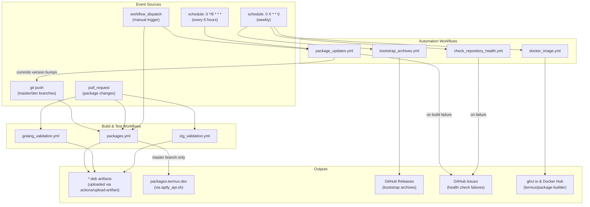
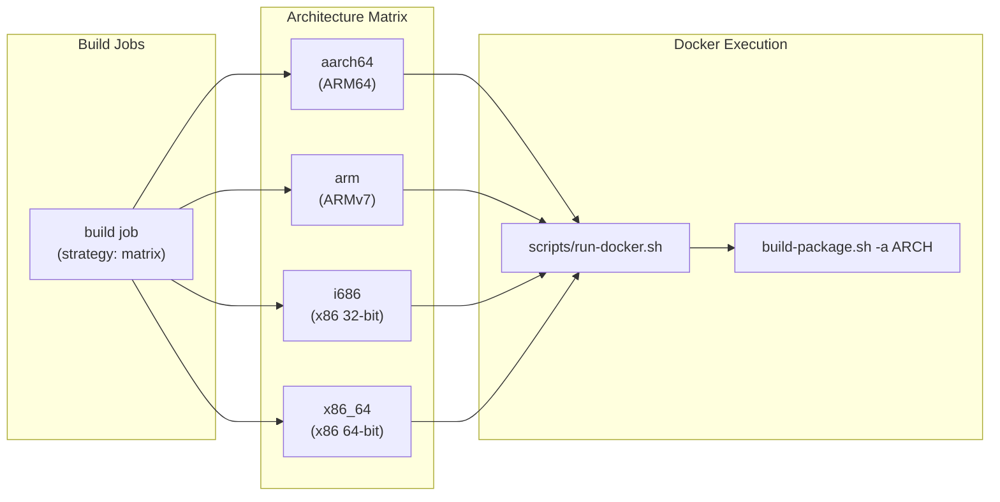
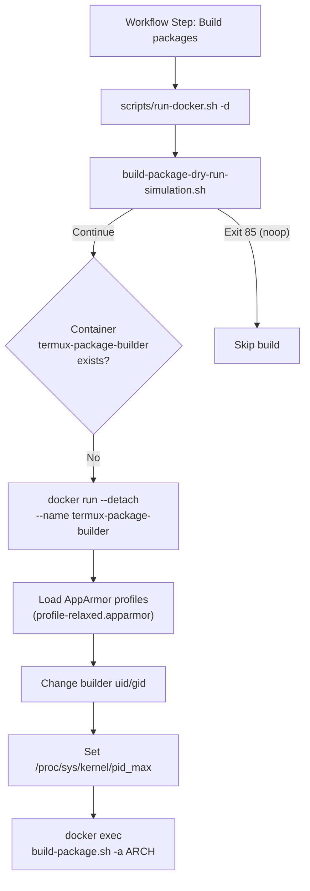

<!-- source: DeepWiki mcp.deepwiki.com · repo termux/termux-packages · page 3 CI/CD Pipeline · fetched 2026-10-26 -->

# CI/CD Pipeline

<details>
<summary>Relevant source files</summary>

The following files were used as context for generating this wiki page:

- [.github/actions/zram/action.yml](.github/actions/zram/action.yml)
- [.github/workflows/bootstrap_archives.yml](.github/workflows/bootstrap_archives.yml)
- [.github/workflows/check_repository_health.yml](.github/workflows/check_repository_health.yml)
- [.github/workflows/codeql.yml](.github/workflows/codeql.yml)
- [.github/workflows/command_not_found.yml](.github/workflows/command_not_found.yml)
- [.github/workflows/docker_image.yml](.github/workflows/docker_image.yml)
- [.github/workflows/golang_validation.yml](.github/workflows/golang_validation.yml)
- [.github/workflows/package_updates.yml](.github/workflows/package_updates.yml)
- [.github/workflows/packages.yml](.github/workflows/packages.yml)
- [.github/workflows/zig_validation.yml](.github/workflows/zig_validation.yml)
- [scripts/bin/validation](scripts/bin/validation)
- [scripts/free-space.sh](scripts/free-space.sh)
- [scripts/run-docker.sh](scripts/run-docker.sh)

</details>


The Termux CI/CD pipeline is a GitHub Actions-based automation system that builds, tests, and distributes packages across four Android architectures. The system processes approximately 1,000+ packages through multiple workflows that handle building, automatic version updates, quality assurance, and publishing to the APT repository at `packages.termux.dev`.

## Overview

The CI/CD infrastructure consists of five primary GitHub Actions workflows located in [.github/workflows/]():

| Workflow | Trigger | Primary Function | Detailed Documentation |
|----------|---------|------------------|------------------------|
| `packages.yml` | Push, PR, Manual | Build and publish packages for 4 architectures | [Main Build Workflow](#3.1) |
| `package_updates.yml` | Schedule (6h), Manual | Auto-update package versions from upstream | [Automated Package Updates](#3.3) |
| `check_repository_health.yml` | Schedule (weekly) | Validate APT repository consistency | [Repository Health Checks](#3.4) |
| `golang_validation.yml` | Manual, PR | Batch-test all Golang packages | [Language-Specific Validation](#3.5) |
| `zig_validation.yml` | Manual, PR | Batch-test all Zig packages | [Language-Specific Validation](#3.5) |

Additional workflows manage supporting infrastructure:
- `docker_image.yml`: Rebuilds Docker images weekly with updated dependencies [.github/workflows/docker_image.yml:22-23]()
- `bootstrap_archives.yml`: Generates minimal Termux installation archives weekly [.github/workflows/bootstrap_archives.yml:4-5]()
- `command_not_found.yml`: Regenerates command-not-found database weekly [.github/workflows/command_not_found.yml:4-5]()

### High-Level Architecture

Title: CI/CD Workflow Relationships and Data Flow



Sources: [.github/workflows/packages.yml:1-18](), [.github/workflows/package_updates.yml:1-25](), [.github/workflows/check_repository_health.yml:1-7](), [.github/workflows/golang_validation.yml:1-13](), [.github/workflows/zig_validation.yml:1-13](), [.github/workflows/docker_image.yml:1-25](), [.github/workflows/bootstrap_archives.yml:1-7]()

## Workflow Triggers and Concurrency

The CI/CD system uses GitHub Actions event triggers to coordinate execution. Different workflows have triggering strategies optimized for their purpose.

### Trigger Matrix

| Workflow | Push | Pull Request | Schedule | Manual | Paths Filter |
|----------|------|--------------|----------|--------|--------------|
| `packages.yml` | master, dev | Yes | No | Yes | packages/**, root-packages/**, x11-packages/** |
| `package_updates.yml` | All branches except master | Yes | Every 6 hours | Yes | packages/**, root-packages/**, x11-packages/** |
| `check_repository_health.yml` | No | No | Sunday 05:00 UTC | Yes | None |
| `golang_validation.yml` | No | Yes | No | Yes | golang/build.sh, termux_setup_golang.sh |
| `zig_validation.yml` | No | Yes | No | Yes | zig/build.sh, termux_setup_zig.sh |

### Concurrency Control

The `packages.yml` workflow implements concurrency control to manage runner resources [.github/workflows/packages.yml:30-34]():

```yaml
concurrency:
  group: ${{ github.event_name == 'pull_request' && format('pr-{0}', github.event.pull_request.number) || github.run_id }}
  cancel-in-progress: ${{ github.event_name == 'pull_request' }}
```

This configuration groups PR builds by number and cancels previous runs if a new commit is pushed, while allowing push events on master to run to completion using the unique `run_id`.

Sources: [.github/workflows/packages.yml:30-34](), [.github/workflows/package_updates.yml:1-25](), [.github/workflows/check_repository_health.yml:3-7](), [.github/workflows/golang_validation.yml:7-13]()

## Build Matrix and Architecture Support

All build workflows execute across a 4-architecture matrix: `aarch64`, `arm`, `i686`, and `x86_64` [.github/workflows/packages.yml:43]().

Title: Architecture Build Matrix



The `fail-fast: false` setting [.github/workflows/packages.yml:44]() ensures that architecture-specific failures do not stop the entire build matrix.

Sources: [.github/workflows/packages.yml:41-44](), [.github/workflows/golang_validation.yml:18-19](), [.github/workflows/zig_validation.yml:18-19]()

## Docker Build Environment

Package builds execute inside Docker containers for reproducibility. `scripts/run-docker.sh` manages the lifecycle, security profiles, and environment setup.

Title: Docker Container Lifecycle in CI/CD



### Container Configuration
The environment utilizes `ghcr.io/termux/package-builder` [scripts/run-docker.sh:5]() and implements security via AppArmor profiles like `profile-relaxed.apparmor` [scripts/run-docker.sh:154](). It also adjusts `pid_max` to 65535 for compatibility with 32-bit architectures using proot [scripts/run-docker.sh:170-171]().

Sources: [scripts/run-docker.sh:1-180](), [scripts/bin/build-package-dry-run-simulation.sh:1-85]()

## Resource and Disk Space Management

GitHub Actions runners have limited disk space. The CI pipeline uses `scripts/free-space.sh` to clear approximately 36G of space by purging pre-installed software like `.NET`, `Android SDK`, and `LLVM` [scripts/free-space.sh:3-44](). Additionally, the `.github/actions/zram` action enables `zram` with `zstd` compression to expand available memory [/.github/actions/zram/action.yml:4-9]().

Sources: [scripts/free-space.sh:1-56](), [/.github/actions/zram/action.yml:1-90]()

## Package Update Pipeline

The `package_updates.yml` workflow automates version bumps. It checks for updates every 6 hours [.github/workflows/package_updates.yml:18]() and uses `scripts/bin/update-packages` to process them [.github/workflows/package_updates.yml:92]().

1. **Check**: Queries GitHub GraphQL or Repology APIs for new versions.
2. **Update**: Modifies `build.sh` and updates checksums [.github/workflows/package_updates.yml:131]().
3. **Validate**: Performs a test build in the Docker environment [.github/workflows/package_updates.yml:116]().
4. **Commit**: Pushes changes back to the repository if successful [.github/workflows/package_updates.yml:132]().

Sources: [.github/workflows/package_updates.yml:1-155](), [scripts/bin/update-packages:1-253]()

## Quality and Health Checks

### Repository Health
`check_repository_health.yml` runs weekly to ensure the APT repository matches the repository state [.github/workflows/check_repository_health.yml:5](). It generates a package list via `scripts/generate-apt-packages-list.sh` [.github/workflows/check_repository_health.yml:24]() and validates it using `scripts/check-repository-health.js` [.github/workflows/check_repository_health.yml:31]().

### Language Validation
Workflows like `golang_validation.yml` batch-test packages using specific toolchains [.github/workflows/golang_validation.yml:59-60](). They use `scripts/bin/validation` to split packages into manageable batches to avoid disk space exhaustion [.github/workflows/golang_validation.yml:26]().

Sources: [.github/workflows/check_repository_health.yml:1-54](), [.github/workflows/golang_validation.yml:1-67](), [scripts/bin/validation:1-162]()

## Detailed Workflow Documentation
For deeper technical details on specific components, see the child pages:
- [Main Build Workflow](#3.1) — Matrix builds, package discovery, and APT uploads.
- [Docker Build Environment](#3.2) — Container security, lifecycle, and optimization.
- [Automated Package Updates](#3.3) — Version checking and auto-committing.
- [Repository Health Checks](#3.4) — APT repository consistency validation.
- [Language-Specific Validation](#3.5) — Batch testing for Golang and Zig.

---

