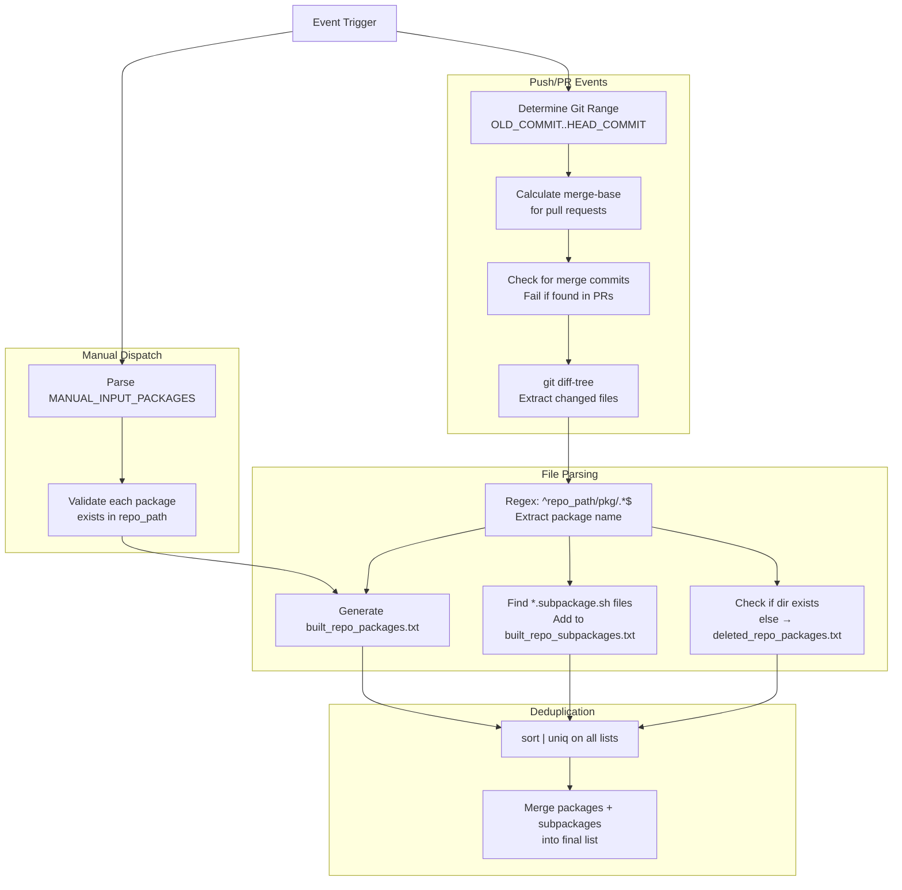
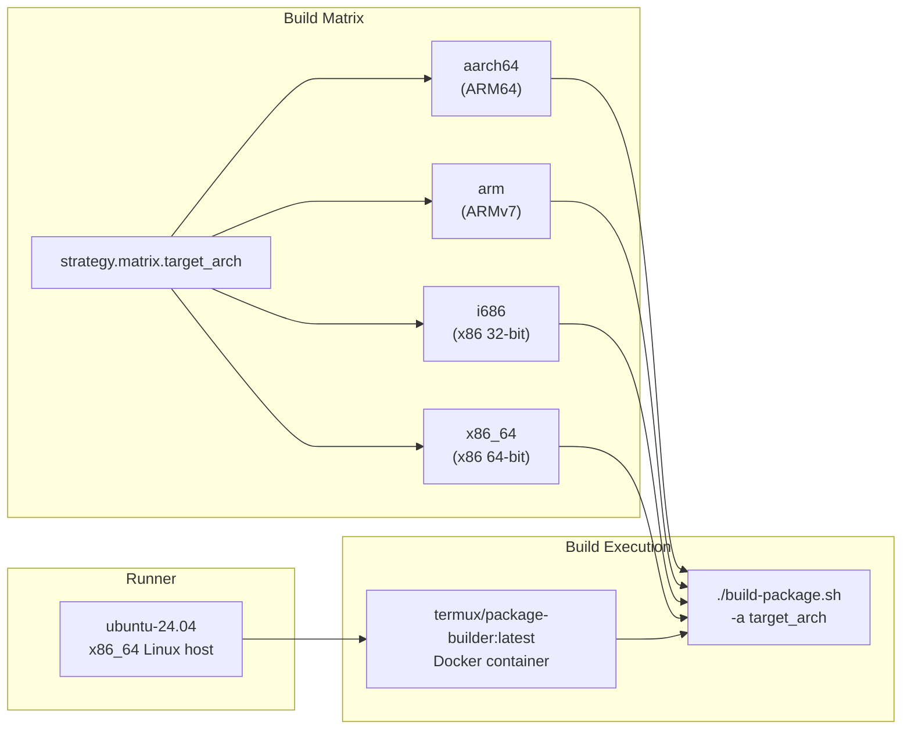
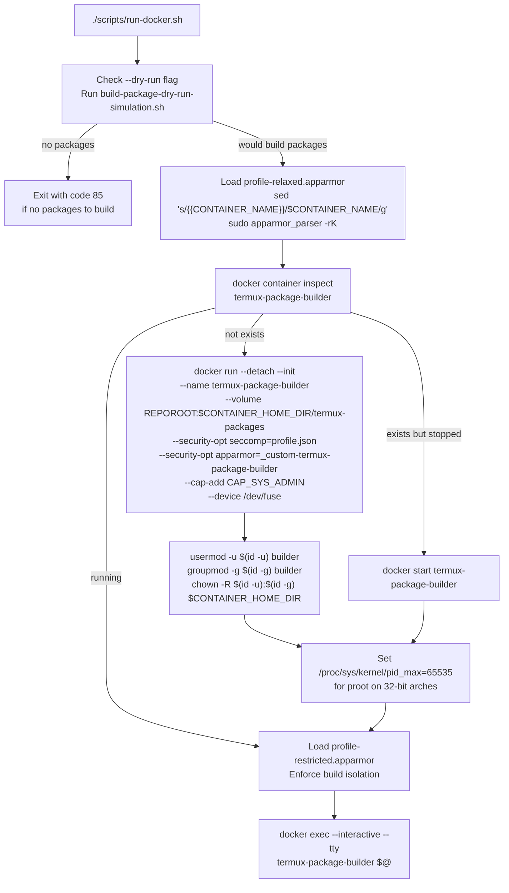
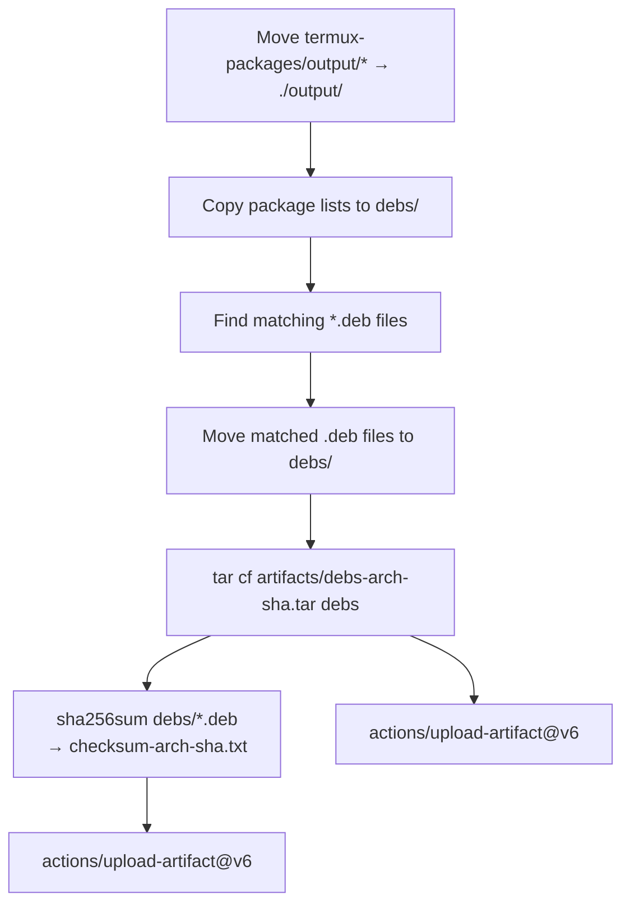

<!-- source: DeepWiki mcp.deepwiki.com · repo termux/termux-packages · page 3.1 Main Build Workflow · fetched 2026-10-26 -->

# Main Build Workflow

<details>
<summary>Relevant source files</summary>

The following files were used as context for generating this wiki page:

- [.github/actions/zram/action.yml](.github/actions/zram/action.yml)
- [.github/workflows/bootstrap_archives.yml](.github/workflows/bootstrap_archives.yml)
- [.github/workflows/check_repository_health.yml](.github/workflows/check_repository_health.yml)
- [.github/workflows/codeql.yml](.github/workflows/codeql.yml)
- [.github/workflows/command_not_found.yml](.github/workflows/command_not_found.yml)
- [.github/workflows/docker_image.yml](.github/workflows/docker_image.yml)
- [.github/workflows/golang_validation.yml](.github/workflows/golang_validation.yml)
- [.github/workflows/package_updates.yml](.github/workflows/package_updates.yml)
- [.github/workflows/packages.yml](.github/workflows/packages.yml)
- [.github/workflows/zig_validation.yml](.github/workflows/zig_validation.yml)
- [packages/lua-lpeg/lua52-lpeg.subpackage.sh](packages/lua-lpeg/lua52-lpeg.subpackage.sh)
- [packages/tesseract/build.sh](packages/tesseract/build.sh)
- [packages/texlab/build.sh](packages/texlab/build.sh)
- [packages/texlive-bin/build.sh](packages/texlive-bin/build.sh)
- [packages/texlive-bin/libandroid-complex-math.patch](packages/texlive-bin/libandroid-complex-math.patch)
- [packages/texlive-bin/texk-xdvipsk-Makefile.in.patch](packages/texlive-bin/texk-xdvipsk-Makefile.in.patch)
- [scripts/bin/validation](scripts/bin/validation)
- [scripts/build/termux_step_install_license.sh](scripts/build/termux_step_install_license.sh)
- [scripts/free-space.sh](scripts/free-space.sh)
- [scripts/lint-packages.sh](scripts/lint-packages.sh)
- [scripts/run-docker.sh](scripts/run-docker.sh)
- [x11-packages/i3status/build.sh](x11-packages/i3status/build.sh)
- [x11-packages/inkscape/build.sh](x11-packages/inkscape/build.sh)
- [x11-packages/jwm/build.sh](x11-packages/jwm/build.sh)
- [x11-packages/keepassxc/build.sh](x11-packages/keepassxc/build.sh)
- [x11-packages/kermit/build.sh](x11-packages/kermit/build.sh)
- [x11-packages/openimageio/build.sh](x11-packages/openimageio/build.sh)
- [x11-packages/openvdb/build.sh](x11-packages/openvdb/build.sh)
- [x11-packages/poppler-qt/build.sh](x11-packages/poppler-qt/build.sh)
- [x11-packages/wireshark-qt/build.sh](x11-packages/wireshark-qt/build.sh)

</details>


The main build workflow is the core continuous integration system that compiles packages across all supported Android architectures and distributes them to the APT repository. This workflow is defined in [.github/workflows/packages.yml]() and handles automatic builds on commits, pull request validation, and manual package rebuilds.

For information about automated version updates, see [Automated Package Updates](#3.3). For Docker environment details, see [Docker Build Environment](#3.2). For repository validation, see [Repository Health Checks](#3.4).

## Trigger Events and Concurrency Control

The workflow activates under three distinct conditions, each with different behavior and permissions.

**Trigger Sources:**

| Event | Branches | Paths | Permissions |
|-------|----------|-------|-------------|
| `push` | `master`, `dev`, `dev/**` | `packages/**`, `root-packages/**`, `x11-packages/**` | `contents: read` |
| `pull_request` | Any | `packages/**`, `root-packages/**`, `x11-packages/**` | `contents: read` |
| `workflow_dispatch` | Any | N/A | Manual package list input |

The concurrency model ensures efficient resource usage: pull requests are grouped by PR number and allow cancellation of outdated runs, while push events use unique run IDs to prevent conflicts.

```yaml
# .github/workflows/packages.yml:30-34
concurrency:
  group: ${{ github.event_name == 'pull_request' && format('pr-{0}', github.event.pull_request.number) || github.run_id }}
  cancel-in-progress: ${{ github.event_name == 'pull_request' }}
```

**Special Commit Tags:**
- `%ci:no-build` - Skip build entirely, mark as passed [[.github/workflows/packages.yml:101-105]()]
- `%ci:free-disk` - Force disk space cleanup even for non-large packages [[.github/workflows/packages.yml:194-196]()]

Sources: [.github/workflows/packages.yml:3-34](), [.github/workflows/packages.yml:99-105](), [.github/workflows/packages.yml:194-196]()

## Package Discovery Process

The workflow determines which packages to build through git diff analysis or manual specification.



**Git Diff Analysis for Push Events:**

The workflow uses `git diff-tree` to identify changed files between commits. For push events, it compares `github.event.before` (`OLD_COMMIT`) to `github.event.after` (`HEAD_COMMIT`). For pull requests, it calculates the merge base against the target branch using `git merge-base`.

[[.github/workflows/packages.yml:62-83]()]

**Package Identification Logic:**

Files matching the pattern `^${repo_path}/([.a-z0-9+-]*)/.*$` are analyzed:
- If `build.sh` or any file in the package directory changed → add to `built_${repo}_packages.txt` [[.github/workflows/packages.yml:128]()]
- If `*.subpackage.sh` exists → add subpackage to `built_${repo}_subpackages.txt` [[.github/workflows/packages.yml:132]()]
- If directory was deleted → add to `deleted_${repo}_packages.txt` [[.github/workflows/packages.yml:135]()]

**Manual Workflow Dispatch:**

When triggered manually, the `MANUAL_INPUT_PACKAGES` input is parsed into an array, and each package is validated to exist in one of the repository paths defined in `repo.json`.

[[.github/workflows/packages.yml:140-161]()]

Sources: [.github/workflows/packages.yml:51-178](), [.github/workflows/packages.yml:18-26]()

## Build Matrix and Architecture Targets

The build job executes in parallel across all supported Android architectures using GitHub Actions matrix strategy.



The matrix uses `fail-fast: false`, ensuring that failures in one architecture don't cancel builds for other architectures. Each job runs independently and uploads its own artifacts.

Sources: [.github/workflows/packages.yml:41-44](), [.github/workflows/packages.yml:40]()

## Lint Validation

Before building, all modified package recipes are validated using `scripts/lint-packages.sh`.

The lint script performs several critical checks:
- **Package Name Validation**: Ensures names follow `dpkg` standards and are at least 2 characters long [[scripts/lint-packages.sh:55-72]()].
- **License Validation**: Checks against an allowed list of standard licenses [[scripts/lint-packages.sh:10-53]()].
- **Indentation Check**: Enforces the use of tabs for indentation and detects mixed indentation [[scripts/lint-packages.sh:74-129]()].
- **Version Check**: Validates `TERMUX_PKG_VERSION` using `dpkg --validate-version` [[scripts/lint-packages.sh:153-201]()].

Sources: [scripts/lint-packages.sh:1-201](), [.github/workflows/packages.yml:218-230]()

## Build Environment Preparation

### ZRAM Configuration

A 16GB zram swap device is configured with zstd compression to optimize memory usage during compilation.

```yaml
# .github/workflows/packages.yml:232-239
- name: Enable zram
  uses: ./.github/actions/zram
  with:
    algorithm: zstd
    size: 16G
    priority: 100
    device_name: /dev/zram0
```

The zram action is used to provide extra memory headroom for large compilations.

Sources: [.github/workflows/packages.yml:232-239](), [.github/actions/zram/action.yml]()

### Docker Image Handling

The workflow supports two Docker image sources:

1. **Pre-built image from GHCR** (default): `ghcr.io/termux/package-builder:latest` [[scripts/run-docker.sh:5]()]
2. **Locally built image**: Built from `scripts/Dockerfile` if build scripts change.

**Disk Space Management:**

The `free-space` flag is set to `true` if manual dispatch requested it, if the commit message contains `%ci:free-disk`, or if a "big" package is detected. When enabled, `scripts/free-space.sh` removes approximately 36GB-60GB of pre-installed software from the GitHub runner, including .NET, Haskell, and cached Docker content.

[[scripts/free-space.sh:1-56]()]

Sources: [.github/workflows/packages.yml:190-206](), [.github/workflows/packages.yml:241-256](), [scripts/free-space.sh:1-56]()

### Docker Container Lifecycle

The `run-docker.sh` script manages container creation, lifecycle, and security profiles.



**AppArmor Profile Loading:**

Two AppArmor profiles provide defense-in-depth security:
1. **profile-relaxed.apparmor**: Loaded during container setup to allow UID/GID changes [[scripts/run-docker.sh:154]()].
2. **profile-restricted.apparmor**: Loaded before build execution to enforce strict isolation [[scripts/run-docker.sh:212]()].

**UID/GID Synchronization:**

To prevent permission issues with bind-mounted volumes, the container's `builder` user UID/GID is modified to match the host user's UID/GID.

[[scripts/run-docker.sh:156-166]()]

**PID Namespace Limit:**

For packages requiring `proot` execution, `/proc/sys/kernel/pid_max` is set to 65535.

[[scripts/run-docker.sh:168-189]()]

Sources: [scripts/run-docker.sh:1-222]()

## Package Build Execution

The actual compilation occurs inside the Docker container via `build-package.sh`.

```bash
# .github/workflows/packages.yml:269
./scripts/run-docker.sh -d ./build-package.sh -I -C -a "${{ matrix.target_arch }}" "${packages[@]}"
```

**Build Flags:**
- `-I`: Install build dependencies.
- `-C`: Continue building packages in list even if one fails.
- `-a <arch>`: Target architecture.
- `-d`: Dry-run check before Docker execution [[scripts/run-docker.sh:71-86]()].

Sources: [.github/workflows/packages.yml:257-272](), [scripts/run-docker.sh:71-86]()

## Artifact Generation and Checksums

After builds complete, artifacts are collected and packaged.



Artifacts are archived as `.tar` files because GitHub Actions has issues with filenames containing special characters like `:`.

[[.github/workflows/packages.yml:274-299]()]

Sources: [.github/workflows/packages.yml:274-319]()

## Upload Validation and Repository Health

For pull requests, the `upload-test` job validates that built packages don't conflict with existing APT repository packages by downloading the remote `Packages.bz2` index and comparing filenames.

[[.github/workflows/packages.yml:347-411]()]

**Repository Health Checks:**

A separate workflow, `Check Repository Health`, runs weekly to compare the `build.sh` definitions against the live APT repository. If discrepancies are found, it generates a report and creates a GitHub issue [[.github/workflows/check_repository_health.yml:1-54]()].

Sources: [.github/workflows/packages.yml:347-411](), [.github/workflows/check_repository_health.yml:1-54]()

## APT Repository Upload (Master Branch)

Only builds on the `master` branch upload packages to the production APT repository. The process uses the Aptly REST API to upload files, add them to the repository, and publish the updated snapshot.

[[.github/workflows/packages.yml:413-474]()]

Sources: [.github/workflows/packages.yml:413-474]()

---

