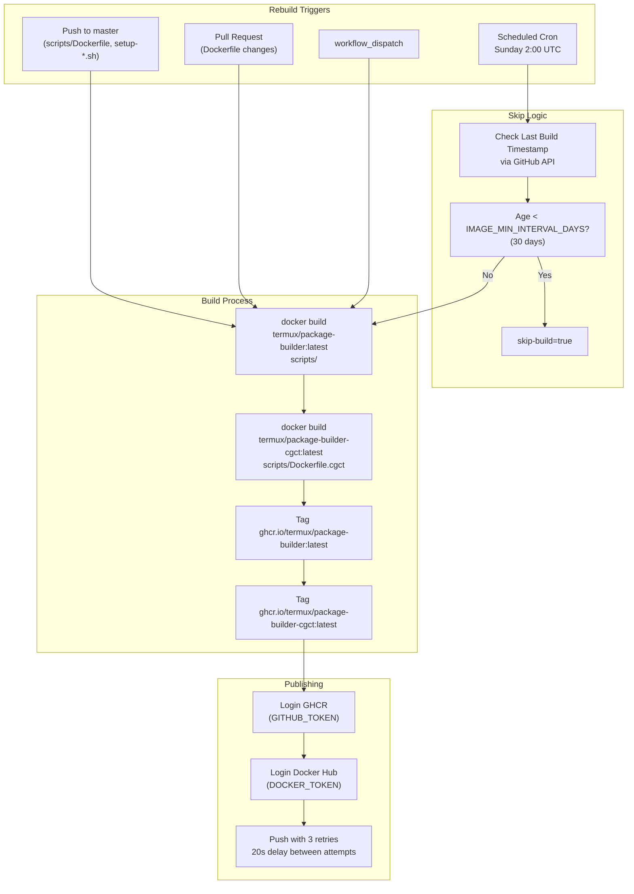
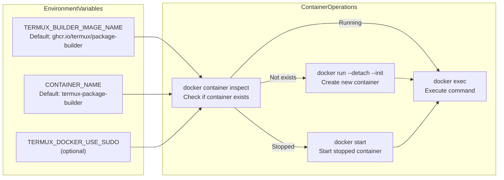
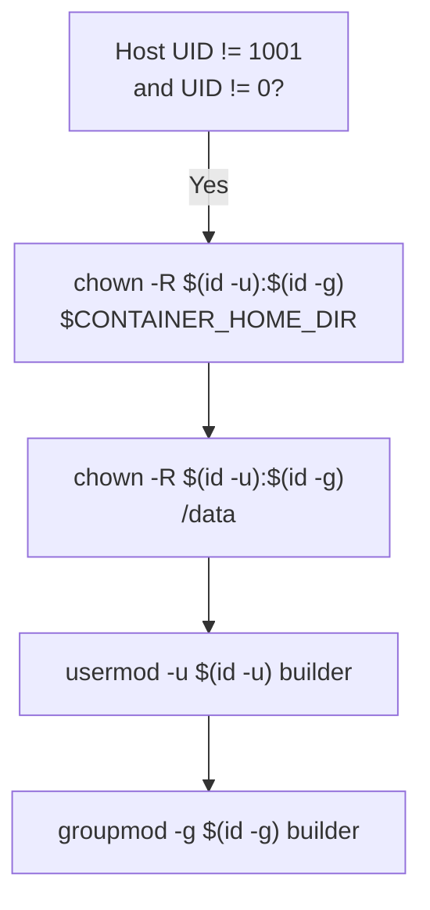
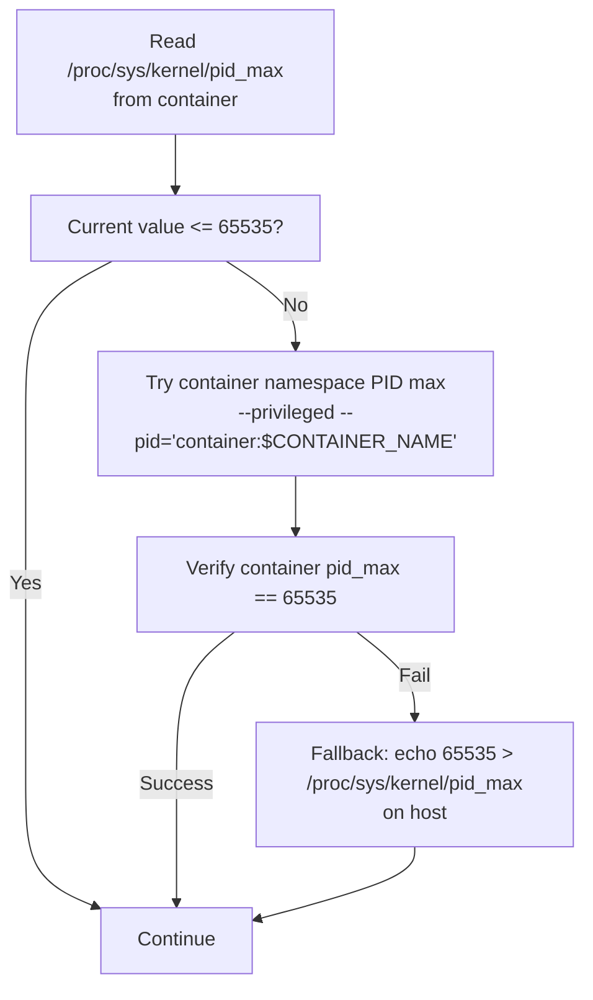
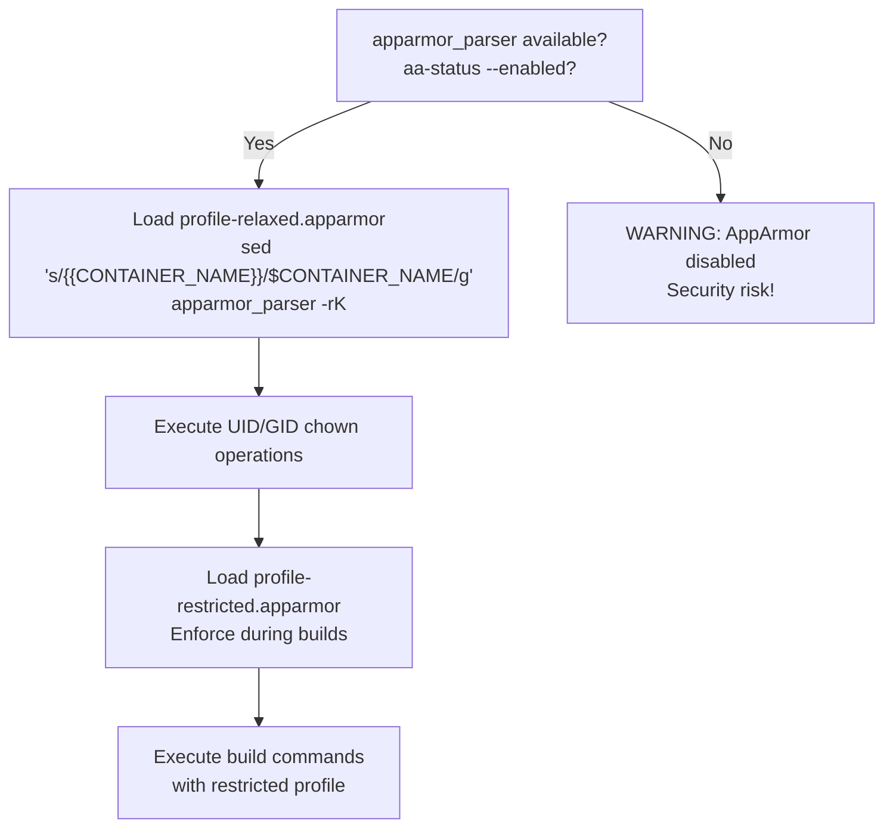
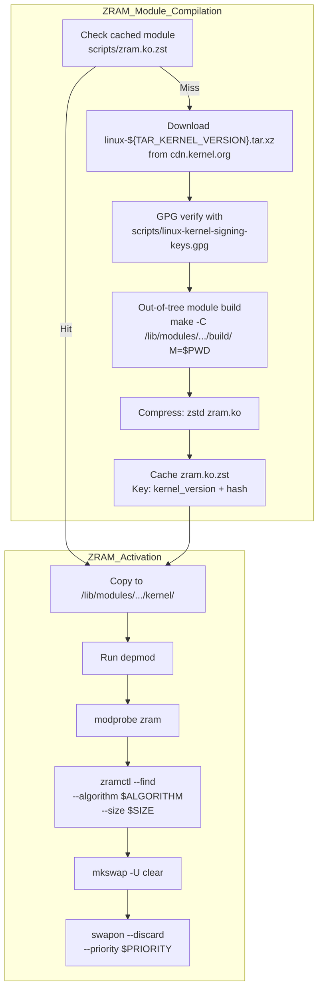
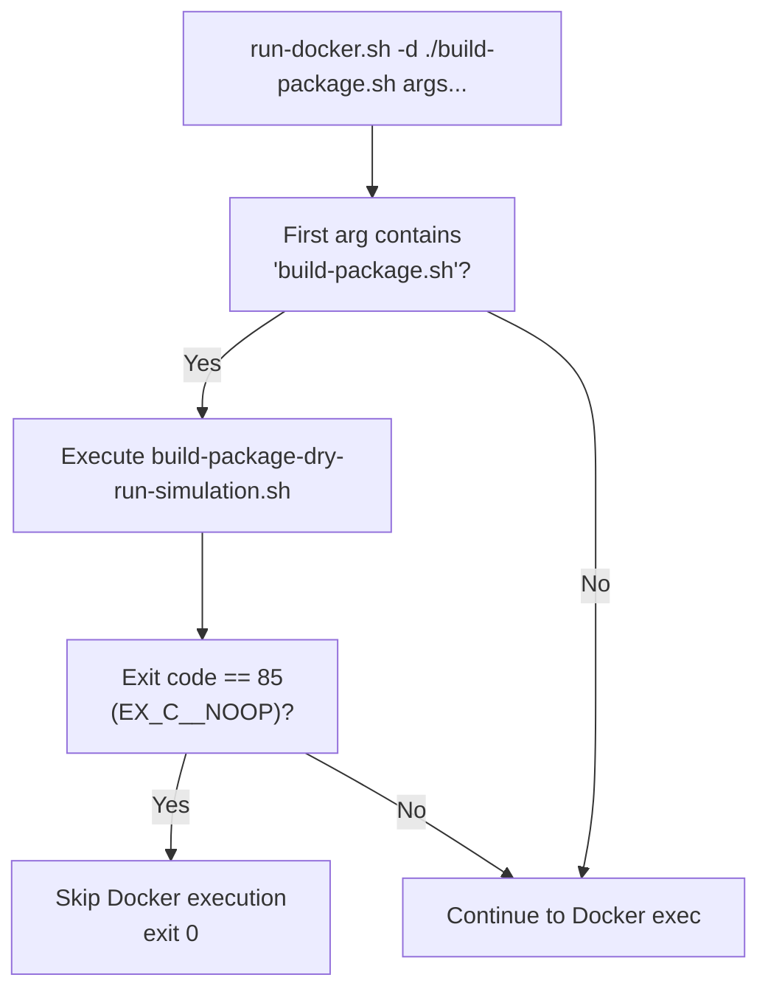

<!-- source: DeepWiki mcp.deepwiki.com · repo termux/termux-packages · page 3.2 Docker Build Environment · fetched 2026-10-26 -->

# Docker Build Environment

<details>
<summary>Relevant source files</summary>

The following files were used as context for generating this wiki page:

- [.github/actions/zram/action.yml](.github/actions/zram/action.yml)
- [.github/workflows/bootstrap_archives.yml](.github/workflows/bootstrap_archives.yml)
- [.github/workflows/check_repository_health.yml](.github/workflows/check_repository_health.yml)
- [.github/workflows/codeql.yml](.github/workflows/codeql.yml)
- [.github/workflows/command_not_found.yml](.github/workflows/command_not_found.yml)
- [.github/workflows/docker_image.yml](.github/workflows/docker_image.yml)
- [.github/workflows/golang_validation.yml](.github/workflows/golang_validation.yml)
- [.github/workflows/package_updates.yml](.github/workflows/package_updates.yml)
- [.github/workflows/packages.yml](.github/workflows/packages.yml)
- [.github/workflows/zig_validation.yml](.github/workflows/zig_validation.yml)
- [scripts/bin/validation](scripts/bin/validation)
- [scripts/free-space.sh](scripts/free-space.sh)
- [scripts/run-docker.sh](scripts/run-docker.sh)

</details>


## Purpose and Scope

This document explains the Docker container infrastructure used to provide consistent, isolated build environments for compiling Termux packages. It covers container lifecycle management via `scripts/run-docker.sh`, security hardening through AppArmor and seccomp profiles, performance optimizations including ZRAM swap, and the weekly image rebuild process. For information about how the build workflow orchestrates these containers across the 4-architecture matrix, see [Main Build Workflow](#3.1).

---

## Docker Image Architecture

The build system uses two Docker images maintained in multiple registries for redundancy and accessibility.

### Image Types and Registries

| Image Name | Purpose | Base Configuration |
|------------|---------|-------------------|
| `termux/package-builder` | Standard package builds | Ubuntu with Android NDK, build tools |
| `termux/package-builder-cgct` | CGCT toolchain builds | Extended with custom GCC cross-compilation toolchain |

Both images are published to:
- **GitHub Container Registry (GHCR)**: `ghcr.io/termux/package-builder:latest`
- **Docker Hub**: `termux/package-builder:latest`

The dual registry strategy provides fallback options, as GHCR connections can be unstable during uploads [[.github/workflows/docker_image.yml:83-100]]().

**Sources**: [[.github/workflows/docker_image.yml:58-65]](), [[scripts/run-docker.sh:5]]()

### Weekly Rebuild Process



**Diagram: Docker Image Weekly Rebuild Workflow**

The rebuild process implements throttling to prevent unnecessary builds on scheduled runs. If the last successful build (tagged `latest`) is less than 30 days old, scheduled runs skip rebuilding [[.github/workflows/docker_image.yml:39-54]](). Push and pull request events always trigger builds to validate changes. The publish step includes retry logic with 20-second delays to handle GHCR connection instability [[.github/workflows/docker_image.yml:86-100]]().

**Sources**: [[.github/workflows/docker_image.yml:1-101]]()

---

## Container Lifecycle Management

The `scripts/run-docker.sh` script manages all container interactions, providing a unified interface for creating, starting, and executing commands within the build container.

### Container Identification and Naming



**Diagram: Container Lifecycle State Machine**

Container naming is consistent across invocations via the `CONTAINER_NAME` variable [[scripts/run-docker.sh:6]](). The script checks container existence with `docker container inspect` [[scripts/run-docker.sh:192]]() and reuses existing containers when possible, creating new ones only when necessary [[scripts/run-docker.sh:192-205]]().

**Sources**: [[scripts/run-docker.sh:1-222]]()

### UID/GID Synchronization

To prevent permission issues, the container's `builder` user UID/GID is synchronized with the host user on non-Darwin platforms [[scripts/run-docker.sh:156-166]]().



**Diagram: UID/GID Synchronization Process**

This synchronization occurs immediately after container creation. The process changes ownership of `/home/builder` and `/data`, then modifies the `builder` user and group IDs to match the host. This ensures files created inside the container have correct ownership when accessed from the host [[scripts/run-docker.sh:160-163]]().

**Sources**: [[scripts/run-docker.sh:156-166]]()

### pid_max Adjustment for 32-bit Architecture Support

Packages requiring native executable execution via `proot` for 32-bit architectures need `pid_max` <= 65535 [[scripts/run-docker.sh:170]]().



**Diagram: pid_max Adjustment Strategy**

The adjustment attempts container-namespace modification first (for kernels >= 6.14 with PID namespacing), falling back to host modification if that fails [[scripts/run-docker.sh:174-189]]().

**Sources**: [[scripts/run-docker.sh:168-189]]()

---

## Security Configuration

### AppArmor Profile Loading

Two AppArmor profiles control container permissions at different build phases:



**Diagram: AppArmor Profile Loading Sequence**

The relaxed profile (`profile-relaxed.apparmor`) is loaded first [[scripts/run-docker.sh:154]]() to permit UID/GID modifications which require elevated permissions. After synchronization completes, the restricted profile (`profile-restricted.apparmor`) is loaded [[scripts/run-docker.sh:212]]() to enforce security constraints during actual builds. Profile template variables like `{{CONTAINER_NAME}}` are substituted via `sed` before loading [[scripts/run-docker.sh:149]]().

**Sources**: [[scripts/run-docker.sh:130-154, 212]]()

### seccomp and Capability Configuration

Security options are configured during container creation on Linux:

```bash
SEC_OPT=" --security-opt seccomp=$REPOROOT/scripts/profile.json --security-opt apparmor=_custom-termux-package-builder-$CONTAINER_NAME --cap-add CAP_SYS_ADMIN --device /dev/fuse"
```

This configuration [[scripts/run-docker.sh:95]]() includes:
- `seccomp`: Custom syscall filtering profile [[scripts/run-docker.sh:95]]().
- `CAP_SYS_ADMIN`: Required for mount operations and FUSE [[scripts/run-docker.sh:95]]().
- `/dev/fuse`: FUSE device access for filesystems [[scripts/run-docker.sh:95]]().

**Sources**: [[scripts/run-docker.sh:88-96, 199]]()

---

## Performance Optimizations

### ZRAM Swap Configuration

ZRAM provides compressed in-memory swap to increase effective memory during builds [[.github/actions/zram/action.yml:1-15]]().



**Diagram: ZRAM Kernel Module Build and Activation**

The module compilation process [[.github/actions/zram/action.yml:38-67]]() performs an out-of-tree build matching the GitHub runner's kernel version. Compiled modules are cached with a composite key including kernel version and GPG keyring hash [[.github/actions/zram/action.yml:36]]().

**Sources**: [[.github/actions/zram/action.yml:1-90]]()

### Disk Space Management

Large builds require liberating disk space on GitHub runners. The script `scripts/free-space.sh` clears approximately 36G of space [[scripts/free-space.sh:3]]() by purging heavy packages like `.NET`, `Android SDKs`, and `LLVM` [[scripts/free-space.sh:15-36]]().

In validation workflows (e.g., Golang, Zig), cleanup is triggered dynamically:
- Before building "big" packages defined in `scripts/big-pkgs.list` [[scripts/bin/validation:187-188]]().
- If free disk space falls below a GiB threshold [[scripts/bin/validation:189-190]]().

**Sources**: [[scripts/free-space.sh:1-56]](), [[scripts/bin/validation:183-198]]()

---

## Build Execution

### Dry-Run Simulation

The dry-run feature skips Docker execution when builds would be no-ops.



**Diagram: Dry-Run Simulation Decision Flow**

Exit code 85 (`EX_C__NOOP`) signals that no packages would be built, allowing `run-docker.sh` to abort early [[scripts/run-docker.sh:67-86]]().

**Sources**: [[scripts/run-docker.sh:50-86]]()

### Docker Execution and Signal Handling

Process termination requires trap setup to kill Docker exec child processes [[scripts/run-docker.sh:215]](). The final execution command propagates environment variables and maintains TTY attachment:

```bash
$SUDO docker exec $CI_OPT --env "DOCKER_EXEC_PID_FILE_PATH=$DOCKER_EXEC_PID_FILE_PATH" --interactive $DOCKER_TTY $TERMUX_DOCKER_EXEC_EXTRA_ARGS $CONTAINER_NAME "$@"
```

This occurs at [[scripts/run-docker.sh:221]]().

**Sources**: [[scripts/run-docker.sh:98-102, 123-128, 221]]()

---

